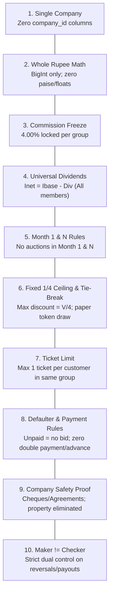

# AGENTS.md — Master Workspace Instructions for AI Coding Agents

> **Product**: **Kumaran Chits**  
> **Company**: **Kumaran Finance** (Tamil Nadu, India)  
> **Target Audience**: All AI Agents, Coding Assistants, and Pair-Programmers  
> **Mandatory Rule**: Read this document first. **If any rule or requirement is ambiguous, STOP and ask the developer before executing code to avoid hallucination.**

---

## 1. Product & Operating Context

- **Platform**: **Kumaran Chits** — official chit-fund operations software built exclusively for **Kumaran Finance**.
- **Operating Reality**: 
  - Operating from **1 physical branch office** (Head Office - Perundurai, Erode, Tamil Nadu).
  - Managed by **4 equal partners** and **2 to 3 field collection agents**.
  - Current business records exist **exclusively in physical hand-written paper notebooks and physical receipts** (no soft copies/Excel in current business).
  - Software supports fresh new chits as well as mid-cycle onboarding from physical notebooks.
- **Tech Stack**:
  - **Backend**: NestJS 12 (TypeScript, Modular Monolith) in `apps/api/`
  - **Database**: PostgreSQL 17 + Prisma ORM (Port `5433` via Docker)
  - **Web Dashboard**: React / Next.js (Admin, Accountant, Partners) in `apps/web/`
  - **Mobile App**: Flutter + Dart (Android-first for Field Agents & Customers) in `apps/mobile/`
  - **Jobs & Queue**: Redis 7 + BullMQ (Background jobs only; PostgreSQL is the sole financial truth)
  - **Object Storage**: Private AWS S3 (Encrypted KYC scans & PDF receipts with 15-minute presigned URLs)

---

## 2. Core Protocol for AI Agents

Every agent starting any task in this codebase must strictly follow these 4 operational protocols:

1. **Search for PoC (Proof of Concept) First**:
   - Before authoring any new module, controller, or algorithm, search the repository for existing PoCs, schemas, and patterns to maintain consistency.
2. **Stop & Ask (Zero Hallucination Policy)**:
   - If a business rule, edge case, calculation formula, or statutory requirement is not 100% explicitly documented in `docs/`, **YOU MUST STOP AND ASK THE DEVELOPER** before writing or executing code.
3. **Small, Reviewable Increments**:
   - Work in small, guided steps (DTO $\to$ Service $\to$ Controller $\to$ Unit Tests). Never generate unverified multi-file code dumps.
4. **File Sizing & Modularity**:
   - Keep files focused and readable (ideally under 300–350 lines). If a service or controller begins to grow too large, propose separating it into modular sub-services or helper files and link them cleanly.

---

## 3. The 10 Invariant Architectural Guardrails (`CONFIRMED-BY-DEVELOPER`)

These 10 rules are mathematically and architecturally non-negotiable. Never violate them under any circumstances:

1. **Single-Company Tenancy (ADR-01)**: Built solely for Kumaran Finance. Zero `company_id` columns exist in any table.
2. **Pure Whole Rupee Math**: All monetary values are 64-bit integer Rupees (**`BigInt`** in Prisma, native **`bigint`** in TypeScript). Paise, decimal fractions (`.00`), and IEEE 754 floating-point numbers (`float`, `number`) are strictly prohibited in financial code.
3. **Commission Freeze (ADR-04)**: Foreman commission defaults to **4.00%**, copied and permanently frozen per chit group upon activation.
4. **Universal Equal Dividend Deduction**: Dividend is allocated **equally across ALL members in that chit group, INCLUDING the auction winner and past prized winners**. Every customer in the group pays the discounted net installment ($I_{net} = I_{base} - Div_{ticket}$) next month.
5. **Month 1 & Month $N$ Rules**: Month 1 full pool is taken by the company customer ticket (**no auction**, ₹0 dividend). Month $N$ is settled directly to the final subscriber with a 4% commission and receipt (**no auction**). Auctions occur exclusively in Months 2 through $N-1$.
6. **Fixed 1/4 Ceiling & Physical Tie-Break Protocol (ADR-06 & Option A)**: Auction discount ceiling is fixed strictly at **one-fourth (1/4 or 25%) of total chit value** ($D \le \frac{V}{4}$). If multiple members bid the ceiling, the Foreman draws paper tokens physically at the branch in front of members; staff enters the drawn winning ticket into the system. **No autonomous software lottery draws**.
7. **Ticket Limit Constraint (ADR-13)**: A customer can join multiple chit groups, but **cannot hold 2 or more tickets in the same chit group** (Database enforced: `@@unique([chitGroupId, customerId])`).
8. **Defaulter & Single Payment Rules (ADR-07)**: Any subscriber who has not paid their installment due for that month is **strictly ineligible to participate or bid** in that month's auction. 3 consecutive unpaid months grants the company removal rights. Each month has strictly a single discrete payment; **zero double payments**, **zero partial payments**, and **zero advance balances** exist. `DueStatus` is strictly `UNPAID`, `PAID`, `OVERDUE`.
9. **Company Safety Proof Checklist (ADR-15)**: Property documents are completely eliminated. Collateral/surety is **not mandatory** across the board and requested only on-demand for company safety. Software acts as a flexible checklist and attachment recordkeeper (signed agreement with winner & nominee, signed blank cheques, promissory notes, and scanned uploads).
10. **Maker-Checker Separation of Duties**: Critical actions (payment reversals, auction finalization, prize disbursements) strictly enforce **`maker_user_id != checker_user_id`** at application and database levels.

---

## 4. Task-to-Documentation Cross-Reference Matrix

Before starting any task, read the exact corresponding specification document in `docs/` to avoid hallucinations:

| Task / Domain Area | Primary Specification Document to Read |
|---|---|
| **Database Models & Prisma Schema** | [`docs/03-architecture/data-model.md`](docs/03-architecture/data-model.md) |
| **Financial Formulas & Chit Math** | [`docs/01-business/financial-rules.md`](docs/01-business/financial-rules.md) |
| **Architectural Decisions (ADR 01-15)** | [`docs/01-business/decision-log.md`](docs/01-business/decision-log.md) |
| **Personas, Roles & RBAC Matrix** | [`docs/01-business/permissions-matrix.md`](docs/01-business/permissions-matrix.md) |
| **Security & Anti-BOLA/IDOR Guardians** | [`docs/03-architecture/security-and-access-guardians.md`](docs/03-architecture/security-and-access-guardians.md) |
| **Functional Requirements (10 Modules)** | [`docs/02-requirements/prd.md`](docs/02-requirements/prd.md) |
| **User Stories & 6-Persona Journey Maps** | [`docs/02-requirements/user-stories-and-journeys.md`](docs/02-requirements/user-stories-and-journeys.md) |
| **API Endpoints, DTOs & HTTP Methods** | [`docs/03-architecture/api-spec.md`](docs/03-architecture/api-spec.md) |
| **State Transitions & Lifecycle Guards** | [`docs/03-architecture/state-machines.md`](docs/03-architecture/state-machines.md) |
| **Non-Functional Standards (NFR)** | [`docs/02-requirements/non-functional-requirements.md`](docs/02-requirements/non-functional-requirements.md) |
| **Bilingual Receipts & Notification Templates**| [`docs/02-requirements/notification-and-receipt-templates.md`](docs/02-requirements/notification-and-receipt-templates.md) |
| **Database Migrations, BigInt & Seeding** | [`docs/04-engineering/database-migration-and-seeding-guide.md`](docs/04-engineering/database-migration-and-seeding-guide.md) |
| **Guided Coding Playbook & Prompt Templates**| [`docs/04-engineering/ai-agent-development-playbook.md`](docs/04-engineering/ai-agent-development-playbook.md) |
| **Definition of Done (10 Quality Gates)** | [`docs/04-engineering/definition-of-done.md`](docs/04-engineering/definition-of-done.md) |
| **Financial Invariants & Test Assertions** | [`docs/05-testing/financial-tests.md`](docs/05-testing/financial-tests.md) |
| **Payment Gateway Sandbox & Reconciliations**| [`docs/05-testing/payment-integration.md`](docs/05-testing/payment-integration.md) |
| **Physical Notebook Onboarding SOP** | [`docs/07-operations/manual-onboarding-sop.md`](docs/07-operations/manual-onboarding-sop.md) |
| **Daily Operations, Cash Handover & Reversals**| [`docs/07-operations/operations-sop.md`](docs/07-operations/operations-sop.md) |
| **Web Admin Portal Operations** | [`docs/07-operations/user-manuals/admin-foreman-manual.md`](docs/07-operations/user-manuals/admin-foreman-manual.md) |
| **Field Agent Android Mobile App** | [`docs/07-operations/user-manuals/agent-mobile-manual.md`](docs/07-operations/user-manuals/agent-mobile-manual.md) |
| **Customer Android Mobile App** | [`docs/07-operations/user-manuals/customer-app-guide.md`](docs/07-operations/user-manuals/customer-app-guide.md) |

---

## 5. Verification Before Submitting Work

Before claiming any task is complete, verify:
- [ ] Stored currency amounts use `BigInt` (not `number` or float).
- [ ] Maker $\ne$ Checker constraint is enforced on sensitive endpoints.
- [ ] No unverified business or statutory rules were assumed without confirmation.
- [ ] Automated tests verify calculation invariants with 100% pass rate.
- [ ] Code is formatted and compiles cleanly without lint errors.
