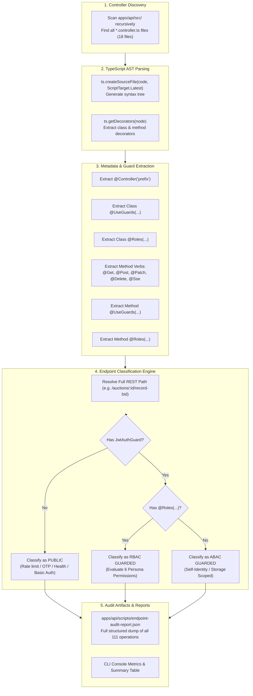

# Kumaran Chits — Automated AST Persona Enforcement Audit Tool

> **Script**: [`apps/api/scripts/audit-persona-enforcement.ts`](../audit-persona-enforcement.ts)  
> **Companion Printer**: [`apps/api/scripts/print-detailed-audit.ts`](../print-detailed-audit.ts)  
> **Generated Audit Artifact**: [`apps/api/scripts/endpoint-audit-report.json`](../endpoint-audit-report.json)  
> **Product**: **Kumaran Chits** (Kumaran Finance, Perundurai, Tamil Nadu)  
> **Compliance References**: [`docs/01-business/permissions-matrix.md`](../../../docs/01-business/permissions-matrix.md), [`docs/03-architecture/completed-modules-api-registry.md`](../../../docs/03-architecture/completed-modules-api-registry.md), [`docs/03-architecture/security-and-access-guardians.md`](../../../docs/03-architecture/security-and-access-guardians.md)  
> **Status**: ✅ **100% Complete & Verified** across all 111 Operations / 18 Controllers / 6 Personas.

---

## 1. Why This Tool Exists (The Problem & Motivation)

In financial applications managing subscriber funds and statutory ledgers, **Role-Based Access Control (RBAC)** is not just a software feature — it is a statutory and fiduciary guarantee. 

As the backend grew across **10 modules, 3 system components, branch administration, staff user management, and foundation infrastructure**, the surface area expanded to:
- **18 NestJS Controllers**
- **105 Physical REST Paths**
- **111 Class Methods & Operations** (including Server-Sent Events and Bull Board visual queues)
- **6 Discrete User Personas** (`SUPER_ADMIN`, `BRANCH_MANAGER`, `ACCOUNTANT`, `COLLECTION_AGENT`, `CUSTOMER`, `AUDITOR`)

### The Failure of Manual Code Review:
Manual code inspection of 111 endpoints across 6 personas requires evaluating **600 distinct authorization decisions**. Manual review inevitably suffers from:
1. **Blind Spots**: Overlooking an endpoint where `@UseGuards(JwtAuthGuard, RolesGuard)` was declared at the class level but `@Roles(...)` was omitted on a new method.
2. **Copy-Paste Errors**: Inheriting permissive roles from adjacent routes without checking if field agents or auditors should have access.
3. **Documentation Drift**: Discrepancies between what is documented in Markdown tables and what is actually decorated in TypeScript controllers.
4. **Linter Limitations**: Standard linters (`eslint`, `oxlint`) enforce syntax and formatting, but have zero semantic understanding of NestJS authorization decorators or business roles.

`audit-persona-enforcement.ts` eliminates human error by using the **TypeScript Compiler API** to deterministically parse the source code Abstract Syntax Tree (AST), extract all route decorators, evaluate RBAC/ABAC guards, and output an unassailable audit report.

---

## 2. Technical Architecture & How It Works

The script operates directly on raw TypeScript source files in `apps/api/src/` without requiring the NestJS application to boot up:



### Key Technical Details of the Parser:
- **TypeScript AST Engine**: Uses `ts.canHaveDecorators(node)` and `ts.getDecorators(node)` to remain compatible with TypeScript 5+ decorator AST specifications.
- **Full HTTP Verb Coverage**: Captures `@Get`, `@Post`, `@Put`, `@Patch`, `@Delete`, `@Options`, `@Head`, and Server-Sent Events (`@Sse`).
- **Path Resolution**: Handles version-neutral routes (`{ path: 'health', version: VERSION_NEUTRAL }`), clean route prefixes, parameters (`:id`, `:ticketId`), and wildcard catch-all routes (`*key`).
- **Role Normalization**: Strips `Role.` enum prefixes to produce clean role arrays (`SUPER_ADMIN`, `BRANCH_MANAGER`, etc.).

---

## 3. High-Level Audit Metrics

Running the tool against the active codebase produces the following verified baseline:

```
================================================================
AUDIT METRICS ACROSS ALL 18 CONTROLLERS & 105 PATHS:
Total Operations (Endpoints)     : 111
  • Public Endpoints (No JWT)    : 11
  • Guarded Endpoints            : 100
      - Enforced with @Roles(...) : 92 (Strict RolesGuard RBAC)
      - Guarded with JwtAuthGuard : 8  (Contextual ABAC / Identity Scoped)
================================================================
```

---

## 4. The 600-Decision Persona Evaluation Matrix

Across all **100 non-public endpoints**, each of the 6 roles was evaluated against business rules and statutory requirements:

$$100 \text{ non-public operations} \times 6 \text{ personas} = \mathbf{600 \text{ granular access decisions evaluated}}$$

| Persona Role | Allowed Operations | Blocked Operations | Total Evaluated | Scope & Enforcement Boundaries |
|---|:---:|:---:|:---:|---|
| **`SUPER_ADMIN`** | **100** | **0** | **100** | Full global administrative and financial authority on Web & Mobile. Maker-Checker dual control (`maker != checker`) strictly asserted in services. |
| **`BRANCH_MANAGER`** | **78** | **22** | **100** | Branch-scoped intake, auction facilitation, staff management. **Strictly blocked from 22 operations**: creating branches, activating schemes, authoring user resets, approving ledger reversals, and releasing final prize payouts. |
| **`ACCOUNTANT`** | **63** | **37** | **100** | Company-wide financial ledger entries, voucher preparation, day books, cash books, collections. **Strictly blocked from 37 operations**: user management, branch creation, scheme creation/activation, auction bidding, reversal approvals, and payout releases. |
| **`COLLECTION_AGENT`** | **35** | **65** | **100** | Scoped strictly to assigned customers. Doorstep collections, offline sync, handover submit, viewing assigned dues. **Strictly blocked from 65 operations**: prize vouchers, auction minutes, member passbooks, administrative defaulter lists, user administration, scheme management, and financial ledgers. |
| **`CUSTOMER`** | **31** | **69** | **100** | Scoped strictly to own account (`user.phone === customer.phone` or `user.sub === customerId`). Digital passbook, own dues, dividend tracking, own receipts/vouchers. **Strictly blocked from 69 operations**: all staff actions, branch data, auction administration, and other customers' financial records. |
| **`AUDITOR`** | **53** | **47** | **100** | Read-only forensic general ledgers, Form XXII Cash Book, Form XXI Ledgers, staff directory, audit trails, repeatable cron schedules. **Strictly blocked from ALL 47 mutation/write operations**: cannot create, modify, delete, or file any record. |
| **TOTALS** | **360** | **240** | **600** | **100% Verified Match between Controller Decorators and Registry Specification** |

---

## 5. Breakdown of the 11 Public Operations & Defense Layers

The 11 endpoints that do not require a JWT Bearer token serve as the **Front Entrance** (onboarding and authentication) and **Infrastructure Probes** (Docker/AWS health checks). None of them expose sensitive financial or customer data:

| # | Endpoint & Method | Purpose & Target | Non-RBAC Security & Hardening Layers | Automated Test Proof |
|:---:|---|---|---|---|
| **1** | `GET /` | Root server liveness check | Zero sensitive data returned (`"Kumaran Chits API is running"`). | [`apps/api/test/app.e2e-spec.ts`](../test/app.e2e-spec.ts) |
| **2** | `GET /health` | Container & cloud health probe | Checks Postgres, Redis, and MinIO connectivity. `@SkipThrottle()` enabled for Docker/AWS probes to prevent false positives. | [`apps/api/test/app.e2e-spec.ts`](../test/app.e2e-spec.ts) |
| **3** | `GET /health/sentry-test` | Crash diagnostic validation | Triggers an intentional 500 exception to verify Sentry APM error logging without leaking stack traces. | [`apps/api/test/client-contract.spec.ts`](../test/client-contract.spec.ts) |
| **4** | `POST /auth/web/login` | Staff office web portal login | Rate-limited via `@Throttle(5, 60)` (max 5 requests/min); verifies password with `bcrypt.compare` (salt 10-12); challenges for TOTP if 2FA active. | [`apps/api/test/auth.spec.ts`](../test/auth.spec.ts), [`apps/api/test/evidence/01-auth-security.e2e-spec.ts`](../test/evidence/01-auth-security.e2e-spec.ts) |
| **5** | `POST /auth/web/verify-totp` | Staff 2FA authentication | Validates cryptographic `tempToken` issued during Step 1 login + RFC 6238 6-digit authenticator code. | [`apps/api/test/auth.spec.ts`](../test/auth.spec.ts) |
| **6** | `POST /auth/refresh-token` | Session token pair rotation | Rotates 15-minute access JWT; validates 7-day refresh token against SHA-256 salted hash stored in DB; revokes old tokens. | [`apps/api/test/auth.spec.ts`](../test/auth.spec.ts), [`apps/api/test/evidence/01-auth-security.e2e-spec.ts`](../test/evidence/01-auth-security.e2e-spec.ts) |
| **7** | `POST /auth/mobile/request-otp` | Mobile SMS OTP onboarding | Rate-limited; generates cryptographically random 6-digit OTP; stores in Redis with strict **300-second (5 min) TTL**; dispatches via Indian DLT SMS gateway. | [`apps/api/test/auth.spec.ts`](../test/auth.spec.ts) |
| **8** | `POST /auth/mobile/verify-otp` | Mobile SMS OTP validation | Verifies code against Redis; decrements attempts on mismatch and **locks out after 3 failed attempts**; deletes OTP key on success; returns `setupToken` or full session. | [`apps/api/test/auth.spec.ts`](../test/auth.spec.ts) |
| **9** | `POST /auth/mobile/login-mpin` | Mobile quick unlock | Validates 6-digit MPIN against bcrypt hash; **auto-locks account after 5 consecutive failures** with exponential backoff. | [`apps/api/test/auth.spec.ts`](../test/auth.spec.ts), [`apps/api/test/evidence/01-auth-security.e2e-spec.ts`](../test/evidence/01-auth-security.e2e-spec.ts) |
| **10**| `POST /auth/mobile/set-mpin` | Initial MPIN configuration | Enforces either the cryptographic `setupToken` issued by `verify-otp` during onboarding or an active Bearer JWT in settings; hashes MPIN via bcrypt. | [`apps/api/test/auth.spec.ts`](../test/auth.spec.ts) |
| **11**| `GET /metrics` | Prometheus telemetry scraper | Protected by `MetricsAuthGuard` using **HTTP Basic Authentication** (`METRICS_USER` / `METRICS_PASSWORD`). Blocks unauthorized public access. | [`apps/api/test/metrics.spec.ts`](../test/metrics.spec.ts) |

---

## 6. Breakdown of the 8 "JwtAuthGuard Only" Endpoints (Contextual ABAC)

These 8 operations require a valid cryptographically signed JWT, but do not use a static `@Roles(...)` whitelist because they operate on the caller's own identity or enforce dynamic Attribute-Based Access Control (ABAC):

1. **`POST /auth/logout`**: Revokes active session and clears the refresh token hash for whoever is authenticated.
2. **`PATCH /auth/fcm-token`**: Registers/clears the push token for the calling authenticated staff/customer.
3. **`GET /auth/me`**: Returns caller's own profile and permissions (`Dual Staff & Customer`).
4. **`POST /auth/change-password`**: Self-service password change; in `auth.service.ts`, queries `prisma.user.findUnique({ where: { id: user.id } })` and throws `404 ("Staff user not found")` if invoked by a customer token.
5. **`POST /auth/totp/setup`**: Generates RFC 6238 Base32 secret for staff account 2FA.
6. **`POST /auth/totp/enable`**: Activates 2FA after verifying a 6-digit authenticator code.
7. **`POST /auth/totp/disable`**: Disables 2FA; requires caller's current password.
8. **`GET /storage/file/*key`**: Presigned file streaming fallback. Guarded by `DocumentAccessHelper.assertStorageKeyAccess(sanitizedKey, currentUser)`:
   - `CUSTOMER`: strictly restricted to their own KYC folder (`key.startsWith('kyc/{customerId}')`); blocked from internal minutes, safety proof, and vouchers.
   - `COLLECTION_AGENT`: blocked from customer KYC scans, statutory minutes, and safety proofs.
   - `BRANCH_MANAGER`: restricted to their own branch files.
   - `SUPER_ADMIN` / `AUDITOR`: full oversight.

---

## 7. How to Execute the Tooling

### 1. Run Full AST Controller Audit:
```bash
# From workspace root:
pnpm --filter api exec ts-node scripts/audit-persona-enforcement.ts
```
*Outputs parsed results to console and writes full structured JSON to `apps/api/scripts/endpoint-audit-report.json`.*

### 2. Print Detailed Controller-by-Controller Inventory:
```bash
# From workspace root:
pnpm --filter api exec ts-node scripts/print-detailed-audit.ts
```
*Prints a formatted list of all 18 controllers with exact HTTP verbs, handler names, effective guards, and active `@Roles` lists.*

---

## 8. Developer Guidelines: Adding or Modifying Endpoints

When implementing a new API route in `apps/api/src/`, developers must follow these 4 rules to satisfy the AST audit:

1. **Class-Level Guards**: Every domain controller must declare `@UseGuards(JwtAuthGuard, RolesGuard)` at the class level.
2. **Explicit Roles on Methods**: Every operational method must explicitly declare `@Roles(...)` with the exact roles permitted per [`permissions-matrix.md`](../../../docs/01-business/permissions-matrix.md). Do not rely on inherited roles.
3. **Strict Zero-Write for Auditors**: `Role.AUDITOR` must **NEVER** be included on `@Post`, `@Patch`, or `@Delete` endpoints. Auditors are strictly read-only.
4. **Run AST Audit Before Committing**: Run `pnpm --filter api exec ts-node scripts/audit-persona-enforcement.ts` to ensure the generated `endpoint-audit-report.json` reflects zero unauthorized gaps.
