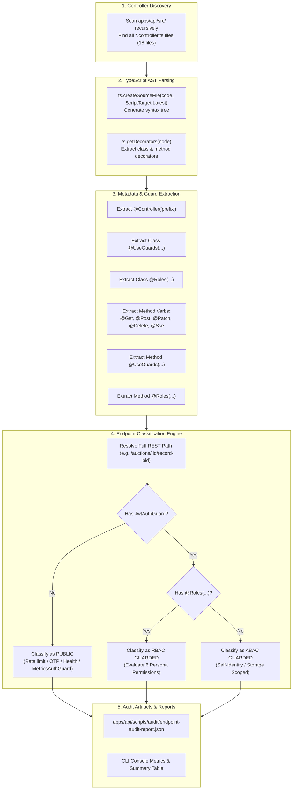

# Kumaran Chits — Automated AST Persona Enforcement Audit Tool & Security Closure Summary

> **Script**: [`apps/api/scripts/audit/audit-persona-enforcement.ts`](../audit/audit-persona-enforcement.ts)  
> **Companion Printer**: [`apps/api/scripts/audit/print-detailed-audit.ts`](../audit/print-detailed-audit.ts)  
> **Generated Audit Artifact**: [`apps/api/scripts/audit/endpoint-audit-report.json`](../audit/endpoint-audit-report.json)  
> **Product**: **Kumaran Chits** (Kumaran Finance, Perundurai, Tamil Nadu)  
> **Compliance References**: [`docs/01-business/permissions-matrix.md`](../../../../docs/01-business/permissions-matrix.md), [`docs/03-architecture/completed-modules-api-registry.md`](../../../../docs/03-architecture/completed-modules-api-registry.md), [`docs/03-architecture/security-and-access-guardians.md`](../../../../docs/03-architecture/security-and-access-guardians.md)  
> **Live API Surface**: **18 NestJS Controllers** / **134 Live HTTP & SSE Operations** (`+1` Bull Board UI `/admin/queues`) / **6 Personas** *(Oct 2026 baseline snapshot: 111 operations / 600 persona decisions)*

---

## 1. Why This Tool Exists (The Problem & Motivation)

In financial applications managing subscriber funds and statutory ledgers, **Role-Based Access Control (RBAC)** and **Attribute-Based Access Control (ABAC)** are fiduciary guarantees. Across **18 NestJS controllers** and **134 live HTTP/SSE operations** spanning **6 user personas** (`SUPER_ADMIN`, `BRANCH_MANAGER`, `ACCOUNTANT`, `COLLECTION_AGENT`, `CUSTOMER`, `AUDITOR`), manual code review risks blind spots, permissive copy-paste errors, and documentation drift.

`audit-persona-enforcement.ts` eliminates human error by using the **TypeScript Compiler API** to deterministically parse `apps/api/src/**/*.controller.ts`, extract all route/guard/role decorators, and emit a machine-verifiable JSON audit report (`endpoint-audit-report.json`).

---

## 2. Technical Architecture & How It Works



### Key Technical Details of the Parser
- **TypeScript AST Engine**: Uses `ts.canHaveDecorators(node)` and `ts.getDecorators(node)` for TypeScript 5+ compatibility.
- **Full HTTP Verb Coverage**: Captures `@Get`, `@Post`, `@Put`, `@Patch`, `@Delete`, `@Options`, `@Head`, and `@Sse`.
- **Path Resolution**: Handles version-neutral routes (`health`, `metrics`), multi-prefix controllers (`['installments', 'installment-dues']`, `['tickets', 'installments/tickets']`), parameters (`:id`, `:ticketId`), and wildcards (`*key`).
- **Role Normalization**: Strips `Role.` enum prefixes into clean arrays (`SUPER_ADMIN`, `BRANCH_MANAGER`, etc.).

---

## 3. Audit Surface Metrics (Historical Baseline vs Live Surface)

- **Oct 2026 Initial AST Baseline**: `18` Controllers · `105` Paths · `111` Operations (`11` Public, `92` `@Roles`, `8` Contextual ABAC `JwtAuthGuard`-only) $\to$ `600` Persona Decisions evaluated (`0` gaps).
- **Current Live Surface (Post-Hardening Expansion)**: **`18` Controllers · `134` Live HTTP/SSE Route Decorators** (`+1` Bull Board UI `/admin/queues`) — incorporating `PATCH /branches/:id`, `POST /auth/complete-onboarding`, `POST /customers/:id/documents/confirm`, `POST /chits/:id/cancel`, 3 auction correction endpoints (`request`/`approve`/`reject`), 3 two-partner defaulter removal endpoints, NPCI UPI intent & claims (`upi-intent`, `upi-claim`, `verify-upi-claim`), Month $N$ two-stage settlement (`prepare`/`approve`), and `GET /health/{readiness,liveness}`.

---

## 4. Persona Authorization Boundaries (Enforcing Guardrails 10 & 11)

| Persona Role | Live Scope & Enforcement Boundaries |
|---|---|
| **`SUPER_ADMIN` (`isPartner: true` — Verified Statutory Partner)** | Full administrative, telemetry, audit log, and financial authority. Maker $\ne$ Checker dual control (`maker_user_id != checker_user_id`) strictly enforced in services (`assertVerifiedPartner`) and **8 PostgreSQL `CHECK` constraints** (`Guardrails 10 & 11`). |
| **`SUPER_ADMIN` (`isPartner: false` — Administrative IT Super Admin)** | IT administration (user onboarding, branches, settings), immutable Audit Logs (`GET /api/v1/reports/audit-logs`), and BullMQ telemetry (`/api/v1/jobs/*`, `/admin/queues`). **Strictly barred (`HTTP 403 PARTNER_IDENTITY_REQUIRED`)** from financial authorizations (reversals, auction finalizations/corrections, prize payouts, defaulter removals/substitutions, `isPartner` flag mutations) per **Guardrail 11 (`ADR-21` / `SEC-A`)**. |
| **`BRANCH_MANAGER`** | Branch-scoped (`currentUser.branchId`, fail-closed Anti-BOLA) intake, staff directory reads, auction bid Maker, and branch reminder triggers. Blocked from creating/editing branches, activating schemes, user password resets, reversal approvals, prize payouts, `/reports/audit-logs`, and `/admin/jobs` telemetry. |
| **`ACCOUNTANT`** | Counter collections, cash handover acknowledgment (`collector != acknowledger`), UPI claim verification (`submitter != verifier`), safety proof uploads/verification, Day Book / Form XXII / Form XXI / Form XVII reads. Blocked from user/branch/scheme admin, reversal mutations (`KFC-SEC-001`), prize payout release authorization, `/reports/audit-logs`, and `/admin/jobs`. |
| **`COLLECTION_AGENT`** | Strictly scoped to assigned branch/route dues, doorstep collections, offline queue sync, evening handover submission, and **upload-only** doorstep KYC scans. Strictly barred from viewing KYC scans / presigned URLs, `/reports/pending-approvals` & SSE stream, Form XVII/XXI/XXII registers, `/reports/audit-logs`, and admin endpoints. |
| **`CUSTOMER`** | Strictly self-isolated (`currentUser.sub === id` / `phone` match): digital passbook, own dues, NPCI UPI intent & claim submission, own bilingual receipts/vouchers, and own KYC documents. Blocked from all staff endpoints and all other subscribers' records. |
| **`AUDITOR`** | **Strictly read-only** across statutory books (Form XVII, Form XXI, Form XXII, Day Book, Defaulters, Pending Approvals read, branches, staff/customer directories). **Strictly blocked (`HTTP 403`)** from ALL mutation endpoints AND from **`/api/v1/reports/audit-logs`** and **`/api/v1/jobs/*` / `/admin/queues`** per **Guardrail 11 (`ADR-21`)**. |

---

## 5. Breakdown of Public & Infrastructure Operations and Defense Layers

| Endpoint & Method | Purpose & Target | Non-RBAC Security & Hardening Layers | Automated Test Proof |
|---|---|---|---|
| `GET /` | Root server liveness | Zero sensitive data returned (`"Kumaran Chits API is running"`). | [`test/e2e/app.e2e-spec.ts`](../../../test/e2e/app.e2e-spec.ts) |
| `GET /health`, `/health/readiness`, `/health/liveness` | Container & VPS orchestrator health probes | Checks PostgreSQL, Redis, MinIO, and `sentryActive`. `@SkipThrottle()` enabled for probe stability. | [`test/e2e/app.e2e-spec.ts`](../../../test/e2e/app.e2e-spec.ts) |
| `GET /health/sentry-test` | Staging Sentry diagnostic | Intentional `500` exception verifying PII-scrubbed Sentry capture. | [`test/unit/sentry.spec.ts`](../../../test/unit/sentry.spec.ts) |
| `POST /api/v1/auth/web/login` | Staff web login (`ADR-18` phone-only) | Edge + NestJS throttled; bcrypt-12 verification; branches into onboarding (`mustChangePassword`) or TOTP challenge. | [`test/unit/auth.spec.ts`](../../../test/unit/auth.spec.ts), [`test/e2e/01-auth-security.e2e-spec.ts`](../../../test/e2e/01-auth-security.e2e-spec.ts) |
| `POST /api/v1/auth/web/verify-totp` | Staff 2FA verification | Scoped `totp_pending` token + RFC 6238 6-digit TOTP check. | [`test/unit/auth.spec.ts`](../../../test/unit/auth.spec.ts) |
| `POST /api/v1/auth/complete-onboarding` | Mandatory first-login onboarding (`F16`) | Single-use `onboarding_restricted` token; atomic password rotation (`mustChangePassword: false`). | [`test/unit/auth.spec.ts`](../../../test/unit/auth.spec.ts) |
| `POST /api/v1/auth/refresh-token` | Client-family session rotation (`ADR-24`) | Validates 7-day refresh token against SHA-256 + bcrypt hash in `Session` table; detects RFC 6819 reuse. | [`test/unit/auth-token-lifecycle.spec.ts`](../../../test/unit/auth-token-lifecycle.spec.ts) |
| `POST /api/v1/auth/mobile/request-otp` | TRAI DLT SMS OTP request (`F13`) | Throttled + daily quota (`MAX_DAILY_OTP_REQUESTS=5`); 300s Redis TTL; SHA-256 hashed OTP. | [`test/unit/auth.spec.ts`](../../../test/unit/auth.spec.ts) |
| `POST /api/v1/auth/mobile/verify-otp` | Atomic Redis Lua OTP verification (`F13`) | Single-call Lua check enforcing 3-attempt lockout (`auth:otp:lockout:<phone>`) & atomic delete. | [`test/unit/auth-redis-live.spec.ts`](../../../test/unit/auth-redis-live.spec.ts) |
| `POST /api/v1/auth/mobile/login-mpin` | Mobile 6-digit MPIN quick unlock (`F01`) | Bcrypt-12 verification + lockout + mandatory TOTP challenge when `isTotpEnabled = true`. | [`test/unit/auth.spec.ts`](../../../test/unit/auth.spec.ts), [`test/e2e/01-auth-security.e2e-spec.ts`](../../../test/e2e/01-auth-security.e2e-spec.ts) |
| `POST /api/v1/auth/mobile/set-mpin` | Initial/updated MPIN setup | Requires single-use `setupToken` or active `JwtAuthGuard` staff session. | [`test/unit/auth.spec.ts`](../../../test/unit/auth.spec.ts) |
| `GET /metrics` | Prometheus telemetry exporter | Protected by `MetricsAuthGuard`: constant-time SHA-256 `timingSafeEqual` **Bearer (`METRICS_BEARER_TOKEN`)** OR **RFC 7617 Basic Auth**; strict-by-default fail-closed outside `development`/`test` (`XR-M7-MET-01`). | [`test/unit/metrics.spec.ts`](../../../test/unit/metrics.spec.ts) |

---

## 6. Contextual ABAC Endpoints (`JwtAuthGuard` Without Static `@Roles`)

1. `POST /api/v1/auth/logout`: Scoped (`?clientType=WEB|MOBILE|DESKTOP`) or global (`ALL`) session revocation + clears `fcmToken = null`.
2. `PATCH /api/v1/auth/fcm-token`: Registers or clears the authenticated user's FCM token (Phase 2 push readiness).
3. `GET /api/v1/auth/me`: Returns caller's own profile, `roles`, `isPartner`, and branch (dual Staff & Customer support).
4. `POST /api/v1/auth/change-password`: Self-service staff password change with current-password verification and 7-day global revocation cutoff (`F02`).
5. `POST /api/v1/auth/totp/setup`: Generates Base32 TOTP secret & QR URI.
6. `POST /api/v1/auth/totp/enable`: Locks 2FA (`password` required when replacing active TOTP per `F10`).
7. `POST /api/v1/auth/totp/disable`: Disables 2FA with current-password confirmation.
8. `GET /api/v1/storage/file/*key`: Guarded by `DocumentAccessHelper.assertStorageKeyAccess(sanitizedKey, currentUser)` — `CUSTOMER` own `kyc/{customerId}/` only; `COLLECTION_AGENT` strictly blocked from viewing KYC scans, minutes, and safety proofs; `BRANCH_MANAGER` own branch only; `SUPER_ADMIN` / `AUDITOR` oversight.

---

## 7. How to Execute the Tooling

```bash
# Run full AST controller audit (generates endpoint-audit-report.json)
pnpm --filter api exec ts-node scripts/audit/audit-persona-enforcement.ts

# Print formatted controller-by-controller inventory
pnpm --filter api exec ts-node scripts/audit/print-detailed-audit.ts
```

---

## 8. Developer Guidelines: Adding or Modifying Endpoints

1. **Class-Level Guards**: Every domain controller must declare `@UseGuards(JwtAuthGuard, RolesGuard)` at class level.
2. **Explicit Roles on Methods**: Every operational route must explicitly declare `@Roles(...)` matching [`docs/01-business/permissions-matrix.md`](../../../../docs/01-business/permissions-matrix.md) and enforce `assertVerifiedPartner` on financial mutations.
3. **Strict Zero-Write for Auditors**: `Role.AUDITOR` must **NEVER** appear on `@Post`, `@Patch`, or `@Delete` routes, nor on `/reports/audit-logs` or `/jobs/*`.
4. **Re-Run AST Audit**: Re-run `audit-persona-enforcement.ts` and `audit-route-shadowing.ts` before committing controller changes.

---

## 9. Two-Layer Security, RBAC & Anti-IDOR Audit Closure Summary

All findings from the comprehensive Stage 03 Security, RBAC & Anti-IDOR Audit (`F01`–`F16`, `KFC-SEC-001`–`004`) are permanently closed and verified across the full stack:

- **Two-Layer Defense**: Layer 1 (`JwtAuthGuard` + `RolesGuard` across all 18 controllers / 134 live operations) paired with Layer 2 service-level Anti-BOLA/IDOR branch & customer isolation (`DocumentAccessHelper`, `resolveScopedBranchId`, `assertVerifiedPartner`, `ParseUUIDPipe`).
- **Session, Edge & BFF Hardening**: Zero browser `localStorage` JWTs (`HttpOnly` BFF cookies), Next.js Edge Middleware `jose` HS256 cryptographic verification, multi-device `Session` vault isolation (`ADR-24`), atomic Lua OTP verification (`F13`), single-flight mobile refresh (`F14`), and mid-stream SSE session/branch validation (`F15`).
- **Database-Engine Dual Control & Forensic Audit Immutability**: **8 PostgreSQL `CHECK` constraints** enforcing `maker_user_id != checker_user_id` (`08-maker-checker-db-constraints.e2e-spec.ts` — 24/24 passing), `AuditLog` `ENABLE ALWAYS` mutation/truncate block triggers + `REVOKE ... FROM PUBLIC`, AsyncLocalStorage real client IP attribution (`TRUST_PROXY`), and OWASP API3 payload secret redaction.
