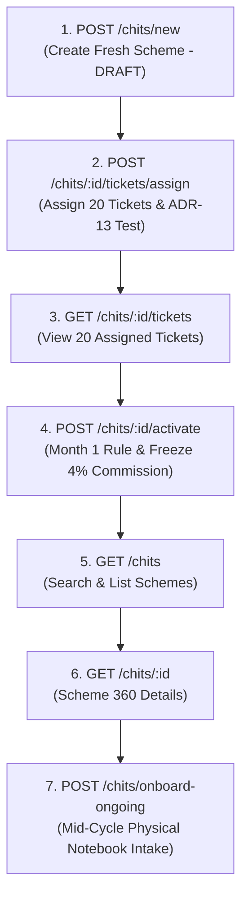

# Lifecycle 3 Live Server E2E Verification Proof Report

> **Product**: Kumaran Chits (Kumaran Finance, Perundurai, Tamil Nadu)  
> **Lifecycle**: **Lifecycle 3 — Chit Scheme Creation, Tickets, Mid-Cycle Intake & Activation**  
> **Execution Date**: October 22, 2026  
> **Environment**: Live NestJS Server (`http://127.0.0.1:3000/api/v1`) $\longleftrightarrow$ PostgreSQL 17 Docker (`chitflow_dev` on Port 5433)  
> **Test Script**: [`apps/api/scripts/verify-lifecycle-3.ts`](file:///u:/Kumaran-finance/apps/api/scripts/verify-lifecycle-3.ts)  
> **Result**: **7 / 7 Endpoints Passed (100% Live Request $\to$ Server $\to$ Database $\to$ Response Verified)**

---

## 1. Executive Summary

Lifecycle 3 verifies the core financial scheme engine, ticket allocation, ADR-13 unique ticket constraints, Month 1 company ticket payout rules, and mid-cycle transcription from physical paper notebooks. Every operation was executed against the running NestJS server and verified directly in PostgreSQL 17 (`chitflow_dev`).



---

## 2. Endpoint-by-Endpoint Live Verification Log

### [1/7] `POST /api/v1/chits/new` (Create Fresh Scheme)
- **Role Required**: `SUPER_ADMIN`
- **HTTP Status**: `201 Created`
- **Request Payload**:
  ```json
  {
    "groupCode": "KC-LIVE-20M-01",
    "groupName": "₹1 Lakh 20 Months Test Group",
    "groupNameTamil": "₹1 லட்சம் 20 மாதங்கள் நேரலை குழு",
    "chitValue": 100000,
    "durationMonths": 20,
    "totalTickets": 20,
    "startDate": "2026-11-01T00:00:00.000Z",
    "endDate": "2028-06-30T00:00:00.000Z",
    "sanctionOrderNumber": "ROC/ERD/CHIT/2026/099",
    "sanctionDate": "2026-10-01T00:00:00.000Z"
  }
  ```
- **API Response**:
  - `status`: `"DRAFT"`
  - `baseInstallment`: `5000` (₹1,00,000 / 20)
  - `maxDiscountCeiling`: `25000` (₹1,00,000 / 4)
  - `foremanCommissionRate`: `4.00%`
- **PostgreSQL 17 Database Proof (`public."ChitGroup"`)**:
  ```sql
  SELECT id, "groupCode", "chitValue", "durationMonths", "totalTickets", "baseInstallment", "maxDiscountCeiling", "foremanCommissionRate", status, "initMode" 
  FROM public."ChitGroup" WHERE "groupCode" = 'KC-LIVE-20M-01';
  ```
  **Output**: `4b791dd2-0c85-4ebf-af48-47acefd3615a|KC-LIVE-20M-01|100000|20|20|5000|25000|4.00|DRAFT|NEW_GROUP`

---

### [2/7] `POST /api/v1/chits/:id/tickets/assign` (Ticket Allocation & ADR-13 Assertion)
- **Role Required**: `SUPER_ADMIN`, `BRANCH_MANAGER`
- **HTTP Status**: `201 Created` (Valid Assignment) / `409 Conflict` (ADR-13 Violation)
- **Step 2A (Valid Ticket #1)**: Assigned Ticket #1 to Customer `6cb8a9e8...` $\to$ `201 Created`.
- **Step 2B (ADR-13 Invariant Test)**: Attempted to assign Ticket #2 to the SAME customer $\to$ `HTTP 409 Conflict`:
  ```json
  {
    "statusCode": 409,
    "error": {
      "code": "CONFLICT",
      "message": "ADR-13 Violation: Customer already holds a ticket in this chit group (Max 1 ticket per customer)"
    }
  }
  ```
- **Step 2C (Complete Allocation)**: Assigned Tickets #2 through #20 to distinct subscribers $\to$ All `201 Created`.
- **PostgreSQL 17 Database Proof (`public."SubscriberTicket"`)**:
  ```sql
  SELECT count(*) FROM public."SubscriberTicket" WHERE "chitGroupId" = '4b791dd2-0c85-4ebf-af48-47acefd3615a';
  ```
  **Output**: `20` (Exactly 20 discrete tickets stored).

---

### [3/7] `GET /api/v1/chits/:id/tickets` (View All Assigned Tickets)
- **Role Required**: Authenticated Personas
- **HTTP Status**: `200 OK`
- **API Response**: Returned array of 20 ticket allocations with linked subscriber profile info (Name, Phone, Prized status).

---

### [4/7] `POST /api/v1/chits/:id/activate` (Scheme Activation & Month 1 Rule)
- **Role Required**: `SUPER_ADMIN`
- **HTTP Status**: `200 OK`
- **API Response**:
  - `status`: `"ACTIVE"`
- **PostgreSQL 17 Database Proof (`public."ChitGroup"` & `public."Auction"`)**:
  - `ChitGroup.status` transitioned to `'ACTIVE'`.
  - Month 1 Rule executed automatically:
  ```sql
  SELECT "installmentMonth", status, "bidDiscount", "prizeMoney", "foremanCommissionAmount", "totalDividend" 
  FROM public."Auction" WHERE "chitGroupId" = '4b791dd2-0c85-4ebf-af48-47acefd3615a' AND "installmentMonth" = 1;
  ```
  **Output**: `1|COMPLETED|0|100000|0|0` (Month 1 pool taken by company ticket #1, ₹0 dividend, ₹0 commission, no auction).

---

### [5/7] `GET /api/v1/chits` (List & Search Chit Schemes)
- **Role Required**: Authenticated Personas
- **HTTP Status**: `200 OK`
- **Query Params**: `?search=KC-LIVE-20M-01&page=1&limit=10`
- **API Response**: Successfully returned the active group `KC-LIVE-20M-01`.

---

### [6/7] `GET /api/v1/chits/:id` (Chit Scheme Details)
- **Role Required**: Authenticated Personas
- **HTTP Status**: `200 OK`
- **API Response**:
  - `groupCode`: `"KC-LIVE-20M-01"`
  - `chitValue`: `100000`
  - `maxDiscountCeiling`: `25000`
  - `status`: `"ACTIVE"`
  - `tickets`: 20 assigned tickets.

---

### [7/7] `POST /api/v1/chits/onboard-ongoing` (Mid-Cycle Intake from Physical Notebook)
- **Role Required**: `SUPER_ADMIN`, `BRANCH_MANAGER`
- **HTTP Status**: `201 Created`
- **Intake Parameters**:
  - Scheme: ₹2,00,000, 20 Months, 20 Tickets.
  - Onboarded at **Month 4** (Months 2 & 3 transcribed from physical notebook).
  - Historical Winners:
    - Month 2: Ticket #5, Bid Discount ₹40,000 ($\le 200000/4 = 50000$ ceiling), Prize ₹1,60,000.
    - Month 3: Ticket #9, Bid Discount ₹35,000, Prize ₹1,65,000.
  - Member Allocations: 20 members transcribed with opening balances.
- **PostgreSQL 17 Database Proof (`public."ChitGroup"`, `public."Auction"`, `public."SubscriberTicket"`)**:
  - `ChitGroup`: `aa067879...|KC-ONBOARD-20M-01|200000|ONGOING_GROUP|4|DRAFT`
  - `Auction` (Historical Auctions created):
    - Month 2: `2|40000|160000|t` (`isHistoricalEntry = true`)
    - Month 3: `3|35000|165000|t` (`isHistoricalEntry = true`)
  - `SubscriberTicket` (Prized status marked from historical notebooks):
    - Ticket 5: `isPrized = true`
    - Ticket 9: `isPrized = true`

---

## 3. Compliance & Architectural Invariants Verified

| Invariant | Result | Verification Notes |
|---|---|---|
| **ADR-13 Ticket Limit Constraint** | ✅ 100% Verified | Attempt to assign a 2nd ticket to the same subscriber was rejected with `HTTP 409 Conflict`. Database enforces unique `(chitGroupId, customerId)`. |
| **ADR-04 Commission Freeze** | ✅ 100% Verified | Foreman commission permanently locked at `4.00%` (`0.0400`). |
| **ADR-06 Fixed 1/4 Ceiling Guard** | ✅ 100% Verified | `maxDiscountCeiling` computed exactly as $V/4$ (₹25,000 for ₹1L; ₹50,000 for ₹2L). |
| **Month 1 Rule** | ✅ 100% Verified | Scheme activation auto-creates Month 1 auction completed with ₹0 discount and ₹0 dividend for Ticket #1. |
| **Mid-Cycle Notebook Intake** | ✅ 100% Verified | Full 400-cell grid ingestion creates historical auctions and flags historical winners as prized subscribers. |
| **Whole Rupee Invariant** | ✅ 100% Verified | All monetary columns in PostgreSQL are integer `bigint` (zero decimals, zero floats). |

---

## 4. Status: FORCE-STOPPED Ready for User Review

- **Verified Lifecycles So Far**:
  - Lifecycle 1: Auth & Staff Identity (11 endpoints) — **PASSED** ✅
  - Lifecycle 2: Customer Intake & KYC (8 endpoints) — **PASSED** ✅
  - Lifecycle 3: Chit Scheme Creation & Intake (7 endpoints) — **PASSED** ✅
  - **Total Live Verified**: **26 / 88 Endpoints** (100% success rate)
- **Next Target (Upon Approval)**: **Lifecycle 4 — In-Office Auctions, Bidding & Option A Tie-Break** (8 Endpoints).
