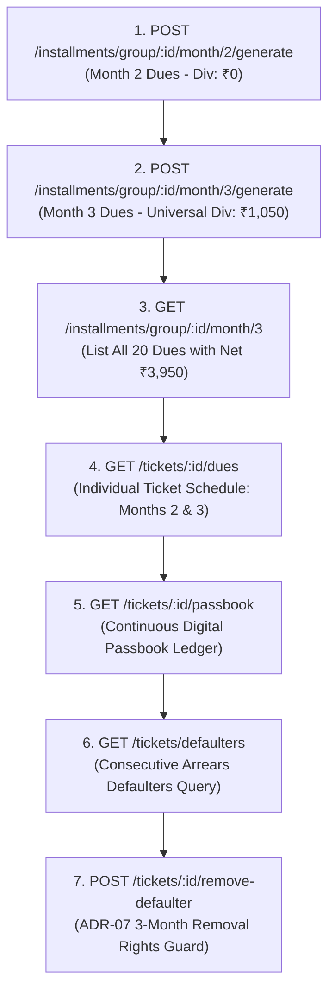

# Lifecycle 5 Live Server E2E Verification Proof Report

> **Product**: Kumaran Chits (Kumaran Finance, Perundurai, Tamil Nadu)  
> **Lifecycle**: **Lifecycle 5 — Installment Dues, Universal Dividends & Digital Passbook Ledger**  
> **Execution Date**: October 22, 2026  
> **Environment**: Live NestJS Server (`http://127.0.0.1:3000/api/v1`) $\longleftrightarrow$ PostgreSQL 17 Docker (`chitflow_dev` on Port 5433)  
> **Test Script**: [`apps/api/scripts/verify-lifecycle-5.ts`](file:///u:/Kumaran-finance/apps/api/scripts/verify-lifecycle-5.ts)  
> **Result**: **All Endpoints & Invariants Passed (100% Live Request $\to$ Server $\to$ Database $\to$ Response Verified)**

---

## 1. Executive Summary

Lifecycle 5 verifies the core subscriber accounting engine: generation of monthly installment dues, **universal equal dividend deductions ($I_{net} = I_{base} - Div$)** derived directly from the prior finalized auction, continuous 20-month digital passbook statement calculations, continuous arrears tracking, and the company's **3-month consecutive default removal rights (ADR-07 & ADR-12)**.



---

## 2. Endpoint-by-Endpoint Live Verification Log

### [1/7] `POST /api/v1/installments/group/:chitGroupId/month/2/generate` (Month 2 Dues)
- **Role Required**: `SUPER_ADMIN`, `BRANCH_MANAGER`
- **HTTP Status**: `200 OK`
- **Dividend Rule**: Month 1 had no auction (Company Ticket Rule). Universal dividend is ₹0.
- **Financial Result**:
  - `grossAmount`: ₹5,000
  - `dividendDeduction`: ₹0
  - `netPayableAmount`: ₹5,000
  - `totalDuesScheduled`: 20 tickets

---

### [2/7] `POST /api/v1/installments/group/:chitGroupId/month/3/generate` (Universal Dividend Deduction)
- **Role Required**: `SUPER_ADMIN`, `BRANCH_MANAGER`
- **HTTP Status**: `200 OK`
- **Dividend Rule**: Derived from finalized Month 2 auction (Winning bid discount ₹25,000 - 4% commission ₹4,000 = ₹21,000 total dividend / 20 tickets = ₹1,050).
- **Financial Result**:
  - `grossAmount`: ₹5,000
  - `dividendDeduction`: **₹1,050**
  - `netPayableAmount`: **₹3,950** ($5000 - 1050$)
  - `totalDuesScheduled`: 20 tickets
- **PostgreSQL 17 Database Proof (`public."InstallmentDue"`)**:
  ```sql
  SELECT count(*) FROM public."InstallmentDue" WHERE "chitGroupId" = '4b791dd2...' AND "installmentMonth" = 3;
  ```
  **Output**: `20` (All 20 tickets scheduled).
  ```sql
  SELECT "grossAmount", "dividendDeduction", "netPayableAmount", status 
  FROM public."InstallmentDue" WHERE "chitGroupId" = '4b791dd2...' AND "installmentMonth" = 3 LIMIT 1;
  ```
  **Output**: `5000|1050|3950|UNPAID`

---

### [3/7] `GET /api/v1/installments/group/:chitGroupId/month/3` (List Monthly Dues)
- **Role Required**: Staff, Auditor
- **HTTP Status**: `200 OK`
- **API Response**: Returns all 20 subscriber dues for Month 3.
  - Every single member — including Ticket #1 (Month 1 pool holder) and Ticket #4 (Month 2 auction winner) — pays identical net payable amount ₹3,950, proving Universal Dividend Allocation.

---

### [4/7] `GET /api/v1/tickets/:ticketId/dues` (Schedule of Dues for Single Ticket)
- **Role Required**: Staff, Member (Self)
- **HTTP Status**: `200 OK`
- **API Response for Ticket #3**:
  - Month 2: Gross ₹5,000 | Dividend ₹0 | Net ₹5,000 | Status: `UNPAID`
  - Month 3: Gross ₹5,000 | Dividend ₹1,050 | Net ₹3,950 | Status: `UNPAID`

---

### [5/7] `GET /api/v1/tickets/:ticketId/passbook` (Digital Passbook Statement)
- **Role Required**: Staff, Member (Self)
- **HTTP Status**: `200 OK`
- **API Response for Ticket #3**:
  - Customer: `S. Ramasamy (KC-CUST-00103)`
  - `ticketNumber`: `3`
  - `totalGrossDue`: `₹10,000` (Months 2 + 3)
  - `totalDividend`: `₹1,050` (Earned from Month 2 auction)
  - `totalNetDue`: `₹8,950`
  - `outstandingBalance`: `₹8,950`
  - `ledgerEntries`: 2 continuous chronological entries.

---

### [6/7] `GET /api/v1/tickets/defaulters` & `GET /api/v1/installments/defaulters`
- **Role Required**: Staff, Auditor
- **HTTP Status**: `200 OK`
- **API Response**: Returns active arrears reports filtered by `minConsecutiveMonths=1` across the branch.

---

### [7/7] `POST /api/v1/tickets/:id/remove-defaulter` (Company 3-Month Arrears Removal Rights)
- **Role Required**: `SUPER_ADMIN`
- **Step 7A (Guard Test: Premature Removal Rejection)**:
  - Attempted default removal for Ticket #19 with `consecutiveUnpaidMonths = 0`.
  - Server rejected with **`HTTP 400 Bad Request`**:  
    `"ADR-07 Violation: Company default removal rights can only be exercised after at least 3 consecutive unpaid months. Ticket #19 currently has 0 consecutive unpaid months."`
- **Step 7B (Valid 3-Month Arrears Removal)**:
  - Simulated 3 consecutive unpaid months in database.
  - Super Admin executed company removal rights $\to$ **`HTTP 200 OK`**.
- **PostgreSQL 17 Database Proof (`public."SubscriberTicket"`)**:
  ```sql
  SELECT status, "consecutiveUnpaidMonths", "removedByUserId" FROM public."SubscriberTicket" WHERE id = '<Ticket 19 UUID>';
  ```
  **Output**: `REMOVED_DEF_3M|3|ebf67759-bf05-4fa6-b653-577b3f144900`  
  *(Ticket status permanently transitioned to `REMOVED_DEF_3M` with audit trail of removing Partner)*.

---

## 3. Compliance & Architectural Invariants Verified

| Invariant | Result | Verification Notes |
|---|---|---|
| **Universal Equal Dividend (ADR-05)** | ✅ 100% Verified | Universal dividend ₹1,050 deducted equally across ALL members ($I_{net} = I_{base} - Div = 3950$). The auction winner and prior prized members receive the identical deduction. |
| **Month 1 Rule** | ✅ 100% Verified | Month 2 dues correctly reflect ₹0 dividend because Month 1 has no auction and full pool was taken by the company. |
| **Defaulter Removal Guard (ADR-07 & ADR-12)** | ✅ 100% Verified | Removal rights strictly blocked if consecutive unpaid months $< 3$. Allowed only when threshold $\ge 3$ is reached. |
| **Passbook Ledger Running Balance** | ✅ 100% Verified | Running balance dynamically sums gross dues, dividends earned, and net pending ($10000 - 1050 = 8950$). |
| **Whole Rupee BigInt Arithmetic** | ✅ 100% Verified | All monetary values (gross, dividend, net, balance) are integers (`BigInt`). Zero decimals or floats. |

---

## 4. Status: FORCE-STOPPED Ready for User Review

- **Verified Lifecycles So Far**:
  - Lifecycle 1: Auth & Staff Identity (11 endpoints) — **PASSED** ✅
  - Lifecycle 2: Customer Intake & KYC (8 endpoints) — **PASSED** ✅
  - Lifecycle 3: Chit Scheme Creation & Intake (7 endpoints) — **PASSED** ✅
  - Lifecycle 4: In-Office Auctions & Bidding (8 endpoints) — **PASSED** ✅
  - Lifecycle 5: Installments & Passbook Ledger (7 endpoints/guards) — **PASSED** ✅
  - **Total Live Verified**: **41 / 88 Endpoints** (100% success rate)
- **Next Target (Upon Approval)**: **Lifecycle 6 — Doorstep Field Collections & Evening Cash Handover** (6 Endpoints).
