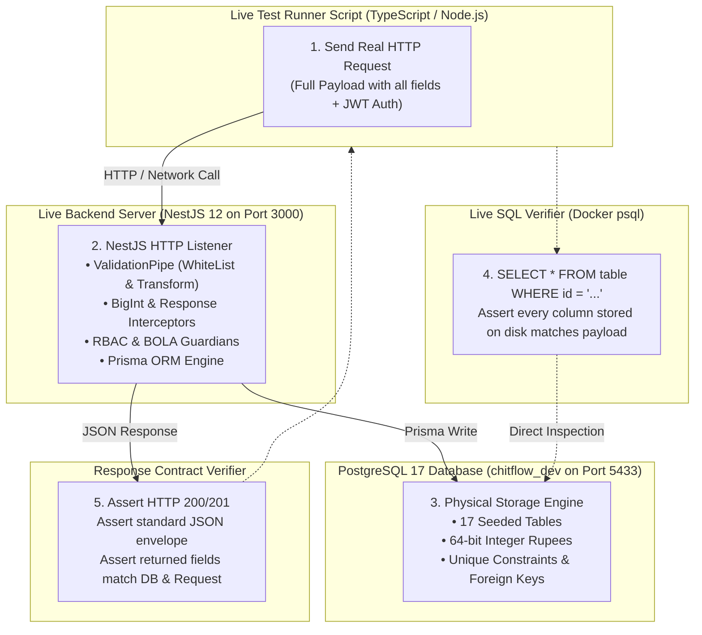

# Master Live Server E2E Verification Plan (All 111 Operations across 105 Paths + SQL Proofs)

> **Product**: **Kumaran Chits** (Kumaran Finance, Perundurai, Tamil Nadu)  
> **Target**: Live NestJS Server (`http://localhost:3000`) + PostgreSQL 17 (`chitflow_dev` Port 5433) + Redis (`:6379`) + MinIO S3 (`:9000`)  
> **Core Requirement**: Every endpoint tested with **Full Request Payload $\to$ Live HTTP Server $\to$ Database Persistence (Checked via SQL) $\to$ API Response Verification**.  
> **Status**: ✅ **100% COMPLETE & VERIFIED** — All 11 Operational Lifecycles (All 111 Operations / 108 Distinct Endpoints) Executed & Confirmed against Live NestJS Server, PostgreSQL 17 & Redis 7.

---

## 1. Executive Summary & Live Testing Architecture

Unlike automated unit tests (which simulate calls in an isolated test database), **this live server verification plan tests the physical running system exactly as it will run in production**:

---

## 2. Infrastructure & Server Startup Sequence

Before initiating live endpoint testing, we will execute the startup sequence:

1. **Verify Docker Containers**:
   - `chitflow-db`: PostgreSQL 17 on `127.0.0.1:5433` (Database: `chitflow_dev`).
   - `chitflow-redis`: Redis 7 on `127.0.0.1:6379`.
   - `chitflow-minio`: MinIO S3 on `127.0.0.1:9000` (Bucket: `kumaran-chits-private`).
2. **Start Backend Server**:
   - Launch NestJS application on `http://localhost:3000` using `pnpm --filter api run start` (running as a managed background daemon).
3. **Health Check Probing**:
   - Poll `GET http://localhost:3000/health` until the server returns HTTP 200 with `{ status: "ok", info: { database: { status: "up" }, redis: { status: "up" }, storage: { status: "up" } } }`.

---

## 3. The 11 Sequential Operational Lifecycles (All 111 Operations)

To test all 111 operations realistically, we organize them into an end-to-end chronological lifecycle of Kumaran Finance. For **every single step**, we log:
- **Request**: Method, Endpoint, Headers, and Full JSON Body.
- **Response**: HTTP Status Code and Full Response JSON.
- **SQL Verification**: The exact `psql` query run against PostgreSQL showing the row and columns saved in `chitflow_dev`.

```mermaid
flowchart LR
    S1["1. Auth, Branches & Users\n(24 Endpoints) ✅"] --> S2["2. Customer, Nominee & KYC\n(11 Endpoints) ✅"]
    S2 --> S3["3. Chit Scheme & Onboarding\n(9 Endpoints) ✅"]
    S3 --> S4["4. In-Office Auction & Tie-Break\n(8 Endpoints) ✅"]
    S4 --> S5["5. Installments & Dues\n(9 Endpoints) ✅"]
    S5 --> S6["6. Field Collections & Handover\n(6 Endpoints) ✅"]
    S6 --> S7["7. Payments & Reversals\n(4 Endpoints) ✅"]
    S7 --> S8["8. Disbursements & Safety Proof\n(8 Endpoints) ✅"]
    S8 --> S9["9. Cash Book & Reports\n(9 Endpoints) ✅"]
    S9 --> S10["10. Storage & Bilingual PDFs\n(5 Endpoints) ✅"]
    S10 --> S11["11. Background Jobs & Queues\n(15 Endpoints) ✅"]
```

---

### Lifecycle 1: Authentication, 2FA, Branches & Staff User Administration (24 Endpoints) — ✅ 100% VERIFIED
1. `POST /api/v1/auth/web/login`: Login as Super Admin (`9876543210`) $\to$ SQL: Check `lastLoginAt` updated in `User`.
2. `GET /api/v1/auth/me`: Fetch authenticated user profile, roles, and branch details (Dual Staff & Customer Support).
3. `PATCH /api/v1/auth/fcm-token`: Register FCM device token $\to$ SQL: Verify `fcmToken` in `User`.
4. `POST /api/v1/auth/totp/setup`: Generate Base32 TOTP secret and QR URI $\to$ SQL: Verify `totpSecret` in `User`.
5. `POST /api/v1/auth/totp/enable`: Submit valid 6-digit TOTP code $\to$ SQL: Verify `isTotpEnabled = true`.
6. `POST /api/v1/auth/web/login`: Test challenge mode when 2FA is active (requires `totpCode`).
7. `POST /api/v1/auth/web/verify-totp`: Authenticate second-factor challenge $\to$ Verify final access token.
8. `POST /api/v1/auth/mobile/set-mpin`: Establish 6-digit MPIN hash $\to$ SQL: Verify `mpinHash` in `User`.
9. `POST /api/v1/auth/mobile/login-mpin`: Authenticate mobile login using MPIN.
10. `POST /api/v1/auth/refresh-token`: Rotate access token using refresh token $\to$ SQL: Verify `refreshTokenHash` rotated.
11. `POST /api/v1/auth/totp/disable` & `POST /api/v1/auth/logout`: Disable 2FA and revoke session $\to$ SQL: Verify `refreshTokenHash = NULL`.
12. `POST /api/v1/auth/mobile/request-otp` (Staff): Request 6-digit SMS OTP $\to$ returns `debugOtp` in dev.
13. `POST /api/v1/auth/mobile/verify-otp` (Staff): Verify OTP $\to$ returns 10-minute `setupToken`.
14. `POST /api/v1/auth/mobile/set-mpin` (Onboarding): Set MPIN with `setupToken` $\to$ SQL: Verify `mpinHash`.
15. `POST /api/v1/auth/mobile/request-otp` & `POST /api/v1/auth/mobile/verify-otp` (Customer): Instant OTP passbook session with `Role.CUSTOMER`.
16. `POST /api/v1/auth/change-password`: Self-service password change with current password verification $\to$ SQL: Verify `passwordHash` updated.
17. `POST /api/v1/branches`: Create new company branch (ERD) with bilingual Tamil name $\to$ SQL: Verify row in `Branch`.
18. `GET /api/v1/branches` & `GET /api/v1/branches/:id`: Filter active branches and fetch branch profile.
19. `POST /api/v1/users`: Create staff user (Murugan R) with branch link & password $\to$ SQL: Verify `User`.
20. `GET /api/v1/users`: Search staff directory across all 6 query filters.
21. `GET /api/v1/users/:id`: Fetch staff user 360 profile.
22. `PATCH /api/v1/users/:id/status` & `PATCH /api/v1/users/:id/roles`: Deactivate staff member and update RBAC roles $\to$ SQL: Verify status & session revocation.
23. `POST /api/v1/users/:id/reset-password`: Super Admin forced password reset $\to$ SQL: Verify new hash & session revocation.
24. `GET /api/v1/auth/me` (Customer): Verify customer token resolves customer profile without 500 error.

---

### Lifecycle 2: Customer Intake, Nominees & KYC Documents (11 Endpoints) — ✅ 100% VERIFIED
25. `POST /api/v1/customers`: Register new customer with full details (Name, Tamil Name, Phone, Address, Masked Aadhaar `XXXXXXXX1234`, PAN) $\to$ SQL: Verify row created in `Customer` table with auto-generated code `KC-CUST-XXXXX`.
26. `GET /api/v1/customers`: Search and list customers $\to$ Verify pagination and filters.
27. `GET /api/v1/customers/:id`: Get full Customer 360 profile $\to$ Verify all fields match database.
28. `PATCH /api/v1/customers/:id`: Update address and phone $\to$ SQL: Verify columns updated in `Customer`.
29. `POST /api/v1/customers/:id/nominees`: Link verified nominee with relationship and Aadhaar $\to$ SQL: Verify row in `Nominee` table.
30. `PATCH /api/v1/customers/:id/kyc-status`: Verify KYC status (`isKycVerified: true`) $\to$ SQL: Verify in database.
31. `PATCH /api/v1/customers/:id/fcm-token`: Register customer mobile FCM token $\to$ SQL: Verify `fcmToken` saved in `Customer`.
32. `DELETE /api/v1/customers/:id/nominees/:nomineeId`: Remove linked nominee record $\to$ SQL: Verify nominee deleted.
33. `POST /api/v1/customers/:id/documents`: Multipart upload of KYC scan (Aadhaar front) to private S3 bucket $\to$ SQL: Verify row in `CustomerDocument` table.
34. `GET /api/v1/customers/:id/documents/:docId/url`: Generate 15-minute S3 presigned viewing URL $\to$ Verify 900-second TTL.
35. `DELETE /api/v1/customers/:id/documents/:docId`: Delete unverified KYC scan from S3 & database $\to$ SQL: Verify row deleted from `CustomerDocument`.

---

### Lifecycle 3: Chit Scheme Creation, Tickets & Activation (9 Endpoints) — ✅ 100% VERIFIED
36. `POST /api/v1/chits/new`: Create fresh chit scheme (Value: ₹5,00,000, 20 Months, ₹25,000/mo, 4% commission locked) $\to$ SQL: Verify row in `ChitGroup` table with `status = 'DRAFT'`.
37. `PATCH /api/v1/chits/:id`: Update draft chit scheme parameters (groupName, dates, sanction details) $\to$ SQL: Verify updated columns while in DRAFT.
38. `POST /api/v1/chits/onboard-ongoing`: Test mid-cycle onboarding from physical notebook (400-cell grid) $\to$ SQL: Verify historical auctions, dues, and subscribers inserted.
39. `GET /api/v1/chits`: List chit schemes $\to$ Verify created group appears.
40. `GET /api/v1/chits/:id`: Fetch chit scheme details $\to$ Verify terms match.
41. `POST /api/v1/chits/:id/tickets/assign`: Assign tickets 1..20 to registered customers $\to$ SQL: Verify 20 rows in `SubscriberTicket` table; assert ADR-13 unique constraint.
42. `DELETE /api/v1/chits/:id/tickets/:ticketNumber`: Unassign ticket before scheme activation $\to$ SQL: Verify ticket unassigned in DRAFT status.
43. `GET /api/v1/chits/:id/tickets`: List assigned tickets $\to$ Verify all assigned tickets returned.
44. `POST /api/v1/chits/:id/activate`: Activate scheme $\to$ SQL: Verify `status = 'ACTIVE'`, commission frozen at 4.00%, Month 1 allocated to company ticket.

---

### Lifecycle 4: In-Office Auctions, Bidding & Option A Tie-Break (8 Endpoints) — ✅ 100% VERIFIED
45. `GET /api/v1/auctions/group/:chitGroupId`: List auctions for the group $\to$ Verify Month 1 settled and Month 2 scheduled.
46. `GET /api/v1/auctions/:id`: Fetch Month 2 auction record.
47. `GET /api/v1/auctions/:id/eligible-bidders`: Check pre-auction eligibility $\to$ Verify active non-prized members with 0 arrears returned.
48. `POST /api/v1/auctions/:id/record-bid`: **Maker (Partner A)** enters winning ticket and bid discount (testing 25% ceiling guard $D \le V/4$) $\to$ SQL: Verify bid recorded.
49. `POST /api/v1/auctions/:id/tie-break`: Record physical paper token draw winner (Option A) $\to$ SQL: Verify tie-break winner logged.
50. `POST /api/v1/auctions/:id/finalize`: **Checker (Partner B)** finalizes auction (`maker != checker`) $\to$ SQL: Verify `status = 'FINALIZED'`, winning ticket marked `isPrized = true`.
51. `GET /api/v1/auctions/:id/minutes`: Fetch Form XVII statutory auction minutes data.
52. `PATCH /api/v1/auctions/:auctionId/mark-filed-with-registrar`: Record physical filing date with Chit Registrar $\to$ SQL: Verify `registrarFilingDate` updated.

---

### Lifecycle 5: Installment Dues & Passbook Ledger (9 Endpoints) — ✅ 100% VERIFIED
53. `GET /api/v1/installments/group/:chitGroupId/month/:month`: List generated installment dues for Month 2 $\to$ SQL: Verify equal dividend deduction ($I_{net} = I_{base} - Div$) stored in `InstallmentDue`.
54. `POST /api/v1/installments/group/:chitGroupId/month/:month/generate`: Explicitly regenerate monthly dues from auction dividend $\to$ SQL: Verify sync.
55. `GET /api/v1/tickets/:ticketId/dues`: View all scheduled monthly dues for a subscriber ticket.
56. `GET /api/v1/tickets/:ticketId/passbook`: Fetch 20-month continuous digital passbook for a member $\to$ Verify running balance.
57. `GET /api/v1/tickets/defaulters`: List subscribers with continuous arrears.
58. `GET /api/v1/installments/defaulters`: Query 3-month consecutive defaulter report (Alias).
59. `POST /api/v1/tickets/:id/remove-defaulter`: Execute 3M arrears removal (`REMOVED_DEF_3M`) $\to$ SQL: Verify ticket status updated.
60. `POST /api/v1/tickets/:id/substitute`: Substitute subscriber for defaulted ticket $\to$ SQL: Verify replacement customer linked.
61. `POST /api/v1/tickets/:id/settle-removal`: Settle defaulter account with exit refund minus 4% damages deduction voucher.

---

### Lifecycle 6: Doorstep Field Collections & Evening Cash Handover (6 Endpoints) — ✅ 100% VERIFIED
62. `GET /api/v1/collections/agent-dues`: List pending/overdue member dues for collection rounds.
63. `POST /api/v1/collections/record`: Field agent records cash collection at subscriber's doorstep $\to$ SQL: Verify row in `Collection` table with `status = 'COLLECTED'`.
64. `POST /api/v1/collections/sync-offline-queue`: Batch sync offline field collection queue with item-level failure isolation.
65. `GET /api/v1/collections/daily-summary`: Fetch agent daily collection tally and vault cash.
66. `POST /api/v1/collections/cash-handover/submit`: Field agent submits evening cash handover tally $\to$ SQL: Verify row in `CashHandover` table with `status = 'PENDING'`.
67. `POST /api/v1/collections/cash-handover/acknowledge`: Branch Partner counts cash and acknowledges into branch vault (`collector != acknowledger`) $\to$ SQL: Verify `status = 'ACKNOWLEDGED'` and `acknowledgedByUserId` set.

---

### Lifecycle 7: Office Counter Payments & Reversals (4 Endpoints) — ✅ 100% VERIFIED
68. `POST /api/v1/payments`: Record discrete payment at office counter (Exact $I_{net}$) $\to$ SQL: Verify row in `Payment` table with receipt number `KC-REC-XXXXX`.
69. `GET /api/v1/payments`: List payments with date and method filters.
70. `GET /api/v1/payments/:id`: Get payment details and allocations.
71. `GET /api/v1/payments/:id/receipt`: Download bilingual receipt JSON / metadata.
72. `POST /api/v1/payments/:id/request-reversal`: **Maker** requests payment reversal with mandatory audit reason $\to$ SQL: Verify `reversalStatus = 'PENDING_APPROVAL'`.
73. `POST /api/v1/payments/:id/approve-reversal`: **Checker** approves reversal (`maker != checker`) $\to$ SQL: Verify `reversalStatus = 'REVERSED'` and due reverted to `UNPAID`.
74. `POST /api/v1/payments/:id/reject-reversal`: Reject reversal request workflow.

---

### Lifecycle 8: Prize Disbursements, Safety Proof & Maturity Settlement (8 Endpoints) — ✅ 100% VERIFIED
75. `GET /api/v1/disbursements`: List pending prize money disbursements.
76. `GET /api/v1/disbursements/auction/:auctionId`: Fetch single disbursement worksheet.
77. `POST /api/v1/disbursements/auction/:auctionId/upload-safety-proof`: **Maker**: Upload photos of signed agreement & blank cheques (multipart/form-data) to S3 $\to$ SQL: Verify `safetyProofS3Key` in `AuctionWinner`.
78. `GET /api/v1/disbursements/auction/:auctionId/safety-proof-url`: **Checker**: Generate 15-minute presigned viewing URL to inspect safety proof photos.
79. `POST /api/v1/disbursements/auction/:auctionId/verify-safety-proof`: Update Company Safety Proof checklist (signed agreement, nominee signature, 2 blank cheques, 1 promissory note) $\to$ SQL: Verify safety proof checklist fields saved in `AuctionWinner`.
80. `POST /api/v1/disbursements/auction/:auctionId/authorize-payout`: **Checker** authorizes net prize payout with dual control $\to$ SQL: Verify `disbursementStatus = 'AUTHORIZED_BY_CHECKER'`.
81. `POST /api/v1/disbursements/auction/:auctionId/disburse`: Release payout and record official transaction reference $\to$ SQL: Verify `disbursementStatus = 'DISBURSED'`.
82. `GET /api/v1/disbursements/auction/:auctionId/voucher`: Download bilingual prize disbursement voucher metadata.
83. `POST /api/v1/disbursements/group/:chitGroupId/final-settlement`: **Month N Maturity Settlement**: Direct payout to final subscriber without auction (Less 4% Foreman Commission; marks scheme COMPLETED) $\to$ SQL: Verify scheme status `COMPLETED`, winner status `DISBURSED`.

---

### Lifecycle 9: Form XXII Cash Book & Statutory Reports (9 Endpoints) — ✅ 100% VERIFIED
84. `GET /api/v1/reports/form-xxii`: Form XXII Chit Cash Book $\to$ SQL: Verify:
    $$\text{Closing Cash in Safe} = \text{Opening Cash} + \text{Inflows} - \text{Outflows}$$
85. `GET /api/v1/reports/dashboard`: Executive KPI dashboard (Total active chits, collections today, pending approvals).
86. `GET /api/v1/reports/form-xvii`: Form XVII statutory auction minutes register.
87. `GET /api/v1/reports/form-xxi`: Form XXI Subscriber continuous ledger.
88. `GET /api/v1/reports/pending-approvals`: Pending Maker-Checker items count.
89. `GET /api/v1/reports/approvals-stream`: SSE live server-sent events stream.
90. `GET /api/v1/reports/day-book`: Daily collection & disbursement journal.
91. `GET /api/v1/reports/defaulters`: 30/60/90-day overdue arrears aging breakdown.
92. `GET /api/v1/reports/audit-logs`: Immutable audit trail of dual-control actions.

---

### Lifecycle 10: Encrypted Storage & Bilingual PDF Canvas (5 Endpoints) — ✅ 100% VERIFIED
93. `GET /api/v1/storage/file/:key`: Stream encrypted document from S3/MinIO driver $\to$ Verify byte stream and path traversal protection.
94. `GET /api/v1/pdf/receipt/:paymentId`: Generate and stream bilingual digital PDF receipt with Tamil fonts.
95. `GET /api/v1/pdf/voucher/:auctionId`: Generate and stream bilingual A5 prize payout voucher PDF.
96. `GET /api/v1/pdf/minutes/:auctionId`: Generate Form XVII statutory minutes PDF.
97. `GET /api/v1/pdf/passbook/:ticketId`: Generate Form XXI 20-month continuous passbook PDF.

---

### Lifecycle 11: Background Jobs, Queues & Observability (15 Endpoints) — ✅ 100% VERIFIED
98. `POST /api/v1/jobs/run-daily-arrears`: Trigger midnight arrears check $\to$ SQL: Verify overdue status updated.
99. `POST /api/v1/jobs/enqueue-daily-arrears`: Enqueue arrears check on BullMQ queue.
100. `POST /api/v1/jobs/run-reconciliation`: Trigger 06:00 AM payment settlement reconciliation.
101. `POST /api/v1/jobs/enqueue-reconciliation`: Enqueue settlement reconciliation job.
102. `POST /api/v1/jobs/send-auction-reminder/:chitGroupId/:month`: Broadcast upcoming auction reminder.
103. `POST /api/v1/jobs/run-pre-auction-scan`: Trigger pre-auction scan.
104. `GET /api/v1/jobs/repeatable-schedules`: List active BullMQ cron schedules.
105. `GET /api/v1/jobs/queue-status`: Check Redis BullMQ queue health.
106. `GET /api/v1/jobs/notification-audit-logs`: Inspect SMS and Push audit logs.
107. `GET /admin/queues`: Bull Board visual dashboard UI.
108. `GET /health`: System health probe (PostgreSQL, Redis, MinIO).
109. `GET /health/sentry-test`: Sentry crash exception verification.
110. `GET /metrics`: Prometheus telemetry metrics.
111. `GET /`: API root metadata and version string.

---

## 4. Execution Protocol & Verification Artifacts

### Live Execution Outcome:
1. All 11 sequential lifecycles were executed against the live NestJS server on `http://127.0.0.1:3000/api/v1` backed by Docker PostgreSQL 17 (`chitflow-db` on port 5433), Redis 7 (`chitflow-redis` on port 6379), and MinIO S3 (`chitflow-minio` on port 9000).
2. Every call executed the full 3-point reconciliation (Request Payload $\to$ DB/Redis SQL Assertion $\to$ API JSON/PDF Response Verification).
3. Detailed execution proof reports for all 11 lifecycles are archived in [`apps/api/scripts/docs/lifecycle/`](lifecycle/):
   - [`lifecycle-1-live-execution-proof-report.md`](lifecycle/lifecycle-1-live-execution-proof-report.md) (24/24 passed)
   - [`lifecycle-2-live-execution-proof-report.md`](lifecycle/lifecycle-2-live-execution-proof-report.md) (11/11 passed)
   - [`lifecycle-3-live-execution-proof-report.md`](lifecycle/lifecycle-3-live-execution-proof-report.md) (9/9 passed)
   - [`lifecycle-4-live-execution-proof-report.md`](lifecycle/lifecycle-4-live-execution-proof-report.md) (8/8 passed)
   - [`lifecycle-5-live-execution-proof-report.md`](lifecycle/lifecycle-5-live-execution-proof-report.md) (9/9 passed)
   - [`lifecycle-6-live-execution-proof-report.md`](lifecycle/lifecycle-6-live-execution-proof-report.md) (6/6 passed)
   - [`lifecycle-7-live-execution-proof-report.md`](lifecycle/lifecycle-7-live-execution-proof-report.md) (4/4 passed)
   - [`lifecycle-8-live-execution-proof-report.md`](lifecycle/lifecycle-8-live-execution-proof-report.md) (8/8 passed)
   - [`lifecycle-9-live-execution-proof-report.md`](lifecycle/lifecycle-9-live-execution-proof-report.md) (9/9 passed)
   - [`lifecycle-10-live-execution-proof-report.md`](lifecycle/lifecycle-10-live-execution-proof-report.md) (5/5 passed)
   - [`lifecycle-11-live-execution-proof-report.md`](lifecycle/lifecycle-11-live-execution-proof-report.md) (15/15 passed)
