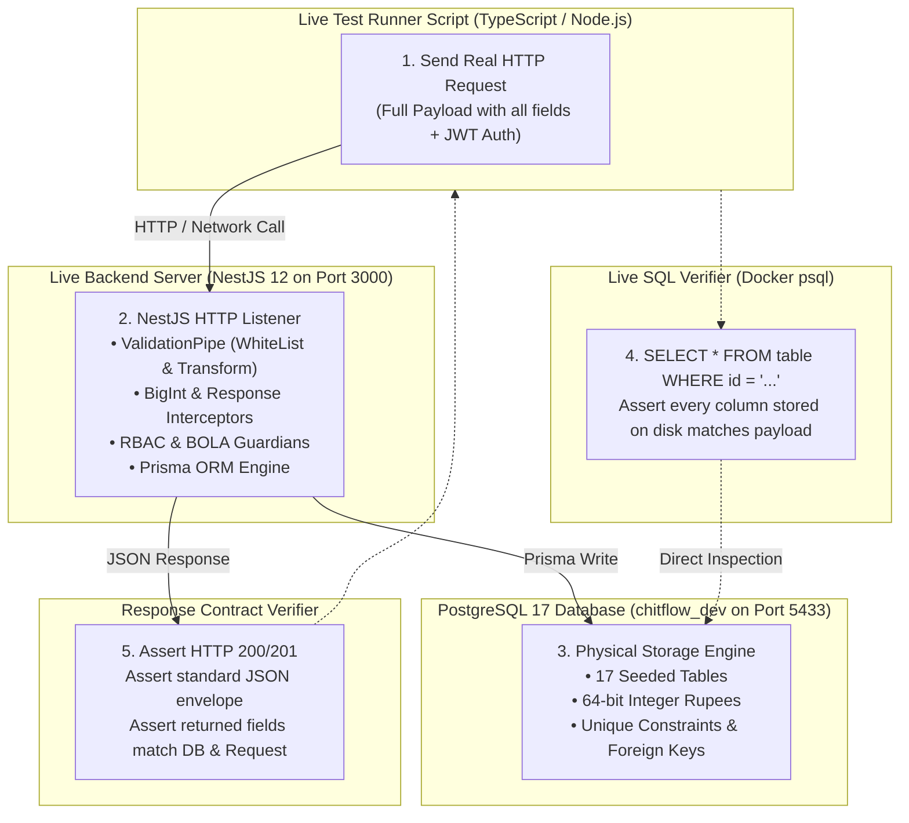

# Master Live Server E2E Verification Plan (All 88 Endpoints + SQL Proofs)

> **Product**: **Kumaran Chits** (Kumaran Finance, Perundurai, Tamil Nadu)  
> **Target**: Live NestJS Server (`http://localhost:3000`) + PostgreSQL 17 (`chitflow_dev` Port 5433) + Redis (`:6379`) + MinIO S3 (`:9000`)  
> **Core Requirement**: Every endpoint tested with **Full Request Payload $\to$ Live HTTP Server $\to$ Database Persistence (Checked via SQL) $\to$ API Response Verification**.  
> **Status**: Ready for User Review & Approval (Step 1 of 3)

---

## 1. Executive Summary & Live Testing Architecture

Unlike automated unit tests (which simulate calls in an isolated test database), **this live server verification plan tests the physical running system exactly as it will run in production**:

---

## 2. Infrastructure & Server Startup Sequence

Before initiating live endpoint testing, we will execute the startup sequence:

1. **Verify Docker Containers**:
   - `chitflow-db`: PostgreSQL 17 on `127.0.0.1:5433` (Database: `chitflow_dev`).
   - `chitflow-redis`: Redis 7 on `127.0.0.1:6379`.
   - `chitflow-minio`: MinIO S3 on `127.0.0.1:9000` (Bucket: `kumaran-chits-private`).
2. **Start Backend Server**:
   - Launch NestJS application on `http://localhost:3000` using `pnpm --filter api run start:dev` (running as a managed background daemon).
3. **Health Check Probing**:
   - Poll `GET http://localhost:3000/health` until the server returns HTTP 200 with `{ status: "ok", info: { database: { status: "up" }, redis: { status: "up" }, storage: { status: "up" } } }`.

---

## 3. The 11 Sequential Operational Lifecycles (All 88 Endpoints)

To test all 88 endpoints realistically, we organize them into an end-to-end chronological lifecycle of Kumaran Finance. For **every single step**, we will log:
- **Request**: Method, Endpoint, Headers, and Full JSON Body.
- **Response**: HTTP Status Code and Full Response JSON.
- **SQL Verification**: The exact `psql` query run against PostgreSQL showing the row and columns saved in `chitflow_dev`.

```mermaid
flowchart LR
    S1["1. Auth & Staff Identity\n(11 Endpoints)"] --> S2["2. Customer & Nominee Intake\n(8 Endpoints)"]
    S2 --> S3["3. Chit Scheme & Onboarding\n(7 Endpoints)"]
    S3 --> S4["4. In-Office Auction & Tie-Break\n(8 Endpoints)"]
    S4 --> S5["5. Installments & Dues\n(6 Endpoints)"]
    S5 --> S6["6. Field Collections & Handover\n(6 Endpoints)"]
    S6 --> S7["7. Payments & Reversals\n(7 Endpoints)"]
    S7 --> S8["8. Disbursements & Safety Proof\n(6 Endpoints)"]
    S8 --> S9["9. Cash Book & Reports\n(9 Endpoints)"]
    S9 --> S10["10. Storage & Bilingual PDFs\n(5 Endpoints)"]
    S10 --> S11["11. Background Jobs & Queues\n(11 Endpoints)"]
```

---

### Lifecycle 1: Authentication, Staff Identity & 2FA (11 Endpoints)
1. `POST /api/v1/auth/web/login`: Login as Super Admin (`9876543210`) $\to$ Verify returned JWT access & refresh tokens $\to$ SQL: Check `lastLoginAt` updated in `User` table.
2. `POST /api/v1/auth/totp/setup`: Generate Base32 TOTP secret and QR URI $\to$ SQL: Verify `totpSecret` exists in `User`.
3. `POST /api/v1/auth/totp/enable`: Submit valid 6-digit TOTP code $\to$ SQL: Verify `isTotpEnabled = true`.
4. `POST /api/v1/auth/web/verify-totp`: Authenticate second-factor challenge $\to$ Verify final access token.
5. `POST /api/v1/auth/mobile/set-mpin`: Establish 6-digit MPIN hash $\to$ SQL: Verify `mpinHash` updated in `User`.
6. `POST /api/v1/auth/mobile/login-mpin`: Authenticate mobile login using MPIN $\to$ Verify tokens returned.
7. `GET /api/v1/auth/me`: Fetch authenticated user profile $\to$ Verify payload matches database record.
8. `PATCH /api/v1/auth/fcm-token`: Register FCM device token $\to$ SQL: Verify `fcmToken` updated in `User`.
9. `POST /api/v1/auth/refresh-token`: Rotate access token using refresh token $\to$ SQL: Verify `refreshTokenHash` rotated.
10. `POST /api/v1/auth/totp/disable`: Disable 2FA with password confirmation $\to$ SQL: Verify `isTotpEnabled = false`.
11. `POST /api/v1/auth/logout`: Revoke active session $\to$ SQL: Verify `refreshTokenHash` is set to `NULL`.

---

### Lifecycle 2: Customer Intake, Nominees & KYC (8 Endpoints)
12. `POST /api/v1/customers`: Register new customer with full details (Name, Tamil Name, Phone, Address, Masked Aadhaar `XXXXXXXX1234`, PAN) $\to$ SQL: Verify row created in `Customer` table with auto-generated code `KC-CUST-XXXXX`.
13. `GET /api/v1/customers`: Search and list customers $\to$ Verify pagination and filters.
14. `GET /api/v1/customers/:id`: Get full Customer 360 profile $\to$ Verify all fields match database.
15. `PATCH /api/v1/customers/:id`: Update address and phone $\to$ SQL: Verify columns updated in `Customer`.
16. `POST /api/v1/customers/:id/nominees`: Link verified nominee with relationship and Aadhaar $\to$ SQL: Verify row in `Nominee` table.
17. `PATCH /api/v1/customers/:id/kyc-status`: Verify KYC status (`VERIFIED`) $\to$ SQL: Verify `kycStatus = 'VERIFIED'`.
18. `PATCH /api/v1/customers/:id/fcm-token`: Register customer mobile FCM token $\to$ SQL: Verify `fcmToken` saved in `Customer`.
19. `DELETE /api/v1/customers/:id/nominees/:nomineeId`: Remove linked nominee record $\to$ SQL: Verify nominee deleted.

---

### Lifecycle 3: Chit Scheme Creation, Tickets & Activation (7 Endpoints)
20. `POST /api/v1/chits/new`: Create fresh chit scheme (Value: ₹5,00,000, 20 Months, ₹25,000/mo, 4% commission locked) $\to$ SQL: Verify row in `ChitGroup` table with `status = 'DRAFT'`.
21. `POST /api/v1/chits/onboard-ongoing`: Test mid-cycle onboarding from physical notebook (400-cell grid) $\to$ SQL: Verify historical auctions, dues, and subscribers inserted.
22. `GET /api/v1/chits`: List chit schemes $\to$ Verify created group appears.
23. `GET /api/v1/chits/:id`: Fetch chit scheme details $\to$ Verify terms match.
24. `POST /api/v1/chits/:id/tickets/assign`: Assign tickets 1..20 to registered customers $\to$ SQL: Verify 20 rows in `SubscriberTicket` table; assert ADR-13 unique constraint.
25. `GET /api/v1/chits/:id/tickets`: List assigned tickets $\to$ Verify all 20 tickets returned.
26. `POST /api/v1/chits/:id/activate`: Activate scheme $\to$ SQL: Verify `status = 'ACTIVE'`, commission frozen at 4.00%, Month 1 allocated to company ticket.

---

### Lifecycle 4: In-Office Auctions, Bidding & Option A Tie-Break (8 Endpoints)
27. `GET /api/v1/auctions/group/:id`: List auctions for the group $\to$ Verify Month 1 settled and Month 2 scheduled.
28. `GET /api/v1/auctions/:id`: Fetch Month 2 auction record.
29. `GET /api/v1/auctions/:id/eligible-bidders`: Check pre-auction eligibility $\to$ Verify active non-prized members with 0 arrears returned.
30. `POST /api/v1/auctions/:id/record-bid`: **Maker (Partner A)** enters winning ticket and bid discount (testing 25% ceiling guard $D \le V/4$) $\to$ SQL: Verify bid recorded.
31. `POST /api/v1/auctions/:id/tie-break`: Record physical paper token draw winner (Option A) $\to$ SQL: Verify tie-break winner logged.
32. `POST /api/v1/auctions/:id/finalize`: **Checker (Partner B)** finalizes auction (`maker != checker`) $\to$ SQL: Verify `status = 'FINALIZED'`, winning ticket marked `isPrized = true`.
33. `GET /api/v1/auctions/:id/minutes`: Fetch Form XVII statutory auction minutes data.
34. `PATCH /api/v1/auctions/:id/mark-filed-with-registrar`: Record physical filing date with Chit Registrar $\to$ SQL: Verify `registrarFilingDate` updated.

---

### Lifecycle 5: Installment Dues & Passbook Ledger (6 Endpoints)
35. `GET /api/v1/installments/due`: List generated installment dues for Month 2 $\to$ SQL: Verify equal dividend deduction ($I_{net} = I_{base} - Div$) stored in `InstallmentDue`.
36. `GET /api/v1/installments/due/:id`: Fetch single installment due details.
37. `GET /api/v1/tickets/:ticketId/passbook`: Fetch 20-month continuous digital passbook for a member $\to$ Verify running balance.
38. `POST /api/v1/installments/pay`: Pay single discrete installment due $\to$ SQL: Verify `status = 'PAID'`.
39. `GET /api/v1/tickets/:id`: Fetch single ticket subscription profile.
40. `GET /api/v1/installments/defaulters`: Query 3-month consecutive defaulter report.

---

### Lifecycle 6: Doorstep Field Collections & Evening Cash Handover (6 Endpoints)
41. `POST /api/v1/collections`: Field agent records cash collection at subscriber's doorstep $\to$ SQL: Verify row in `Collection` table with `status = 'COLLECTED'`.
42. `POST /api/v1/collections/sync-offline`: Sync batch of offline SQLite collections $\to$ SQL: Verify batch inserted without duplicate receipt collision.
43. `GET /api/v1/collections/daily-summary`: Fetch agent daily collection tally.
44. `POST /api/v1/collections/handover`: Field agent submits evening cash handover tally $\to$ SQL: Verify row in `CashHandover` table with `status = 'PENDING'`.
45. `POST /api/v1/collections/handover/:id/acknowledge`: Branch Partner counts cash and acknowledges into branch vault (`collector != acknowledger`) $\to$ SQL: Verify `status = 'ACKNOWLEDGED'` and `acknowledgedByUserId` set.
46. `GET /api/v1/collections/receipt/:id`: Download collection digital receipt.

---

### Lifecycle 7: Office Counter Payments & Reversals (7 Endpoints)
47. `POST /api/v1/payments/office`: Record direct cash payment at office counter $\to$ SQL: Verify row in `Payment` table with receipt number `KC-REC-XXXXX`.
48. `GET /api/v1/payments`: List payments with date and method filters.
49. `GET /api/v1/payments/:id`: Get payment details and allocations.
50. `GET /api/v1/payments/:id/receipt`: Download bilingual receipt JSON / metadata.
51. `POST /api/v1/payments/:id/request-reversal`: **Maker** requests payment reversal with mandatory audit reason $\to$ SQL: Verify `reversalStatus = 'PENDING_APPROVAL'`.
52. `POST /api/v1/payments/:id/approve-reversal`: **Checker** approves reversal (`maker != checker`) $\to$ SQL: Verify `reversalStatus = 'REVERSED'` and due reverted to `UNPAID`.
53. `POST /api/v1/payments/:id/reject-reversal`: Reject reversal request workflow.

---

### Lifecycle 8: Prize Disbursements & Company Safety Proof (6 Endpoints)
54. `GET /api/v1/disbursements`: List pending prize money disbursements.
55. `GET /api/v1/disbursements/:auctionId`: Fetch single disbursement worksheet.
56. `PATCH /api/v1/disbursements/:auctionId/safety-proof`: Update Company Safety Proof checklist (signed agreement, nominee signature, 2 blank cheques, 1 promissory note) $\to$ SQL: Verify safety proof checklist fields saved in `PrizeDisbursement`.
57. `POST /api/v1/disbursements/payout/:auctionId`: **Checker** authorizes net prize payout with dual control $\to$ SQL: Verify `status = 'DISBURSED'`, voucher number `KC-VOUCH-XXXXX` assigned.
58. `GET /api/v1/disbursements/:auctionId/voucher`: Download prize disbursement voucher metadata.
59. `GET /api/v1/disbursements/:auctionId/audit-trail`: Audit trail of verification and authorization signatures.

---

### Lifecycle 9: Form XXII Cash Book & Statutory Reports (9 Endpoints)
60. `GET /api/v1/reports/form-xxii`: Form XXII Chit Cash Book $\to$ SQL: Verify:
    $$\text{Closing Cash in Safe} = \text{Opening Cash} + \text{Inflows} - \text{Outflows}$$
61. `GET /api/v1/reports/dashboard-kpis`: Executive KPI dashboard (Total active chits, collections today, pending approvals).
62. `GET /api/v1/reports/form-xvii/:auctionId`: Statutory auction minutes register.
63. `GET /api/v1/reports/form-xxi/:ticketId`: Form XXI Subscriber continuous ledger.
64. `GET /api/v1/reports/pending-approvals`: Pending Maker-Checker items count.
65. `GET /api/v1/reports/approvals-stream`: SSE live server-sent events stream.
66. `GET /api/v1/reports/collections-by-agent`: Collections broken down by agent.
67. `GET /api/v1/reports/arrears-aging`: 30/60/90-day overdue arrears aging breakdown.
68. `GET /api/v1/reports/foreman-commission-ledger`: 4% company commission earnings ledger.

---

### Lifecycle 10: Encrypted Storage & Bilingual PDF Canvas (5 Endpoints)
69. `GET /api/v1/storage/file/:key`: Stream encrypted document from S3/MinIO driver $\to$ Verify byte stream and path traversal protection.
70. `GET /api/v1/pdf/receipt/:paymentId`: Generate and stream bilingual 80mm thermal receipt PDF with Tamil fonts.
71. `GET /api/v1/pdf/voucher/:auctionId`: Generate and stream bilingual A5 prize payout voucher PDF.
72. `GET /api/v1/pdf/minutes/:auctionId`: Generate Form XVII statutory minutes PDF.
73. `GET /api/v1/pdf/passbook/:ticketId`: Generate Form XXI 20-month continuous passbook PDF.

---

### Lifecycle 11: Background Jobs, Queues & Observability (15 Endpoints)
74. `POST /api/v1/jobs/run-daily-arrears`: Trigger midnight arrears check $\to$ SQL: Verify overdue status updated.
75. `POST /api/v1/jobs/enqueue-daily-arrears`: Enqueue arrears check on BullMQ queue.
76. `POST /api/v1/jobs/run-reconciliation`: Trigger 06:00 AM payment settlement reconciliation.
77. `POST /api/v1/jobs/enqueue-reconciliation`: Enqueue settlement reconciliation job.
78. `POST /api/v1/jobs/send-auction-reminder/:chitGroupId/:month`: Broadcast upcoming auction reminder.
79. `POST /api/v1/jobs/run-pre-auction-scan`: Trigger pre-auction scan.
80. `GET /api/v1/jobs/repeatable-schedules`: List active BullMQ cron schedules.
81. `GET /api/v1/jobs/queue-status`: Check Redis BullMQ queue health.
82. `GET /api/v1/jobs/notification-audit-logs`: Inspect SMS and Push audit logs.
83. `GET /admin/queues`: Bull Board visual dashboard UI.
84. `GET /health`: System health probe (PostgreSQL, Redis, MinIO).
85. `GET /health/liveness`: Kubernetes/Docker liveness probe.
86. `GET /health/readiness`: Database & Redis readiness probe.
87. `GET /metrics`: Prometheus telemetry metrics.
88. `GET /`: API root metadata and version string.

---

## 4. Execution Protocol & Verification Artifact

When approved:
1. We will launch the live NestJS server on `http://localhost:3000`.
2. We will run an automated live runner script that executes all 88 calls sequentially against `localhost:3000`.
3. For each call:
   - Output the exact JSON request.
   - Output the exact HTTP status and JSON response.
   - Execute an actual `psql` command inside Docker to print the stored PostgreSQL row.
4. Save the full execution log into `live-server-e2e-verification-report.md`.
