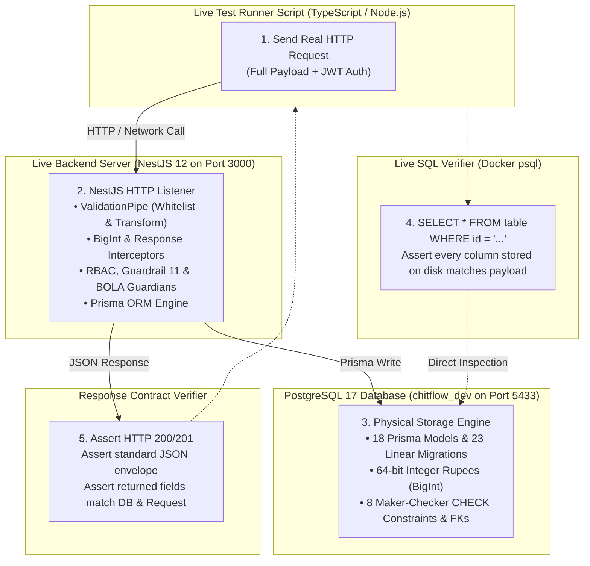

# Master Live Server E2E Verification Plan & Program Audit Reconciliation Ledger

> **Product**: **Kumaran Chits** (Kumaran Finance, Perundurai, Tamil Nadu)  
> **Target**: Live NestJS 12 Server (`http://localhost:3000`) + PostgreSQL 17 (`chitflow_dev` Port `5433`, **18 Prisma models / 23 linear migrations / 8 DB `CHECK` constraints**) + Redis 7 (`:6379`, `noeviction`) + MinIO/R2 S3 (`:9000`)  
> **Historical Baseline**: All **11 Operational Lifecycles** (Oct 2026 **111-operation** HTTP $\to$ SQL $\to$ Response proof run) **100% Passed**.  
> **Current Live API Surface**: **18 NestJS Controllers / 134 Live HTTP & SSE Operations** (`+1` Bull Board UI `/admin/queues`), continuously verified by **63 Jest unit suites (`1,226` tests)**, **14 PostgreSQL 17 E2E suites (`187` tests)**, **26/26 real-PG concurrency invariants**, **376 Web unit tests**, **46 Playwright E2E assertions**, **10 SDK tests**, and **6/6 Dart Core suites**.

---

## 1. Executive Summary & Live Testing Architecture

Unlike isolated mock tests, the live-server verification harness validates real HTTP payloads against a running NestJS 12 process backed by PostgreSQL 17, Redis 7, and S3-compatible storage:

---

## 2. Infrastructure & Server Startup Sequence

1. **Verify Docker Containers**:
   - `chitflow-db`: PostgreSQL 17 on `127.0.0.1:5433` (`chitflow_dev` / `chitflow_test`).
   - `chitflow-redis`: Redis 7 on `127.0.0.1:6379` (`--maxmemory 512mb --maxmemory-policy noeviction` per `KFC-INF-001`).
   - `chitflow-minio`: MinIO S3 on `127.0.0.1:9000` (Bucket: `kumaran-chits-private`).
2. **Start Backend Server**: `pnpm --filter api run start` on `http://localhost:3000`.
3. **Health Check Probing**: Poll `GET http://localhost:3000/health` (plus `/health/readiness` & `/health/liveness`) until HTTP `200` reports PostgreSQL, Redis, and Storage `"up"`.

---

## 3. The 11 Sequential Operational Lifecycles (Oct 2026 111-Operation Baseline + Live Contract Notes)

```mermaid
flowchart LR
    S1["1. Auth, Branches & Users\n(24 Endpoints) ✅"] --> S2["2. Customer, Nominee & KYC\n(11 Endpoints) ✅"]
    S2 --> S3["3. Chit Scheme & Onboarding\n(9 Endpoints) ✅"]
    S3 --> S4["4. In-Office Auction & Tie-Break\n(8 Endpoints) ✅"]
    S4 --> S5["5. Installments & Dues\n(9 Endpoints) ✅"]
    S5 --> S6["6. Field Collections & Handover\n(6 Endpoints) ✅"]
    S6 --> S7["7. Payments & Reversals\n(7 Endpoints) ✅"]
    S7 --> S8["8. Disbursements & Safety Proof\n(9 Endpoints) ✅"]
    S8 --> S9["9. Cash Book & Reports\n(9 Endpoints) ✅"]
    S9 --> S10["10. Storage & Bilingual PDFs\n(5 Endpoints) ✅"]
    S10 --> S11["11. Background Jobs & Ops\n(15 Endpoints) ✅"]
```

### Lifecycle 1: Authentication, 2FA, Branches & Staff User Administration (24 Baseline Steps) — ✅ VERIFIED
- Covers web login (`POST /api/v1/auth/web/login`, now strictly `ADR-18` phone-only `{ phone, password }`), `/me`, `/fcm-token`, `/totp/{setup,enable,disable}`, `/web/verify-totp`, `/mobile/{request-otp,verify-otp,set-mpin,login-mpin}`, `/refresh-token`, `/logout`, `/change-password`, `POST/GET /branches`, and `POST/GET/PATCH /users` + `/reset-password`.
- *Post-Oct-2026 Live Additions (covered by Jest & E2E)*: `POST /api/v1/auth/complete-onboarding` (`F16`), `PATCH /api/v1/branches/:id` (`ISSUE-M2-03`), `Session` vault isolation (`ADR-24`), and `isPartner` Verified Partner governance (`ADR-21`).

### Lifecycle 2: Customer Intake, Nominees & KYC Documents (11 Baseline Steps) — ✅ VERIFIED
- Covers `POST/GET/PATCH /customers`, `/nominees`, `/kyc-status`, `/fcm-token`, `/documents` upload, 15-min presigned URL, and delete.
- *Post-Oct-2026 Live Additions*: `POST /api/v1/customers/:id/documents/confirm` (`HeadObject` check per `DEF-FE-07`), strict `/^[6-9]\d{9}$/` regex, masked 4-digit Aadhaar (`ADR-17`), auto-uppercase PAN, and `COLLECTION_AGENT` upload-only / no-view boundary.

### Lifecycle 3: Chit Scheme Creation, Tickets & Activation (9 Baseline Steps) — ✅ VERIFIED
- Covers `POST /chits/new`, `PATCH /chits/:id`, `POST /chits/onboard-ongoing`, `GET /chits`, `GET /chits/:id`, ticket assign/unassign/list, and `POST /chits/:id/activate`.
- *Post-Oct-2026 Live Additions*: `POST /api/v1/chits/:id/cancel` (`DRAFT -> CANCELLED`), $V \pmod N = 0$ whole-rupee divisibility, and Maker $\ne$ Checker Verified Partner scheme activation (`DEF-M4-01..04`).

### Lifecycle 4: In-Office Auctions, Bidding & Option A Tie-Break (8 Baseline Steps) — ✅ VERIFIED
- Covers `GET /auctions/group/:chitGroupId`, `GET /auctions/:id`, `/eligible-bidders`, `/record-bid`, `/tie-break`, `/finalize`, `/minutes`, and `PATCH /mark-filed-with-registrar`.
- *Post-Oct-2026 Live Additions*: Two-Partner finalized auction correction workflow (`POST /auctions/:id/correction/{request,approve,reject}` per `KFC-FIN-005`/`M9-DUAL-DEF-01`), dynamic frozen commission basis-point math, and `ParseUUIDPipe` across all 12 auction routes.

### Lifecycle 5: Installment Dues & Passbook Ledger (9 Baseline Steps) — ✅ VERIFIED
- Covers monthly dues list/generate, `/tickets/:ticketId/{dues,passbook}`, `/defaulters` (mounted on both `/installments` & `/installment-dues`), defaulter removal, and subscriber substitution.
- *Live Contract Evolution*: Defaulter removal now enforces strict **2-Partner Dual Control** (`POST /tickets/:id/{request-removal,approve-removal,reject-removal}` + DB constraint `chk_ticket_removal_maker_checker` per `ADR-22`), and `POST /tickets/:id/settle-removal` **fails closed (`UNAPPROVED_SETTLEMENT_POLICY`)** awaiting legal/owner confirmation of `Q25`.

### Lifecycle 6: Doorstep Field Collections & Evening Cash Handover (6 Baseline Steps) — ✅ VERIFIED
- Covers `/collections/{agent-dues,record,sync-offline-queue,daily-summary,cash-handover/submit,cash-handover/acknowledge}`.
- *Live Hardening*: Enforces `PRIOR_INSTALLMENT_UNPAID` sequential payment order, strict `(ticketId, installmentMonth)` offline sort, `paymentStatus === SUCCESS` + branch-scoped handover checks, and DB constraint `chk_payment_cash_handover_maker_checker`.

### Lifecycle 7: Office Counter Payments, Direct UPI Claims & Reversals — ✅ VERIFIED
- Covers `POST/GET /payments`, `GET /payments/:id`, `/receipt`, and `POST /payments/:id/{request-reversal,approve-reversal,reject-reversal}`.
- *Post-Oct-2026 Live Additions & Hardening*: Direct NPCI KVB UPI intent (`GET /installments/:dueId/upi-intent`) and dual-control UPI claim verification (`POST /payments/upi-claim`, `POST /payments/:id/verify-upi-claim` per `ADR-19`). All reversal mutations (`request`, `approve`, `reject`) strictly enforce **Verified Partner `SUPER_ADMIN` (`isPartner: true`)** with `maker != checker` (`KFC-SEC-001` + `chk_reversal_maker_checker`).

### Lifecycle 8: Prize Disbursements, Safety Proof & Maturity Settlement — ✅ VERIFIED
- Covers `GET /disbursements`, `/auction/:auctionId`, `upload-safety-proof`, `safety-proof-url`, `verify-safety-proof`, `authorize-payout`, `disburse`, `voucher`, and Month $N$ maturity settlement.
- *Post-Oct-2026 Live Additions*: Two-stage Maker–Checker Month $N$ settlement (`POST /disbursements/group/:chitGroupId/{prepare-final-settlement,approve-final-settlement}` per `FIN-B`), automatic unpaid arrears offset with release TOCTOU check (`FIN-A`/`FIN-D`), `PAYOUT_OVERRIDE_NOT_PERMITTED` (`KFC-FIN-004`), and `assertNoPendingAuctionCorrection` lock.

### Lifecycle 9: Form XXII Cash Book & Statutory Reports (9 Endpoints) — ✅ VERIFIED
- Covers `dashboard`, `pending-approvals`, `approvals-stream` (`@BypassEnvelope()` SSE), `day-book`, `form-xxii` ($\text{Closing} = \text{Opening} + \text{In} - \text{Out}$ with cash reversals & `cashHandoverAcknowledgedAt`), `form-xvii`, `form-xxi`, `defaulters`, and **`SUPER_ADMIN`-only `audit-logs`** (`Guardrail 11`).

### Lifecycle 10: Private Storage & Bilingual PDF Canvas (5 Endpoints) — ✅ VERIFIED
- Covers `GET /storage/file/*key` (and `POST /storage/presign-upload` / `upload/*`) plus bilingual A5 Receipt, Payout Voucher, Form XVII, and Form XXI PDFs (`ParseUUIDPipe`, `SAFE_PDF_CUSTOMER_SELECT`, `Cache-Control: private, no-store`, `X-Content-Type-Options: nosniff`).

### Lifecycle 11: Background Jobs, Queues & Observability (15 Baseline Steps) — ✅ VERIFIED
- Covers all 9 `JobsController` routes (`queue-status`, `repeatable-schedules`, `notification-audit-logs` strictly **`SUPER_ADMIN`-only** per Guardrail 11; plus 6 manual triggers), Bull Board `/admin/queues` (`F11` Super Admin JWT primary), `/health`, `/health/{readiness,liveness,sentry-test}`, `/metrics` (`MetricsAuthGuard` constant-time Bearer/Basic Auth), and `/`.

---

## 4. Archived Lifecycle Proof Reports (`apps/api/scripts/docs/lifecycle/`)

All 11 Oct 2026 live-server proof logs are archived under [`apps/api/scripts/docs/lifecycle/`](lifecycle/):
- [`lifecycle-1`](lifecycle/lifecycle-1-live-execution-proof-report.md) (24/24) · [`lifecycle-2`](lifecycle/lifecycle-2-live-execution-proof-report.md) (11/11) · [`lifecycle-3`](lifecycle/lifecycle-3-live-execution-proof-report.md) (9/9) · [`lifecycle-4`](lifecycle/lifecycle-4-live-execution-proof-report.md) (8/8) · [`lifecycle-5`](lifecycle/lifecycle-5-live-execution-proof-report.md) (9/9) · [`lifecycle-6`](lifecycle/lifecycle-6-live-execution-proof-report.md) (6/6) · [`lifecycle-7`](lifecycle/lifecycle-7-live-execution-proof-report.md) (8/8) · [`lifecycle-8`](lifecycle/lifecycle-8-live-execution-proof-report.md) (8/8) · [`lifecycle-9`](lifecycle/lifecycle-9-live-execution-proof-report.md) (9/9) · [`lifecycle-10`](lifecycle/lifecycle-10-live-execution-proof-report.md) (5/5) · [`lifecycle-11`](lifecycle/lifecycle-11-live-execution-proof-report.md) (15/15).

---

## 5. Master Audit Verification, Remediation Closure & Reconciliation Register

This register consolidates the final, reconciled status across all 34 business rules, all remediation tracks (`KFC-*`, `F01–F16`, Modules 1–10), and the independent discrepancy investigation:

### 5.1 Reconciliation of All 34 Confirmed Business Rules
| Category | Count | Current Verified Status |
|---|:---:|---|
| **Fully Implemented & Automated-Test Verified (`MATCH / TESTED`)** | **28** | Enforced across PostgreSQL 17, NestJS 12, Next.js 15, `@kumaran/api-client`, and Dart Core (all 11 Architectural Guardrails, whole-rupee `BigInt`, 4% frozen commission, universal dividends, 1/4 ceiling & Option A tie-break, Month 1/$N$ rules, discrete payments, sequential receipts, arrears offset, safety proof checklist, 8 DB `CHECK` constraints, `isPartner: true`, bilingual EN/TA receipts/PDFs, zero WhatsApp). |
| **Software Complete — Pending Live Production External Credentials (`PARTIAL / OPS`)** | **3** | Live MSG91 TRAI DLT production credentials (`KMRCHT`), live Cloudflare R2/S3 production bucket keys, and live KVB corporate UPI bank reconciliation operations on go-live VPS. |
| **Intentionally Fail-Closed Pending Business Owner / Legal Sign-Off (`BLOCKED`)** | **2** | `Q19` (unclaimed prize money statutory bank deposit automation) and `Q25` (early subscriber exit settlement deduction policy — `settle-removal` fails closed with `UNAPPROVED_SETTLEMENT_POLICY`). |
| **Authoritatively Deferred to Phase 2 (`DEFERRED — Q2 2027`)** | **1** | Flutter Android mobile UI screens, APK packaging, and live FCM push rollout (`ADR-26`); Dart Client Core (`apps/mobile/lib/core/`) is built and passing 6/6 suites. |

### 5.2 Master Remediation Closure Register (Zero Open Code Defects)
- **Financial Closures (`KFC-FIN-001`–`005`, `FIN-A`–`FIN-E`)**: Month $N$ direct two-stage settlement without double-collection (`FIN-B`), exact whole-rupee dividend divisibility (`KFC-FIN-002`), automatic arrears offset & release TOCTOU protection (`FIN-A`/`FIN-D`/`KFC-FIN-003`), strict `PAYOUT_OVERRIDE_NOT_PERMITTED` (`KFC-FIN-004`), and two-partner finalized auction correction with downstream unpaid due reconciliation (`KFC-FIN-005`/`FIN-E`).
- **Security & RBAC Closures (`KFC-SEC-001`–`004`, `F01`–`F16`)**: Verified Partner-only reversal Maker & Checker (`KFC-SEC-001`), Partner-only defaulter removal & substitution with `chk_ticket_removal_maker_checker` (`KFC-SEC-002`), `SUPER_ADMIN`-only Audit Logs & BullMQ telemetry (`ADR-21`), multi-device `Session` vault (`ADR-24`), atomic Lua OTP (`F13`), single-flight mobile refresh (`F14`/`DEF-MOB-01`), SSE mid-flight session/branch guard (`F15`), and `complete-onboarding` (`F16`).
- **PDF, Notification & Infra Closures (`KFC-PDF-001`, `KFC-NOT-001`, `KFC-INF-001`)**: Statutory bilingual cancelled-receipt watermark (`ரத்து செய்யப்பட்டது / CANCELLED` at `-35deg`, `#DC2626`) + banner (`KFC-PDF-001`), complete purge of WhatsApp Business API references (`KFC-NOT-001` / `Q34`), and Redis `--maxmemory 512mb --maxmemory-policy noeviction` (`KFC-INF-001`).
- **All 10 Module Forensic Audits (`Modules 1–10`)**: 100% remediated and verified across API, Web, SDK, Dart Core, and PostgreSQL 17 with **zero open code defects**.

### 5.3 Independent Discrepancy Verdict: Software Readiness vs Live Production Prerequisites
The independent source-code verification confirmed **100% software readiness** across every executable gate (`1,226` API unit tests across `63` suites · `187` API E2E tests across `14` suites · `26/26` real-PG concurrency invariants · `376` Web native Node unit tests across `52` spec files · `46` Playwright E2E assertions / `84` visual crawls · `10/10` `@kumaran/api-client` tests · `6/6` Dart Core suites + `0` `tsc`/`dart analyze` errors), while maintaining an honest separation from **deployment-day operational prerequisites**:
1. Flat-fee Linux VPS provisioning, `chmod 600 .env`, strong $\ge 32$-char `JWT_SECRET` shared across `api`/`worker`/`web`, and non-default `BULL_BOARD_PASSWORD`/`METRICS_PASSWORD`/`METRICS_BEARER_TOKEN`.
2. Live Cloudflare R2 / S3 credentials, live MSG91 TRAI DLT credentials, TLS certificates (`certbot`), and loopback-only DB/Redis port bindings (`127.0.0.1`).
3. Honest DRP operating envelope (`RPO <= 24h`, `RTO <= 60m`, nightly `pg_dump -F c` non-PITR baseline, 8-year Chit Funds Act §45 retention, and mandatory dual-partner sign-off before running CLI `pg_restore`).
