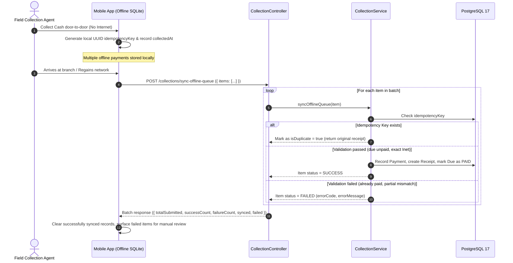

# Collection & Cash Handover Module (`apps/api/src/collection`)

## 1. Overview
The **Collection & Cash Handover** module handles doorstep field collections and counter collections for **Kumaran Chits** (Perundurai, Erode). Designed specifically for rural Tamil Nadu operating realities where collection agents travel door-to-door in areas with intermittent or absent network coverage, it enforces strict financial invariants, sequential bilingual receipting, offline queue synchronization, and dual-control vault handovers.

---

## 2. Core Architectural Invariants

| Guardrail | Invariant Rule | Implementation |
|---|---|---|
| **Exact $I_{net}$ Matching** | Collection must identically match $I_{net} = I_{base} - Div$ | Rejects with `PARTIAL_PAYMENTS_NOT_ALLOWED` if amount $\ne$ `due.netPayableAmount` |
| **Zero Double Payments** | Installment cannot be paid twice | Rejects with `INSTALLMENT_ALREADY_PAID` if `due.status === PAID` |
| **Zero Float / Whole Rupee Math** | All currency stored in integer rupees | Native TypeScript `bigint` & Prisma `BigInt` |
| **Idempotency Deduplication** | Safe retry without duplicate receipts | Unique `idempotencyKey` UUID per transaction |
| **Dual-Control Vault Handover** | Agent cannot acknowledge their own cash | Strict validation: `collectorUserId != acknowledgerUserId` |

---

## 3. Endpoints Matrix

| HTTP Method | Route | Description | Authorized Roles |
|---|---|---|---|
| `GET` | `/collections/agent-dues` | Fetch pending/overdue subscriber dues for field collection rounds | `COLLECTION_AGENT`, `ACCOUNTANT`, `BRANCH_MANAGER`, `SUPER_ADMIN`, `AUDITOR` |
| `POST` | `/collections/record` | Record single real-time collection with exact $I_{net}$ check | `COLLECTION_AGENT`, `ACCOUNTANT`, `BRANCH_MANAGER`, `SUPER_ADMIN` |
| `POST` | `/collections/sync-offline-queue` | Batch sync offline queued collections with partial failure isolation | `COLLECTION_AGENT`, `ACCOUNTANT`, `BRANCH_MANAGER`, `SUPER_ADMIN` |
| `GET` | `/collections/daily-summary` | Summary of today's collections, cash pending handover, and digital payments | `COLLECTION_AGENT` (own only), `ACCOUNTANT`, `BRANCH_MANAGER`, `SUPER_ADMIN`, `AUDITOR` |
| `POST` | `/collections/cash-handover/submit` | Submit evening cash collection batch for vault deposit (Maker step) | `COLLECTION_AGENT`, `SUPER_ADMIN` |
| `POST` | `/collections/cash-handover/acknowledge` | Acknowledge physical cash deposit into vault (Checker step) | `BRANCH_MANAGER`, `ACCOUNTANT`, `SUPER_ADMIN` (`collector != acknowledger`) |

---

## 4. Batch Offline Queue Synchronization Protocol

### Workflow


### Request Payload (`SyncOfflineQueueDto`)
```json
{
  "items": [
    {
      "idempotencyKey": "a92e1041-3b7c-47bc-8f69-7c8bb172ad91",
      "ticketId": "f78d910b-6072-45e0-8fa3-d34e62817812",
      "installmentMonth": 4,
      "amount": 3950,
      "paymentMethod": "CASH",
      "collectedAt": "2026-10-21T09:45:00.000Z",
      "transactionRef": null
    }
  ]
}
```

### Response Payload (`SyncOfflineQueueResponse`)
```json
{
  "totalSubmitted": 2,
  "successCount": 1,
  "failureCount": 1,
  "synced": [
    {
      "idempotencyKey": "a92e1041-3b7c-47bc-8f69-7c8bb172ad91",
      "paymentId": "pmt-7711",
      "receiptNumber": "KC-REC-PRD-2026-00125",
      "amount": "3950",
      "status": "SUCCESS",
      "isDuplicate": false,
      "collectedAt": "2026-10-21T09:45:00.000Z"
    }
  ],
  "failed": [
    {
      "idempotencyKey": "b18f2190-2c8d-4912-9c10-09a8b1112233",
      "ticketId": "e55d881a-1122-3344-5566-778899aabbcc",
      "installmentMonth": 4,
      "amount": 3950,
      "errorCode": "INSTALLMENT_ALREADY_PAID",
      "errorMessage": "INSTALLMENT_ALREADY_PAID: Month 4 installment has already been paid in full"
    }
  ]
}
```

### Error Code Reference
| Error Code | Cause | Resolution |
|---|---|---|
| `INSTALLMENT_ALREADY_PAID` | Due was already paid at the branch counter or online | Inform subscriber that installment is settled; initiate field cash return |
| `PARTIAL_PAYMENTS_NOT_ALLOWED` | Amount collected does not match net installment | Check passbook / dividend calculation |
| `TICKET_NOT_FOUND` | Ticket UUID is invalid or deleted | Verify subscriber record |
| `CHIT_NOT_ACTIVE` | Chit group is completed, terminated, or not yet started | Verify group status |
| `TICKET_REMOVED` | Subscriber ticket was removed due to 3 consecutive months of arrears | Follow defaulting subscriber settlement SOP |
| `DUE_NOT_FOUND` | Installment due has not been generated for the target month | Generate monthly dues |

---

## 5. Sequential Bilingual Receipt Numbering
Receipts follow the mandated format:
$$\text{KC-REC-}\{\text{BranchCode}\}\text{-}\{\text{YYYY}\}\text{-}\{\text{Sequence: 5 digits}\}$$
Example: `KC-REC-PRD-2026-00045`.
Every collection immediately issues a receipt record linked to the discrete `Payment` and `PaymentAllocation`.

---

## 6. Dual-Control Cash Handover Protocol
1. **Evening Handover (`POST /collections/cash-handover/submit`)**:
   - Field collection agent aggregates all cash marked `PENDING_HANDOVER`.
   - Submits handover batch at the end of the day.
2. **Vault Deposit Verification (`POST /collections/cash-handover/acknowledge`)**:
   - Authorized checker (Super Admin, Branch Manager, or Accountant) physically counts currency notes.
   - Strictly validates `collectorUserId != acknowledgerUserId`.
   - Verifies counted amount matches the exact sum of payments.
   - Status transitions from `PENDING_HANDOVER` to `ACKNOWLEDGED`.
