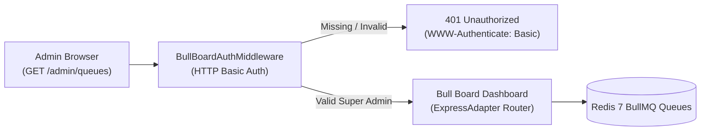

# Bull Board Background Queue Monitor

> **Package**: `@bull-board/api` & `@bull-board/express`  
> **Route**: `/admin/queues` (HTTP Basic Auth)  
> **Access Level**: `SUPER_ADMIN` (The 4 Partners)  
> **Compliance**: [`docs/01-business/permissions-matrix.md`](../../../../../docs/01-business/permissions-matrix.md) §1 & §2, [`docs/03-architecture/completed-modules-api-registry.md`](../../../../../docs/03-architecture/completed-modules-api-registry.md) §13  

---

## 1. Overview

The Bull Board Queue Monitor provides a visual web interface mounted at `/admin/queues` to inspect, manage, and monitor the three core BullMQ background queues powering Kumaran Chits:

1. **`daily-maintenance-queue`**:
   - Executes daily midnight overdue installment recalculation.
   - Tags 3-month consecutive defaulters for company removal rights per ADR-07.
2. **`notification-queue`**:
   - Dispatches Indian Telecom DLT SMS and WhatsApp Business bilingual receipts.
   - Broadcasts upcoming monthly auction reminders.
   - Sends default warning notices to subscribers entering arrears.
3. **`reconciliation-queue`**:
   - Executes the daily 06:00 AM payment settlement reconciliation.
   - Detects and auto-resolves payment gateway ghost drops.

---

## 2. Security & Authentication Architecture

In strict adherence to the **Maker-Checker & Super Admin access governance** mandated in [`docs/01-business/permissions-matrix.md`](../../../../../docs/01-business/permissions-matrix.md), access to `/admin/queues` is restricted to authorized company administrators:



### Authentication Credentials
- **Mechanism**: Native HTTP Basic Authentication (supported natively by all modern web browsers without requiring a custom login frontend).
- **Environment Variables**:
  - `BULL_BOARD_USER`: Username (defaults to `admin`).
  - `BULL_BOARD_PASSWORD`: Secure administrative password (defaults to `chitflow_secret` in development).

---

## 3. Ingress Reverse Proxy Configuration

When running through the production Nginx reverse proxy, `/admin/queues` is configured with WebSocket and SSE support in [`infra/docker/nginx/conf.d/chitflow.conf`](../../../../../infra/docker/nginx/conf.d/chitflow.conf):

```nginx
location /admin/queues {
    proxy_pass http://api_upstream/admin/queues;
    proxy_http_version 1.1;
    proxy_set_header Upgrade $http_upgrade;
    proxy_set_header Connection 'upgrade';
    proxy_set_header Host $host;
    proxy_set_header X-Real-IP $remote_addr;
    proxy_set_header X-Forwarded-For $proxy_add_x_forwarded_for;
    proxy_set_header X-Forwarded-Proto $scheme;
    proxy_cache_bypass $http_upgrade;
}
```

---

## 4. Key Administrative Capabilities

Inside the dashboard, Super Admins can:
1. **View Real-Time Counters**: Inspect active, waiting, completed, delayed, and failed job counts across all 3 queues.
2. **Inspect Job Data & Payloads**: Click into any job to view input parameters, execution start time, duration, and worker logs.
3. **Retry Failed Jobs**: One-click manual retry for failed notifications or gateway reconciliations.
4. **Purge Completed / Failed Jobs**: Clean up historical jobs to maintain clean Redis memory utilization.

---

## 5. Automated Test Verification

The Bull Board subsystem is verified by automated test suites in [`apps/api/test/bull-board.spec.ts`](../../../test/bull-board.spec.ts):
- Rejects unauthenticated requests with `401 Unauthorized`.
- Rejects invalid passwords with `401 Unauthorized`.
- Authorizes valid Super Admin credentials.
- Binds active BullMQ queues cleanly in both connected and offline fallback modes.
