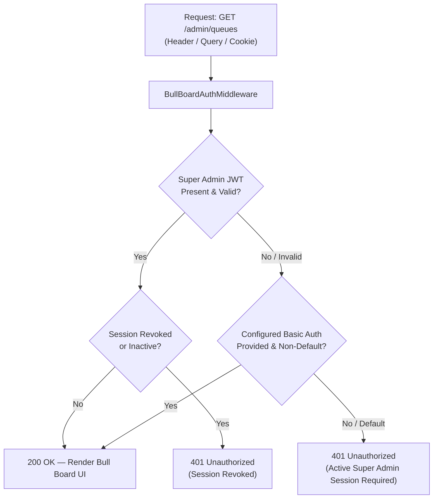

# Bull Board Background Queue Monitor

> **Package**: `@bull-board/api` & `@bull-board/express`  
> **Route**: `/admin/queues` (Super Admin JWT Session Primary / Non-Default HTTP Basic Auth Secondary)  
> **Access Level**: `SUPER_ADMIN` strictly (Guardrail 11 / `ADR-21`)  
> **Broker Safety (`KFC-INF-001`)**: Redis 7 pinned to `--maxmemory 512mb --maxmemory-policy noeviction`  
> **Compliance**: [`docs/01-business/permissions-matrix.md`](../../../../../docs/01-business/permissions-matrix.md) §1 & §2, [`docs/03-architecture/security-and-access-guardians.md`](../../../../../docs/03-architecture/security-and-access-guardians.md) §7.10 (`F11`)

---

## 1. Overview

The Bull Board Queue Monitor provides a visual web interface mounted at `/admin/queues` to inspect, retry, and monitor the three BullMQ background queues powering Kumaran Chits:

1. **`daily-maintenance-queue`**:
   - Executes daily `00:01 AM IST` overdue installment recalculation via canonical `arrears.util.ts`.
   - Tags 3-month consecutive defaulters (`DEFAULT_3_MONTHS`) for company removal rights per `ADR-07`.
2. **`notification-queue`**:
   - Pre-renders bilingual A5 receipt PDFs to private S3/R2 (`XR-M8-PAY-01`) and dispatches Phase 1 bilingual **MSG91 TRAI DLT SMS** (`KMRCHT`; zero WhatsApp per `Q34`; Android FCM Push activates in Phase 2 Q2 2027 per `ADR-23` / `ADR-26`).
   - Broadcasts upcoming monthly auction reminders, finalized auction results, default warnings, and Maker–Checker approval alerts.
3. **`reconciliation-queue`**:
   - Executes daily `06:00 AM IST` direct Karur Vysya Bank (KVB) UPI claim & pending receipt settlement reconciliation (`ADR-19`; zero third-party payment gateway).

---

## 2. Security & Authentication Architecture

In strict adherence to Guardrail 11 (`ADR-21`) and security remediation **`F11`**, access to `/admin/queues` is restricted strictly to active `SUPER_ADMIN` identities via `BullBoardAuthMiddleware`:



### Authentication Mechanisms
1. **Primary Authentication (Super Admin JWT Session)**:
   - Validates active `Role.SUPER_ADMIN` access tokens (`tokenType === 'access'`) delivered via `Authorization: Bearer <token>`, query param `?token=<token>`, or browser cookies (`access_token` or `jwt`).
   - Asserts real-time database `user.isActive` / `tokenRevokedBefore` and fast-path Redis revocation cutoffs (`auth:revoked:${sub}`). Non-Super Admin roles receive `403 Forbidden`.
2. **Secondary Fallback (HTTP Basic Auth)**:
   - Evaluated ONLY if explicitly configured with strong, non-default credentials via `BULL_BOARD_USER` and `BULL_BOARD_PASSWORD`.
   - The insecure default password `chitflow_secret` is permanently rejected across all environments under `F11`.

---

## 3. Ingress Reverse Proxy Configuration

In production, `/admin/queues` is proxied with WebSocket upgrade and request tracing headers in [`infra/docker/nginx/conf.d/chitflow.conf`](../../../../../infra/docker/nginx/conf.d/chitflow.conf):

```nginx
location /admin/queues {
    proxy_pass http://api_upstream/admin/queues;
    proxy_http_version 1.1;
    proxy_set_header Upgrade $http_upgrade;
    proxy_set_header Connection 'upgrade';
    proxy_set_header Host $host;
    proxy_set_header X-Real-IP $remote_addr;
    proxy_set_header X-Forwarded-For $proxy_add_x_forwarded_for;
    proxy_set_header X-Forwarded-Proto $scheme;
    proxy_set_header X-Forwarded-Host $http_host;
    proxy_set_header X-Request-ID $request_id;
    proxy_cache_bypass $http_upgrade;
}
```

---

## 4. Key Administrative Capabilities

Inside the dashboard, Super Admins can:
1. **View Real-Time Counters**: Inspect active, waiting, completed, delayed, and failed job counts across all 3 queues.
2. **Inspect Job Data & Payloads**: View input parameters, execution start time, duration, and worker logs.
3. **Retry Failed Jobs**: One-click manual retry for failed notifications or settlement reconciliations. Failed jobs are bounded automatically via `removeOnFail: { count: 500, age: 604800 }` (500 jobs / 7 days per queue) so DLQ entries remain actionable under Redis `noeviction`.
4. **Purge Completed / Failed Jobs**: Clean up historical jobs alongside automatic completion cleanup (`removeOnComplete: true`).

---

## 5. Automated Test Verification

Verified by **7 automated Jest unit tests** in [`apps/api/test/unit/bull-board.spec.ts`](../../../test/unit/bull-board.spec.ts):
- Rejects unauthenticated requests and default `chitflow_secret` Basic Auth with `401 Unauthorized`.
- Rejects non-`SUPER_ADMIN` JWTs with `403 Forbidden` and revoked sessions with `401 Unauthorized`.
- Authorizes valid active `SUPER_ADMIN` JWT sessions and explicitly configured non-default Basic credentials.
- Binds all 3 BullMQ queues cleanly in connected and offline fallback modes.

```bash
pnpm --filter api test -- test/unit/bull-board.spec.ts
```
