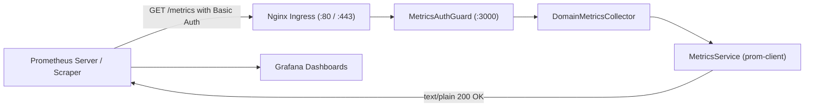

# Kumaran Chits — Prometheus Metrics Exporter (`/metrics`)

> **Product**: **Kumaran Chits** (Kumaran Finance, Perundurai, Tamil Nadu)  
> **Location**: `apps/api/src/metrics/`  
> **Compliance Reference**: [`docs/02-requirements/non-functional-requirements.md`](../../../docs/02-requirements/non-functional-requirements.md) §3

---

## 1. Overview & Architecture

The **Prometheus Metrics Exporter** provides real-time operational telemetry for Kumaran Finance's operations, collecting:
1. **HTTP Request Latencies & Counters**: Measuring API performance against NFR §3 targets ($p95 \le 200\text{ ms}$ for reads, $\le 500\text{ ms}$ for financial writes).
2. **PostgreSQL Database Health**: Connection status and query performance.
3. **BullMQ Background Queue Telemetry**: Tracking jobs across `daily-maintenance-queue`, `notification-queue`, and `reconciliation-queue`.
4. **Chit Fund Domain Invariants & KPIs**: Active schemes, active subscribers, overdue defaulter buckets, pending Maker-Checker approvals, and today's total collection volume in whole Rupees (`BigInt`).



---

## 2. Exported Metric Catalog

### A. HTTP Request & Latency Metrics
| Metric Name | Type | Labels | Description |
|---|---|---|---|
| `http_requests_total` | Counter | `method`, `route`, `status_code` | Total HTTP requests processed by endpoint. |
| `http_request_duration_seconds` | Histogram | `method`, `route`, `status_code` | Latency distribution with buckets: `[0.01, 0.05, 0.1, 0.2, 0.5, 1.0, 2.0, 5.0]`. |

### B. Database & Infrastructure Metrics
| Metric Name | Type | Labels | Description |
|---|---|---|---|
| `chitflow_db_connected` | Gauge | — | `1` = PostgreSQL connected & healthy; `0` = unreachable. |
| `chitflow_db_query_duration_seconds` | Histogram | `model`, `action` | Database query execution time in seconds. |

### C. BullMQ Queue Telemetry
| Metric Name | Type | Labels | Description |
|---|---|---|---|
| `bullmq_queue_jobs_count` | Gauge | `queue`, `status` | Job count per queue (`daily-maintenance-queue`, `notification-queue`, `reconciliation-queue`) and state (`waiting`, `active`, `completed`, `failed`, `delayed`). |

### D. Chit Fund Business Domain KPIs
| Metric Name | Type | Labels | Description |
|---|---|---|---|
| `chitflow_active_chit_groups_total` | Gauge | — | Total count of registered & running chit groups. |
| `chitflow_active_subscribers_total` | Gauge | — | Total count of active subscriber tickets. |
| `chitflow_defaulter_tickets_count` | Gauge | `bucket` | Count of overdue subscribers in `1_MONTH` or `3_MONTH_REMOVAL` buckets. |
| `chitflow_maker_checker_pending_count` | Gauge | `type` | Pending dual-control tasks (`PAYMENT_REVERSAL`, `PRIZE_DISBURSEMENT`). |
| `chitflow_daily_collected_amount_rupees` | Gauge | — | Total collection volume recorded today in whole integer Rupees (`BigInt`). |

### E. Standard V8 & Process Metrics
Standard Node.js process metrics with prefix `nodejs_` (e.g., `nodejs_heap_size_used_bytes`, `nodejs_eventloop_lag_seconds`, `nodejs_version_info`).

---

## 3. Security & HTTP Basic Authentication

To prevent public leakage of financial collection volumes and internal operational stats, `/metrics` is strictly protected by **HTTP Basic Authentication**:

- **Environment Variables**:
  - `METRICS_USER` (Default fallback: `BULL_BOARD_USER` or `admin`)
  - `METRICS_PASSWORD` (Default fallback: `BULL_BOARD_PASSWORD` or `chitflow_secret`)
- **Scrape Header**: `Authorization: Basic <base64(user:password)>`
- Unauthenticated requests receive `401 Unauthorized` with `WWW-Authenticate: Basic realm="Prometheus Metrics"`.

---

## 4. Prometheus Server Configuration (`prometheus.yml`)

Configure your Prometheus instance to scrape Kumaran Chits:

```yaml
scrape_configs:
  - job_name: 'kumaran-chits-api'
    scrape_interval: 15s
    scrape_timeout: 10s
    metrics_path: '/metrics'
    basic_auth:
      username: 'admin'
      password: 'chitflow_secret'
    static_configs:
      - targets: ['api:3000']
```

---

## 5. Recommended PromQL Queries for Grafana

### 1. 95th Percentile Read Latency (NFR §3 Target: $\le 200\text{ ms}$):
```promql
histogram_quantile(0.95, sum(rate(http_request_duration_seconds_bucket{method="GET"}[5m])) by (le))
```

### 2. 95th Percentile Financial Mutation Latency (NFR §3 Target: $\le 500\text{ ms}$):
```promql
histogram_quantile(0.95, sum(rate(http_request_duration_seconds_bucket{method=~"POST|PUT|PATCH"}[5m])) by (le))
```

### 3. Total Request Rate per Second:
```promql
sum(rate(http_requests_total[1m])) by (status_code)
```

### 4. Failed Background Queue Jobs:
```promql
sum(bullmq_queue_jobs_count{status="failed"}) by (queue)
```

### 5. Pending Maker-Checker Approvals:
```promql
chitflow_maker_checker_pending_count
```
