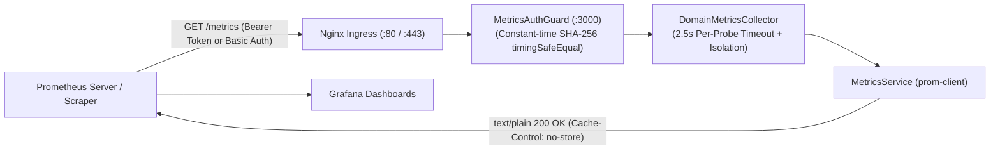

# Kumaran Chits — Prometheus Metrics Exporter (`/metrics`)

> **Product**: **Kumaran Chits** (Kumaran Finance, Perundurai, Tamil Nadu)  
> **Location**: `apps/api/src/metrics/`  
> **Compliance Reference**: [`docs/02-requirements/non-functional-requirements.md`](../../../../docs/02-requirements/non-functional-requirements.md) §3

---

## 1. Overview & Architecture

The **Prometheus Metrics Exporter** provides real-time operational telemetry for Kumaran Finance's operations, collecting:
1. **HTTP Request Latencies & Counters**: Measuring API performance against NFR §3 targets ($p95 \le 200\text{ ms}$ for reads, $\le 500\text{ ms}$ for financial writes) with cardinality protection and accurate error-status capture.
2. **PostgreSQL Database Health**: Non-blocking bounded-timeout (`2500ms`) connection probe and query performance histogram.
3. **BullMQ Background Queue Telemetry**: Tracking jobs across `daily-maintenance-queue`, `notification-queue`, and `reconciliation-queue` with per-queue error isolation.
4. **Chit Fund Domain Invariants & KPIs**: Active schemes, active subscribers, overdue defaulter buckets, pending Maker-Checker approvals (`PAYMENT_REVERSAL`, `PRIZE_DISBURSEMENT` across `PENDING_VERIFICATION` & `VERIFIED_BY_MAKER`), and today's IST (`Asia/Kolkata`) total collection volume in whole Rupees (`BigInt` with safe gauge clamping).



---

## 2. Exported Metric Catalog

### A. HTTP Request & Latency Metrics
| Metric Name | Type | Labels | Description |
|---|---|---|---|
| `http_requests_total` | Counter | `method`, `route`, `status_code` | Total HTTP requests processed by normalized endpoint and actual HTTP status (including controller exceptions). |
| `http_request_duration_seconds` | Histogram | `method`, `route`, `status_code` | Latency distribution with buckets: `[0.01, 0.05, 0.1, 0.2, 0.5, 1.0, 2.0, 5.0]`. |

### B. Database & Infrastructure Metrics
| Metric Name | Type | Labels | Description |
|---|---|---|---|
| `chitflow_db_connected` | Gauge | — | `1` = PostgreSQL connected & healthy within 2.5s probe timeout; `0` = unreachable or timed out. |
| `chitflow_db_query_duration_seconds` | Histogram | `model`, `action` | Database query execution time in seconds (registered for query instrumentation). |

### C. BullMQ Queue Telemetry
| Metric Name | Type | Labels | Description |
|---|---|---|---|
| `bullmq_queue_jobs_count` | Gauge | `queue`, `status` | Job count per queue (`daily-maintenance-queue`, `notification-queue`, `reconciliation-queue`) and state (`waiting`, `active`, `completed`, `failed`, `delayed`). |

### D. Chit Fund Business Domain KPIs
| Metric Name | Type | Labels | Description |
|---|---|---|---|
| `chitflow_active_chit_groups_total` | Gauge | — | Total count of active chit groups (`status: 'ACTIVE'`). |
| `chitflow_active_subscribers_total` | Gauge | — | Total count of active subscriber tickets (`status: 'ACTIVE'`). |
| `chitflow_defaulter_tickets_count` | Gauge | `bucket` | Count of active (non-removed) subscriber tickets by consecutive unpaid months (`1_MONTH`: `consecutiveUnpaidMonths = 1`; `3_MONTH_REMOVAL`: `consecutiveUnpaidMonths >= 3`). |
| `chitflow_maker_checker_pending_count` | Gauge | `type` | Pending dual-control tasks (`PAYMENT_REVERSAL` in `REQUESTED`; `PRIZE_DISBURSEMENT` covering finalized-auction `PENDING_VERIFICATION`/`VERIFIED_BY_MAKER` plus Month N prepared settlements). |
| `chitflow_daily_collected_amount_rupees` | Gauge | — | Total `SUCCESS` collection volume recorded since IST midnight (`UTC+05:30`) in whole integer Rupees (`BigInt`, safely clamped to `[0, Number.MAX_SAFE_INTEGER]`). |

### E. Standard V8 & Process Metrics
Standard Node.js process metrics with prefix `nodejs_` (e.g., `nodejs_heap_size_used_bytes`, `nodejs_eventloop_lag_seconds`, `nodejs_version_info`).

### F. External Third-Party & Telecom Telemetry
| Metric Name | Type | Labels | Description |
|---|---|---|---|
| `kumaran_sms_dispatches_total` | Counter | `provider`, `template`, `status` | Dispatches categorized by telecom gateway, TRAI DLT template, and outcome (`success`, `fallback_success`, `circuit_open`, `failure`, `bypassed`). |
| `kumaran_sms_circuit_breaker_state` | Gauge | `provider` | Gateway circuit breaker health (`0 = CLOSED`, `1 = HALF_OPEN`, `2 = OPEN`). |

---

## 3. Security, Cardinality Protection & Non-Blocking Isolation

### 3.1 Constant-Time Authentication (`MetricsAuthGuard`)
To prevent public leakage of financial collection volumes and internal operational stats, `/metrics` is strictly protected using constant-time `crypto.timingSafeEqual` over SHA-256 digests (eliminating timing and length-oracle attacks):

- **Mode 1 — Bearer Token (`METRICS_BEARER_TOKEN`)**:
  - Header: `Authorization: Bearer <METRICS_BEARER_TOKEN>`
  - Strictly fail-closed: if `METRICS_BEARER_TOKEN` is unset, any Bearer request returns `401 Unauthorized`.
- **Mode 2 — HTTP Basic Auth (`METRICS_USER` / `METRICS_PASSWORD`)**:
  - Environment Variables: `METRICS_USER` (fallback: `BULL_BOARD_USER` or dev-only `admin`), `METRICS_PASSWORD` (fallback: `BULL_BOARD_PASSWORD` or dev-only `chitflow_secret`).
  - Header: `Authorization: Basic <base64(user:password)>` (RFC 7617 compliant: supports `:` inside passwords).
- **Strict-by-Default Fail-Closed Invariant**:
  - Every environment EXCEPT explicit `NODE_ENV=development` or `NODE_ENV=test` (including unset `NODE_ENV`, `production`, `staging`, `prod`, `uat`) is enforced as strict: default credentials (`chitflow_secret`, whitespace-padded or plain) are **never enabled** and rejected with `401 Unauthorized`.
  - Whenever `METRICS_BEARER_TOKEN` is configured (even in `development`/`test`), the dev `admin:chitflow_secret` Basic Auth fallback is strictly disabled.
  - If neither a strong `METRICS_BEARER_TOKEN` nor strong Basic Auth credentials are configured in a strict environment, every scrape fails closed immediately (`Production credentials required`).

### 3.2 Label Cardinality Protection (`HttpMetricsInterceptor`)
- Prefers Express matched route templates (`req.route.path`) to keep label cardinality strictly O(endpoints).
- Collapses unmatched `404` scanner paths to `__unmatched__`.
- Normalizes fallback paths by masking UUIDs, numeric IDs, long hex/opaque tokens, receipt numbers (`:receiptNo`), voucher numbers (`:voucherNo`), customer codes (`:customerCode`), chit group codes (`:groupCode`), and storage wildcard keys (`/storage/file/:key`, `/storage/upload/:key`).
- Enforces a hard upper bound (`200` unique fallback routes; overflow maps to `__other__`) and excludes `/metrics`, `/health`, `/api/docs`, and `/admin/queues` from self-telemetry.

### 3.3 Non-Blocking Resilience
- `HttpMetricsInterceptor` wraps telemetry updates in `try/catch` so metric failures can never disrupt financial HTTP responses.
- `DomainMetricsCollector` isolates every DB, Redis/BullMQ, and domain KPI probe with `Promise.allSettled`, per-probe `2500ms` timeouts (with `clearTimeout` cleanup), and pure-BigInt safe gauge conversion.

---

## 4. Prometheus Server Configuration (`prometheus.yml`)

### Option A: Bearer Token (Recommended)
```yaml
scrape_configs:
  - job_name: 'kumaran-chits-api'
    scrape_interval: 15s
    scrape_timeout: 10s
    metrics_path: '/metrics'
    authorization:
      type: Bearer
      credentials: '${METRICS_BEARER_TOKEN}'
    static_configs:
      - targets: ['api:3000']
```

### Option B: HTTP Basic Auth
```yaml
scrape_configs:
  - job_name: 'kumaran-chits-api'
    scrape_interval: 15s
    scrape_timeout: 10s
    metrics_path: '/metrics'
    basic_auth:
      username: 'admin'
      password: '${PROMETHEUS_METRICS_SCRAPE_SECRET}' # Set in deployment; defaults rejected in prod/staging
    static_configs:
      - targets: ['api:3000']
```

---

## 5. Recommended PromQL Queries for Grafana

### 1. 95th Percentile Read Latency (NFR §3 Target: $\le 200\text{ ms}$):
```promql
histogram_quantile(0.95, sum(rate(http_request_duration_seconds_bucket{method="GET"}[5m])) by (le))
```

### 2. 95th Percentile Financial Mutation Latency (NFR §3 Target: $\le 500\text{ ms}$):
```promql
histogram_quantile(0.95, sum(rate(http_request_duration_seconds_bucket{method=~"POST|PUT|PATCH"}[5m])) by (le))
```

### 3. Total Request Rate per Second:
```promql
sum(rate(http_requests_total[1m])) by (status_code)
```

### 4. Failed Background Queue Jobs:
```promql
sum(bullmq_queue_jobs_count{status="failed"}) by (queue)
```

### 5. Pending Maker-Checker Approvals:
```promql
chitflow_maker_checker_pending_count
```

### 6. SMS Gateway Circuit Breaker Status:
```promql
kumaran_sms_circuit_breaker_state{provider="msg91"}
```

### 7. BullMQ Queue Backlog Alert (> 50 waiting jobs):
```promql
sum(bullmq_queue_jobs_count{status="waiting"}) by (queue) > 50
```

---

## 6. Recommended Prometheus Alertmanager Rules

```yaml
groups:
  - name: kumaran_chits_alerts
    rules:
      - alert: BullMQQueueBacklogHigh
        expr: sum(bullmq_queue_jobs_count{status="waiting"}) by (queue) > 50
        for: 5m
        labels:
          severity: warning
        annotations:
          summary: "BullMQ queue {{ $labels.queue }} backlog exceeds 50 waiting jobs"
          description: "Queue backlog has sustained > 50 waiting jobs for more than 5 minutes. Check worker concurrency or upstream downstream bottlenecks."

      - alert: BullMQQueueJobsFailed
        expr: sum(bullmq_queue_jobs_count{status="failed"}) by (queue) > 0
        for: 1m
        labels:
          severity: critical
        annotations:
          summary: "BullMQ queue {{ $labels.queue }} has failed jobs in DLQ"
          description: "Failed jobs detected. Inspect Bull Board at /admin/queues and trigger manual retry if appropriate."
```
