# Real-Time Maker-Checker Actions & Pending Approvals Stream (`apps/api/src/report`)

## 1. Context & Business Need
In **Kumaran Chits** (Kumaran Finance), strict dual control is an invariant architectural guardrail (Guardrail #10: Maker $\ne$ Checker). Sensitive actions cannot be finalized by a single individual:
1. **Cash Handover**: Field collection agents collect physical cash door-to-door, but only an authorized partner or branch manager (who did not collect the money) can count and sign off the cash into the branch vault (`POST /collections/cash-handover/acknowledge`).
2. **Payment Reversals**: Staff or collection agents initiate a reversal request with a business reason, but only a Super Admin (Partner) can commit the reversal (`POST /payments/:id/approve-reversal`).
3. **Prize Disbursements**: Desk staff verifies the physical safety proof documents (agreements, cheques, promissory notes), but only an authorized Checker can authorize releasing the funds (`POST /auctions/:id/authorize-payout`).

To empower Partners (Super Admin) and Branch Managers to act promptly without navigating between 4 separate screens or repeatedly refreshing browser tabs, this module provides:
- A unified, actionable pending approvals endpoint (`GET /reports/pending-approvals`).
- A real-time Server-Sent Events (SSE) stream (`GET /reports/approvals-stream`) that pushes live counter updates and alerts to the React/Next.js Web Admin Portal and Flutter Mobile App.

---

## 2. API Endpoints

### 2.1 Aggregated Pending Approvals (`GET /reports/pending-approvals`)
- **Route**: `GET /reports/pending-approvals`
- **Query Parameters**: `branchId?: string` (Optional; Super Admin & Auditor only)
- **Authorized Roles**: `SUPER_ADMIN`, `BRANCH_MANAGER`, `ACCOUNTANT`, `AUDITOR`
- **Branch Scoping**:
  - `BRANCH_MANAGER`: Automatically restricted to items belonging to their assigned branch.
  - `SUPER_ADMIN` & `ACCOUNTANT`: Full company-wide visibility across all branches.

#### Response Structure
```json
{
  "summary": {
    "totalPendingCount": 4,
    "cashHandoversCount": 1,
    "disbursementAuthorizationsCount": 1,
    "paymentReversalsCount": 1,
    "safetyProofVerificationsCount": 1,
    "cashHandoversTotalAmount": "7900",
    "disbursementsTotalAmount": "75000",
    "reversalsTotalAmount": "3950"
  },
  "cashHandovers": [
    {
      "collectorId": "collector-uuid-001",
      "collectorName": "K. Senthil",
      "collectorPhone": "9842111111",
      "branchId": "branch-prd-001",
      "totalAmount": "7900",
      "paymentCount": 2,
      "oldestCollectionAt": "2026-10-21T09:00:00.000Z",
      "paymentIds": ["pmt-01", "pmt-02"]
    }
  ],
  "disbursementAuthorizations": [
    {
      "id": "winner-uuid-001",
      "auctionId": "auc-uuid-001",
      "chitGroupCode": "KCA-1L-20M-01",
      "chitGroupName": "Perundurai 1L Scheme",
      "installmentMonth": 4,
      "customerCode": "KC-CUST-00005",
      "customerName": "M. Duraisamy",
      "customerPhone": "9842155555",
      "ticketNumber": 5,
      "netPayableAmount": "75000",
      "disbursementMode": "NEFT",
      "verifiedByUserId": "staff-maker-01",
      "agreementSigned": true,
      "nomineeSigned": true,
      "hasSecurityDoc": true
    }
  ],
  "paymentReversals": [
    {
      "id": "rev-uuid-001",
      "paymentId": "pmt-wrong-001",
      "receiptNumber": "KC-REC-PRD-2026-00010",
      "amount": "3950",
      "customerCode": "KC-CUST-00003",
      "customerName": "Ramasamy K",
      "reason": "Duplicate entry by field agent",
      "notes": "Customer already paid at counter",
      "initiatedByUserId": "agent-maker-01",
      "createdAt": "2026-10-21T08:00:00.000Z"
    }
  ],
  "safetyProofVerifications": [
    {
      "id": "winner-uuid-002",
      "auctionId": "auc-uuid-002",
      "chitGroupCode": "KCA-1L-20M-02",
      "chitGroupName": "Perundurai 1L Scheme 2",
      "installmentMonth": 5,
      "customerCode": "KC-CUST-00008",
      "customerName": "P. Shanmugam",
      "customerPhone": "9842188888",
      "ticketNumber": 8,
      "netPayableAmount": "80000",
      "auctionDate": "2026-10-21T11:00:00.000Z"
    }
  ]
}
```

---

### 2.2 Real-Time Server-Sent Events (SSE) Stream (`GET /reports/approvals-stream`)
- **Route**: `GET /reports/approvals-stream`
- **Protocol**: HTTP/1.1 or HTTP/2 Server-Sent Events (`text/event-stream`)
- **Authorized Roles**: `SUPER_ADMIN`, `BRANCH_MANAGER`, `ACCOUNTANT`, `AUDITOR`
- **Emission Cadence**: Emits an `APPROVALS_UPDATE` event immediately upon connection, and subsequently every 15 seconds.
- **Client Handling (Next.js / Flutter)**:
  ```ts
  const eventSource = new EventSource('/api/reports/approvals-stream', {
    headers: { Authorization: `Bearer ${jwtToken}` }
  });

  eventSource.onmessage = (event) => {
    const payload = JSON.parse(event.data);
    if (payload.type === 'APPROVALS_UPDATE') {
      updateApprovalBadgeCounter(payload.summary.totalPendingCount);
      updateDashboardSummary(payload.summary);
    }
  };
  ```

---

## 3. Maker-Checker Invariant Matrix

```mermaid
flowchart TD
    subgraph Cash Handover Dual Control
        A1[Field Agent collects cash] --> A2[Agent submits handover: PENDING_HANDOVER]
        A2 --> A3{Checker acknowledges into vault}
        A3 -->|collector == acknowledger| A4[Strict 403 Forbidden]
        A3 -->|collector != acknowledger| A5[ACKNOWLEDGED into Vault]
    end

    subgraph Payment Reversal Dual Control
        B1[Staff initiates reversal] --> B2[Reversal Status: REQUESTED]
        B2 --> B3{Checker approves reversal}
        B3 -->|maker == checker| B4[Strict 403 Forbidden]
        B3 -->|maker != checker| B5[Payment REVERSED & Ledgers Adjusted]
    end

    subgraph Prize Disbursement Dual Control
        C1[Staff verifies safety proofs] --> C2[Disbursement Status: VERIFIED_BY_MAKER]
        C2 --> C3{Checker authorizes payout}
        C3 -->|maker == checker| C4[Strict 403 Forbidden]
        C3 -->|maker != checker| C5[AUTHORIZED_BY_CHECKER & Voucher Generated]
    end
```



---

## 4. Verification & Testing
- Unit tests in `apps/api/test/report.spec.ts` verify:
  1. Complete aggregation across all 4 operational approval queues with whole rupee calculations.
  2. Branch scoping restrictions preventing Branch Managers from accessing other branches' pending handovers or payouts.
  3. Clean serialization with integer strings to preserve whole rupee invariant accuracy.
