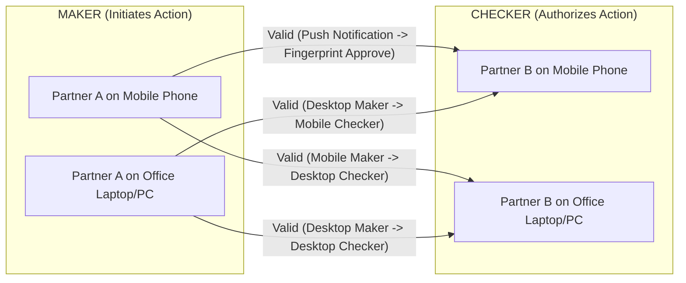

# Kumaran Chits — Role-Based Access Control (RBAC) & Permissions Matrix

> **Product**: **Kumaran Chits**  
> **Company**: **Kumaran Finance**  
> **Status**: Working Specification (`CONFIRMED-BY-DEVELOPER`)  
> **Status Labels Used**: `CONFIRMED-BY-DEVELOPER`, `PROPOSED`, `OPEN`, `UNVERIFIED-LEGAL`  
> **Core Principle**: Least privilege, strict branch scoping, and mandatory separation of duties (maker-checker).

---

## 1. User Groups & Scoping (`CONFIRMED-BY-DEVELOPER`)

The software implements a standardized, industry-standard set of personas. Kumaran Finance currently operates with **4 equal partners** and **2 to 3 field collection agents** (`CONFIRMED-BY-DEVELOPER`). The partners allocate administrative and operational personas among themselves as per company needs, while the software strictly enforces separation of duties.

| Role | Scope | Description | Status |
|---|---|---|---|
| **Super Admin (isPartner: true)** | Global (Company-wide) | **The 4 Equal Partners**. Verified business partners holding legal and financial ownership. Can act as Maker and Checker under strict `maker != checker`. Authorized for auction finalization, payout authorization, reversal approvals, and defaulter removal. | `CONFIRMED-BY-DEVELOPER` |
| **Super Admin (isPartner: false)** | Global (Company-wide) | Administrative IT / System staff. Manages users, system settings, viewing immutable audit logs, BullMQ queue telemetry, and notification dispatch logs. Strictly blocked from all financial authorizations (`assertVerifiedPartner`). | `CONFIRMED-BY-DEVELOPER` |
| **Branch Manager** | Assigned Branch | Optional role. In current operations, the **4 partners fulfill all branch manager duties directly**; no external manager is hired. Accessible via Web Portal. | `CONFIRMED-BY-DEVELOPER` |
| **Accountant** | Company-wide | Financial recordkeeper for day books, voucher preparation, and reconciliations. **Can be held by a field collection agent wearing the accountant hat**. Primarily uses Web Portal for dense data entry; accessible on Mobile (Phase 2). | `CONFIRMED-BY-DEVELOPER` |
| **Collection Agent** | Assigned Customers | Field staff (2–3 agents today) for daily/monthly doorstep collections; **also handles office accounting tasks**. Phase 1 uses Web Portal; dedicated Flutter Android Mobile App UI deferred to Phase 2 (`ADR-26`). | `CONFIRMED-BY-DEVELOPER` |
| **Customer / Member** | Self Only | Subscribers viewing their personal digital passbook, dividends, upcoming dues, and making online UPI payments. Dedicated Flutter Mobile App UI deferred to Phase 2 (`ADR-26`); backend passbook & UPI APIs preserved. | `CONFIRMED-BY-DEVELOPER` |
| **Auditor** | Read-Only (Global) | Independent chartered accountant / auditor viewing ledgers, auction minutes, and compliance reports without edit permissions. Uses Web Portal. | `CONFIRMED-BY-DEVELOPER` |

---

### 1.1 Client Platform Delivery & Access Matrix (`CONFIRMED-BY-DEVELOPER` / `ADR-26`)

> **Phase 1 Production Scope (`ADR-26`)**: Per the authoritative November 13, 2026 business owner directive, the **Web Portal (`apps/web/`)** and **NestJS API (`apps/api/`)** constitute the active Phase 1 production release. Flutter Android UI screens and APK packaging are **deferred to Phase 2 (Q2 2027)**, while `apps/mobile/lib/core/` (typed 64-bit `int` Dart models, offline sync core, single-flight refresh mutex) and all mobile backend APIs remain 100% preserved.

| Persona | Phase 1 Active Platform | Phase 2 Target Platform | Feature Parity & Workflows |
|---|:---:|:---:|---|
| **Super Admin (The 4 Partners)** | **Web Portal** (`apps/web/`) | **Mobile App** (`apps/mobile/`, Deferred) | **100% Full Parity Architecture**. Can act as Maker and Checker on either device under `maker != checker`. |
| **Branch Manager** *(Latent)* | **Web Portal** (`apps/web/`) | — | Branch-scoped intake, auction facilitation, staff management. |
| **Desk Accountant** | **Web Portal** (`apps/web/`) | Mobile App (Deferred) | High-density physical notebook transcription, Form XXII Cash Book, day books, voucher preparation. |
| **Field Collection Agent** | **Web Portal** (`apps/web/`) | Mobile App (Deferred) | Doorstep collection recording, offline SQLite sync API (`POST /collections/sync-offline-queue`), evening cash handover. |
| **Customer (Chit Subscriber)** | **Web / Passbook PDF** | Mobile App (Deferred) | Bilingual digital passbook, 1-tap UPI intent (`GET /installments/:dueId/upi-intent`), dividend tracker, auction results. |
| **Auditor (Chartered Accountant)** | **Web Portal** (`apps/web/`) | — | Read-only forensic general ledgers, Form XXII Cash Book, Form XXI Ledgers, Day Book, and statutory minutes. (Audit logs and system health telemetry are strictly restricted to Super Admin). |

---

## 2. Granular Permissions Matrix (`CONFIRMED-BY-DEVELOPER`)

| Functional Area | Action | Super Admin | Branch Manager | Accountant | Collection Agent | Customer | Auditor | Status |
|---|---|:---:|:---:|:---:|:---:|:---:|:---:|:---:|
| **Company & Branch** | Manage Settings & Defaults | Yes | No | No | No | No | Read-only | `CONFIRMED-BY-DEVELOPER` |
| **Users & Roles** | Create / Deactivate Staff | Yes | No | No | No | No | Read-only | `CONFIRMED-BY-DEVELOPER` |
| **Password / Login** | Reset Staff Credentials | Yes | No | No | No | Self (OTP/MPIN)| No | `CONFIRMED-BY-DEVELOPER` |
| **Customer Management**| View Customers | All | Branch scope | All | Assigned branch active tickets | Own profile only| Read-only | `CONFIRMED-BY-DEVELOPER` |
| | Create Customer Profile (`POST /customers`) | Yes | Yes (Branch) | No | Yes (Branch intake) | No | No | `CONFIRMED-BY-DEVELOPER` |
| | Edit Customer Profile (`PATCH /customers/:id`) | Yes | Yes (Branch) | No | No | No | No | `CONFIRMED-BY-DEVELOPER` |
| | View KYC / Safety Proof Documents | All | Branch scope | Verification | No | Own docs only | Read-only | `CONFIRMED-BY-DEVELOPER` |
| | Verify Customer KYC Documents | Yes | Yes (Branch) | Yes | No | No | Read-only | `CONFIRMED-BY-DEVELOPER` |
| **Chit Schemes** | Create / Register / Activate / Cancel / Close Scheme | Yes | Review only | Review only | No | No | Read-only | `CONFIRMED-BY-DEVELOPER` |
| | Onboard Ongoing Notebook Chit (Maker) | Yes | Yes (Branch) | Yes (Maker) | No | No | Read-only | `CONFIRMED-BY-DEVELOPER` |
| **Enrollment & Tickets**| Assign Ticket to Subscriber | Yes | Yes (Branch) | No | No | Request only | Read-only | `CONFIRMED-BY-DEVELOPER` |
| **Collections** | Record Field Cash Collection | Yes | Yes (Branch) | Yes | Assigned only | Online payment | Read-only | `CONFIRMED-BY-DEVELOPER` |
| | Generate UPI Intent Deep-Link | Yes | Yes | Yes | Yes | Own ticket only | No (Exempt) | `CONFIRMED-BY-DEVELOPER` |
| | Submit UPI Claim (Bank UTR) | Yes | Yes | Yes | No | Own ticket only | No | `CONFIRMED-BY-DEVELOPER` |
| | Verify UPI Claim & Issue Receipt | Yes (Checker)| Yes (Branch) | Yes (Checker)| No | No | Read-only | `CONFIRMED-BY-DEVELOPER` |
| | Submit Cash Handover | Yes (Agent role)| No | No | Yes (Assigned) | No | No | `CONFIRMED-BY-DEVELOPER` |
| | Acknowledge Cash Handover (`collector != acknowledger`) | Yes | Yes (Branch) | Yes | No | No | Read-only | `CONFIRMED-BY-DEVELOPER` |
| **Payment Adjustments**| Request Payment Reversal (Maker) | Yes (Partner A)| No | No | No | No | No | `CONFIRMED-BY-DEVELOPER` |
| | Approve / Reject Payment Reversal (Checker) | Yes (Partner B)| No | No | No | No | Read-only | `CONFIRMED-BY-DEVELOPER` |
| **Offline Auctions** | Record Auction Result (Maker) | Yes (Partner A)| Yes (Branch) | No | No | View result | Read-only | `CONFIRMED-BY-DEVELOPER` |
| | Finalize Auction Result (Checker) | Yes (Partner B)| No | No | No | No | Read-only | `CONFIRMED-BY-DEVELOPER` |
| | Request Auction Correction (Maker) | Yes (Partner A)| No | No | No | No | No | `CONFIRMED-BY-DEVELOPER` |
| | Approve / Reject Auction Correction (Checker) | Yes (Partner B)| No | No | No | No | Read-only | `CONFIRMED-BY-DEVELOPER` |
| | Mark Form XVII Minutes Filed with Registrar | Yes (Partner only)| Yes (Branch) | Yes | No | No | Read-only | `CONFIRMED-BY-DEVELOPER` |
| **Defaulter Management**| Request Defaulter Removal (3-Month Default) | Yes (Partner A)| No | No | No | No | Read-only | `CONFIRMED-BY-DEVELOPER` |
| | Approve / Reject Defaulter Removal (Checker) | Yes (Partner B)| No | No | No | No | Read-only | `CONFIRMED-BY-DEVELOPER` |
| | Substitute Removed Ticket | Yes (Partner)| No | No | No | No | Read-only | `CONFIRMED-BY-DEVELOPER` |
| | Settle Defaulter Exit (`POST /tickets/:id/settle-removal`) | **BLOCKED (Q25)** | No | No | No | No | Read-only | `OPEN / BLOCKED` |
| **Prize Disbursement** | Verify Safety Proof Checklist & Voucher (Maker) | Yes | Yes (Branch) | Yes (Voucher prep)| No | View status | Read-only | `CONFIRMED-BY-DEVELOPER` |
| | Authorize Prize Payout (Checker) | Yes (Partner B)| No | No | No | No | Read-only | `CONFIRMED-BY-DEVELOPER` |
| | Release Prize Payout (`POST .../disburse`) | Yes | No | Yes | No | View status | Read-only | `CONFIRMED-BY-DEVELOPER` |
| | Prepare Month $N$ Final Settlement (Maker) | Yes | Yes (Branch) | Yes | No | No | Read-only | `CONFIRMED-BY-DEVELOPER` |
| | Approve Month $N$ Final Settlement (Checker) | Yes (Partner B)| No | No | No | No | Read-only | `CONFIRMED-BY-DEVELOPER` |
| **Reports & Auditing** | View Financial Reports & Day Books | Global | Branch scope | Global | Dual role only | Own passbook | Read-only | `CONFIRMED-BY-DEVELOPER` |
| | Export Reports / Ledgers | Yes | Branch scope | Global | Dual role only | Own statement | Read-only | `CONFIRMED-BY-DEVELOPER` |
| | View Immutable Audit Logs | Yes (Super Admin only)| No | No | No | No | No | `CONFIRMED-BY-DEVELOPER` |
| **System Health & Queues**| View BullMQ Status & Schedules | Yes (Super Admin only)| No | No | No | No | No | `CONFIRMED-BY-DEVELOPER` |
| | View Notification Dispatch Logs | Yes (Super Admin only)| No | No | No | No | No | `CONFIRMED-BY-DEVELOPER` |

---

## 3. Mandatory Maker-Checker Controls (`CONFIRMED-BY-DEVELOPER`)

To prevent accounting errors, unauthorized modifications, and internal fraud, high-risk financial actions require **strict Maker-Checker separation of duties**:

### Fundamental Architectural Rule:
> **The Maker and Checker must always be different individual user accounts (`CONFIRMED-BY-DEVELOPER`).**  
> Under no circumstances may the user who initiates or records an action approve or finalize it. The application and database strictly reject any transaction where `maker_user_id == checker_user_id`, regardless of the user's role or partner status.

### 1. Payment Reversals & Adjustments (`KFC-SEC-001`):
- **Maker**: Super Admin (Partner A only, `isPartner: true`) initiates a reversal request with a mandatory documented justification (`POST /payments/:id/request-reversal`). Branch Manager and Accountant roles are strictly blocked.
- **Checker**: Super Admin (Partner B, `isPartner: true`) verifies the justification and approves (`POST /payments/:id/approve-reversal`) or rejects (`POST /payments/:id/reject-reversal`) the ledger adjustment.
- **Hard Guard**: `maker_user_id != checker_user_id` enforced in application logic and PostgreSQL CHECK constraint `chk_reversal_maker_checker` (Partner A cannot approve or reject their own reversal request; Partner B, C, or D must verify).

### 2. Offline Auction Recording vs. Finalization (`KFC-SEC-003`):
- **Maker (Record Result)**: Super Admin (Partner A) or Branch Manager who conducted/attended the physical auction enters winning ticket, bid discount, tie-break tokens, and attendee list (`POST /auctions/:id/record-bid`, `POST /auctions/:id/tie-break`).
- **Checker (Finalize Result)**: Super Admin (Partner B, `isPartner: true`) reviews the entered bid against ceiling rules ($D \le V/4$) and commits the auction outcome (`POST /auctions/:id/finalize`). Branch Manager and non-partner Super Admins are strictly blocked.
- **Hard Guard**: `maker_user_id != checker_user_id` enforced in application logic and PostgreSQL CHECK constraint `chk_auction_maker_checker` (covers both `COMPLETED` and `MINUTES_FILED`).

### 2.1 Finalized Auction Correction (`KFC-FIN-005` & `M9-DUAL-DEF-01..05`):
- **Maker (Request Correction)**: Super Admin (Partner A, `isPartner: true`) requests correction of winning ticket or bid discount with mandatory reason (`POST /auctions/:id/correction/request`). Blocked if prize money is already disbursed (`DISBURSED_PRIZE_IMMUTABLE`) or if downstream Month $N+1$ dues are already paid (`ALREADY_PAID_DUES_EXIST`). While pending, all 3 disbursement stages fail closed (`PENDING_CORRECTION_LOCKOUT`).
- **Checker (Approve / Reject Correction)**: Independent Super Admin (Partner B, `isPartner: true`) approves (`POST /auctions/:id/correction/approve`, swapping `isPrized` flags, purging stale tie-bidders on sub-ceiling corrections, and reconciling downstream unpaid dues) or rejects (`POST /auctions/:id/correction/reject`).
- **Hard Guard**: `maker_user_id != checker_user_id`.

### 3. Prize Money Disbursement (`KFC-FIN-003`, `KFC-FIN-004`, `FIN-D`, `CR-DISB-08`):
- **Maker (Verify & Submit)**: Accountant, Branch Manager, or Super Admin (Partner A) verifies the physical safety proof checklist (`POST /disbursements/auction/:auctionId/verify-safety-proof`) and prepares the payout voucher (`KC-VOU-`).
- **Checker (Authorize Payout)**: Super Admin (Partner B, `isPartner: true`) authorizes payout (`POST /disbursements/auction/:auctionId/authorize-payout`) with automatic prior arrears offset (`KFC-FIN-003`). Manual payout overrides are strictly prohibited (`KFC-FIN-004`).
- **Release**: Accountant or Super Admin releases payout (`POST /disbursements/auction/:auctionId/disburse`) with row-locked TOCTOU arrears verification (`ARREARS_STATE_CHANGED`, `FIN-D`) and idempotency header replay (`CR-DISB-08`).
- **Hard Guard**: `maker_user_id != checker_user_id` enforced in application logic and PostgreSQL CHECK constraint `chk_winner_maker_checker`.

### 3.1 Defaulter Removal Two-Partner Dual Control (SEC-B, `KFC-SEC-002`, `KFC-SEC-004`):
- **Prized Ticket Immutability (`KFC-SEC-004`)**: Prized subscriber tickets can never be removed or substituted (`PRIZED_TICKET_IMMUTABLE`).
- **Maker (Request Removal)**: Partner A (`SUPER_ADMIN` with `isPartner: true`) requests removal of non-prized subscriber after 3 consecutive months of arrears (`POST /tickets/:id/remove-defaulter/request`). Status becomes `PENDING_REMOVAL_APPROVAL`.
- **Checker (Approve / Reject Removal)**: Independent Partner B (`SUPER_ADMIN` with `isPartner: true`) reviews justification and approves (`POST /tickets/:id/remove-defaulter/approve` $\to$ `REMOVED_DEF_3M`) or rejects (`POST /tickets/:id/remove-defaulter/reject` $\to$ `DEFAULT_3_MONTHS`).
- **Hard Guard**: `ticket.removalRequestedByUserId !== checkerPartnerUserId` (`MAKER_CHECKER_VIOLATION`) enforced in application logic and PostgreSQL CHECK constraint `chk_ticket_removal_maker_checker`.
- **Q25 Financial Guardrail**: Financial damage settlement (`POST /tickets/:id/settle-removal`) remains **BLOCKED** and fails closed with `UNAPPROVED_SETTLEMENT_POLICY` pending legal confirmation.

### 3.2 Month N Final Settlement Two-Stage Dual Control (F05, ADR-25 & `CR-DISB-02`):
- **Stage 1 (Maker Preparation)**: Accountant, Branch Manager, or Super Admin Partner A (`POST /disbursements/group/:chitGroupId/prepare-final-settlement`) computes Month $N$ settlement voucher, verifying arrears, Month $N$ due deduction (`FIN-B`: ₹0 if already paid), and frozen 4.00% commission. Stamped with `conductedByUserId = makerUserId`.
- **Stage 2 (Checker Authorize & Disburse)**: Independent Partner B (`SUPER_ADMIN` with `isPartner: true`, `POST /disbursements/group/:chitGroupId/approve-final-settlement` or `final-settlement` with `requirePreparedSettlement: true`) verifies voucher calculations and commits payout.
- **Hard Guard**: `maker_user_id != checker_user_id` enforced in application logic and PostgreSQL CHECK constraint `chk_winner_maker_checker`. Single-step self-approval is rejected.

### 4. Field Cash Handover & Vault Deposit (Dual Agent/Accountant Guard):
- **Collector (Submit Handover)**: Field Collection Agent or Super Admin (`POST /collections/cash-handover/submit`) collects cash from customers and submits daily handover batch.
- **Acknowledger (Accept Handover)**: Desk Accountant, Branch Manager, or Partner (`POST /collections/cash-handover/acknowledge`, `@Roles(SUPER_ADMIN, BRANCH_MANAGER, ACCOUNTANT)`) physically counts cash and acknowledges handover into branch vault with cross-branch Anti-BOLA enforcement.
- **Hard Guard**: `collector_user_id != acknowledger_user_id` enforced in application logic and PostgreSQL CHECK constraint `chk_payment_cash_handover_maker_checker`. Even when a collection agent also holds the `ACCOUNTANT` role, **they can NEVER acknowledge their own collected cash**.

### 5. Customer UPI Claim Verification:
- **Maker (Submit Claim)**: Customer or collecting staff submits 12-digit bank UTR reference (`POST /payments/upi-claim`) in `INITIATED` status (enforcing PostgreSQL unique index on `transactionRef`).
- **Checker (Verify & Issue Receipt)**: Desk Accountant, Branch Manager, or Partner inspects KVB NetBanking credit and verifies (`POST /payments/:id/verify-upi-claim`) with cross-branch Anti-BOLA enforcement.
- **Hard Guard**: `maker_user_id != checker_user_id`. The user who submitted the claim cannot verify it or self-issue receipts.

### 6. Audit Log Integrity:
- Every high-risk modification, reversal, auction finalization, correction, removal, and payout approval is recorded in an **append-only, immutable audit log** (`CONFIRMED-BY-DEVELOPER`), viewable strictly by `SUPER_ADMIN` (`GET /reports/audit-logs`).

---

### 7. Branch Manager Checker Scope — Explicit Boundary Rule (`CONFIRMED-BY-DEVELOPER`):

> **Today's Reality**: Kumaran Finance does **not** hire an external Branch Manager. All 4 Partners (Super Admin) directly handle both Maker and Checker duties across all high-risk actions under the `maker_user_id != checker_user_id` constraint.
>
> **Future / Latent Role**: The `BRANCH_MANAGER` role is kept in the system architecture as a future-ready latent role. If a Branch Manager is ever hired, the following Checker scope boundaries apply — and must be enforced strictly by the application:

| High-Risk Action | Branch Manager as Checker? | Reason |
|---|:---:|---|
| **Finalize In-Office Auction Result** | 🚫 **STRICTLY BLOCKED** (`KFC-SEC-003`) | Financial commitment — locks dividend allocations and prize debt; reserved strictly for Super Admin / Partners |
| **Approve / Reject Payment Reversal** | 🚫 **STRICTLY BLOCKED** (`KFC-SEC-001`) | Ledger change — financial authority reserved exclusively for Super Admin / Partners |
| **Authorize Prize Payout / Month $N$ Settlement** | 🚫 **STRICTLY BLOCKED** (`KFC-FIN-003`, `ADR-25`) | Financial outflow — money leaving the company; reserved exclusively for Super Admin / Partners |
| **Approve / Reject Auction Correction** | 🚫 **STRICTLY BLOCKED** (`KFC-FIN-005`) | Ledger change — modifies dividend allocation and winner entitlement; reserved exclusively for Super Admin / Partners |
| **Approve Defaulter Removal / Exit Settlement** | 🚫 **STRICTLY BLOCKED** (`KFC-SEC-002`) | Subscriber forfeiture & refund voucher — reserved exclusively for Super Admin / Partners under Maker != Checker |

- **The Governing Principle**: Branch Manager is strictly an **operational branch facilitation role**. Any action that involves **money leaving the company**, **finalizing auctions**, or **correcting the financial ledger** is strictly reserved for **Super Admin (Partners)** as the final financial authority.
- **Hard Guard**: Backend asserts `@Roles(Role.SUPER_ADMIN)` + `assertVerifiedPartner` (`isPartner: true && isActive !== false`) on all finalization, reversal, correction, removal, and payout authorization endpoints.

---

### 8. Cross-Device Maker-Checker Agnostic Enforcement (`CONFIRMED-BY-DEVELOPER`)

The fundamental invariant `maker_user_id != checker_user_id` is enforced strictly at the API and database levels. The backend is **device-agnostic**, supporting dual control across any combination of Web and Mobile clients (Phase 2 mobile UI per `ADR-26`):

**Invariant**: In every scenario, the database strictly asserts `maker_user_id != checker_user_id` and records both distinct user IDs, timestamps, and client device user-agents in the immutable audit log.

---

### 9. Master Summary of All 8 Maker-Checker Controls & PostgreSQL Constraints

| # | Control Workflow | Maker Route & Role | Checker Route & Role | Application & DB Enforcement |
| :-: | :--- | :--- | :--- | :--- |
| **1** | **Payment Reversal** | `POST /payments/:id/request-reversal` (Partner A) | `POST /payments/:id/{approve,reject}-reversal` (Partner B) | `isPartner: true`, `maker != checker`, `chk_reversal_maker_checker` |
| **2** | **Auction Finalization** | `POST /auctions/:id/{record-bid,tie-break}` (Staff / Partner A) | `POST /auctions/:id/finalize` (Partner B) | `isPartner: true`, `maker != checker`, `chk_auction_maker_checker` |
| **3** | **Auction Correction** | `POST /auctions/:id/correction/request` (Partner A) | `POST /auctions/:id/correction/{approve,reject}` (Partner B) | `isPartner: true`, `maker != checker`, `DISBURSED_PRIZE_IMMUTABLE`, `ALREADY_PAID_DUES_EXIST`, `PENDING_CORRECTION_LOCKOUT` |
| **4** | **Prize Disbursement** | `POST /disbursements/auction/:auctionId/verify-safety-proof` (Staff) | `POST /disbursements/auction/:auctionId/authorize-payout` (Partner B) $\to$ `/disburse` | `isPartner: true`, `maker != checker`, `chk_winner_maker_checker`, TOCTOU `ARREARS_STATE_CHANGED` |
| **5** | **Month $N$ Settlement** | `POST /disbursements/group/:chitGroupId/prepare-final-settlement` (Staff) | `POST /disbursements/group/:chitGroupId/approve-final-settlement` (Partner B) | `isPartner: true`, `maker != checker`, `chk_winner_maker_checker`, `FIN-B` |
| **6** | **Defaulter Removal** | `POST /tickets/:id/remove-defaulter/request` (Partner A) | `POST /tickets/:id/remove-defaulter/{approve,reject}` (Partner B) | `isPartner: true`, `maker != checker`, `chk_ticket_removal_maker_checker`, `PRIZED_TICKET_IMMUTABLE` |
| **7** | **Cash Handover** | `POST /collections/cash-handover/submit` (Agent / Super Admin) | `POST /collections/cash-handover/acknowledge` (Accountant / BM / Partner) | `collector != acknowledger`, `chk_payment_cash_handover_maker_checker`, Branch Anti-BOLA |
| **8** | **UPI Claim Verification** | `POST /payments/upi-claim` (Customer / Staff) | `POST /payments/:id/verify-upi-claim` (Accountant / BM / Partner) | `maker != checker`, `@unique transactionRef`, Branch Anti-BOLA |

---

## 4. Operating Reality & Persona Mapping (`CONFIRMED-BY-DEVELOPER`)

1. **Current Team Structure**:
   - Kumaran Finance operates from **1 physical branch office** (Head Office - Perundurai, Erode, Tamil Nadu).
   - Managed by **4 equal partners** and **2 to 3 field collection agents**.
2. **Direct Partner Management (No External Branch Manager Hired)**:
   - Kumaran Finance does **not** hire an external Branch Manager.
   - The **4 partners directly run branch operations**, oversee auctions, supervise field agents, manage customer onboarding, and authorize all payouts and reversals.
   - In the database and API, partners hold the **Super Admin** role.
3. **Dual Role: Field Collection Agent + Desk Accountant**:
   - The field collection agents also perform desk **Accountant** duties (maintaining day books, preparing payment vouchers, and reconciling physical receipts).
   - The system allows assigning both the Collection Agent and Accountant roles to the same user account.
   - To maintain financial safety, the system enforces **`collector_user_id != acknowledger_user_id`** (`chk_payment_cash_handover_maker_checker`): when wearing their collection hat, they submit handovers; an independent Desk Accountant, Branch Manager, or Partner must count and acknowledge the cash.
4. **Partner-to-Partner Maker-Checker Dual Control**:
   - All 4 partners have administrative authority, but the **`maker_user_id != checker_user_id`** constraint prevents any single partner from initiating and completing high-risk financial transactions unilaterally.
   - Example: Partner 1 conducts the auction and enters the winning bid $\to$ Partner 2, 3, or 4 reviews and finalizes the auction in the system.
5. **Role Naming**:
   - Confirmed standard roles: **Super Admin** (Partners), **Accountant** (Desk accounts/Agent dual role), **Collection Agent** (Field mobile app), **Customer** (Subscribers), and **Auditor** (Read-only CA).
   - The legacy term "Head Office Accountant" is completely retired.

---

## 5. Layer-2 Object Ownership & Anti-BOLA/IDOR Guardians

While the matrix above defines **Layer-1 Role-Based Access Control (RBAC)**, the system strictly enforces **Layer-2 Attribute-Based & Ownership Access Control (ABAC)** to eliminate OWASP API1:2023 (BOLA) and IDOR vulnerabilities across:
- **Component 1 (Encrypted Storage Service)**: Directory sandboxing (`kyc/`, `safety-proof/`, `minutes/`, `receipts/`, `vouchers/`, `passbooks/`).
- **Component 2 (Bilingual PDF Canvas Engine)**: Horizontal subscriber isolation and branch boundary enforcement via `DocumentAccessHelper`.
- **Component 3 (BullMQ Background Queue & Daily Cron Worker)**: Administrative trigger restrictions and queue isolation.

📖 **Detailed Technical Specification**: Refer to [`docs/03-architecture/security-and-access-guardians.md`](../03-architecture/security-and-access-guardians.md) for full flowcharts, method signatures, and automated test assertions.

