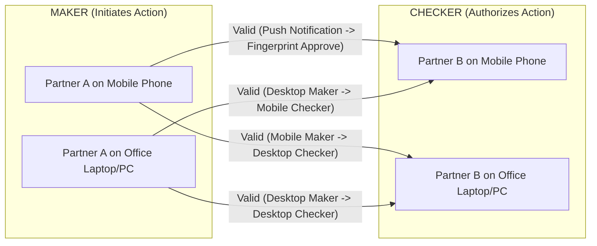

# Kumaran Chits — Role-Based Access Control (RBAC) & Permissions Matrix

> **Product**: **Kumaran Chits**  
> **Company**: **Kumaran Finance**  
> **Status**: Working Specification (`CONFIRMED-BY-DEVELOPER`)  
> **Status Labels Used**: `CONFIRMED-BY-DEVELOPER`, `PROPOSED`, `OPEN`, `UNVERIFIED-LEGAL`  
> **Core Principle**: Least privilege, strict branch scoping, and mandatory separation of duties (maker-checker).

---

## 1. User Groups & Scoping (`CONFIRMED-BY-DEVELOPER`)

The software implements a standardized, industry-standard set of personas. Kumaran Finance currently operates with **4 equal partners** and **2 to 3 field collection agents** (`CONFIRMED-BY-DEVELOPER`). The partners allocate administrative and operational personas among themselves as per company needs, while the software strictly enforces separation of duties.

| Role | Scope | Description | Status |
|---|---|---|---|
| **Super Admin (isPartner: true)** | Global (Company-wide) | **The 4 Equal Partners**. Verified business partners holding legal and financial ownership. Can act as Maker and Checker under strict `maker != checker`. Authorized for auction finalization, payout authorization, reversal approvals, and defaulter removal. | `CONFIRMED-BY-DEVELOPER` |
| **Super Admin (isPartner: false)** | Global (Company-wide) | Administrative IT / System staff. Manages users, system settings, viewing audit logs. Strictly blocked from financial authorizations. | `CONFIRMED-BY-DEVELOPER` |
| **Branch Manager** | Assigned Branch | Optional role. In current operations, the **4 partners fulfill all branch manager duties directly**; no external manager is hired. Accessible via Web Portal. | `CONFIRMED-BY-DEVELOPER` |
| **Accountant** | Company-wide | Financial recordkeeper for day books, voucher preparation, and reconciliations. **Can be held by a field collection agent wearing the accountant hat**. Primarily uses Web Portal for dense data entry; accessible on Mobile. | `CONFIRMED-BY-DEVELOPER` |
| **Collection Agent** | Assigned Customers | Field staff (2–3 agents today) using mobile app for daily/monthly doorstep collections; **also handles office accounting tasks**. Primarily uses Mobile App. | `CONFIRMED-BY-DEVELOPER` |
| **Customer / Member** | Self Only | Subscribers viewing their personal digital passbook, dividends, upcoming dues, and making online UPI/card payments. Uses Mobile App. | `CONFIRMED-BY-DEVELOPER` |
| **Auditor** | Read-Only (Global) | Independent chartered accountant / auditor viewing ledgers, auction minutes, and compliance reports without edit permissions. Uses Web Portal. | `CONFIRMED-BY-DEVELOPER` |

---

### 1.1 Client Platform Delivery & Access Matrix (`CONFIRMED-BY-DEVELOPER`)

| Persona | Primary Platform | Secondary Platform | Feature Parity & Workflows |
|---|:---:|:---:|---|
| **Super Admin (The 4 Partners)** | **Web Portal** (`apps/web/`) | **Mobile App** (`apps/mobile/`) | **100% Full Parity on BOTH Platforms**. Can act as Maker and Checker on either device. Instant push notifications for approvals on mobile; full-screen spreadsheets on web. |
| **Branch Manager** *(Latent)* | **Web Portal** (`apps/web/`) | — | Branch-scoped intake, auction facilitation, staff management. |
| **Desk Accountant** | **Web Portal** (`apps/web/`) | Mobile App | High-density physical notebook transcription, Form XXII Cash Book, day books, voucher preparation. |
| **Field Collection Agent** | **Mobile App** (`apps/mobile/`) | Web Portal (Dual Role) | 1-second fingerprint unlock, doorstep collections (< 30s), offline SQLite sync, evening cash handover. |
| **Customer (Chit Subscriber)** | **Mobile App** (`apps/mobile/`) | Web Passbook (Optional) | Bilingual digital passbook, 1-tap UPI payments (GPay/PhonePe), dividend tracker, auction results. |
| **Auditor (Chartered Accountant)** | **Web Portal** (`apps/web/`) | — | Read-only forensic general ledgers, Form XXII Cash Book, Form XXI Ledgers, Trial Balance, Day Book, and statutory minutes. (Audit logs and system health telemetry are strictly restricted to Super Admin). |

---

## 2. Granular Permissions Matrix (`CONFIRMED-BY-DEVELOPER`)

| Functional Area | Action | Super Admin | Branch Manager | Accountant | Collection Agent | Customer | Auditor | Status |
|---|---|:---:|:---:|:---:|:---:|:---:|:---:|:---:|
| **Company & Branch** | Manage Settings & Defaults | Yes | No | No | No | No | Read-only | `CONFIRMED-BY-DEVELOPER` |
| **Users & Roles** | Create / Deactivate Staff | Yes | No | No | No | No | Read-only | `CONFIRMED-BY-DEVELOPER` |
| **Password / Login** | Reset Staff Credentials | Yes | No | No | No | Self (OTP/MPIN)| No | `CONFIRMED-BY-DEVELOPER` |
| **Customer Management**| View Customers | All | Branch scope | All | Assigned only | Own profile only| Read-only | `CONFIRMED-BY-DEVELOPER` |
| | Create / Edit Customer Profile | Yes | Yes (Branch) | Limited intake| Lead intake only| Update request | No | `CONFIRMED-BY-DEVELOPER` |
| | View KYC / Safety Proof Documents | All | Branch scope | Verification | No | Own docs only | Read-only | `CONFIRMED-BY-DEVELOPER` |
| | Verify Customer KYC Documents | Yes | Yes (Branch) | Yes | No | No | Read-only | `CONFIRMED-BY-DEVELOPER` |
| **Chit Schemes** | Create Scheme Draft / Template | Yes | Review only | Review only | No | No | Read-only | `CONFIRMED-BY-DEVELOPER` |
| | Onboard Ongoing Notebook Chit (Maker) | Yes | Yes (Branch) | Yes (Maker) | No | No | Read-only | `CONFIRMED-BY-DEVELOPER` |
| | Activate Chit Scheme | Yes | No | No | No | No | Read-only | `CONFIRMED-BY-DEVELOPER` |
| **Enrollment & Tickets**| Assign Ticket to Subscriber | Yes | Yes (Branch) | No | No | Request only | Read-only | `CONFIRMED-BY-DEVELOPER` |
| **Collections** | Record Field Cash Collection | Yes | Yes (Branch) | Yes | Assigned only | Online payment | Read-only | `CONFIRMED-BY-DEVELOPER` |
| | Generate UPI Intent Deep-Link | Yes | Yes | Yes | Yes | Own ticket only | No (Exempt) | `CONFIRMED-BY-DEVELOPER` |
| | Submit UPI Claim (Bank UTR) | Yes | Yes | Yes | No | Own ticket only | No | `CONFIRMED-BY-DEVELOPER` |
| | Verify UPI Claim & Issue Receipt | Yes (Checker)| Yes (Branch) | Yes (Checker)| No | No | Read-only | `CONFIRMED-BY-DEVELOPER` |
| | Submit Cash Handover | Yes (Agent role)| No | No | Yes (Assigned) | No | No | `CONFIRMED-BY-DEVELOPER` |
| | Acknowledge Cash Handover | Yes | Yes (Branch) | Yes | No | No | Read-only | `CONFIRMED-BY-DEVELOPER` |
| **Payment Adjustments**| Request Payment Reversal (Maker)| Yes (Partner A)| No | No | No | No | No | `CONFIRMED-BY-DEVELOPER` |
| | Approve Payment Reversal (Checker)| Yes (Partner B)| No | No | No | No | Read-only | `CONFIRMED-BY-DEVELOPER` |
| **Offline Auctions** | Record Auction Result (Maker) | Yes (Partner A)| Yes (Branch) | No | No | View result | Read-only | `CONFIRMED-BY-DEVELOPER` |
| | Finalize Auction Result (Checker)| Yes (Partner B)| No | No | No | No | Read-only | `CONFIRMED-BY-DEVELOPER` |
| | Request Auction Correction (Maker)| Yes (Partner A)| No | No | No | No | No | `CONFIRMED-BY-DEVELOPER` |
| | Approve Auction Correction (Checker)| Yes (Partner B)| No | No | No | No | Read-only | `CONFIRMED-BY-DEVELOPER` |
| **Defaulter Management**| Remove Defaulter (3-Month Default)| Yes (Partner A)| No | No | No | No | Read-only | `CONFIRMED-BY-DEVELOPER` |
| | Settle Defaulter Exit (Checker)| Yes (Partner B)| No | No | No | No | Read-only | `CONFIRMED-BY-DEVELOPER` |
| **Prize Disbursement** | Verify Safety Proof Checklist & Voucher (Maker)| Yes | Yes (Branch) | Yes (Voucher prep)| No | View status | Read-only | `CONFIRMED-BY-DEVELOPER` |
| | Authorize Prize Payout (Checker)| Yes | No | No | No | No | Read-only | `CONFIRMED-BY-DEVELOPER` |
| **Reports & Auditing** | View Financial Reports & Day Books| Global | Branch scope | Global | Dual role only | Own passbook | Read-only | `CONFIRMED-BY-DEVELOPER` |
| | Export Reports / Ledgers | Yes | Branch scope | Global | Dual role only | Own statement | Read-only | `CONFIRMED-BY-DEVELOPER` |
| | View Immutable Audit Logs | Yes (Super Admin only)| No | No | No | No | No | `CONFIRMED-BY-DEVELOPER` |
| **System Health & Queues**| View BullMQ Status & Schedules | Yes (Super Admin only)| No | No | No | No | No | `CONFIRMED-BY-DEVELOPER` |
| | View Notification Dispatch Logs | Yes (Super Admin only)| No | No | No | No | No | `CONFIRMED-BY-DEVELOPER` |

---

## 3. Mandatory Maker-Checker Controls (`CONFIRMED-BY-DEVELOPER`)

To prevent accounting errors, unauthorized modifications, and internal fraud, high-risk financial actions require **strict Maker-Checker separation of duties**:

### Fundamental Architectural Rule:
> **The Maker and Checker must always be different individual user accounts (`CONFIRMED-BY-DEVELOPER`).**  
> Under no circumstances may the user who initiates or records an action approve or finalize it. The application and database strictly reject any transaction where `maker_user_id == checker_user_id`, regardless of the user's role or partner status.

### 1. Payment Reversals & Adjustments (`KFC-SEC-001`):
- **Maker**: Super Admin (Partner A only) initiates a reversal request with a mandatory documented justification (`POST /payments/:id/request-reversal`). Branch Manager and Accountant roles are strictly blocked.
- **Checker**: Super Admin (Partner B) verifies the justification and approves the ledger adjustment (`POST /payments/:id/approve-reversal`).
- **Hard Guard**: `maker_user_id != checker_user_id` (Partner A cannot approve their own reversal request; Partner B, C, or D must verify).

### 2. Offline Auction Recording vs. Finalization (`KFC-SEC-003`):
- **Maker (Record Result)**: Super Admin (Partner A who conducted/attended physical auction) enters winning ticket, bid discount, and attendee list.
- **Checker (Finalize Result)**: Super Admin (Partner B) reviews the entered bid against ceiling rules ($D \le V/4$) and commits the auction outcome (`POST /auctions/:id/finalize`). Branch Manager is strictly blocked from finalizing.
- **Hard Guard**: `maker_user_id != checker_user_id`.

### 2.1 Finalized Auction Correction (`KFC-FIN-005`):
- **Maker (Request Correction)**: Super Admin (Partner A) requests correction of winning ticket or bid discount with mandatory reason (`POST /auctions/:id/correction/request`). Blocked if prize money already disbursed.
- **Checker (Approve Correction)**: Super Admin (Partner B) verifies and applies correction (`POST /auctions/:id/correction/approve`), swapping `isPrized` flags and reconciling downstream unpaid dues.
- **Hard Guard**: `maker_user_id != checker_user_id`.

### 3. Prize Money Disbursement:
- **Maker (Verify & Submit)**: Accountant or Super Admin (Partner A) verifies the physical safety proof checklist (winner agreement [Yes/No], nominee signed [Yes/No], signed blank cheques [Yes/No], scanned uploads) and prepares the payout voucher.
- **Checker (Authorize Payout)**: Super Admin (Partner B) authorizes payment release via Cheque, NEFT/RTGS/IMPS, or Cash with automatic prior arrears offset (`KFC-FIN-003`). Payout overrides are strictly prohibited (`KFC-FIN-004`).
- **Hard Guard**: `maker_user_id != checker_user_id`.

### 3.1 Defaulter Removal Two-Partner Dual Control (SEC-B, `KFC-SEC-002`, `KFC-SEC-004`):
- **Prized Ticket Immutability (`KFC-SEC-004`)**: Prized subscriber tickets can never be removed or substituted (`PRIZED_TICKET_IMMUTABLE`).
- **Maker (Request Removal)**: Partner A (`SUPER_ADMIN` with `isPartner: true`) requests removal of non-prized subscriber after 3 consecutive months of arrears (`POST /tickets/:id/remove-defaulter/request`). Status becomes `PENDING_REMOVAL_APPROVAL`.
- **Checker (Approve Removal)**: Independent Partner B (`SUPER_ADMIN` with `isPartner: true`) reviews justification and approves removal (`POST /tickets/:id/remove-defaulter/approve`). Status becomes `REMOVED_DEF_3M` and ticket is vacated for substitution.
- **Hard Guard**: `ticket.removalRequestedByUserId !== checkerPartnerUserId` (`MAKER_CHECKER_VIOLATION`). The partner who requested the removal cannot approve it.
- **Q25 Financial Guardrail**: Financial damage settlement on removal remains **BLOCKED** and fails closed with `UNAPPROVED_SETTLEMENT_POLICY` pending legal confirmation.

### 4. Field Cash Handover & Vault Deposit (Dual Agent/Accountant Guard):
- **Collector (Submit Handover)**: Field Collection Agent (or staff in field collector role) collects cash from customers and submits daily handover batch.
- **Acknowledger (Accept Handover)**: Partner (Super Admin) physically counts cash and signs off / acknowledges handover into branch vault.
- **Hard Guard**: `collector_user_id != acknowledger_user_id`. Even though a collection agent also performs accountant desk duties, **they can NEVER acknowledge or sign off on their own collected cash**. An independent Partner must accept and verify the physical cash.

### 5. Customer UPI Claim Verification:
- **Maker (Submit Claim)**: Customer or collecting staff submits 12-digit bank UTR reference (`POST /payments/upi-claim`) in `INITIATED` status.
- **Checker (Verify & Issue Receipt)**: Desk Accountant or Partner inspects KVB NetBanking credit and verifies (`POST /payments/:id/verify-upi-claim`).
- **Hard Guard**: `maker_user_id != checker_user_id`. The user who submitted the claim cannot verify it or self-issue receipts.

### 6. Audit Log Integrity:
- Every high-risk modification, reversal, auction finalization, and payout approval is recorded in an **append-only, immutable audit log** (`CONFIRMED-BY-DEVELOPER`).

---

### 6. Branch Manager Checker Scope — Explicit Boundary Rule (`CONFIRMED-BY-DEVELOPER`):

> **Today's Reality**: Kumaran Finance does **not** hire an external Branch Manager. All 4 Partners (Super Admin) directly handle both Maker and Checker duties across all high-risk actions under the `maker_user_id != checker_user_id` constraint.
>
> **Future / Latent Role**: The `BRANCH_MANAGER` role is kept in the system architecture as a future-ready latent role. If a Branch Manager is ever hired, the following Checker scope boundaries apply — and must be enforced strictly by the application:

| High-Risk Action | Branch Manager as Checker? | Reason |
|---|:---:|---|
| **Finalize In-Office Auction Result** | 🚫 **STRICTLY BLOCKED** (`KFC-SEC-003`) | Financial commitment — locks dividend allocations and prize debt; reserved strictly for Super Admin / Partners |
| **Approve Payment Reversal** | 🚫 **STRICTLY BLOCKED** (`KFC-SEC-001`) | Ledger change — financial authority reserved exclusively for Super Admin / Partners |
| **Authorize Prize Payout** | 🚫 **STRICTLY BLOCKED** (`KFC-FIN-003`) | Financial outflow — money leaving the company; reserved exclusively for Super Admin / Partners |
| **Approve Auction Correction** | 🚫 **STRICTLY BLOCKED** (`KFC-FIN-005`) | Ledger change — modifies dividend allocation and winner entitlement; reserved exclusively for Super Admin / Partners |
| **Settle Defaulter Exit** | 🚫 **STRICTLY BLOCKED** (`KFC-SEC-002`) | Financial refund voucher — reserved exclusively for Super Admin / Partners under Maker != Checker |

- **The Governing Principle**: Branch Manager is strictly an **operational branch facilitation role**. Any action that involves **money leaving the company**, **finalizing auctions**, or **correcting the financial ledger** is strictly reserved for **Super Admin (Partners)** as the final financial authority.
- **Hard Guard**: Backend asserts `@Roles(Role.SUPER_ADMIN)` on all finalization, reversal, correction, and exit settlement endpoints. Any non-Super Admin caller fails with `HTTP 403 Forbidden`.

---

### 7. Cross-Device Maker-Checker Agnostic Enforcement (`CONFIRMED-BY-DEVELOPER`)

The fundamental invariant `maker_user_id != checker_user_id` is enforced strictly at the API and database levels. The backend is **device-agnostic**, allowing partners to initiate or authorize transactions across any combination of Web and Mobile clients:

1. **Mobile-to-Mobile**: Partner A records the auction bid on their smartphone at the branch $\to$ Partner B receives an instant push notification on their smartphone, reviews the bid, and finalizes with fingerprint authentication.
2. **Web-to-Mobile**: Desk Accountant prepares a prize payout voucher on the office PC $\to$ Partner B in transit receives an alert on their mobile phone, inspects the scanned cheque photo, and authorizes payout.
3. **Mobile-to-Web**: Partner A enters a payment reversal request with justification on their phone $\to$ Partner B at the office PC reviews the audit impact and approves.
4. **Web-to-Web**: Partner A enters transcription data on PC $\to$ Partner B verifies against physical paper notebook and commits activation on PC.

**Invariant**: In every scenario, the database strictly asserts `maker_user_id != checker_user_id` and records both distinct user IDs, timestamps, and client device user-agents in the immutable audit log.

---

## 4. Operating Reality & Persona Mapping (`CONFIRMED-BY-DEVELOPER`)

1. **Current Team Structure**:
   - Kumaran Finance operates from **1 physical branch office** (Head Office - Perundurai, Erode, Tamil Nadu).
   - Managed by **4 equal partners** and **2 to 3 field collection agents**.
2. **Direct Partner Management (No External Branch Manager Hired)**:
   - Kumaran Finance does **not** hire an external Branch Manager.
   - The **4 partners directly run branch operations**, oversee auctions, supervise field agents, manage customer onboarding, and authorize all payouts and reversals.
   - In the database and API, partners hold the **Super Admin** role.
3. **Dual Role: Field Collection Agent + Desk Accountant**:
   - The field collection agents also perform desk **Accountant** duties (maintaining day books, preparing payment vouchers, and reconciling physical receipts).
   - The system allows assigning both the Collection Agent and Accountant roles to the same user account.
   - To maintain financial safety, the system enforces **`collector_user_id != acknowledger_user_id`**: when wearing their collection hat, they submit handovers; a Partner must count and acknowledge the cash.
4. **Partner-to-Partner Maker-Checker Dual Control**:
   - All 4 partners have administrative authority, but the **`maker_user_id != checker_user_id`** constraint prevents any single partner from initiating and completing high-risk financial transactions unilaterally.
   - Example: Partner 1 conducts the auction and enters the winning bid $\to$ Partner 2, 3, or 4 reviews and finalizes the auction in the system.
5. **Role Naming**:
   - Confirmed standard roles: **Super Admin** (Partners), **Accountant** (Desk accounts/Agent dual role), **Collection Agent** (Field mobile app), **Customer** (Subscribers), and **Auditor** (Read-only CA).
   - The legacy term "Head Office Accountant" is completely retired.

---

## 5. Layer-2 Object Ownership & Anti-BOLA/IDOR Guardians

While the matrix above defines **Layer-1 Role-Based Access Control (RBAC)**, the system strictly enforces **Layer-2 Attribute-Based & Ownership Access Control (ABAC)** to eliminate OWASP API1:2023 (BOLA) and IDOR vulnerabilities across:
- **Component 1 (Encrypted Storage Service)**: Directory sandboxing (`kyc/`, `safety-proof/`, `minutes/`, `receipts/`, `vouchers/`, `passbooks/`).
- **Component 2 (Bilingual PDF Canvas Engine)**: Horizontal subscriber isolation and branch boundary enforcement via `DocumentAccessHelper`.
- **Component 3 (BullMQ Background Queue & Daily Cron Worker)**: Administrative trigger restrictions and queue isolation.

📖 **Detailed Technical Specification**: Refer to [`docs/03-architecture/security-and-access-guardians.md`](../03-architecture/security-and-access-guardians.md) for full flowcharts, method signatures, and automated test assertions.

