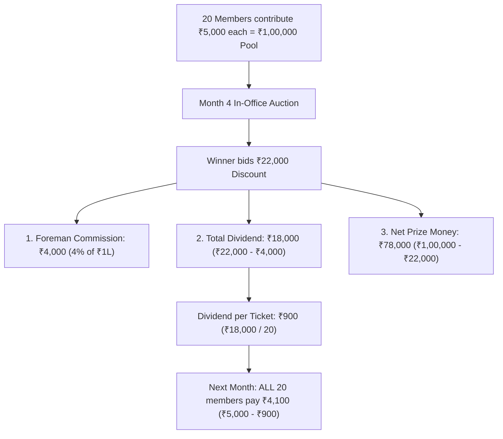
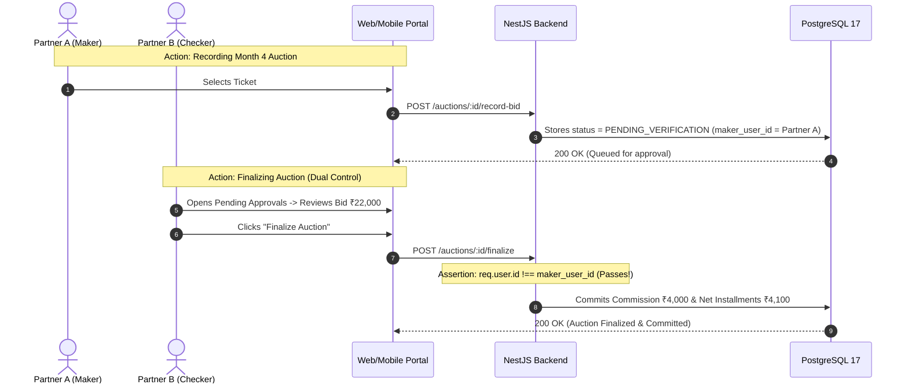
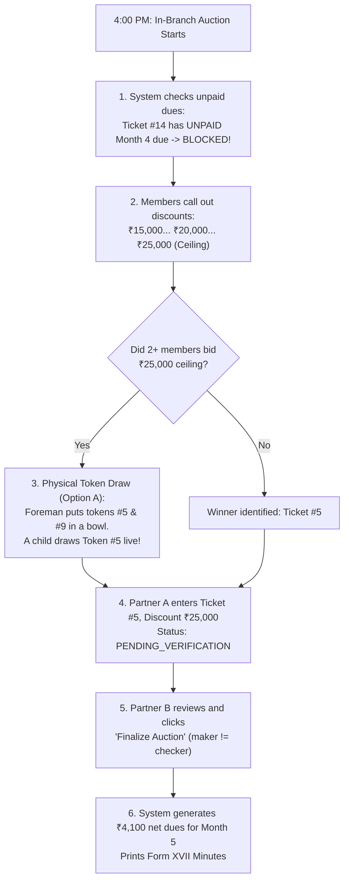
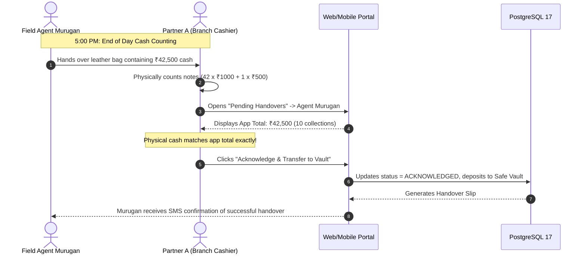

# Phase 1: Super Admin / Owner (The 4 Partners) — Comprehensive Operational Guide & User Journeys

> **Product**: **Kumaran Chits**  
> **Company**: **Kumaran Finance** (Head Office: Perundurai, Erode, Tamil Nadu)  
> **Persona**: **Super Admin / Owner (The 4 Equal Partners)**  
> **Target Audience**: Beginners, Business Partners, Staff, and Engineers learning Kumaran Chits operations.  
> **Platform Parity**: **100% Full Feature Parity across BOTH Web Portal (`apps/web/`) and Android Mobile App (`apps/mobile/`)**.  
> **Authoritative Compliance**: [`AGENTS.md`](../../../AGENTS.md), [`financial-rules.md`](../../01-business/financial-rules.md), and [`permissions-matrix.md`](../../01-business/permissions-matrix.md).

---

## 1. Persona Mental Model & Real-World Context

### Who Are the 4 Partners?
Kumaran Finance is owned and actively run by **4 equal partners** based in Perundurai, Tamil Nadu. Unlike large corporate banks with disconnected executives, the 4 partners are on the ground every day:
- They sit at the branch counters, meet local farmers, weavers, and merchants.
- They supervise 2 to 3 field collection agents who ride motorcycles collecting daily/monthly cash.
- They conduct monthly in-office auctions in person where members gather to bid.
- They physically count cash, inspect signed blank cheques and promissory notes before releasing lakhs of rupees in prize money.

### Why Do They Need 100% Parity on Both Web and Mobile?
- **At the Desk (Web Portal)**: When sitting at the Head Office PC, a partner needs a full-screen view for high-density tasks—transcribing 20-month physical notebooks into the system, reviewing Form XXII 12-column daily cash books, and issuing bilingual digital receipts.
- **On the Move (Android Mobile App)**: When a partner is at home, in the field, or visiting subscribers, they cannot wait to get back to the office to approve transactions. The Android app provides **1-second fingerprint unlock** and **1-tap push notification approvals** for prize disbursements, payment reversals, and evening cash handovers.

### Core Chit Fund Concepts Explained for Beginners

Before exploring the screens, let's understand the basic vocabulary of a chit fund:

1. **Chit Value ($V$)**: The total gross pool of money (e.g., ₹1,00,000).
2. **Duration / Months ($N$)**: Total duration of the scheme (e.g., 20 months).
3. **Tickets ($M = N$)**: The total seats in the chit (e.g., 20 tickets). Each ticket represents one subscriber.
4. **Base Monthly Installment ($I_{base}$)**: Gross monthly payment before any dividend ($V / N = ₹1,00,000 / 20 = ₹5,000$).
5. **Foreman**: The company organizing the chit (**Kumaran Finance**).
6. **Foreman Commission ($C_f$)**: The company's legal fee for running the chit, fixed permanently at **4.00%** of chit value ($₹1,00,000 \times 4\% = ₹4,000$).
7. **Winning Bid Discount ($D$)**: The discount the auction winner agrees to forfeit to take the pool early (e.g., ₹22,000).
8. **Prize Money ($P$)**: The actual cash the winner takes home ($V - D = ₹1,00,000 - ₹22,000 = ₹78,000$).
9. **Total Dividend ($Div_{total}$)**: The savings returned to the subscribers ($D - C_f = ₹22,000 - ₹4,000 = ₹18,000$).
10. **Per-Ticket Dividend ($Div_{ticket}$)**: The total dividend divided equally among all 20 tickets ($₹18,000 / 20 = ₹900$).
11. **Net Installment ($I_{net}$)**: The discounted amount members actually pay next month ($I_{base} - Div_{ticket} = ₹5,00,000 / 20 - ₹900 = ₹4,100$).
12. **Maker-Checker Rule**: The partner who enters a transaction (Maker) **can never approve it** (Checker). A second partner must verify and click approve (`maker_user_id != checker_user_id`).

---

## 2. Granular User Stories across All 10 Modules

Here are the formal Agile user stories defining every capability the Super Admin partner has across the platform:

### Module 1: Authentication & Security (M1)
* **US-1.1 (Web Login & 2FA)**: *As a Partner*, I want to log in to the Web Portal using my registered phone/email, password, and Microsoft Authenticator 6-digit TOTP code, *so that* unauthorized persons cannot access company funds even if they know my password.
* **US-1.2 (Mobile Biometric Unlock)**: *As a Partner*, I want to unlock the Android app using my fingerprint or 6-digit MPIN in under 1 second, *so that* I can instantly review urgent approvals in the field.
* **US-1.3 (Remote Session Revocation)**: *As a Partner*, I want to log out and invalidate all active session tokens immediately, *so that* my account remains secure if I misplace my device.

### Module 2: Branch & Staff Management (M2)
* **US-2.1 (Branch Information)**: *As a Partner*, I want to view and manage Head Office details (Perundurai, Erode), including bilingual English and Tamil names, *so that* all receipts and legal documents print accurately.
* **US-2.2 (Staff Credential & Role Provisioning)**: *As a Partner*, I want to create, update, or deactivate staff accounts and assign dual roles (e.g., granting both `COLLECTION_AGENT` and `ACCOUNTANT` roles to an employee), *so that* staff have appropriate permissions for their daily duties.

### Module 3: Customer Intake & Lightweight KYC (M3)
* **US-3.1 (Notebook-Style Intake)**: *As a Partner*, I want to register a new customer with minimal fields (Full Name in English/Tamil, Mobile, Address, Nominee) without forced identity paperwork, *so that* known local village subscribers can be onboarded in under 60 seconds.
* **US-3.2 (Masked Identity Scans)**: *As a Partner*, I want the option to enter the last 4 digits of Aadhaar (`XXXXXXXX1234`), PAN, and upload optional document photos to private S3, *so that* legal proof is stored safely without violating DPDP Act regulations.

### Module 4: Chit Scheme Management (M4)
* **US-4.1 (Fresh Chit Launch)**: *As a Partner*, I want to create a new chit scheme where the Foreman Commission is permanently locked at 4.00% and the discount ceiling is locked at 25% (1/4), *so that* company revenue and statutory caps are safeguarded from day 1.
* **US-4.2 (Physical Notebook Mid-Cycle Onboarding)**: *As a Partner*, I want to transcribe an active running chit from our physical paper notebook (e.g., entering at Month 7), entering past winners and binary `PAID`/`UNPAID` payment grids, *so that* ongoing chits transition seamlessly into the software.
* **US-4.3 (Month 1 & Month $N$ Automation)**: *As a Partner*, I want the system to automatically assign Month 1 to the company ticket with ₹0 dividend and settle Month $N$ directly to the final subscriber with 4% commission without an auction, *so that* standard chit-fund rules are executed flawlessly.

### Module 5: Ticket Enrollment & Defaulter Removal (M5)
* **US-5.1 (Single Ticket Enforcement)**: *As a Partner*, I want the system to prevent any customer from holding 2 or more tickets in the same chit scheme, *so that* concentration risk is eliminated and local guidelines are respected.
* **US-5.2 (3-Month Defaulter Removal)**: *As a Partner*, I want the system to alert me when a subscriber has missed 3 consecutive monthly payments and allow me to execute the company removal workflow (`REMOVED_DEF_3M`), *so that* we can reassign the ticket to a new subscriber or settle the balance.

### Module 6: Installments & Due Schedules (M6)
* **US-6.1 (Universal Equal Dividend Schedule)**: *As a Partner*, I want the system to calculate next month's net installment in whole integer Rupees and deduct the exact same dividend for **all 20 members (including the auction winner)**, *so that* accounting remains simple and transparent.
* **US-6.2 (Discrete Binary Payment Enforcement)**: *As a Partner*, I want the system to ensure dues can only be `UNPAID` or `PAID` in full, rejecting partial payments or advance balances, *so that* physical ledger reconciliation matches software records without confusion.

### Module 7: Field Collections & Cash Handover (M7)
* **US-7.1 (Supervising Collections)**: *As a Partner*, I want to view live collection amounts collected by field agents during the day, *so that* I know our daily cash inflow.
* **US-7.2 (Evening Cash Handover Sign-Off)**: *As a Partner*, I want to count the physical cash handed over by an agent at 5:00 PM and click acknowledge in the software, *so that* the cash is formally transferred into the company vault.
* **US-7.3 (Anti-Self-Acknowledgment Guard)**: *As a Partner*, if I personally collected cash in the field, I want the software to block me from acknowledging my own handover, requiring one of the other 3 partners to sign off, *so that* dual-control integrity is maintained.

### Module 8: Payments, Bilingual Receipts & Reversals (M8)
* **US-8.1 (In-Branch Payment Recording)**: *As a Partner*, I want to record walk-in payments via Cash, UPI, Cheque, or NEFT, sign the customer's physical passbook, and trigger an instant mobile app push notification (or optional fallback SMS for non-app users), *so that* customers get instant proof of payment without incurring unnecessary telecom SMS costs.
* **US-8.2 (Maker-Checker Payment Reversal)**: *As a Partner*, if an erroneous payment is recorded, I want Partner A to initiate a reversal with a written reason and Partner B to verify and approve it, *so that* no single person can manipulate cash entries.

### Module 9: Offline Auctions & Prize Disbursements (M9)
* **US-9.1 (Defaulter Auction Block)**: *As a Partner*, I want the software to strictly prevent any subscriber who has unpaid dues for the month from bidding or winning the auction, *so that* defaulters cannot take company prize money.
* **US-9.2 (Recording Auction Result - Maker)**: *As a Partner (Maker)*, I want to enter the winning ticket and bid discount (up to 25% ceiling) after conducting the in-person branch auction, *so that* the result is queued for verification.
* **US-9.3 (Physical Paper Token Tie-Break)**: *As a Partner*, if multiple members bid the maximum 25% ceiling, I want to conduct a physical paper lot draw in front of members and type the drawn winning ticket into the system, *so that* the draw is completely transparent and verified by subscribers.
* **US-9.4 (Auction Finalization - Checker)**: *As a Partner (Checker)*, I want to review the entered auction bid and click finalize (`maker != checker`), *so that* dividends and next month's due schedules are committed.
* **US-9.5 (Company Safety Proof Verification - Maker)**: *As a Partner (Maker)*, I want to inspect the winner's agreement, nominee signature, signed blank cheques, and promissory notes, check off the items, and prepare the payout voucher.
* **US-9.6 (Prize Payout Authorization - Checker)**: *As a Partner (Checker)*, I want to review the safety proof and authorize releasing the prize money via Cash, Cheque, or NEFT (`maker != checker`), *so that* funds are safely disbursed.

### Module 10: Dashboards & Statutory Reports (M10)
* **US-10.1 (Executive Business Pulse)**: *As a Partner*, I want to see today's cash in vault, pending customer dues, and upcoming auctions at a glance, *so that* I can steer company operations effectively.
* **US-10.2 (Form XXII Daily Cash Book)**: *As a Partner*, I want to inspect and export the 12-column daily cash register, *so that* physical vault cash reconciles with system figures to the last rupee.
* **US-10.3 (Statutory Form XVII Minutes & Form XXI Passbook)**: *As a Partner*, I want to generate formatted PDF minutes and passbooks for subscriber review and Chit Registrar compliance.
* **US-10.4 (Forensic Audit Trail)**: *As a Partner*, I want an immutable log showing who initiated and who approved every financial action, *so that* internal disputes are impossible.

---

## 3. Step-by-Step UI & Field Action Journeys

Let's walk through the exact screens, buttons, and clicks a partner uses in their daily work:

---

### Journey 1: Morning Login & Executive Business Pulse

#### On Desktop Web Portal:
1. Open Chrome/Edge and visit `https://admin.kumaranfinance.com`.
2. **Screen 1 (Credentials)**: Enter your registered mobile number (e.g., `9842100001`) and password. Click **"Sign In"**.
3. **Screen 2 (2FA Challenge)**: Open **Microsoft Authenticator** on your Android smartphone. View the 6-digit rotating code (e.g., `482 195`). Type the 6 digits into the portal. Click **"Verify Code"**.
4. **Screen 3 (Branch Selection)**: System displays `Head Office - Perundurai (PRD)`. Click **"Enter Portal"**.
5. **Screen 4 (Executive Dashboard)**:
   - **Vault Cash Metric Card**: Displays `₹3,42,500` (Physical cash verified in office safe).
   - **Today's Collections**: Displays `₹45,000` (Collected by Agents Murugan & Selvam so far).
   - **Overdue Installments**: Displays `14 Subscribers` (Total ₹57,400 overdue).
   - **Upcoming Auctions**: Highlights `KCA-1L-20M-01: Month 4 Auction today at 4:00 PM`.

#### On Android Mobile App:
1. Pull phone out of pocket. Tap **Kumaran Chits** app icon.
2. System presents **Native Biometric Prompt**: Touch your thumb to the fingerprint sensor. (Takes $<0.5$ seconds to unlock).
3. Alternatively, enter your **6-digit MPIN** (e.g., `749201`).
4. **Mobile Home Screen**: Displays the exact same 4 KPI metric cards with a floating **"Quick Approvals (3)"** badge.

---

### Journey 2: Onboarding an Ongoing Chit from a Physical Paper Notebook

When Kumaran Finance migrates an active running chit (e.g., `KCA-1L-20M-01` currently at Month 7 in hand-written notebooks):

1. **Navigate**: Go to **Chit Schemes $\to$ "Onboard Ongoing Physical Chit"** (Web Portal).
2. **Step 1: Scheme Header**:
   - Scheme Name: `KCA-1L-20M-01`.
   - Chit Value: Type `100000` (₹1,00,000).
   - Duration: Select `20 months`.
   - Total Tickets: Type `20`.
   - Foreman Commission: Auto-filled and locked to **`4.00%`** (`₹4,000`).
   - Starting Date: Select original start date (e.g., `15-Apr-2026`).
   - Current Month Entering: Select **`Month 7`**.
3. **Step 2: Past Auction History (Months 1 to 6)**:
   - **Month 1**: Auto-marked as Company Pool payout (`₹1,00,000`, ₹0 dividend).
   - **Month 2**: Select Winning Ticket `#3` (Ramasamy), Enter Bid Discount `₹25,000`, Payout Status: `PAID`.
   - **Month 3**: Select Winning Ticket `#11` (Ponnusamy), Enter Bid Discount `₹23,500`, Payout Status: `PAID`.
   - **Months 4 to 6**: Fill in historical winners and discounts from notebook pages.
4. **Step 3: The 20-Subscriber Binary Payment Grid**:
   - The screen renders a high-density grid: 20 rows (Subscribers 1 to 20) $\times$ 6 past months.
   - For each cell, click once to toggle between **`PAID`** (Green) or **`UNPAID`** (Red).
   - *Beginner Rule*: No partial payments exist in Kumaran Finance. If a subscriber paid ₹4,000 out of ₹4,000, mark `PAID`. If they did not pay, mark `UNPAID`.
5. **Step 4: Balancing Guard Check**:
   - Look at the bottom footer: `System Total Collected: ₹4,82,500`.
   - Compare this number with the hand-written summary line on page 42 of your physical notebook.
   - If the numbers match exactly, click **"Submit Onboarding Draft"** (Partner A — Maker).
6. **Step 5: Checker Verification**:
   - Partner B logs into the portal, opens **"Pending Activations"**, inspects the transcribed grid against the notebook, and clicks **"Verify & Activate Scheme"** (Checker).
   - The scheme is now live! Month 7 installment dues are instantly generated.

---

### Journey 3: Conducting & Finalizing the Month 4 In-Office Auction

On the 15th of the month at 4:00 PM, subscribers gather in the Perundurai branch office:

#### Detailed Actions:
1. **Pre-Auction Defaulter Check**:
   - Partner A opens **Auctions $\to$ KCA-1L-20M-01 (Month 4)**.
   - The screen shows the list of all 20 tickets.
   - Subscriber Murugesan (Ticket `#14`) has not paid his Month 4 installment. His row is highlighted in red with badge: **`INELIGIBLE (UNPAID DUE)`**.
   - If Murugesan attempts to bid, Partner A informs him: *"Per chit fund rules, dues must be cleared before participating in the auction."* The software physically disables selecting Ticket `#14`.
2. **Bidding & 25% Ceiling Cap**:
   - Members call out discounts: ₹18,000... ₹22,000... ₹25,000.
   - If a member shouts ₹26,000, Partner A stops them: *"The maximum legal ceiling is one-fourth (25%) of the chit value, which is ₹25,000."*
   - If someone tries to enter ₹26,000 in the software, the input border turns red with error: **`Bid discount cannot exceed ₹25,000 (1/4 ceiling)`**.
3. **The Physical Paper Token Tie-Break (Option A)**:
   - Subscriber Kandasamy (Ticket `#5`) and Subscriber Velusamy (Ticket `#9`) both bid the maximum ₹25,000 ceiling.
   - Partner A writes `5` and `9` on two identical paper slips, folds them, and places them into a steel lot bowl.
   - In front of all attending members, an independent member or child draws one slip: **Ticket `#5`**.
   - Partner A clicks **"Tie-Break: Physical Token Draw"** and selects **Ticket `#5`**.
4. **Submitting Auction Entry (Maker)**:
   - Winning Ticket: `#5` (Kandasamy).
   - Winning Bid Discount: `₹25,000`.
   - Partner A clicks **"Submit Auction Result"**.
   - System displays: `Auction recorded. Awaiting Partner approval (Maker: Partner A)`.
5. **Finalizing Auction (Checker)**:
   - Partner B receives a push notification on his mobile app: *"Auction Finalization required for KCA-1L Month 4"*.
   - Partner B opens the approval screen, verifies the bid (`₹25,000`), and clicks **"Finalize Auction"**.
   - *Backend Guard*: If Partner A tries to click Finalize on his own phone, the system rejects it with: **`Access Denied: Maker and Checker cannot be the same user`**.
   - Upon Partner B's click:
     - Foreman Commission is committed: `₹4,000` (4.00%).
     - Total Dividend: `₹21,000` (`₹25,000 - ₹4,000`).
     - Per-Ticket Dividend: `₹1,050` (`₹21,000 / 20 tickets`).
     - Next Month's Net Installment: `₹3,950` (`₹5,000 - ₹1,050`) for **all 20 members**.
     - Form XVII Statutory Minutes PDF is generated and ready to sign.

---

### Journey 4: Verifying Company Safety Proof & Disbursing Prize Money

Kandasamy (Ticket `#5`) comes to the office 3 days later to collect his prize money (`₹1,00,000 - ₹25,000 = ₹75,000`).

1. **Step 1: Open Disbursement Screen**:
   - Partner A navigates to **Disbursements $\to$ Pending Verification $\to$ Ticket #5 (KCA-1L-20M-01)**.
2. **Step 2: Company Safety Proof Checklist (ADR-15)**:
   - *Beginner Note*: Property documents are never required. Kumaran Finance evaluates safety proof on a case-by-case basis.
   - Partner A fills the checklist:
     - **Safety proof required for this subscriber?** [x] Yes.
     - **Winner Chit Agreement signed?** [x] Yes.
     - **Nominee signed agreement?** [x] Yes (Wife: Shanthi).
     - **Signed blank cheques collected?** [x] Yes. (Partner A enters: *Canara Bank, Cheque #004128*).
     - **Promissory note collected?** [x] Yes.
     - **Upload Scans**: Partner A taps **"Capture / Upload"** on the mobile app or uploads PDFs from desktop.
3. **Step 3: Prepare Payout Voucher (Maker)**:
   - Payout Amount: `₹75,000` (Whole integer Rupees).
   - Payment Mode: Select **`Cheque`** (or `Cash` / `NEFT`).
   - Partner A enters Cheque No: `904121`, drawn on Kumaran Finance's current account.
   - Click **"Submit Payout Voucher"** (Maker: Partner A).
4. **Step 4: Authorize Prize Payout (Checker)**:
   - Partner C (or Partner B/D) opens the approval queue on their mobile phone.
   - They inspect the attached cheque scan and signed agreement.
   - Partner C clicks **"Authorize & Disburse Prize Money"**.
   - The status changes to **`DISBURSED`**.
   - A bilingual Tamil/English payout voucher and SMS receipt are dispatched to Kandasamy.

---

### Journey 5: Evening Cash Handover & Vault Deposit

At 5:00 PM, Field Collection Agent Murugan returns to the Head Office after completing his collection rounds.

#### Detailed Actions:
1. Agent Murugan opens his mobile app, navigates to **"Submit Cash Handover"**, and clicks submit for today's batch: `₹42,500` across 10 collections.
2. Murugan hands his cash bag to Partner A at the counter.
3. Partner A physically counts the notes on the counter note-sorting machine: **`₹42,500`**.
4. Partner A opens **Collections $\to$ Pending Handovers $\to$ Batch #42**.
5. Partner A clicks **"Acknowledge Handover"**.
6. *Anti-Self-Acknowledgment Guard Check*: If Partner A himself had gone into the field and collected cash under his own user ID, he cannot click Acknowledge. Partner B must count his cash and click Acknowledge (`collector_user_id != acknowledger_user_id`).
7. The system transfers ₹42,500 into the **Branch Safe Vault Balance**, and Agent Murugan's mobile cash-in-hand drops to ₹0.

---

### Journey 6: Reversing an Erroneous Payment (Maker-Checker)

Suppose an accountant accidentally recorded a cash payment of ₹4,100 to Ticket `#8` instead of Ticket `#9`:

1. **Step 1: Initiate Reversal Request (Maker — Partner A)**:
   - Partner A locates Payment Receipt `KC-REC-PRD-2026-00412`.
   - Clicks **"Request Payment Reversal"**.
   - Form prompts: **Mandatory Reason for Reversal**.
   - Partner A types: *"Cashier error: Member Mani (Ticket #9) paid ₹4,100 cash, but payment was accidentally recorded against Ticket #8 (Kannan). Physical counter receipt attached."*
   - Partner A clicks **"Submit Reversal Request"**.
   - Payment status changes to **`REVERSAL_PENDING`**. The money is NOT yet reversed.
2. **Step 2: Checker Approval (Partner B)**:
   - Partner B opens the **Reversals Approval Queue**.
   - Reads Partner A's explanation and inspects the physical receipt photo.
   - Partner B clicks **"Approve Reversal"**.
   - System commits the reversal:
     - Ticket `#8` due reverts to `UNPAID`.
     - An offsetting entry is recorded in the Form XXII Cash Book.
     - An audit log entry is written with both `maker_user_id` (Partner A) and `checker_user_id` (Partner B).
   - Partner A can now record the correct payment against Ticket `#9`.

---

## 4. Edge Cases, Traps & Mistakes to Avoid

| Potential Trap / Mistake | What Happens in the Software | How the Partner Resolves It |
|---|---|---|
| **Partner tries to approve their own auction or reversal** | System throws `HTTP 403: Forbidden - Maker and Checker cannot be the same user`. | Ask any of the other 3 partners to log in on Web or Mobile and click Approve. |
| **Subscriber wants to pay ₹2,00,0 now and ₹2,100 next week** | Software rejects entering ₹2,000. Dues are strictly discrete (`UNPAID` or `PAID`). | Inform customer: *"Under company policy, full monthly installment must be paid at once."* Hold cash in office drawer until full balance is ready, or use customer savings. |
| **Bidding discount entered as ₹27,000 on a ₹1L chit** | Software rejects bid with red validation error: `Discount cannot exceed 1/4 ceiling (₹25,000)`. | Re-enter bid discount $\le \text{₹}25,000$. Remind bidders of statutory ceiling. |
| **Subscriber missed 3 consecutive months** | System triggers Defaulter Alert: `Ticket #14 has 3 consecutive unpaid dues`. | Partner initiates **"Execute Company Removal"** (`REMOVED_DEF_3M`), freeing the ticket for a replacement subscriber. |
| **Internet goes down during in-office auction** | Partners conduct the physical auction offline on paper slips as usual. | Once broadband/mobile 4G resumes, enter the winning ticket and finalize results. |

---

## 5. Summary & Checklist for Phase 1

- [x] Full operational context of the 4 equal partners established.
- [x] Basic chit-fund mathematics and vocabulary explained in simple terms.
- [x] 10 granular user stories spanning all 10 modules authored.
- [x] 6 detailed, click-by-click operational journeys with Mermaid diagrams documented.
- [x] 100% full feature parity on Web and Mobile clearly illustrated.
- [x] All 10 invariant guardrails and common operational traps documented.
