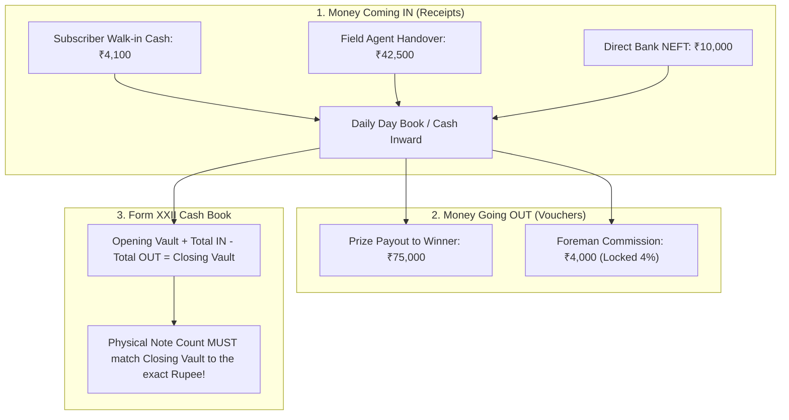
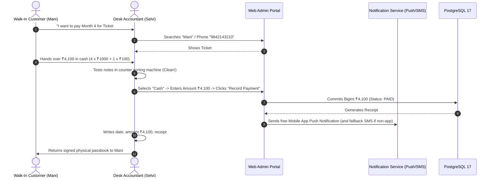
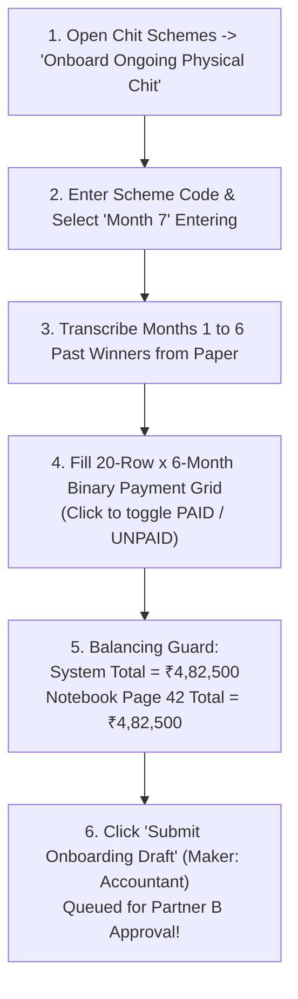
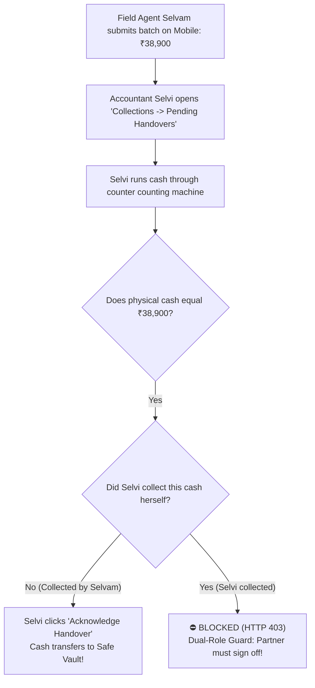

# Phase 2: Desk Accountant — Comprehensive Operational Guide & User Journeys

> **Product**: **Kumaran Chits**  
> **Company**: **Kumaran Finance** (Head Office: Perundurai, Erode, Tamil Nadu)  
> **Persona**: **Desk Accountant / Office Cashier**  
> **Target Audience**: Beginners, Accounting Staff, and Engineers learning Kumaran Chits accounting operations.  
> **Primary Platform**: **Web Portal (`apps/web/`)** (High-density spreadsheets, Form XXII Cash Book, notebook transcription)  
> **Secondary Platform**: **Android Mobile App (`apps/mobile/`)** (Mobile ledger viewing & dual-role collection)  
> **Authoritative Compliance**: [`AGENTS.md`](../../../AGENTS.md), [`financial-rules.md`](../../01-business/financial-rules.md), and [`permissions-matrix.md`](../../01-business/permissions-matrix.md).

---

## 1. Persona Mental Model & Real-World Context

### Who Is the Desk Accountant at Kumaran Finance?
In the Perundurai Head Office, the **Desk Accountant** (often assisted by senior staff or field agents wearing the accounting hat) sits behind the physical customer service counter. Their operational desk looks like this:
- A desktop computer running the Kumaran Chits Web Portal.
- A high-speed **electronic currency note-sorting & counting machine** on the counter.
- A physical safe-drawer with separate slots for ₹500, ₹200, ₹100, and ₹50 notes.
- Heavy **hand-written paper day-book ledgers** and customer physical passbooks.
- Files of signed subscriber agreements, blank bank cheques, and promissory notes in metal filing cabinets.

### The Dual-Role Reality (Field Agent + Accountant)
In local Tamil Nadu chit funds, staffing is lean and practical. A staff member might ride a motorcycle in the morning collecting subscriptions (`COLLECTION_AGENT`), and then sit at the office desk from 2:00 PM to 6:00 PM managing the accounts (`ACCOUNTANT`).
- **The Golden Safety Guard**: Even if an accountant also collects cash in the field, **they can NEVER acknowledge or sign off on their own collected cash**. The software enforces `collector_user_id != acknowledger_user_id`. An independent partner must physically count the money and sign it into the vault.

### Core Chit Fund Accounting Concepts Explained for Beginners

1. **Form XXII Daily Cash Book**: The statutory 12-column daily register mandated by chit fund regulations. It records every rupee received (installments, penalties, interest) and disbursed (prize payouts, foreman commission, company expenses) each business day.
2. **Day Book**: The daily running journal of all counter and field collections.
3. **Receipt vs. Voucher**:
   * **Receipt (Money IN)**: Generated when a subscriber pays their monthly installment.
   * **Voucher (Money OUT)**: Prepared when the company releases prize money or pays business expenses.
4. **Maker Role for Accountant**: The accountant prepares prize vouchers, enters notebook transcriptions, and requests payment reversals (Maker). However, the accountant **CANNOT authorize payouts or finalize reversals**—only a Partner / Super Admin can act as the Checker.

---

## 2. Granular User Stories across All 10 Modules

Here are the formal Agile user stories defining the exact permissions, boundaries, and tasks for the Desk Accountant:

### Module 1: Authentication & Security (M1)
* **US-1.1 (Secure Staff Web Login)**: *As a Desk Accountant*, I want to log in using my staff credentials and Microsoft Authenticator TOTP on the desktop PC, *so that* sensitive financial ledgers cannot be accessed by unauthorized persons.
* **US-1.2 (Automatic Inactivity Lock)**: *As a Desk Accountant*, I want the portal to lock automatically after 15 minutes of counter inactivity, *so that* walk-in subscribers cannot see company books if I step away to count cash.

### Module 2: Branch & Staff Management (M2)
* **US-2.1 (Branch Scoped View)**: *As a Desk Accountant*, I want to view branch metadata (Perundurai Head Office, branch code `PRD`, contact numbers), *so that* all receipts print with correct header information. *(Accountant has read-only access to branch settings and cannot create/delete other staff).*

### Module 3: Customer Intake & Lightweight KYC (M3)
* **US-3.1 (Walk-In Customer Intake)**: *As a Desk Accountant*, I want to quickly register a new walk-in customer with their name (English and Tamil), phone number, physical address, and nominee details, *so that* they can be enrolled in upcoming schemes without paper delays.
* **US-3.2 (KYC Document Verification)**: *As a Desk Accountant*, I want to inspect customer Aadhaar cards (recording only the last 4 digits `XXXXXXXX1234`) and PAN details, *so that* customer identity records are verified before ticket allocation.

### Module 4: Chit Scheme Management (M4)
* **US-4.1 (Reviewing Active Schemes)**: *As a Desk Accountant*, I want to view all active, draft, and completed chit schemes with their locked 4% foreman commission and 25% discount ceilings, *so that* I know which groups are active for collections.
* **US-4.2 (High-Density Physical Notebook Transcription — Maker)**: *As a Desk Accountant*, I want to transcribe running chits from paper notebooks into the system, entering historical winner discounts and the binary `PAID`/`UNPAID` grid, *so that* ongoing chits are digitized with 100% balancing precision for Partner approval.

### Module 5: Ticket Enrollment & Membership (M5)
* **US-5.1 (Inspecting Ticket Allocations)**: *As a Desk Accountant*, I want to look up which subscriber holds which ticket number (1 to $N$) in any group, *so that* I can accurately record payments when a customer walks up to the counter saying *"I am Ticket #7 in the 1 Lakh chit"*.
* **US-5.2 (Monitoring Consecutive Arrears)**: *As a Desk Accountant*, I want to identify subscribers who have missed 2 or 3 consecutive months, *so that* I can alert the partners before issuing legal default notices.

### Module 6: Installments & Due Schedules (M6)
* **US-6.1 (Looking Up Net Installment Due)**: *As a Desk Accountant*, I want to instantly see the exact net amount due for any ticket ($I_{net} = I_{base} - Div$), *so that* I tell the customer the exact whole-rupee amount to pay without manual calculation errors.
* **US-6.2 (Enforcing Discrete Binary Payments)**: *As a Desk Accountant*, if a customer offers partial cash (e.g., ₹2,000 for a ₹4,100 due), I want the system to prohibit entering partial payments, *so that* our ledgers remain strictly aligned with the single discrete payment rule.

### Module 7: Field Collections & Cash Handover (M7)
* **US-7.1 (Receiving Evening Field Cash)**: *As a Desk Accountant (acting as Branch Cashier)*, I want to count the physical cash brought in by Field Agents at 5:00 PM, verify the currency breakdown on the screen, and click acknowledge, *so that* the agent's cash liability drops to ₹0 and the branch vault balance updates.
* **US-7.2 (Anti-Self-Acknowledgment Defense)**: *As a Staff Member with dual roles*, if I personally collected money in the field, I want the software to strictly block me from acknowledging my own cash handover, *so that* cash is always verified by an independent second pair of eyes.

### Module 8: Payments, Bilingual Receipts & Reversals (M8)
* **US-8.1 (Recording Counter Walk-In Payments)**: *As a Desk Accountant*, I want to record counter payments via Cash, UPI, Cheque, or NEFT, manually enter the record into the customer's physical passbook, and trigger an automated free mobile app push notification (with fallback SMS for non-app users), *so that* the customer walks away with verified proof of payment without telecom billing waste.
* **US-8.2 (Initiating Payment Reversal — Maker)**: *As a Desk Accountant*, if I accidentally post cash to the wrong customer's ticket, I want to submit a reversal request with a mandatory reason and receipt scan, *so that* a Partner can review and approve the correction.
* **US-8.3 (Verifying Customer UPI Payment Claims — Checker)**: *As a Desk Accountant*, I want to inspect the queue of customer self-reported UPI claims (`GET /payments/pending-upi-claims`), cross-check the 12-digit UTR against our Karur Vysya Bank current account statement, and approve (`POST /payments/:id/verify-upi-claim`), *so that* verified online collections are officially receipted with ₹0 payment gateway fees under Maker != Checker dual control.

### Module 9: Offline Auctions & Prize Disbursements (M9)
* **US-9.1 (Preparing Prize Payout Voucher — Maker)**: *As a Desk Accountant*, I want to verify the winner's safety proof checklist (signed agreements, nominee signatures, blank cheques, promissory notes), upload document scans, and prepare the payout voucher for Partner authorization, *so that* prize money is prepared securely.
* **US-9.2 (Disbursement Authorization Block)**: *As a Desk Accountant*, I want the system to block me from authorizing the final payout, *so that* financial release authority remains strictly with the company Partners (Checkers).

### Module 10: Dashboards & Statutory Reports (M10)
* **US-10.1 (Form XXII Daily Cash Book Balancing)**: *As a Desk Accountant*, I want to generate and balance the 12-column Daily Cash Book at 6:00 PM every evening, *so that* opening cash + receipts - disbursements equals physical cash in safe to the exact rupee.
* **US-10.2 (Member Passbook Printing)**: *As a Desk Accountant*, I want to print or export the Form XXI 20-month continuous passbook for any subscriber, *so that* they can verify all past installments, dividends earned, and receipt numbers.

---

## 3. Step-by-Step UI & Desk Action Journeys

---

### Journey 1: Morning Day Book Opening & Cash Desk Setup

Every morning at 8:45 AM, the Desk Accountant opens the branch cash desk:

1. **Log In to Desktop Web Portal**:
   - Open browser at `https://admin.kumaranfinance.in`.
   - Enter staff mobile number and password. Enter 6-digit TOTP code from Microsoft Authenticator.
2. **Navigate to Daily Cash Book**: Go to **Accounting $\to$ Form XXII Cash Book**.
3. **Inspect Opening Vault Balance**:
   - The screen shows: `Opening Cash in Safe: ₹3,42,500` (carried forward from yesterday's closing).
4. **Physical Cash Verification**:
   - Open the office steel safe with the physical key.
   - Count the physical bundles: ₹500 bundles, ₹200 bundles, ₹100 bundles.
   - The physical note count is exactly **`₹3,42,500`**.
5. **Click "Open Cash Day Book"**:
   - The accountant clicks **`"Confirm Opening Balance & Open Day Book"`**.
   - The system timestamps the opening. Counter payment recording is now officially active for the day.

---

### Journey 2: High-Density Physical Notebook Transcription (Mid-Cycle Onboarding — Maker)

When digitizing an ongoing 20-month chit scheme from hand-written paper notebooks:

#### Detailed Actions:
1. Open **Chit Schemes $\to$ "Onboard Ongoing Physical Chit"**.
2. **Scheme Parameters**:
   - Group Code: `KCA-2L-20M-02`.
   - Chit Value: `₹2,00,000`. Duration: `20 months`. Total Tickets: `20`.
   - Commission: Frozen at **`4.00%`** (`₹8,000`).
   - Active Month: Select **`Month 5`** (meaning Months 1 to 4 are already finished on paper).
3. **Past Winners Transcription**:
   - Month 1: Auto-locked to Company Pool (`₹2,00,000`, ₹0 dividend).
   - Month 2: Ticket `#14` (Chinnasamy), Winning Bid: `₹48,000`, Payout: `PAID`.
   - Month 3: Ticket `#4` (Murugesan), Winning Bid: `₹45,000`, Payout: `PAID`.
   - Month 4: Ticket `#19` (Arumugam), Winning Bid: `₹42,000`, Payout: `PAID`.
4. **Binary Payment Transcription Grid**:
   - The accountant places the open physical notebook on the desk next to the keyboard.
   - The screen shows 20 rows (Subscribers 1 to 20) with columns for Months 1, 2, 3, and 4.
   - The accountant presses `Tab` and `Spacebar` to toggle cells:
     - Green checkmark = **`PAID`**.
     - Red cross = **`UNPAID`**.
   - *Strict Rule*: Zero partial payments. If a member hasn't paid, leave it `UNPAID`.
5. **Balancing Guard Assertion**:
   - The footer calculates: `Total Historical Collections = ₹3,46,000`.
   - The accountant verifies the total against the bottom of notebook page 58.
   - The numbers match to the rupee!
6. **Submit Transcription**:
   - Click **`"Submit Onboarding Draft for Partner Verification"`**.
   - System confirms: *"Onboarding draft submitted. Notification dispatched to Partners for Checker approval."*

---

### Journey 3: Counter Walk-In Cash Collection & Physical Passbook Entry

At 11:30 AM, customer Velusamy walks up to the counter to pay his monthly chit installment:

1. **Quick Subscriber Lookup**:
   - Press hotkey `/` to focus the search bar.
   - Type Velusamy's phone `9842188990` or ticket number `KCA-1L #5`.
   - The screen loads **Subscriber Profile $\to$ Pending Dues**.
2. **Inspect Due Amount**:
   - Installment Month: `Month 4`.
   - Base Installment: `₹5,000`.
   - Dividend Earned: `- ₹900`.
   - **Net Payable Due: `₹4,100`** (Status: `UNPAID`).
3. **Receive & Count Cash**:
   - Velusamy hands over 4 notes of ₹1,000 (or 8 of ₹500) + 1 note of ₹100. Total = **`₹4,100`**.
   - The accountant feeds the notes into the desktop counter machine to verify genuineness and count.
4. **Record Payment**:
   - Click **`"Record Payment"`**.
   - Payment Mode: Select **`Cash`**.
   - Amount: Auto-locked to exact net due **`₹4,100`** (No partial amounts permitted).
   - Click **`"Confirm & Record Collection"`**.
5. **Physical Passbook Entry & In-App Notification**:
   - The system displays the confirmed Receipt No: **`KC-REC-PRD-2026-00415`**.
   - A free mobile push notification is instantly dispatched to Velusamy's smartphone, updating his in-app digital passbook (with fallback SMS only if the user has no smartphone).
   - The accountant takes Velusamy's **physical paper passbook booklet**:
     - Writes the date: `21-Oct-2026`
     - Writes the month: `Month 4`
     - Writes the amount paid: `₹4,100` (Cash)
     - Writes receipt number: `KC-REC-00415`
     - Signs her initials with pen in the passbook column.
   - The accountant hands the physical passbook back to Velusamy. (Optional: A digital PDF receipt is accessible on screen for downloading if requested).

---

### Journey 3B: Verifying Customer UPI Payment Claims against Bank Statement (Checker Role)

Throughout the day, subscribers who pay via 1-tap UPI (GPay, PhonePe, Paytm, BHIM) submit their 12-digit Bank UTR claim from the mobile app. The Desk Accountant verifies these credits against Karur Vysya Bank:

1. **Navigate to Pending UPI Claims**:
   - On the web portal, click **Payments $\to$ Pending UPI Claims** (`GET /api/v1/payments/pending-upi-claims`).
   - The screen lists claims in `INITIATED` status with Subscriber Name, Scheme Code, Ticket Number, Net Amount ($I_{net}$), and Customer-entered 12-digit UTR.
2. **Open Karur Vysya Bank Corporate NetBanking**:
   - In a second browser tab, log in to Kumaran Finance's KVB Current Account portal.
   - Filter transactions for the current date.
3. **Cross-Check the 12-Digit Bank UTR**:
   - Find the matching credit entry in the KVB statement.
   - Verify that:
     - The UTR in KVB matches the customer's claimed UTR (e.g., `429812345678`).
     - The amount received exactly matches the net installment (e.g., ₹4,100).
4. **Approve & Issue Official Bilingual Receipt**:
   - On the portal, click **"Verify Credit & Issue Receipt"** (`POST /api/v1/payments/:id/verify-upi-claim`).
   - Enter optional verification note: `"Confirmed credit in KVB current account statement on 27/10/2026."`
   - **Maker != Checker Hard Guard**: If the logged-in staff member personally created or submitted the claim, the backend immediately blocks approval (`HTTP 403 Forbidden`).
5. **System Updates**:
   - Payment status transitions from `INITIATED` $\to$ `SUCCESS`.
   - Installment due status transitions from `UNPAID` $\to$ `PAID`.
   - Sequential bilingual receipt `#KC-REC-PRD-2026-XXXXX` is issued.
   - An asynchronous BullMQ notification job dispatches a free push notification to the customer's mobile app.

---

### Journey 4: Evening Cash Handover & Safe Vault Sign-Off

At 5:00 PM, Field Agent Selvam returns from his collection rounds:

#### Detailed Actions:
1. Agent Selvam places his leather cash pouch on the counter and taps **"Submit Handover"** on his mobile app.
2. The accountant clicks **Collections $\to$ Pending Handovers $\to$ Agent Selvam**.
3. The screen displays:
   - Batch ID: `#HO-2026-0091`.
   - Collections Recorded: `9 Customers`.
   - Total App Cash: **`₹38,900`**.
4. The accountant unzips the pouch, stacks the notes, and runs them through the electronic counter:
   - 76 notes of ₹500 = ₹38,000
   - 9 notes of ₹100 = ₹900
   - Physical Total = **`₹38,900`**.
5. **Acknowledge Handover**:
   - The accountant clicks **`"Acknowledge & Transfer to Vault"`**.
   - *System Check*: The backend asserts `collector_user_id (Selvam) !== acknowledger_user_id (Selvi)`. It passes!
   - System commits the transfer. Selvam's mobile cash-in-hand drops to ₹0, and the Head Office safe vault balance increments by ₹38,900.
   - A digital handover acknowledgment record is generated instantly. Selvam's mobile app confirms status `CONFIRMED`, relieving him of cash liability before heading home.

---

### Journey 5: Preparing Prize Payout Voucher & Verifying Safety Proof (Maker Role)

Subscriber Kandasamy won the Month 4 auction (`₹1,00,000` chit, discount `₹25,000`, net prize `₹75,000`). He brings his documents to the counter:

1. **Open Disbursement Workspace**:
   - Go to **Disbursements $\to$ Pending Verification $\to$ Ticket #5 (KCA-1L-20M-01)**.
2. **Complete Company Safety Proof Checklist (ADR-15)**:
   - *Beginner Note*: Property deeds are NEVER demanded. Kumaran Finance uses a practical checklist for company safety.
   - The accountant verifies physical papers and marks the checklist:
     - [x] **Safety Proof Required?**: Yes.
     - [x] **Subscriber Agreement Form signed?**: Yes (Signed by Kandasamy).
     - [x] **Nominee Agreement signed?**: Yes (Signed by wife Shanthi).
     - [x] **Signed Blank Cheques collected?**: Yes. (Accountant enters: *Bank of Baroda, Cheque #441902*).
     - [x] **Promissory Note signed?**: Yes (₹75,000 demand note).
3. **Scan & Upload Documents**:
   - The accountant places the signed agreement and cheques on the flatbed scanner (or takes clear photos using the office tablet).
   - Clicks **`"Upload Safety Proof Attachments"`**. Files are uploaded to encrypted private S3 storage.
4. **Prepare Payout Voucher (Maker)**:
   - Select Payment Method: **`Cheque`** (or `Cash` / `NEFT`).
   - Enter Kumaran Finance Current Account Cheque No: `904122`.
   - Amount: `₹75,000` (Whole integer Rupees).
   - Click **`"Submit Payout Voucher for Partner Authorization"`** (Maker: Accountant Selvi).
5. **The Hard Authorization Block**:
   - The voucher is now in state **`PENDING_AUTHORIZATION`**.
   - If the accountant looks for an "Authorize" button, it does **not exist** on their screen. Only a Super Admin (Partner) can authorize money release.
6. **Executing Fund Release Once Authorized**:
   - Once Partner B inspects the cheques on their mobile phone and clicks Authorize (`POST /disbursements/auction/:auctionId/authorize-payout`), the voucher status updates to **`AUTHORIZED_BY_CHECKER`**.
   - The Desk Accountant opens the authorized voucher, hands the physical account payee cheque to Kandasamy, and clicks **`"Release Disbursement"`** (`POST /disbursements/auction/:auctionId/disburse`) entering reference `CHQ-904122`.
   - The status updates to **`DISBURSED`**, the company bank journal reflects the outflow, and a bilingual payout receipt is generated and handed to the winner.

---

### Journey 6: Daily Form XXII Cash Book Balancing & 6:00 PM Office Closure

At 6:00 PM, before locking the branch vault and leaving for the day:

1. Navigate to **Accounting $\to$ Form XXII Cash Book**.
2. **Review the 12-Column Daily Ledger**:
   - **Receipts (Inward)**:
     - Opening Vault Cash: `₹3,42,500`
     - Walk-in Counter Collections (Cash): `₹18,400`
     - Field Agent Handovers (Murugan + Selvam): `₹81,400`
     - Total Inward Cash: `₹4,42,300`
   - **Disbursements (Outward)**:
     - Cash Prize Disbursements released today: `₹75,000`
     - Office Tea / Stationery petty cash: `₹300`
     - Total Outward Cash: `₹75,300`
   - **System Computed Closing Balance**:
     $$\text{Closing Balance} = ₹4,42,300 - ₹75,300 = \text{₹}3,67,000$$
3. **Physical Cash Lock-Up**:
   - The accountant and Partner A count all physical notes in the safe: **`₹3,67,000`**.
   - Zero rupee shortage, zero rupee excess.
4. **Sign Off & Close Day**:
   - The accountant clicks **`"Generate Form XXII PDF & Close Day"`**.
   - The system locks the day's records into an append-only archive. The physical safe is dual-key locked by the Accountant and Partner.

---

## 4. Edge Cases, Traps & Mistakes to Avoid

| Potential Trap / Mistake | What Happens in the Software | How the Accountant Resolves It |
|---|---|---|
| **Accountant collected cash in field, then tries to acknowledge own handover** | System throws `HTTP 403: Forbidden - Collector and Acknowledger cannot be the same user`. | Ask an independent Partner or another authorized staff member to physically count the cash and click Acknowledge. |
| **Walk-in customer wants to pay ₹3,000 instead of ₹4,100 net due** | System rejects entering ₹3,000 (Field strictly expects exact net due). | Explain to customer: *"Chit installments cannot be accepted in partial amounts. Please pay the remaining ₹1,100 to receive your official receipt."* |
| **Accountant tries to approve a payment reversal they initiated** | Button is disabled. System asserts `maker_user_id != checker_user_id`. | Notify a Partner to log in on desktop or mobile app to inspect the receipt and approve the reversal. |
| **Customer asks for a loan against their chit** | Software has no loan module. Kumaran Finance operations do not issue informal loans against chit balances. | Inform customer politely that Kumaran Finance is strictly a registered chit-fund company and does not issue personal loans. |
| **Customer forgot their physical passbook booklet** | Transaction is safely committed to the database and SMS receipt is dispatched to customer's phone immediately. | Advise customer to bring passbook on next visit; cashier can enter previous month's entry by looking up receipt history in the portal. |

---

## 5. Review & Approval Gate

This concludes the exhaustive operational and educational guide for **Persona 2: Desk Accountant / Office Cashier**.

Please review this document. Once you are satisfied with the workflows, balancing guards, and dual-role restrictions, let me know to proceed to **Phase 3: Field Collection Agent**.
