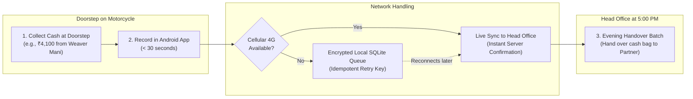
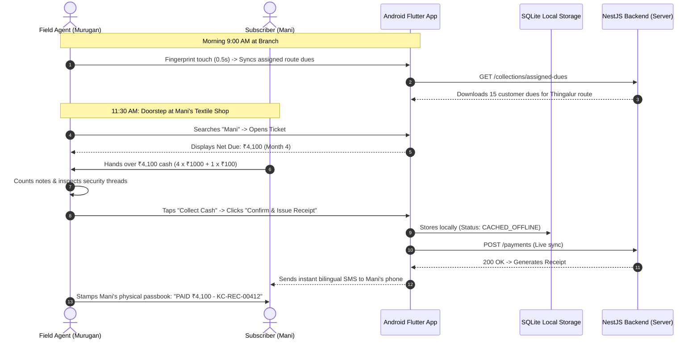
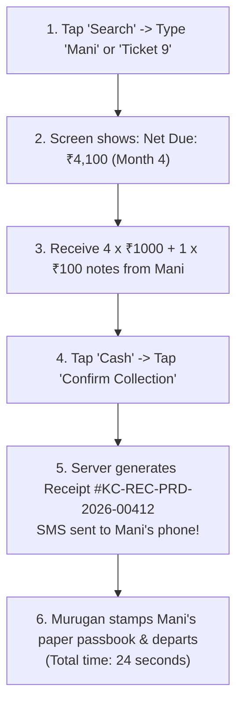
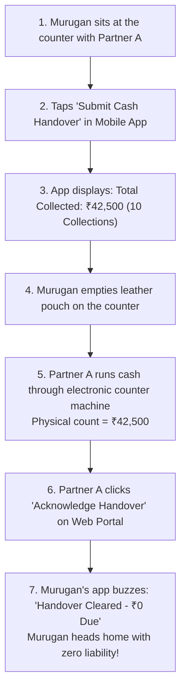

# Phase 3: Field Collection Agent — Comprehensive Operational Guide & User Journeys

> **Product**: **Kumaran Chits**  
> **Company**: **Kumaran Finance** (Head Office: Perundurai, Erode, Tamil Nadu)  
> **Persona**: **Field Collection Agent** (Doorstep Cash Collector)  
> **Target Audience**: Beginners, Field Staff, Route Coordinators, and Mobile Engineers learning Kumaran Chits field operations.  
> **Primary Platform**: **Android Mobile App (`apps/mobile/`)** (Offline-first, 1-second biometric unlock, 30-second doorstep collection)  
> **Secondary Platform**: **Web Portal (Dual Role Only)** (For agents who also perform desk accounting tasks in the afternoon)  
> **Authoritative Compliance**: [`AGENTS.md`](../../../AGENTS.md), [`financial-rules.md`](../../01-business/financial-rules.md), and [`permissions-matrix.md`](../../01-business/permissions-matrix.md).

---

## 1. Persona Mental Model & Real-World Field Context

### Who Is the Field Collection Agent?
In Perundurai and surrounding rural panchayats (Thingalur, Vijayamangalam, Chennimalai, Kunnathur), Kumaran Finance operates with **2 to 3 trusted field collection agents** (e.g., Murugan and Selvam). 

Their day-to-day reality is entirely mobile and on the road:
- They ride 100cc/125cc motorcycles carrying a durable **leather cash-collection shoulder pouch**.
- They visit power-loom weavers, textile printing workshops, tea-stall owners, grocery merchants, and agricultural households at their doorsteps.
- In their bag, they carry their **Android smartphone**, a ballpoint pen, an official Kumaran Finance rubber seal, and subscribers' physical passbooks.
- **The 30-Second Doorstep Imperative**: When an agent pulls up to a busy weaver's shed or tea stall, the merchant cannot stop work for 10 minutes. The agent must unlock their phone, select the subscriber, count the cash, record the payment, stamp the physical passbook, and trigger a bilingual SMS receipt—all in **under 30 seconds**.

### Why Rural Offline Architecture Is Vital
In the agricultural belt between Perundurai and Chennimalai, cellular 4G/5G signals frequently drop into dead zones:
- An agent **cannot tell a customer**: *"The internet is down, I can't take your cash."* In financial operations, turning away cash harms collections and destroys subscriber trust.
- The **Kumaran Chits Android App** is engineered with an **Offline SQLite Vault**. If the agent is in a cell-dead area, the app seamlessly records the collection locally, encrypts it, generates an offline timestamped receipt, and automatically syncs with the Head Office server the moment cellular signal returns.

---

## 2. Granular User Stories across All 10 Modules

Here are the formal Agile user stories defining the exact permissions, boundaries, and tasks for the Field Collection Agent:

### Module 1: Authentication & Security (M1)
* **US-1.1 (1-Second Biometric / MPIN Unlock)**: *As a Field Agent*, I want to unlock the mobile app using my fingerprint (or a 6-digit MPIN) in under 1 second without typing passwords, *so that* I can quickly record collections while standing at a customer's doorstep with my motorcycle helmet on.
* **US-1.2 (Device Cryptographic Binding)**: *As a Field Agent*, I want my app session to be tied securely to my registered phone, *so that* my account cannot be hijacked if my phone is stolen or lost.

### Module 2: Branch & Staff Management (M2)
* **US-2.1 (Viewing Branch Contact & Support)**: *As a Field Agent*, I want to view the Perundurai Head Office phone number and branch code (`PRD`) in my app menu, *so that* I can instantly call a Partner if an emergency arises on the road. *(Agents have zero access to staff management or branch configurations).*

### Module 3: Customer Intake & Lightweight KYC (M3)
* **US-3.1 (On-the-Road Lead Intake)**: *As a Field Agent*, when a friend or neighbor of an existing subscriber asks to join a new chit, I want to capture their basic contact info (Full Name, Phone, Village) as a "New Lead", *so that* the branch partners can follow up and formally enroll them. *(Field agents cannot activate customer accounts or verify KYC documents).*

### Module 4: Chit Scheme Management (M4)
* **US-4.1 (Inspecting Active Schemes for Collection)**: *As a Field Agent*, I want to view the list of active chits (e.g., `KCA-1L-20M-01`, `KCA-2L-20M-02`) and their current month numbers, *so that* I understand which chits are currently collecting dues. *(Agents have read-only access and cannot create or modify schemes).*

### Module 5: Ticket Enrollment & Membership (M5)
* **US-5.1 (Assigned Route Customer Lookup)**: *As a Field Agent*, I want to search and view subscribers assigned to my collection route by their name, phone number, or ticket number, *so that* I can quickly locate their profile when arriving at their home.
* **US-5.2 (Checking Consecutive Missed Months)**: *As a Field Agent*, I want to see if a customer is on their 1st, 2nd, or 3rd consecutive missed month, *so that* I can remind them that 3 consecutive missed dues may lead to company removal (`REMOVED_DEF_3M`).

### Module 6: Installments & Due Schedules (M6)
* **US-6.1 (Real-Time Net Installment Display)**: *As a Field Agent*, I want the app to display the exact net amount due ($I_{net} = I_{base} - Div$) in bold, whole integer Rupees (e.g., `Net Payable: ₹4,100`), *so that* I can quote the exact figure without doing manual mental arithmetic.
* **US-6.2 (Enforcing Discrete Binary Payments)**: *As a Field Agent*, if a customer tries to hand me ₹2,000 for a ₹4,100 due, I want the app to disallow entering partial amounts, *so that* I am supported by the software policy in refusing partial cash.

### Module 7: Field Collections & Cash Handover (M7)
* **US-7.1 (30-Second Doorstep Cash Recording)**: *As a Field Agent*, I want to select a customer's due, tap "Cash", verify the notes, and tap confirm in under 30 seconds, *so that* neither the customer nor I waste valuable business time.
* **US-7.2 (Seamless Offline Collection Queue)**: *As a Field Agent*, when riding through areas with zero cellular reception, I want the app to record collections into an encrypted local queue with a visible "Offline" badge, *so that* I never turn away cash.
* **US-7.3 (Automatic Background Reconnection Sync)**: *As a Field Agent*, when I ride back into mobile network coverage, I want the app to automatically sync all cached collections to the office server using unique idempotency keys, *so that* transactions are committed without duplicate records.
* **US-7.4 (Evening Cash Handover Batch Submission)**: *As a Field Agent*, when I return to the Head Office at 5:00 PM, I want to tap "Submit Cash Handover" to present my daily tally (e.g., `₹42,500`) to the branch cashier/partner for physical counting and sign-off.

### Module 8: Payments, Bilingual Receipts & Reversals (M8)
* **US-8.1 (Immediate Bilingual Digital Receipt)**: *As a Field Agent*, immediately upon confirming a collection, I want the app to show a clean bilingual receipt (English and Tamil) and a one-tap button to share it via WhatsApp or SMS, *so that* the customer receives instant proof of payment.
* **US-8.2 (Payment Reversal Restriction)**: *As a Field Agent*, I want the system to block me from reversing or deleting any payment, *so that* if a cash mistake happens, I must report it to the office accountant to initiate a formal Maker-Checker reversal.

### Module 9: Offline Auctions & Prize Disbursements (M9)
* **US-9.1 (Strict Auction & Prize Isolation)**: *As a Field Agent*, I want to have zero access to auction bidding screens, tie-breaker forms, safety proof checklists, or prize payout releases, *so that* field staff are completely isolated from high-risk prize money disbursements. *(Field agents never disburse prize money).*

### Module 10: Dashboards & Daily Performance (M10)
* **US-10.1 (Personal Daily Collection Dashboard)**: *As a Field Agent*, I want to see my daily progress at the top of the home screen (`Target: ₹45,000`, `Collected: ₹28,000`, `Remaining: ₹17,000`), *so that* I know how much cash is physically in my leather pouch at any given minute.
* **US-10.2 (Electronic Handover Clearance Slip)**: *As a Field Agent*, once the Partner physically counts my cash and signs off the handover, I want an official digital clearance slip with status `CONFIRMED` on my phone, *so that* I am 100% relieved of personal cash liability before heading home.

---

## 3. Step-by-Step UI & Field Action Journeys

---

### Journey 1: Morning Route Sync & Cash Bag Check (9:00 AM at Branch)

Before mounting their motorcycle at 9:00 AM:

1. **Open the Mobile App**:
   - Tap the **Kumaran Chits** icon on the Android phone.
   - Touch your index finger to the rear/side fingerprint sensor.
   - App unlocks instantly ($<0.5$ seconds) and displays the **Agent Collection Dashboard**.
2. **Review Assigned Route Target**:
   - The top banner displays:
     - **Date**: `21-Oct-2026`
     - **Assigned Route**: `Thingalur & Vijayamangalam Belt`
     - **Daily Target**: `₹45,000` across 11 assigned customer tickets.
     - **Cash in Pouch**: `₹0` (Empty leather bag verified).
3. **Trigger Pre-Route Sync**:
   - While still on high-speed branch Wi-Fi, tap the **"Sync Route Dues"** icon.
   - The app downloads full customer profiles, phone numbers, addresses, and pending dues into local encrypted SQLite storage.
   - The app displays: *"11 customer dues cached for offline use. You are ready for field rounds!"*
4. **Physical Gear Check**:
   - Verify leather shoulder pouch is empty and zipped.
   - Ensure official Kumaran Finance date stamp and purple ink pad are in the pouch pocket.
   - Mount motorcycle and depart for the morning route.

---

### Journey 2: 30-Second Doorstep Cash Collection (Online Mode)

At 11:15 AM, Agent Murugan arrives at subscriber Mani's power-loom weaving unit in Thingalur:

#### Detailed Step-by-Step Actions:
1. **Locate Customer Profile (5 seconds)**:
   - Tap the Search bar, type `Mani` or scan Mani's physical passbook QR code.
   - Tap on **Mani — Ticket #9 (KCA-1L-20M-01)**.
2. **Review Net Due Amount (3 seconds)**:
   - The app displays in large bold green font:
     - Installment: `Month 4 / 20`
     - Base: `₹5,000` | Dividend: `- ₹900`
     - **NET AMOUNT PAYABLE: `₹4,100`**
3. **Receive & Verify Physical Cash (10 seconds)**:
   - Mani hands over ₹4,100 cash.
   - Murugan counts the notes, checking for genuine watermarks. Total = **`₹4,100`**.
4. **Confirm Collection in App (4 seconds)**:
   - Tap **"Record Cash Collection"**.
   - Amount is auto-locked to `₹4,100` (Discrete single payment).
   - Tap **"Confirm & Issue Receipt"**.
5. **Instant Receipt & Passbook Stamp (5 seconds)**:
   - The app shows a green checkmark: *"Payment Confirmed — Receipt #KC-REC-PRD-2026-00412"*.
   - Mani's phone buzzes with an incoming SMS from `KMRCHT`:
     > *"Kumaran Chits: Received Rs. 4,100 cash from Mani for Ticket #9 (KCA-1L M4). Receipt: KC-REC-PRD-2026-00412. Thank you!"*
   - Murugan inks the date stamp, stamps line 4 of Mani's physical paper passbook, writes `₹4,100` and his initials, and hands it back.
   - Murugan places the ₹4,100 into his leather pouch.
   - **App Metrics Update**: `Collected: ₹4,100 / ₹45,000 | Cash-in-Hand: ₹4,100`.

---

### Journey 3: Doorstep Cash Collection in a Cellular Dead Zone (Offline Mode)

At 1:30 PM, Murugan visits farmer Ramasamy whose farm is in a hollow with zero cellular reception (phone shows `No Service` / `Emergency Calls Only`):

1. **Offline Mode Indicator**:
   - The top banner of the app turns amber with a cloud-slash icon: **`Offline Mode (Zero Signal)`**.
2. **Accessing Cached Dues**:
   - Murugan opens Ramasamy's profile. Because the data was pre-cached in the morning, Ramasamy's details load instantly from local SQLite.
   - Screen displays: **`Ramasamy — Ticket #3 (KCA-1L-20M-01) | Net Due: ₹4,100`**.
3. **Record Offline Collection**:
   - Ramasamy hands over ₹4,100 cash. Murugan verifies the notes.
   - Murugan taps **"Record Cash Collection"** $\to$ **"Save Offline"**.
4. **Offline Receipt Generation**:
   - The app commits the record to the local SQLite database.
   - The app generates an **Offline Pending Receipt** (`OFFLINE-SYNC-9842100001-1729497000`).
   - Murugan stamps Ramasamy's physical passbook, writes the offline receipt code, and explains: *"Network is currently out, Uncle. You will receive your official SMS receipt as soon as I reach the main road."*
   - Ramasamy is completely reassured because his physical passbook is stamped and signed.
5. **Automatic Reconnection Sync (2:15 PM)**:
   - Murugan rides 3 kilometers out to the Thingalur junction. His phone reconnects to 4G LTE.
   - The app detects internet connectivity in the background and silently triggers the sync queue.
   - An HTTP POST with the unique `idempotencyKey` uploads Ramasamy's collection to the server.
   - The server converts the offline record into permanent official receipt `KC-REC-PRD-2026-00413`.
   - Ramasamy's phone immediately receives the official SMS confirmation.
   - Murugan's app shows: *"1 offline transaction successfully synchronized with Head Office!"*

---

### Journey 4: Capturing a Walk-In Customer Lead on the Road

While at Mani's shop, Mani's brother-in-law (Karthik) says: *"I heard you are starting a new 2 Lakh chit next month. Can I join?"*

1. **Open Lead Intake Form**:
   - In the app bottom navigation, tap **"Leads" $\to$ "+ New Lead"**.
2. **Enter Lightweight Details (60 seconds)**:
   - Full Name: `S. Karthik` (கார்த்திக்)
   - Mobile Number: `9842199112`
   - Village / Area: `Thingalur West`
   - Interested Scheme: `₹2,00,000 (20 Months)`
   - Notes: *"Mani's brother-in-law, owns grocery shop opposite school."*
3. **Submit Lead**:
   - Tap **"Save Lead"**.
   - The record syncs to the Head Office portal.
   - Murugan tells Karthik: *"Thank you, brother! Partner Chinnasamy will call you from the office tomorrow morning to complete your enrollment."*
   - *(Notice: Murugan does not assign a ticket or collect advance money, respecting Module 5 and Module 7 guardrails).*

---

### Journey 5: Evening 5:00 PM Cash Handover at Head Office

At 4:45 PM, Agent Murugan returns to the Perundurai Head Office:

#### Detailed Step-by-Step Actions:
1. **Prepare Handover Batch in App**:
   - Murugan taps **"Evening Cash Handover"** in the app menu.
   - The screen shows the compiled daily breakdown:
     - Cash Collections Today: `10 Subscribers`
     - Total Cash in Bag: **`₹42,500`**
     - Note Denomination Helper:
       - ₹500 $\times$ 84 notes = ₹42,000
       - ₹100 $\times$ 5 notes = ₹500
   - Murugan taps **`"Submit Handover Batch #HO-2026-0092"`**.
2. **Physical Cash Handover**:
   - Murugan unzips his leather bag and places the cash stacks on the counter in front of Partner A.
   - Partner A feeds the ₹500 notes into the note-sorting machine: `84 notes = ₹42,000`.
   - Partner A adds the 5 notes of ₹100: `5 notes = ₹500`.
   - Physical cash count = **`₹42,500`**. The physical money matches the app batch to the exact rupee!
3. **Partner A Acknowledgment**:
   - Partner A clicks **"Acknowledge Handover"** on the Head Office desktop PC.
4. **Instant App Clearance**:
   - Murugan's mobile app immediately vibrates and updates with a green seal:
     > 🛡️ **Handover Confirmed**: Batch `#HO-2026-0092`  
     > **Amount Acknowledged**: `₹42,500`  
     > **Received By**: `Partner A (Head Office Vault)`  
     > **Your Current Cash Liability**: `₹0`
   - Murugan signs the branch physical handover journal, puts his empty bag away, and safely heads home for the evening.

---

### Journey 6: The Dual-Role Safety Block (Self-Acknowledgment Defense)

Suppose Agent Murugan also performs desk accounting duties on Saturdays. At 5:00 PM, he tries to acknowledge his own collection:

1. Murugan sits at the Head Office PC, opens the Web Portal under his staff login, and navigates to **"Pending Handovers"**.
2. He locates his own batch: `Batch #HO-2026-0092 (Collector: Murugan, ₹42,500)`.
3. If Murugan clicks the "Acknowledge" button, the system **instantly rejects the action**:
   > ⛔ **Dual-Role Guard Violation (HTTP 403)**:  
   > *"Access Denied: You collected this cash batch. Under Kumaran Finance financial guardrails, an independent Partner or Cashier must physically count the money and sign off."*
4. Murugan calls Partner B over to the desk. Partner B logs in, counts the physical notes, and completes the acknowledgment.

---

## 4. Edge Cases, Traps & Mistakes to Avoid

| Potential Trap / Mistake | What Happens in the Software | How the Agent Resolves It |
|---|---|---|
| **Subscriber insists on paying ₹2,000 instead of ₹4,100 due** | App disallows entering anything other than the exact net due. | Politely tell the member: *"Brother, our company system does not accept partial payments. Please pay the remaining ₹2,100 together so your official receipt can be issued."* |
| **Phone battery completely dies while on the route** | Agent cannot use the mobile app. | Pull out the emergency physical carbon-copy receipt book from the motorcycle bag. Issue a hand-written receipt, stamp the passbook, and transcribe it into the app upon returning to the office. |
| **Customer claims: "I already paid online via GPay"** | App shows the due as `UNPAID` because no gateway/bank confirmation was recorded. | Tap "Refresh Profile". If still `UNPAID`, ask customer for their UPI transaction reference number (UTR). Call the Head Office desk to verify if the bank account received it before stamping their passbook. |
| **Agent loses cellular signal for 4 hours in rural farms** | App automatically switches to **Offline Mode**. | Continue collecting normally. Stamp customer passbooks with offline receipt IDs. When returning to network, the app auto-syncs without data loss. |
| **Winning subscriber asks: "Can you bring my ₹75,000 prize cash to my home?"** | Field agents have zero prize disbursement permissions in the app. | Explain clearly: *"Per Kumaran Finance rules, prize money is disbursed exclusively at the branch office after verifying signed agreements and blank cheques with the Partners."* |

---

## 5. Review & Approval Gate

This concludes the exhaustive operational and educational guide for **Persona 3: Field Collection Agent (Doorstep Cash Collector)**.

Please review this document. Once you are satisfied with the workflows, offline sync mechanisms, and doorstep rules, let me know to proceed to **Phase 4: Customer / Chit Subscriber**.
