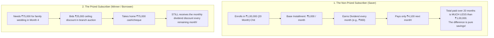
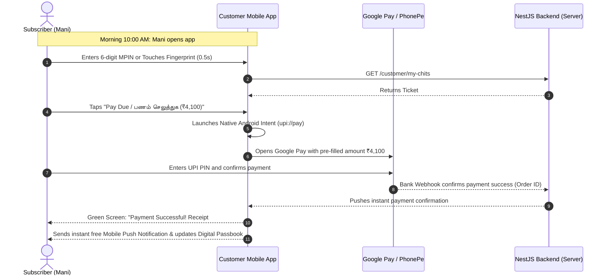
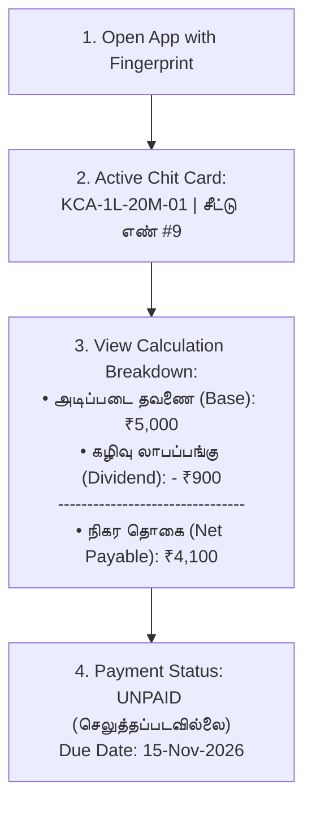

# Phase 4: Customer / Chit Subscriber — Comprehensive Operational Guide & User Journeys

> **Product**: **Kumaran Chits**  
> **Company**: **Kumaran Finance** (Head Office: Perundurai, Erode, Tamil Nadu)  
> **Persona**: **Customer / Chit Subscriber (சந்தாதாரர்)**  
> **Target Audience**: Subscribers, Beginners, Customer Support, and Mobile Engineers learning subscriber workflows.  
> **Primary Platform**: **Android Mobile App (`apps/mobile/`)** (Bilingual English & தமிழ், 1-tap UPI, digital passbook)  
> **Secondary Platform**: **Customer Physical Paper Passbook** (Where agent/staff hand-writes and signs monthly entries)  
> **Authoritative Compliance**: [`AGENTS.md`](../../../AGENTS.md), [`financial-rules.md`](../../01-business/financial-rules.md), and [`permissions-matrix.md`](../../01-business/permissions-matrix.md).

---

## 1. Persona Mental Model & Real-World Subscriber Context

### Who Is the Subscriber at Kumaran Finance?
Kumaran Finance serves the industrious communities of Perundurai and Erode district:
- Power-loom and hand-loom weavers in Chennimalai and Thingalur.
- Small grocery, tea-stall, and textile shop owners in Perundurai town.
- Turmeric and coconut farmers across rural Erode panchayats.
- Salaried workers, teachers, and local families planning for weddings, children's higher education, or house renovations.

### Why Do They Join Kumaran Chits?
Chit funds in Tamil Nadu fulfill two vital financial needs that traditional commercial banks often fail to serve with personal care:
1. **Disciplined Monthly Savings**: Saving a fixed sum every month while earning **monthly dividends** that reduce their out-of-pocket payment.
2. **Access to Borrowing Without Pledging Land**: When a farmer needs to buy a borewell motor or a weaver needs to purchase yarn, they do not need to mortgage their ancestral land or wait months for a bank loan. They can bid in the monthly auction and take home the **lump-sum prize money** in cash or cheque within days.

---

## 2. Core Concepts Explained for Subscribers (In Plain Tamil & English)

### 1. Universal Equal Dividend (அனைவருக்கும் சமமான லாபப் பங்கு)
In Kumaran Finance, **every single member gets the exact same dividend discount every month**.
* Even after you win the auction and take home the prize money, **your dividend does NOT stop**.
* If the dividend for Month 5 is ₹1,050, **all 20 members** (including the person who won in Month 2, the person who won in Month 4, and those who haven't won yet) pay the exact same discounted net amount:
  $$\text{Net Payable} = ₹5,000 - ₹1,050 = \text{₹}3,950$$

### 2. The 25% (1/4) Safety Ceiling (உச்சவரம்பு பாதுகாப்பு)
Under Kumaran Finance rules, the maximum discount any member can bid is strictly capped at **one-fourth (25%) of the chit value**.
* On a ₹1,00,000 chit, no one can bid more than **₹25,000**.
* *Why this protects you*: In unregulated chits, desperate members bid 40% or 50% discount and lose all their money. The 25% ceiling ensures you always take home at least ₹75,000.

### 3. Month 1 & Month 20 (Final Month) Rules
* **Month 1**: Taken by the company as the organizer ticket. There is **NO auction**, and the dividend is ₹0 (everyone pays the base ₹5,000).
* **Month 20 (Final Month)**: There is **NO auction**. The last remaining member who never bid simply receives the full prize money settled directly with 4% company commission.
* **Auctions occur strictly in Months 2 through 19**.

### 4. Auction Eligibility (ஏலத்தில் பங்கேற்க தகுதி)
To bid in any monthly auction, **you must have paid your installment due for that month**. If your due is unpaid on auction day, the software strictly blocks you from bidding to protect company funds.

### 5. The 3-Month Arrears Warning (3 மாத நிலுவை எச்சரிக்கை)
If a subscriber fails to pay for **3 consecutive months**, the company has the legal right to remove them from the chit (`REMOVED_DEF_3M`) and substitute another member. Always pay your monthly due on time!

---

## 3. Granular User Stories across All 10 Modules

Here are the formal Agile user stories defining every capability the Customer has:

### Module 1: Authentication & Security (M1)
* **US-1.1 (Mobile Login & Language Choice)**: *As a Subscriber*, I want to log in using my 10-digit mobile number, SMS OTP, and set a 6-digit MPIN (or Fingerprint) with a choice of **English or தமிழ்**, *so that* I can access my passbook in my mother tongue.
* **US-1.2 (Strict Privacy & Anti-IDOR)**: *As a Subscriber*, I want the system to ensure that only I can see my chit tickets and receipts, *so that* no other subscriber can view my financial balance.

### Module 2: Branch Information & Customer Support (M2)
* **US-2.1 (Branch Contact & Direct Phone Help Desk)**: *As a Subscriber*, I want to see Kumaran Finance's Perundurai Head Office address and direct phone dialer button (`0424-2223333` / partner mobiles), *so that* I can easily contact the branch partners directly with one tap.

### Module 3: Customer Profile & Nominee (M3)
* **US-3.1 (Viewing My Profile & Nominee)**: *As a Subscriber*, I want to verify my registered address, masked Aadhaar (`XXXXXXXX1234`), and registered Nominee name, *so that* I know my family's claim is properly recorded in company files.

### Module 4: Enrolled Schemes & Calendar (M4)
* **US-4.1 (My Active Chits)**: *As a Subscriber*, I want to view all chit schemes I am enrolled in, showing the chit value (e.g., ₹1,00,000), total duration (20 months), and current month number, *so that* I can track my multi-chit savings.

### Module 5: Ticket Details & Membership Status (M5)
* **US-5.1 (Single Ticket Verification)**: *As a Subscriber*, I want to see my unique ticket number (e.g., `Ticket #9`) in each group and confirm my status as **Non-Prized (சேமிப்பாளர்)** or **Prized Winner (வெற்றியாளர்)**.
* **US-5.2 (Overdue & Default Alert)**: *As a Subscriber*, if I forget to pay my due, I want the app to show a clear warning banner showing days overdue, *so that* I do not reach 3 consecutive months of arrears.

### Module 6: Installments & Dividend Savings (M6)
* **US-6.1 (Transparent Net Installment Math)**: *As a Subscriber*, I want to see the clear breakdown of my monthly due:
  $$\text{Base Installment (₹5,000)} - \text{Dividend Earned (₹900)} = \textbf{Net Due: ₹4,100}$$
  *so that* I understand exactly how much dividend savings I earned this month.
* **US-6.2 (Single Discrete Payment Rule)**: *As a Subscriber*, I want to pay the full net installment in one transaction, knowing that partial payments and advance balances are disallowed to keep books clean.

### Module 7: Doorstep Payments to Field Agents (M7)
* **US-7.1 (Instant App Push Notification on Doorstep)**: *As a Subscriber*, when I hand physical cash and my paper passbook to Agent Murugan at my home, I want my phone to receive an immediate in-app push notification and digital passbook update before the agent leaves, *so that* I have instant digital confirmation alongside my signed paper passbook.

### Module 8: Online UPI Payments & Bilingual Receipts (M8)
* **US-8.1 (1-Tap UPI Payment)**: *As a Subscriber*, I want to pay my monthly due using Google Pay, PhonePe, Paytm, or BHIM directly from my mobile app, *so that* I don't have to wait for the field agent or visit the branch office.
* **US-8.2 (Download Bilingual PDF Receipt)**: *As a Subscriber*, I want to view and download official bilingual (English + Tamil) digital PDF receipts with sequential numbers (`KC-REC-PRD-2026-XXXXX`) for every payment I make.

### Module 9: In-Office Auction Results & Transparency (M9)
* **US-9.1 (Auction Date & Eligibility Status)**: *As a Subscriber*, I want to see the date and time of the next branch auction (e.g., *15-Nov-2026 at 4:00 PM*) and see a green badge saying **"Eligible to Bid (தகுதியுடையவர்)"** if my due is paid.
* **US-9.2 (Past Auction Results & Dividend Credit)**: *As a Subscriber*, I want to see the winning ticket number, winning discount, and my credited dividend for every past month, *so that* I have complete transparency on auction fairness.

### Module 10: 20-Month Continuous Digital Passbook (M10)
* **US-10.1 (Form XXI Digital Passbook)**: *As a Subscriber*, I want a 20-month continuous digital ledger showing month-by-month installments, dividend savings, payment dates, receipt numbers, and cumulative savings, *so that* I can review my financial history anytime.

---

## 4. Step-by-Step UI Action Journeys

---

### Journey 1: First-Time App Setup & Language Selection

When subscriber Mani installs the app on his Android phone:

1. **Download App**: Open Google Play Store, search **"Kumaran Chits"**, and tap Install.
2. **Language Selection Screen**:
   - The app opens with two large buttons:
     - **English**
     - **தமிழ் (Tamil)**
   - Mani taps **தமிழ்**. The entire interface switches into clear, clean Tamil typography.
3. **Mobile Number Verification**:
   - Mani enters his 10-digit mobile number: `9842143210`.
   - Tap **"தொடர்க / Continue"**.
   - An SMS with a 6-digit OTP arrives via MSG91 (`1407...` TRAI DLT flow).
   - The app auto-detects the SMS and fills the OTP.
4. **Set 6-Digit MPIN**:
   - Mani enters a private 6-digit PIN: `147258`. Re-enters to confirm.
   - Screen prompts: *"கைரேகை உள்நுழைவை இயக்க விரும்புகிறீர்களா? / Enable Fingerprint Unlock?"*
   - Mani touches the fingerprint sensor. Biometric unlock is activated.
5. **Welcome Home Screen**:
   - Mani is welcomed with his name: **"வணக்கம், எஸ். மணி!"**
   - Shows active ticket: `KCA-1L-20M-01 (சீட்டு எண் #9)`.

---

### Journey 2: Inspecting Monthly Due & Dividend Savings

On the 5th of every month, Mani opens his app to check his payable installment:

#### Detailed Screen Inspection:
1. The Home screen displays a crisp savings card:
   - **Chit Name**: `KCA-1L-20M-01 (1 Lakh - 20 Months)`
   - **Ticket Number**: `சீட்டு எண்: #9`
   - **Membership Type**: `சேமிப்பாளர் (Non-Prized Subscriber)`
2. **The Due Breakdown Container**:
   - Base Installment: `₹5,000`
   - Minus Dividend Earned (Month 4 Auction): `- ₹900`
   - **NET PAYABLE DUE: `₹4,100`**
   - **Due Date**: `15-Nov-2026` (10 days remaining).
   - **Status**: `UNPAID (செலுத்தப்படவில்லை)`.
3. Mani smiles knowing he only has to pay ₹4,100 instead of ₹5,000 because of his **₹900 dividend savings**!

---

### Journey 3: 1-Tap Online Payment via UPI (Google Pay / PhonePe)

Mani decides to pay online from his textile shop without waiting for the agent:

1. **Tap "Pay Due" Button**:
   - On the due card, Mani taps the large green button: **"பணம் செலுத்துக / Pay Due (₹4,100)"**.
2. **Payment Confirmation Modal**:
   - The app displays:
     - Subscriber: `S. Mani (9842143210)`
     - Ticket: `KCA-1L-20M-01 (#9)`
     - Amount: `₹4,100` (Whole integer Rupees).
     - *Note*: Amount cannot be edited. Partial payments are disallowed.
   - Mani taps **"Pay with UPI (GPay / PhonePe / Paytm)"**.
3. **Android App Chooser**:
   - The phone opens the native Android Intent sheet showing installed UPI apps: **Google Pay**, **PhonePe**, **Paytm**.
   - Mani taps **Google Pay**.
4. **Authorize in Google Pay**:
   - Google Pay opens with pre-filled payee `Kumaran Finance` and exact amount `₹4,100`.
   - Mani enters his 4-digit UPI bank PIN.
   - Google Pay displays: *"Paid ₹4,100 to Kumaran Finance - UPI Ref: 4291880192"*.
5. **Instant App Confirmation & Receipt**:
   - Mani is returned to the Kumaran Chits app.
   - The screen shows a festive green checkmark animation:
     > ✅ **பணம் வெற்றிகரமாக செலுத்தப்பட்டது! / Payment Successful!**  
     > **ரசீது எண் / Receipt No**: `KC-REC-PRD-2026-00412`  
     > **செலுத்திய தொகை / Amount Paid**: `₹4,100`  
     > **செலுத்திய முறை / Mode**: `UPI (Google Pay)`  
     > **தேதி / Date**: `21-Oct-2026 10:05 AM`
6. **Download Receipt**:
   - Mani taps **"ரசீதை பதிவிறக்குக / Download PDF Receipt"**.
   - A clean bilingual A5 PDF receipt is saved to his phone's Downloads folder.
   - Mani's due status changes immediately from `UNPAID` to **`PAID (செலுத்தப்பட்டது)`**.

---

### Journey 4: Paying Cash at the Doorstep & Receiving Instant Push Notification

If Mani prefers paying physical cash when Field Agent Murugan visits his shop:

1. Agent Murugan arrives on his motorcycle and quotes the exact due: `₹4,100`.
2. Mani hands over 4 notes of ₹1,000 + 1 note of ₹100 along with his **physical paper passbook booklet**.
3. Murugan counts the notes, taps confirm on his agent mobile app, hand-writes the entry in Mani's physical passbook, and signs with pen.
4. Within **3 seconds**, Mani's smartphone chimes with a **free Mobile App Push Notification**:
   > *"குமரன் பைனான்ஸ்: மணி அவர்களுக்கு நன்றி. சீட்டு KCA-1L #9 மாத தவணை 4-க்கான தொகை ரூ. 4,100 ரொக்கமாக பெறப்பட்டது. ரசீது எண்: KC-REC-PRD-2026-00412."*
5. Mani taps the notification:
   - The Kumaran Chits app opens directly to his **Digital Passbook**.
   - Month 4 is automatically marked **`PAID`** with a green shield.
   - Mani has his double guarantee: **his signed paper passbook in hand** and his **digital app passbook updated**!

---

### Journey 5: Pre-Auction Eligibility & Attending the Branch Auction

On the 15th of the month at 4:00 PM, Kumaran Finance holds the monthly in-office auction:

1. **Check Auction Eligibility in App**:
   - Mani taps **"Auctions / ஏல விவரங்கள்"**.
   - Screen displays:
     - Next Auction: `KCA-1L-20M-01 (Month 5 Auction)`
     - Date & Time: `15-Nov-2026 at 4:00 PM`
     - Location: `Perundurai Head Office Counter`
     - **Your Bidding Status**: 
       - If Month 4 due is PAID: **`தகுதியுடையவர் / ELIGIBLE TO BID`** (Green Shield).
       - If Month 4 due is UNPAID: **`தகுதியற்றவர் / INELIGIBLE (UNPAID DUE)`** (Red Warning).
2. **Attending the In-Person Auction**:
   - Mani travels to the Head Office. He sits in the auction room with other subscribers.
   - The Foreman (Partner A) calls for bids.
   - Bidders shout discounts starting from ₹15,000 up to the **25% ceiling (₹25,000)**.
3. **If Mani Wins the Auction**:
   - Mani bids the winning discount of ₹24,000.
   - Partner A records Ticket `#9` as the winner.
   - Mani's app status updates to **`வெற்றியாளர் / PRIZED WINNER`**.
   - His prize money calculation is clearly displayed:
     $$\text{Chit Value (₹1,00,000)} - \text{Bid Discount (₹24,000)} = \textbf{Prize Money: ₹76,000}$$

---

### Journey 6: Receiving Prize Money & Submitting Company Safety Proof

To claim his ₹76,000 prize money, Mani visits the branch desk 3 days later:

1. **Inspect Safety Proof Checklist in App**:
   - Under **"My Prize Payout"**, Mani sees what documents to bring:
     - [ ] Sign Winner Chit Agreement Form.
     - [ ] Nominee signature (Wife: Shanthi).
     - [ ] Signed blank bank cheque (as company safety proof).
     - [ ] Demand promissory note.
   - *(Note: No land documents or property deeds are required).*
2. **Branch Handover & Verification**:
   - Mani and his wife Shanthi sign the agreement at the counter.
   - Mani hands over a signed blank cheque from his Canara Bank account.
   - Desk Accountant Selvi uploads photos of the cheque and agreement into the system.
3. **Payout Authorization & Disbursement**:
   - Partner B authorizes the voucher.
   - Partner A hands Mani an **Account Payee Cheque for ₹76,000** (or initiates direct bank NEFT).
   - Mani's mobile app immediately displays: **`Prize Money Disbursed (ரூ. 76,000 வழங்கப்பட்டது)`** along with payment voucher `#PV-2026-0045`.
4. **Future Months Reassurance**:
   - Mani opens his app next month. He sees that **he still receives his monthly dividend discount** just like everyone else!

---

## 5. Edge Cases, Traps & Mistakes to Avoid

| Potential Trap / Mistake | What Happens in the Software | How the Customer Resolves It |
|---|---|---|
| **Customer tries to pay ₹2,000 online via UPI instead of ₹4,100** | App locks the payment field to the exact net due (₹4,100). The amount is non-editable. | Chit funds do not allow partial installments. Pay the full ₹4,100 to keep the ticket active and eligible for auctions. |
| **Bank debited ₹4,100 on GPay, but internet died before returning to app** | The backend's automated payment reconciliation worker detects the gateway webhook and credits the account. | Re-open the app when internet resumes. The status will show `PAID`. If not, tap **"Contact Branch"** and share your UPI 12-digit UTR number. |
| **Subscriber fails to pay for 3 continuous months** | Warning modal appears: `3 மாத நிலுவை எச்சரிக்கை / 3-Month Arrears Warning`. | Visit the branch office immediately, clear all pending dues with the partners to prevent ticket cancellation and legal default action (`REMOVED_DEF_3M`). |
| **Subscriber thinks dividend stops after winning the prize money** | It does NOT stop. Kumaran Finance uses Universal Equal Dividends. | Check your app next month! You will see the exact same dividend deducted from your base installment as non-prized members. |
| **Subscriber forgets their 6-digit MPIN** | Cannot log in with old PIN. | Tap **"Forgot MPIN / பின் மறந்துவிட்டதா?"**. Enter mobile number, verify with SMS OTP, and set a new 6-digit MPIN in 30 seconds. |

---

## 6. Review & Approval Gate

This concludes the exhaustive operational and educational guide for **Persona 4: Customer / Chit Subscriber (சந்தாதாரர்)**.

Please review this document. Once you are satisfied with the workflows, bilingual screens, universal dividend rules, and UPI journeys, let me know to proceed to **Phase 5: Branch Manager (Operational Lead)**.
