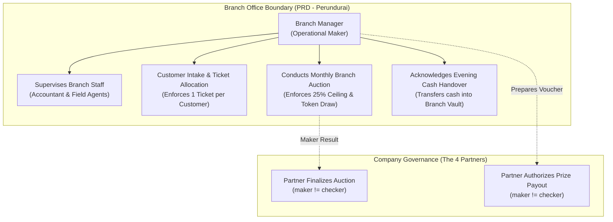
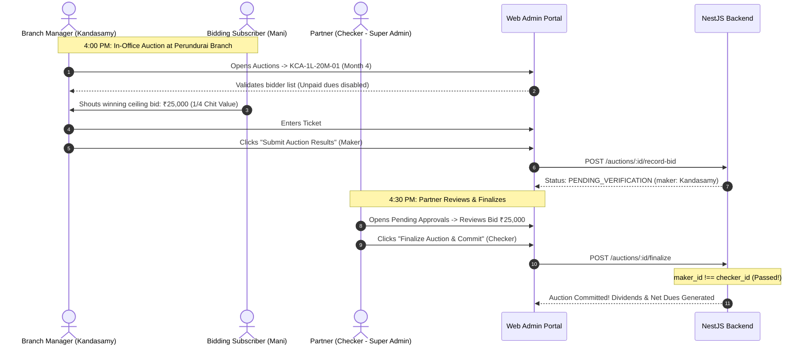
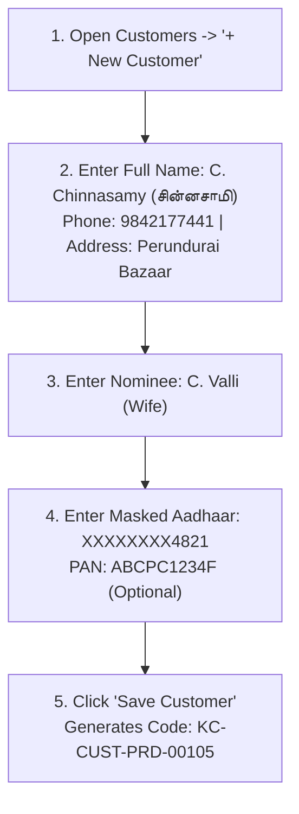
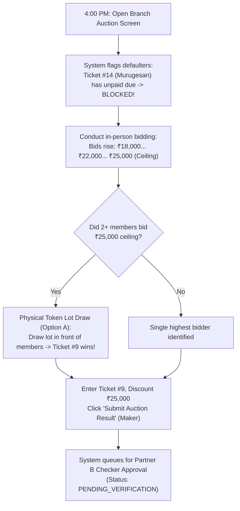

# Phase 5: Branch Manager (Operational Lead) — Comprehensive Operational Guide & User Journeys

> **Product**: **Kumaran Chits**  
> **Company**: **Kumaran Finance** (Head Office: Perundurai, Erode, Tamil Nadu)  
> **Persona**: **Branch Manager / Operational Lead**  
> **Target Audience**: Beginners, Branch Managers, Operations Coordinators, and Engineers learning branch-scoped operations.  
> **Primary Platform**: **Web Portal (`apps/web/`)** (Branch management workspace, customer intake, auction desk, vault supervision)  
> **Operating Reality**: In current operations at Kumaran Finance, **the 4 Partners fulfill all Branch Manager duties directly**. However, the software maintains this role as a distinct, branch-scoped persona for future branch expansions across Tamil Nadu.  
> **Authoritative Compliance**: [`AGENTS.md`](../../../AGENTS.md), [`financial-rules.md`](../../01-business/financial-rules.md), and [`permissions-matrix.md`](../../01-business/permissions-matrix.md).

---

## 1. Persona Mental Model & Real-World Context

### Who Is the Branch Manager?
The **Branch Manager** is the operational leader responsible for the day-to-day execution of a physical branch office (e.g., Head Office - Perundurai, branch code `PRD`):
- They manage branch staff: the Desk Accountant and the 2 to 3 Field Collection Agents assigned to that branch.
- They lead local subscriber intake, verify customer KYC documents, and allocate tickets.
- They conduct the **monthly in-person chit auctions** at the branch counter in the presence of attending subscribers.
- They supervise the branch cash desk, count evening cash handovers from field agents, and ensure the physical safe vault reconciles to the rupee.

### Branch Scoping & Anti-BOLA Security (OWASP Top 10)
To prevent cross-branch data leaks, the Kumaran Chits architecture enforces strict **Branch Scoping (`user.branchId === item.branchId`)**:
- A Branch Manager assigned to Perundurai (`PRD`) can **only** see customers, collections, tickets, and vouchers belonging to Perundurai.
- If a manager attempts to open a receipt or customer folder from a different branch, the backend's [`DocumentAccessHelper`](file:///u:/Kumaran-finance/apps/api/src/storage/helpers/document-access.helper.ts) immediately blocks the request with `HTTP 403 Forbidden`.

---

## 2. What the Branch Manager CAN and CANNOT Do

To maintain strict financial governance, the Branch Manager's powers are deliberately partitioned:

| Action Category | Branch Manager Capability | Who Has Final Authority? |
|---|---|---|
| **Customer Intake & KYC** | ✅ Creates profiles, verifies last 4 digits of Aadhaar, PAN, and links nominees. | Branch Manager |
| **Ticket Allocation** | ✅ Assigns tickets 1 to $N$ to verified branch subscribers (Max 1 per scheme). | Branch Manager |
| **Chit Scheme Creation** | ❌ Review only. Cannot create schemes or alter 4.00% foreman commission. | **The 4 Partners (Super Admin)** |
| **Conducting Auctions** | ✅ Conducts physical auction; records winning bid as **Maker**. | **The 4 Partners (Checker Finalization)** |
| **Prize Money Release** | ✅ Verifies safety proof checklist; prepares payout voucher as **Maker**. | **The 4 Partners (Checker Authorization)** |
| **Cash Handover** | ✅ Acknowledges evening field agent cash batches into the branch safe vault. | Branch Manager / Partner |
| **Payment Reversals** | ✅ Submits reversal request with documented justification as **Maker**. | **The 4 Partners (Checker Approval)** |

---

## 3. Granular User Stories across All 10 Modules

Here are the formal Agile user stories defining every capability of the Branch Manager:

### Module 1: Authentication & Security (M1)
* **US-1.1 (Branch Manager Web Login & 2FA)**: *As a Branch Manager*, I want to log in using my staff credentials and Microsoft Authenticator TOTP, *so that* access to branch operations is strictly authenticated.
* **US-1.2 (Strict Branch Scoping Enforcement)**: *As a Branch Manager*, I want the system to restrict my visibility strictly to my assigned branch (`PRD`), *so that* cross-branch customer data cannot be leaked.

### Module 2: Branch & Staff Supervision (M2)
* **US-2.1 (Branch Profile Management)**: *As a Branch Manager*, I want to view my branch's legal metadata (Perundurai Head Office, bilingual Tamil/English address, landline phone, GSTIN), *so that* all receipts print with accurate local headers.
* **US-2.2 (Staff Supervision & Route Tracking)**: *As a Branch Manager*, I want to view active staff assigned to my branch (Desk Accountant and Field Agents), *so that* I can monitor route assignments and counter coverage.

### Module 3: Customer Intake & Lightweight KYC (M3)
* **US-3.1 (Complete Customer Intake)**: *As a Branch Manager*, I want to onboard new subscribers by entering their full name (English and Tamil), phone, address, and nominee details, *so that* local subscribers are formally enrolled.
* **US-3.2 (Document Verification & Privacy)**: *As a Branch Manager*, I want to inspect customer identity cards, recording only the last 4 digits of Aadhaar (`XXXXXXXX4821`) and PAN, and upload optional photos to private S3, *so that* branch files are legally compliant without violating data protection laws.

### Module 4: Chit Scheme Oversight (M4)
* **US-4.1 (Reviewing Active Branch Chits)**: *As a Branch Manager*, I want to view all running chit schemes operating at my branch, tracking their current month, total pool value, and auction schedule, *so that* branch operations run smoothly.

### Module 5: Ticket Enrollment & Arrears Monitoring (M5)
* **US-5.1 (Enrolling Subscribers into Tickets)**: *As a Branch Manager*, I want to allocate tickets (1 to $N$) to approved subscribers, with the system strictly preventing any customer from holding 2 or more tickets in the same scheme, *so that* concentration risk is avoided.
* **US-5.2 (Managing 3-Month Defaulters)**: *As a Branch Manager*, I want to review subscribers who have missed 3 consecutive monthly installments and submit removal recommendations (`REMOVED_DEF_3M`) to the Partners, *so that* inactive tickets can be reassigned.

### Module 6: Due Schedules & Dividend Allocations (M6)
* **US-6.1 (Branch Dues Schedule Lookup)**: *As a Branch Manager*, I want to view the active due schedule for my branch showing the net installment payable ($I_{net} = I_{base} - Div$) for all tickets, *so that* I can resolve customer billing inquiries accurately.

### Module 7: Field Collections & Cash Handover (M7)
* **US-7.1 (Supervising Route Progress)**: *As a Branch Manager*, I want to monitor live field collection totals during the day, *so that* I know which agents have completed their assigned routes.
* **US-7.2 (Acknowledging Evening Cash Handover)**: *As a Branch Manager*, I want to physically count cash brought in by agents at 5:00 PM, verify the note denominations, and click acknowledge, *so that* cash is transferred safely into the branch safe vault.
* **US-7.3 (Anti-Self-Acknowledgment Assertion)**: *As a Branch Manager*, if I personally collected cash in the field, I want the software to prevent me from acknowledging my own handover, requiring an independent Partner to sign off, *so that* dual control is maintained.

### Module 8: Payments, Digital Receipts & Reversals (M8)
* **US-8.1 (Branch Counter Payment Handling)**: *As a Branch Manager*, I want to assist at the counter during peak morning hours by recording walk-in payments, signing customer physical passbooks, and triggering free in-app mobile push notifications (with fallback SMS if non-smartphone), *so that* subscriber wait times are minimized without wasteful SMS gateway costs.
* **US-8.2 (Initiating Payment Reversal — Maker)**: *As a Branch Manager*, if a counter cashier makes a posting mistake, I want to submit a formal reversal request with the attached physical receipt photo and reason, *so that* a Partner can review and approve the correction.

### Module 9: Conducting Branch Auctions & Payout Prep (M9)
* **US-9.1 (Conducting In-Person Branch Auction — Maker)**: *As a Branch Manager*, I want to conduct the physical monthly auction at the branch counter, verify that unpaid members are blocked from bidding, record the winning ticket and bid discount (up to the 25% ceiling), and submit the result for Partner finalization.
* **US-9.2 (Executing Physical Paper Token Draw — Option A)**: *As a Branch Manager*, when multiple bidders bid the maximum 25% ceiling, I want to conduct a physical lot draw in front of members and record the drawn winning ticket into the software, *so that* the process remains transparent and trusted.
* **US-9.3 (Verifying Safety Proof Checklist — Maker)**: *As a Branch Manager*, I want to inspect the winner's agreement, nominee signature, blank bank cheques, and promissory notes, upload scans, and prepare the payout voucher for Partner authorization.

### Module 10: Branch Dashboards & Form XXII Cash Book (M10)
* **US-10.1 (Branch Executive Dashboard)**: *As a Branch Manager*, I want to view my branch's daily collection targets, overdue subscriber lists, upcoming auction dates, and vault cash position at a glance.
* **US-10.2 (Form XXII Daily Cash Book Balancing)**: *As a Branch Manager*, I want to inspect the branch 12-column daily cash register at 6:00 PM, ensuring that the physical cash in the safe matches the system closing balance to the last rupee before locking the vault.

---

## 4. Step-by-Step UI & Desk Action Journeys

---

### Journey 1: Morning Branch Desk Opening & Field Agent Dispatch

At 8:30 AM every morning at the Perundurai Head Office:

1. **Log In to Desktop Web Portal**:
   - Visit `https://admin.kumaranfinance.com`.
   - Enter registered mobile number and password. Enter 6-digit TOTP from Microsoft Authenticator.
   - Screen confirms assigned branch: **`Head Office - Perundurai (PRD)`**.
2. **Review Branch Morning Dashboard**:
   - **Vault Cash in Safe**: `₹3,42,500` (Opening balance).
   - **Today's Branch Target**: `₹85,000` across 22 subscriber collections.
   - **Overdue Priority List**: 6 subscribers flagged with overdue dues $>15$ days.
3. **Dispatch Field Collection Agents**:
   - Meet with Field Agents Murugan and Selvam at the briefing counter.
   - Assign route priorities: Murugan assigned Thingalur; Selvam assigned Chennimalai.
   - Ensure both agents have synced their mobile apps over office Wi-Fi and that their leather cash bags are empty.
   - Dispatch agents to their routes by 9:00 AM.

---

### Journey 2: Branch Customer Intake & Document Verification

At 10:30 AM, local merchant Chinnasamy visits the branch to enroll in Kumaran Chits:

#### Detailed Actions:
1. Navigate to **Customers $\to$ "+ New Customer"**.
2. **Basic Profile Intake (60 seconds)**:
   - Full Name (English): `C. Chinnasamy`
   - Full Name (Tamil): `செ. சின்னசாமி`
   - Mobile Phone: `9842177441`
   - Physical Address: `No. 42, Car Street, Perundurai, Erode - 638052`
   - Nominee Details: `C. Valli (வள்ளி)` — Relationship: `Wife`
3. **Identity & KYC Scans**:
   - Chinnasamy presents his physical Aadhaar card.
   - The Branch Manager inspects the original card and enters only the **last 4 digits**: `4821`. Full 12 digits are never typed.
   - Place card on the counter flatbed scanner and click **"Capture Attachment"**. Scanned image uploads to private encrypted S3 (`kyc/cust-105/*`).
4. **Click "Save Customer Profile"**:
   - The system generates unique code: **`KC-CUST-PRD-00105`**.
   - Profile is now verified and eligible for ticket assignment.

---

### Journey 3: Assigning Tickets to Subscribers (Single Ticket Constraint)

Chinnasamy wants to join the upcoming ₹1,00,000 (20-Month) chit group `KCA-1L-20M-01`:

1. Open **Chit Schemes $\to$ KCA-1L-20M-01 $\to$ "Ticket Allocation"**.
2. The screen shows all 20 tickets (Tickets 1 to 20):
   - Ticket `#1`: Company Representative Ticket (Locked per Month 1 rule).
   - Tickets `#2` to `#11`: Already allocated to verified members.
   - Ticket `#12`: `VACANT`.
3. **Allocate Ticket #12**:
   - Click **"Assign Ticket #12"**.
   - Search subscriber: Type `Chinnasamy` or `9842177441`.
   - Select `KC-CUST-PRD-00105 (C. Chinnasamy)`.
   - Click **"Confirm Ticket Allocation"**.
4. **The Single Ticket Constraint Guard Check (ADR-13)**:
   - If Chinnasamy already held Ticket `#4` in this exact same chit group, the database constraint `@@unique([chitGroupId, customerId])` triggers.
   - The UI blocks the allocation with an immediate error:
     > ⛔ **Ticket Limit Violation**:  
     > *"Subscriber Chinnasamy already holds Ticket #4 in scheme KCA-1L-20M-01. Under Kumaran Finance rules, a customer cannot hold 2 or more tickets in the same scheme."*
   - Since this is Chinnasamy's first ticket in this group, the assignment succeeds cleanly. Ticket `#12` is locked.

---

### Journey 4: Conducting the Monthly Branch Auction as Maker

On the 15th of the month at 4:00 PM, subscribers gather in the branch auction room:

#### Detailed Actions:
1. Open **Auctions $\to$ Active Auctions $\to$ KCA-1L-20M-01 (Month 4)**.
2. **Defaulter Check**:
   - Ticket `#14` is greyed out with badge: **`INELIGIBLE (UNPAID DUE)`**. Murugesan cannot participate.
3. **In-Person Bidding**:
   - Members call out bids. Kandasamy (Ticket `#5`) and Mani (Ticket `#9`) both call out the maximum **₹25,000 ceiling**.
4. **Physical Token Lot Draw (Option A)**:
   - Branch Manager writes `5` and `9` on identical paper tokens, folds them, and places them in the brass lot bowl.
   - An attending customer draws Token `#9` (Mani).
5. **Record Auction Entry (Maker)**:
   - Winning Ticket: `#9 (S. Mani)`.
   - Winning Bid Discount: `₹25,000`.
   - Tie-Breaker Mode: Select **`Physical Paper Token Draw`**.
   - Click **`"Submit Auction Results for Partner Finalization"`** (Maker: Branch Manager).
   - Status changes to `PENDING_VERIFICATION`. The Branch Manager **cannot finalize the auction**; Partner B will finalize it from their phone or desk.
6. **Record Physical Filing with Registrar**:
   - Once Partner B finalizes the auction, the Branch Manager prints Form XVII minutes, collects Foreman and subscriber signatures, and submits the hard copy to the Registrar of Chits office in Erode.
   - The Branch Manager navigates to the auction record and clicks **"Mark Filed with Registrar"** (`PATCH /auctions/:auctionId/mark-filed-with-registrar`), recording the filing date and reference order. The auction transitions to status **`MINUTES_FILED`**.

---

### Journey 5: Acknowledging Evening Cash Handover from Field Agents

At 5:00 PM, Field Agent Selvam returns from Chennimalai with today's cash collection:

1. Selvam taps "Submit Cash Handover" on his mobile phone: `Batch #HO-2026-0091` (`₹38,900` across 9 collections).
2. The Branch Manager opens **Collections $\to$ Pending Handovers $\to$ Batch #HO-2026-0091**.
3. Selvam unzips his leather pouch and places the cash on the counter.
4. The Branch Manager feeds the notes into the electronic note counter:
   - 76 notes of ₹500 = ₹38,000
   - 9 notes of ₹100 = ₹900
   - **Physical Count = `₹38,900`** (Exact match!).
5. The Branch Manager clicks **`"Acknowledge & Transfer to Vault"`**.
   - The system asserts `collector_user_id (Selvam) !== acknowledger_user_id (Branch Manager)`. It passes!
   - System commits the transfer: Selvam's mobile cash-in-hand drops to ₹0, and the Head Office safe vault balance increments by ₹38,900.

---

### Journey 6: Verifying Safety Proof & Submitting Prize Voucher (Maker)

Auction winner Mani visits the branch 3 days later to claim his ₹75,000 prize money:

1. Go to **Disbursements $\to$ Pending Verification $\to$ Ticket #9 (KCA-1L-20M-01)**.
2. Complete the **Company Safety Proof Checklist (ADR-15)**:
   - [x] Safety proof required? Yes.
   - [x] Winner agreement signed? Yes (Mani).
   - [x] Nominee signed? Yes (Shanthi).
   - [x] Signed blank cheques collected? Yes (*Canara Bank, Cheque #004128*).
   - [x] Promissory note signed? Yes.
3. Upload scanned copies of the cheques and agreement into the private S3 vault.
4. Prepare the Payout Voucher:
   - Mode: **`Cheque`** (Kumaran Finance Current A/c Cheque No: `904125`).
   - Amount: **`₹75,000`** (Whole integer Rupees).
   - Click **`"Submit Payout Voucher for Partner Authorization"`** (Maker: Branch Manager).
5. The voucher enters state `PENDING_AUTHORIZATION`. Partner B receives a push notification on their phone to authorize the payout.

---

## 5. Edge Cases, Traps & Mistakes to Avoid

| Potential Trap / Mistake | What Happens in the Software | How the Branch Manager Resolves It |
|---|---|---|
| **Branch Manager attempts to view collections from another branch** | System intercepts request via `DocumentAccessHelper` and throws `HTTP 403: Forbidden`. | Adhere strictly to assigned branch boundary. Cross-branch auditing is restricted to Super Admins and Auditors. |
| **Branch Manager tries to click "Authorize Payout" on prize voucher** | Button does not exist. System restricts authorization to `SUPER_ADMIN`. | Call a Partner to review the attached cheque scan and authorize the release. |
| **Subscriber wants to take 2 tickets in the same scheme** | Software database constraint `@@unique([chitGroupId, customerId])` rejects assignment. | Explain to subscriber: *"Company rules permit 1 ticket per customer per chit. You are welcome to take a second ticket in our 2 Lakh scheme instead."* |
| **Ceiling tie in branch auction (3 members bid ₹25,000)** | Software requires a single winning ticket number. | Conduct physical lot draw with 3 paper tokens in front of all members. Enter the drawn winning ticket into the software. |
| **Field agent reports cash loss on the road** | Never acknowledge a short handover. | Count the actual cash in the pouch. If pouch contains ₹35,000 instead of ₹38,900, record the actual physical cash received, and immediately alert the Partners to investigate the shortage. |

---

## 6. Review & Approval Gate

This concludes the exhaustive operational and educational guide for **Persona 5: Branch Manager (Operational Lead)**.

Please review this document. Once you are satisfied with the branch workflows, scoping rules, and Maker-Checker boundaries, let me know to proceed to **Phase 6: Independent Auditor (Chartered Accountant)**.
