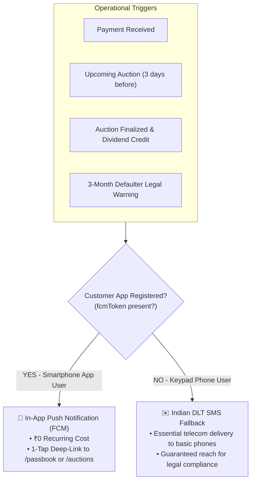

# Kumaran Chits — Bilingual Notification & Receipt Templates

> **Product**: **Kumaran Chits** (Kumaran Finance, Perundurai, Tamil Nadu)  
> **Supported Channels**: Customer Physical Paper Passbook (Hand-written & Signed with Pen), Mobile App Push Notifications (Primary ₹0 Cost), Indian DLT SMS (Reserved for OTPs & Keypad Phone Fallback), Bilingual PDF Receipts (Internal Accounting & Dispute Backup), and Digital Passbook.  
> **Unified Rule (`CONFIRMED-BY-DEVELOPER`)**:
> 1. **Authentication (Device Login OTP)**: **SMS only** (DLT Template `1407169823412093847`).
> 2. **All Financial & Operational Events**: Follow a single, elegant **Smart Channel Hierarchy**:
>    - **Smartphone Users (App installed / `fcmToken` present)**: Receive **Free In-App Push Notifications (FCM, ₹0 cost)** deep-linking to the passbook or auction screen.
>    - **Keypad Phone Users (Non-app / No `fcmToken`)**: Fall back to **Telecom DLT SMS**.
> 3. **WhatsApp Business API**: **Parked / Shelved in V1 (`KFC-NOT-001`, Rule 34)** to eliminate third-party SaaS and per-conversation fees. Any code simulation stubs are strictly diagnostic mocks; active production delivery channels are exclusively Mobile Push (FCM) and Indian DLT SMS (MSG91).
> 4. **Help Desk & Support**: Handled via **Direct Phone Calls** to Perundurai Head Office (`0424-2223333` / Partner mobiles).
> 5. **Report Sharing**: Manual on-demand utility (A4 PDF download & Excel/CSV export) for Form XXII, Form XXI, and Handover tallies.
> **Languages**: English & தமிழ் (Tamil)  
> **Currency Standard**: All monetary values are strictly in **whole integer Rupees (₹)** (`CONFIRMED-BY-DEVELOPER`).

---

## 1. Bilingual Digital Receipt (PDF & Print Layout) (`CONFIRMED-BY-DEVELOPER`)

### 1.1 Purpose & Role in Kumaran Finance
In daily operations in Perundurai and rural Erode, the customer's primary proof of payment is the **hand-written entry and pen signature** placed by the agent or cashier inside the customer's **physical paper passbook booklet (சீட்டு பாஸ்புக்)**. Customers do not want or keep loose paper slips.

However, the software generates and archives a computer-generated digital receipt for three vital reasons:
1. **Company Internal Accounting**: Provides a unique sequential receipt number (`KC-REC-PRD-2026-00412`) required for the Form XXII Chit Cash Book and evening field cash reconciliation.
2. **UPI / Online Payments**: When a subscriber pays self-service via GPay or PhonePe without an agent physically present, the app generates an instant receipt record.
3. **Dispute Resolution & Lost Passbooks**: If a customer misplaces their physical paper booklet, Kumaran Finance can instantly reprint their entire historical transaction ledger.

```text
================================================================================
                    KUMARAN FINANCE / குமரன் பைனான்ஸ்
               Chit Fund Operations / சீட்டு நிறுவனம்
        Main Road, Perundurai, Erode / தலைமை கிளை, பெருந்துறை, ஈரோடு
                 Phone / தொலைபேசி: +91 98765 43210
================================================================================
                   சந்தா ரசீது / SUBSCRIPTION RECEIPT
--------------------------------------------------------------------------------
ரசீது எண் / Receipt No   : KC-REC-PRD-2026-00412    தேதி / Date : 17-Oct-2026
சீட்டு குறியீடு / Chit Code: KCA-1L-20M-01             மாதம் / Month: 4 / 20
டிக்கெட் எண் / Ticket No : 07                         நேரம் / Time: 10:45 AM
--------------------------------------------------------------------------------
சந்தாதாரர் பெயர் / Subscriber Name : திரு. S. சுந்தரம் / S. Sundaram
முகவரி / Address                 : 14, நேதாஜி ரோடு, பெருந்துறை, ஈரோடு
தொலைபேசி / Mobile                : +91 98421 XXXXX
--------------------------------------------------------------------------------
கட்டண விவரங்கள் / PAYMENT BREAKDOWN:
  அடிப்படை தவணை / Base Installment      : ₹ 5,000
  கழிவு லாபப்பங்கு / Dividend Deduction : - ₹ 1,250
  செலுத்த வேண்டியது / Net Payable       : ₹ 3,750
--------------------------------------------------------------------------------
செலுத்திய தொகை / AMOUNT PAID           : ₹ 3,750
(ரூபாய் மூன்றாயிரத்து எழுநூற்று ஐம்பது மட்டும் / Rupees Three Thousand Seven Hundred Fifty Only)

கட்டண முறை / Payment Mode              : ரொக்கம் / CASH
வசூலித்தவர் / Collected By             : முகவர் முனியசாமி (AG-04)
--------------------------------------------------------------------------------
  * கணினி மூலம் உருவாக்கப்பட்ட ரசீது. கையொப்பம் தேவையில்லை.
  * This is a computer-generated digital receipt.
================================================================================
```

### 1.2 Cancelled / Reversed Payment Receipt (`KFC-PDF-001` / `CONFIRMED-BY-DEVELOPER`)
When a payment is reversed by dual-partner approval (`PaymentStatus === 'REVERSED'`), the PDFKit engine bypasses any pre-reversal cached S3 document and generates a marked invalid receipt:
- **Header Alert**: Prominent banner `*** ரத்து செய்யப்பட்ட ரசீது / CANCELLED RECEIPT ***`
- **Watermark Specification**:
  - Text: `ரத்து செய்யப்பட்டது / CANCELLED`
  - Font: 28pt Bold Helvetica
  - Color: Crimson Red (`#DC2626`)
  - Angle: -35° diagonal
  - Opacity: 0.22 centered across the page
- **Audit Footer**: Displays reversal timestamp, approving partner ID, and reversal reason.
- **Cache File**: Stored and retrieved under key `${receiptNumber}-cancelled.pdf` to guarantee that invalid receipts can never be misrepresented as active.

```text
================================================================================
                    KUMARAN FINANCE / குமரன் பைனான்ஸ்
               Chit Fund Operations / சீட்டு நிறுவனம்
        Main Road, Perundurai, Erode / தலைமை கிளை, பெருந்துறை, ஈரோடு
================================================================================
            *** ரத்து செய்யப்பட்ட ரசீது / CANCELLED RECEIPT ***
--------------------------------------------------------------------------------
ரசீது எண் / Receipt No   : KC-REC-PRD-2026-00412    தேதி / Date : 17-Oct-2026
ரத்து தேதி / Cancelled   : 18-Oct-2026 14:30       காரணம் / Reason: WRONG_TICKET
--------------------------------------------------------------------------------
                     /-----------------------------------\
                    /   ரத்து செய்யப்பட்டது / CANCELLED   \
                   \         (REVERSAL VERIFIED)         /
                    \-----------------------------------/
--------------------------------------------------------------------------------
செலுத்திய தொகை / AMOUNT PAID : ₹ 3,750 [ரத்து செய்யப்பட்டது / REVERSED]
ஒப்புதல் / Approved By      : பார்ட்னர் (Super Admin B)
================================================================================
```

---

## 2. The Unified Smart Channel Hierarchy (`CONFIRMED-BY-DEVELOPER`)

For all operational notifications, Kumaran Finance applies an automated device-aware routing hierarchy:



### 2.1 Event-by-Event Routing Specification:

| Operational Event | Smartphone App User (`fcmToken` present) | Keypad Phone User (No App / No `fcmToken`) |
|---|---|---|
| **1. Payment Confirmation** | **Push**: `மாத தவணை தொகை ரூ. {#amount#} பெறப்பட்டது! ரசீது எண்: {#receipt_number#}.` (Deep-links to `/passbook`) | **SMS**: `Kumaran Chits: Received Rs.{#var#} for Chit {#var#}, Ticket #{#var#}. Receipt: {#var#}. View passbook: {#var#}` |
| **2. Upcoming Auction Reminder** | **Push**: `மாதம் {#month#} ஏல அறிவிப்பு: {#date#} {#time#} ({#branch#}).` (Deep-links to `/auctions/{#id}`) | **SMS**: `Kumaran Chits: Auction for Chit {#var#} Month {#var#} is scheduled on {#var#} at {#var#}. Venue: {#var#}. Contact: {#var#}` |
| **3. Auction Result & Dividend** | **Push**: `மாதம் {#month#} ஏல முடிவு: லாபப்பங்கு ரூ. {#div#}. அடுத்த மாத தவணை: ரூ. {#payable#}.` | **SMS**: `Kumaran Chits: Chit {#var#} Month {#var#} Auction won at Rs.{#discount#}. Dividend: Rs.{#div#}. Next month: Rs.{#payable#}.` |
| **4. 3-Month Defaulter Warning** | **Push**: `எச்சரிக்கை: டிக்கெட் #{#tkt#} ({#chit#}) தொடர்ந்து {#m#} மாதங்கள் நிலுவையில் உள்ளது (ரூ. {#amt#}).` (Urgent Red Banner) | **SMS**: `Kumaran Chits: Urgent: Ticket #{#var#} in Chit {#var#} has {#var#} months overdue (Rs.{#var#}). Clear dues to avoid cancellation. Contact: {#var#}` |
| **5. Maker-Checker Partner Approval Alerts** | **High-Priority Push**: `பரிசு தொகை / ரத்து ஒப்புதல் தேவை / Approval Required` (Deep-links to `/approvals` with biometrics) | N/A (Internal administrative alert delivered strictly to registered Partner/Manager smartphones, excluding maker) |

---

## 3. Indian Telecom DLT-Compliant SMS Templates (`CONFIRMED-BY-DEVELOPER`)

SMS is reserved exclusively for:
1. **Device Login OTP Authentication** (All users).
2. **Fallback for Keypad Phone Users** who do not have a smartphone or the mobile app installed.

### 3.1 Device Registration OTP (Authentication)
- **Sender ID (Header)**: `KMRCHT`
- **Template ID**: `1407169823412093847`
- **Template Text**:
```text
Kumaran Chits: Your one-time verification code is {#var#}. Valid for 5 minutes. Do not share this OTP with anyone. / உங்கள் சரிபார்ப்பு குறியீடு {#var#}. யாருடனும் பகிர வேண்டாம்.
```

### 3.2 Payment Receipt Alert (Keypad Fallback)
- **Sender ID (Header)**: `KMRCHT`
- **Template ID**: `1407169823412093848`
- **Template Text**:
```text
Kumaran Chits: Received Rs.{#var#} for Chit {#var#}, Ticket #{#var#} on {#var#}. Receipt: {#var#}. View passbook: {#var#}
```

### 3.3 Upcoming Monthly Auction Reminder (Keypad Fallback)
- **Sender ID (Header)**: `KMRCHT`
- **Template ID**: `1407169823412093849`
- **Template Text**:
```text
Kumaran Chits: Auction for Chit {#var#} Month {#var#} is scheduled on {#var#} at {#var#}. Venue: {#var#}. Contact: {#var#}
```

### 3.4 Default Arrears Warning Notice (Keypad Fallback & Statutory Notice)
- **Sender ID (Header)**: `KMRCHT`
- **Template ID**: `1407169823412093850`
- **Template Text**:
```text
Kumaran Chits: Urgent: Ticket #{#var#} in Chit {#var#} has {#var#} months overdue (Rs.{#var#}). Clear dues to avoid membership cancellation. Contact: {#var#}
```

### 3.5 Pluggable SMS Architecture & Compliance
- **Implementation**: [`apps/api/src/notification/`](../../apps/api/src/notification/)
- **Pluggable Drivers**: `MockSmsDriver` (local dev & testing) and `Msg91SmsDriver` (production Indian DLT gateway).
- **Non-Blocking Invariant**: Telecom SMS timeouts or failures never block financial ledger updates or database transactions.
- **DPDP Act 2023 Compliance**: Recipient phone numbers are masked as `+91******XXXX` in all application logs and telemetry.

---

## 4. WhatsApp Business API Status — Parked in V1 (`CONFIRMED-BY-DEVELOPER`)

To maintain the leanest possible operational expenditure and eliminate third-party SaaS fees, **WhatsApp Business Cloud API integration is officially Parked / Shelved in V1**:
- Automated server-to-user WhatsApp background messages are deactivated.
- **Help Desk & Customer Support**: Handled via **Direct Phone Calls** to the Kumaran Finance Head Office (`0424-2223333` / Partner mobile numbers).
- In the mobile app, tapping "Help / உதவி" provides direct one-touch phone dialer access (`tel:04242223333`).

---

## 5. Report Sharing Specification (`CONFIRMED-BY-DEVELOPER`)

"Report Sharing" in Kumaran Finance is strictly a **manual, on-demand utility** for office staff, partners, and the CA auditor. It does not send automated broadcasts.

### 5.1 The 4 Core Operational Reports
1. **Form XXII — Daily Chit Cash Book (தினசரி ரொக்க ஏடு)**:
   - 12-column daily cash register recording all collections, prize money disbursements, bank transactions, and the closing physical cash in the office safe vault.
   - **Primary Users**: Desk Accountant, Partners, and CA Auditor.
2. **Form XXI — Subscriber Ledger / Passbook Statement (சந்தாதாரர் கணக்கு ஏடு)**:
   - Complete 20-month historical account statement for a subscriber ticket showing monthly installments, dividends credited, net amounts paid, and receipt numbers.
   - **Primary Users**: Subscriber (on-demand printed statement) and CA Auditor.
3. **Form XVII — Auction Minutes (ஏல நடவடிக்கைகள் மற்றும் மினிட்ஸ்)**:
   - Statutory auction proceedings document listing attendees, bidding ceiling compliance ($D \le V/4$), winning ticket, commission, and dividend per subscriber.
   - **Primary Users**: Filed with the Chit Registrar within statutory deadlines.
4. **Daily Field Agent Handover Tally**:
   - Evening summary reconciling cash collected by each field agent against digital receipts before vault deposit.
   - **Primary Users**: Field Agents, Desk Accountant, and Partners.

### 5.2 Delivery & Export Methods
- **Web Admin Portal (Desktop PC)**:
  - **"Download PDF"**: Generates official A4 PDF formatted with Kumaran Finance letterhead for office filing or printing for a visiting customer.
  - **"Export Excel / CSV"**: Structured tabular export for the CA Auditor to import into Tally or spreadsheet tools.
- **Mobile App (For Partners on the Move)**:
  - **"Share Statement / Summary"**: Uses the native Android share sheet to transfer the generated PDF via WhatsApp, Bluetooth, or messaging without recurring API costs.

---

## 6. Digital Passbook Data Structure (Mobile App View) (`CONFIRMED-BY-DEVELOPER`)

In the mobile app, the subscriber's **Digital Passbook (டிஜிட்டல் சந்தா புத்தகம்)** renders each month in chronological order with strictly whole integer Rupees:

| Month Index | Due Date | Gross Due | Dividend Credit | Net Paid | Payment Date | Mode | Receipt No. | Status |
|:---:|:---:|:---:|:---:|:---:|:---:|:---:|:---:|:---:|
| **Month 1** | 10-May-2026 | ₹5,000 | ₹0 (Initial Month) | ₹5,000 | 08-May-2026 | Cash | REC-0012 | **PAID** |
| **Month 2** | 10-Jun-2026 | ₹5,000 | ₹1,250 | ₹3,750 | 09-Jun-2026 | UPI | REC-0145 | **PAID** |
| **Month 3** | 10-Jul-2026 | ₹5,000 | ₹1,300 | ₹3,700 | 10-Jul-2026 | Cash | REC-0280 | **PAID** |
| **Month 4** | 10-Aug-2026 | ₹5,000 | ₹1,200 | ₹3,800 | 12-Aug-2026 | Cash | REC-0412 | **PAID** |
| **Month 5** | 10-Sep-2026 | ₹5,000 | ₹1,150 | ₹3,850 | - | - | - | **UPCOMING** |

---

## 7. Mobile App Push Notification Hierarchy & FCM Payloads (`CONFIRMED-BY-DEVELOPER`)

Push notifications provide **₹0-cost real-time delivery** over Android FCM and Apple APNs networks.

### 7.1 Delivery Priority Hierarchy
```
1. Mobile App Push Notification (FCM HTTP v1) ---> [Primary, ₹0 Cost for smartphone users]
2. Indian Telecom DLT SMS (KMRCHT Header)    ---> [Fallback for keypad phones / unregistered devices]
```

### 7.2 High-Priority Channels & Deep-Link Data Payloads

All push payloads configure high importance (`kumaran_high_importance`) to display alerts instantly even when phone is in doze mode:

| Purpose | Android Sound | Title | Body Text | Deep-Link Payload | Target Route |
|---|:---:|---|---|---|---|
| **Payment Receipt** | Default | `குமரன் பைனான்ஸ்` | `மாத தவணை தொகை ரூ. {#amount#} பெறப்பட்டது! ரசீது: {#receiptNumber#}` | `{ type: "RECEIPT", passbookUrl: "...", receiptNumber: "..." }` | `/passbook` |
| **Auction Reminder** | Default | `குமரன் பைனான்ஸ்` | `மாதம் {#month#} ஏல அறிவிப்பு: {#date#} {#time#}` | `{ type: "AUCTION_REMINDER", chitCode: "...", month: "..." }` | `/auctions` |
| **Auction Result** | Default | `குமரன் பைனான்ஸ்` | `மாதம் {#month#} ஏல முடிவு: வெற்றி கழிவு ரூ. {#discount#}. லாபப்பங்கு ரூ. {#dividend#}.` | `{ type: "AUCTION_RESULT", chitCode: "...", installmentMonth: "..." }` | `/passbook` |
| **Default Warning** | Alert | `எச்சரிக்கை அறிவிப்பு` | `டிக்கெட் #{#ticket#} தொடர்ந்து 3 மாத தவணைகள் நிலுவையில் உள்ளது.` | `{ type: "DEFAULT_WARNING", ticketId: "..." }` | `/dues` |
| **Disbursement Approval** | Alert | `பரிசு தொகை ஒப்புதல் தேவை` | `குழு {#chitCode#} டிக்கெட் #{#ticket#} பரிசு தொகை ரூ. {#amount#} சரிபார்க்கப்பட்டது.` | `{ approvalType: "DISBURSEMENT_APPROVAL", auctionId: "..." }` | `/approvals` |
| **Reversal Approval** | Alert | `திருப்புதல் ஒப்புதல் தேவை` | `ரூ. {#amount#} கட்டண திருப்புதல் ஒப்புதலுக்கு காத்திருக்கிறது. காரணம்: {#reason#}.` | `{ approvalType: "REVERSAL_APPROVAL", paymentId: "..." }` | `/approvals` |

### 7.3 Stale Device Token Pruning
If a smartphone uninstalls the app or rotates device tokens, FCM responds with `messaging/registration-token-not-registered`. The backend automatically clears `fcmToken = null` on the subscriber record in PostgreSQL. Future alerts immediately fall back to **TRAI DLT SMS** without message loss.

