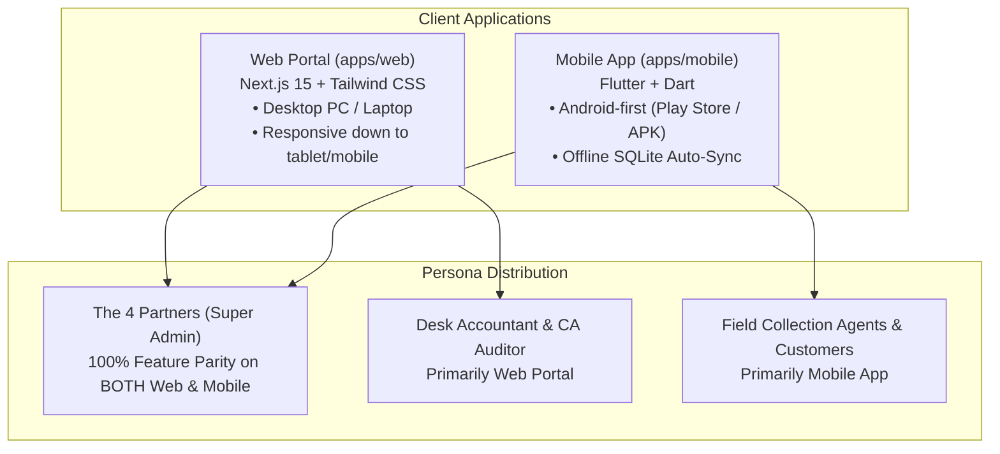

# Kumaran Chits — Product Requirements Document (PRD)

> **Product**: **Kumaran Chits**  
> **Company**: **Kumaran Finance**  
> **Jurisdiction**: Tamil Nadu, India  
> **Status**: Working Specification (`CONFIRMED-BY-DEVELOPER`)  
> **Status Labels Used**: `CONFIRMED-BY-DEVELOPER`, `PROPOSED`, `OPEN`, `UNVERIFIED-LEGAL`

---

## 1. Product Goals & Scope

### 1.1 Goal
Provide a reliable, robust, single-company chit-fund operations platform for **Kumaran Finance**, supporting branch staff, field collection agents, accountants, partners, and customers across Tamil Nadu.

### 1.2 Data Scope & Onboarding (`CONFIRMED-BY-DEVELOPER`)
1. **Fresh Start for New Chit Schemes**: Launching new chit groups from Month 1 onward.
2. **Mid-Cycle Onboarding for Active Ongoing Chits**: Seamlessly importing active running chit groups currently tracked in physical notebooks and paper receipts (no soft copies/Excel in current business; `CONFIRMED-BY-DEVELOPER`). Captures past winners, historical payments, and generates future due schedules.
3. **No Dead Data**: Closed or archived chits from past years are not imported into the operational database.
4. **Currency Integrity**: All financial amounts across all modules are stored and calculated strictly as **whole integer Rupees (₹)**. Paise are never used in Kumaran Finance operations (`CONFIRMED-BY-DEVELOPER`).

---

## 2. The 10 Core Functional Modules

### Module 1: Company & Branch Management (`CONFIRMED-BY-DEVELOPER`)
- **Single-Company Tenancy**: Dedicated database for **Kumaran Finance** (zero redundant `company_id` columns; `CONFIRMED-BY-DEVELOPER`).
- **Branch Hierarchy**: Supports Kumaran Finance's 1 active physical branch today, while architecturally supporting dynamic $N$ branch offices for future expansion.
- **Bilingual Branch Metadata**: Branch names, addresses, and contacts maintained in both English and Tamil for receipt rendering.
- **Data Scoping**: Localized data boundaries by assigned branch for operational staff.

### Module 2: Users & Permissions (Dynamic Persona RBAC) (`CONFIRMED-BY-DEVELOPER`)
- **Dynamic Capacity ($N$ Persons Per Persona)**:
  - The software supports an arbitrary, dynamic number ($N$) of users assigned to any persona.
  - Headcounts are **never static or hardcoded**. The system accommodates any number of partners, managers, accountants, collection agents, customers, and auditors at present and in the future.
- **The Standardized Personas & Operating Reality**:
  1. `SUPER_ADMIN`: Company partners / proprietors with full administrative, configuration, and final approval (Checker) authority. The **4 partners directly run branch operations**; no external Branch Manager is hired.
  2. `BRANCH_MANAGER`: Operational branch head persona (optional/future expansion). Currently fulfilled directly by the 4 partners.
  3. `ACCOUNTANT`: Manages collections verification, bank reconciliation, day books, cash handovers, and voucher prep. **Can be assigned to field collection agents performing dual office accounting roles**.
  4. `COLLECTION_AGENT`: Field staff using mobile app for doorstep collections, offline recording, and cash handover submission.
  5. `CUSTOMER`: Subscribers viewing digital passbooks, dividend savings, upcoming dues, and making online payments.
  6. `AUDITOR`: Independent auditor with read-only access to ledgers, auction records, and reports.
- **Enforced Maker-Checker Dual Controls**:
  - High-risk operations (payment reversals, auction finalization, prize disbursements) strictly enforce `maker_user_id != checker_user_id` at application and database levels (`CONFIRMED-BY-DEVELOPER`).
  - Partner-to-Partner workflow: One partner initiates an entry (Maker) $\to$ Another partner reviews and finalizes (Checker).

### Module 3: Customer Management & KYC (`CONFIRMED-BY-DEVELOPER`)
- **Unique Customer Code**: System-generated identifier (e.g., `KC-CUST-00101`).
- **Bilingual Profiles**: Customer names captured in English and Tamil.
- **Lightweight Notebook-Style Intake (`CONFIRMED-BY-DEVELOPER`)**:
  - Full name (English and optional Tamil), mobile phone number, physical address, and nominee details.
  - Known local subscribers are onboarded immediately without forced identity paperwork.
  - Optional Fields: Masked Aadhaar (last 4 digits only, e.g., `4821`), PAN number, and document uploads are strictly optional and never mandatory.
- **Document Storage**: Optional identity and agreement scans stored in secure private AWS S3 storage with time-limited presigned access links.

### Module 4: Chit Scheme Management (New & Ongoing) (`CONFIRMED-BY-DEVELOPER`)
- **Scheme Parameters**: Chit Value ($V$), Duration Months ($N$), Total Tickets ($M = N$), Base Monthly Installment ($I_{base} = V / N$). All values in whole integer Rupees (₹).
- **Foreman Commission**: Configurable default of **4.00%**, copied and frozen onto the chit group record upon activation (`CONFIRMED-BY-DEVELOPER`).
- **Fixed 1/4 (25%) Auction Discount Ceiling (`CONFIRMED-BY-DEVELOPER`)**:
  - Discount ceiling is fixed strictly at **one-fourth (1/4 or 25.00%) of total chit value** ($D_{max} = \frac{V}{4} = 0.25 \times V$).
  - System rejects any entered bid discount exceeding 1/4 of total chit value ($D \le \frac{V}{4}$).
  - Minimum floor: Bid discount cannot be lower than foreman commission ($D \ge C_f = 0.04 \times V$).
- **Month 1 Rule (`CONFIRMED-BY-DEVELOPER`)**:
  - One company representative acts as a customer (holds 1 ticket).
  - Full first-month pool is collected and taken by the company.
  - **NO auction** is conducted in Month 1; dividend is ₹0.
- **Final Month (Month $N$) Rule (`CONFIRMED-BY-DEVELOPER`)**:
  - **NO auction** is conducted in Month $N$.
  - Company retains 4.00% commission and the final month's payable installment, and settles the entire prize money to the final non-prized subscriber with a formal payout receipt.
- **Initialization Lifecycle**:
  - `NEW_GROUP`: Standard lifecycle starting from Month 1.
  - `ONGOING_GROUP`: Mid-cycle onboarding from physical paper notebooks (e.g., entering at Month 7) with historical winner discounts and opening balances.

### Module 5: Subscriber Enrollment & Ticket Limits (`CONFIRMED-BY-DEVELOPER`)
- Enrolls verified customers into specific chit schemes with unique ticket numbers (1 to $N$).
- **Ticket Limit Policy (`CONFIRMED-BY-DEVELOPER`)**:
  - A customer may join multiple chit groups.
  - A customer **cannot hold 2 or more tickets in the same chit group** (Max 1 ticket per customer per scheme).
- **3-Month Consecutive Arrears & Company Removal Rights (`CONFIRMED-BY-DEVELOPER`)**:
  - The software tracks consecutive missed monthly installments per ticket.
  - If a subscriber fails to pay for **3 continuous (consecutive) months**, the company has the full right and authority to **remove the customer from the chit group**.
  - Company management / Partners can execute the removal workflow in the software, transitioning the ticket to `REMOVED_DEF_3M` and allowing substitution or settlement.
- Real-time tracking of Prized vs. Non-Prized status per ticket.

### Module 6: Installments & Due Schedules (`CONFIRMED-BY-DEVELOPER`)
- **Net Installment Calculation**:
  - For All Subscribers (Including Auction Winners & Past Prized Winners):
    $$I_{net} = I_{base} - Div_{ticket}$$
    (e.g., if base is ₹10,000 and dividend is ₹2,100, every subscriber including the auction winner pays ₹7,900 next month; applies uniformly across all schemes; `CONFIRMED-BY-DEVELOPER`).
- **Statuses**: `UNPAID`, `PAID`, `OVERDUE`. Partial payments are strictly prohibited under the single discrete payment rule (`CONFIRMED-BY-DEVELOPER`).
- All installment and dividend values calculated in clean **whole integer Rupees**.

### Module 7: Field Collections & Cash Handover (`CONFIRMED-BY-DEVELOPER`)
- Mobile-first interface for field collection agents (supporting dynamic $N$ agents) showing assigned customer dues.
- Offline-resilient collection recording with timestamp and receipt generation.
- **Single Discrete Payment Rule (`CONFIRMED-BY-DEVELOPER`)**:
  - Each installment month accepts strictly one payment matching the net installment due.
  - Double payments for the same month will never happen in business operations.
  - The concept of "Advance Balance" is completely eliminated from the product.
- **End-of-Day Cash Handover & Dual Agent/Accountant Guard (`CONFIRMED-BY-DEVELOPER`)**:
  - Agent records physical cash collected during field rounds and submits handover batch.
  - Branch Cashier / Partner verifies physical cash and acknowledges handover in the software before transactions are closed.
  - **Hard Guard**: `collector_user_id != acknowledger_user_id`. An agent who also performs accounting tasks can never acknowledge their own collected cash.

### Module 8: Payments, Reversals, & Bilingual Receipts (`CONFIRMED-BY-DEVELOPER`)
- **Payment Modes**: Cash, UPI, Bank Transfer (NEFT/RTGS/IMPS), and Cheque.
- **Bilingual Receipts & Unified Notification Hierarchy (V1 Scope)**:
  - Formatted in both English and Tamil with sequential branch-scoped numbering (e.g., `KC-REC-PRD-2026-00045`).
  - Hand-written and signed directly in customer's physical paper passbook booklet; confirmed digitally via free mobile app push notification; downloadable digital PDFs available on-demand.
  - **Smart Channel Hierarchy**: Payments and field collections asynchronously enqueue background receipt delivery to BullMQ (`notification-queue` / `JOB_DISPATCH_PAYMENT_RECEIPT`). Free In-App Push Notifications (FCM, ₹0) for smartphone app users; Telecom DLT SMS fallback for keypad phone users across Payments, Upcoming Auctions, Post-Auction Dividends (`JOB_DISPATCH_AUCTION_RESULT`), and 3-Month Default warnings. High-priority Partner push alerts (`JOB_DISPATCH_APPROVAL_ALERT`) are dispatched for Maker-Checker dual control (payment reversals, prize disbursements), strictly excluding the maker user.
  - **Authentication**: OTP delivered strictly via Telecom DLT SMS and managed securely in Redis (`auth:otp:<phone>`) with a 300-second (5-minute) TTL and 3-attempt brute-force lockout.
  - **Help Desk**: Direct phone calls to Perundurai Head Office (`0424-2223333`); WhatsApp Business API parked in V1.
- **Prize Payout Vouchers (V1 Scope)**:
  - Supports Cheque, NEFT/RTGS/IMPS, and Cash (`CONFIRMED-BY-DEVELOPER`). Enforces zero artificial cash blocks or limits; full hard cash disbursements permitted for any amount to match local business reality.
  - Requires company safety proof checklist verification (signed agreement [Yes/No], nominee signed [Yes/No], signed blank cheques [Yes/No], scanned uploads; `CONFIRMED-BY-DEVELOPER`).
  - Property documents are completely eliminated; security proof is evaluated case-by-case by the company and is **not mandatory** across the board (`CONFIRMED-BY-DEVELOPER`).
- **Payment Reversals**:
  - Never delete a posted payment.
  - Requires Maker entry with documented reason and Checker approval by Super Admin (`maker_user_id != checker_user_id`).

### Module 9: In-Office Staff-Recorded Auction Engine (`CONFIRMED-BY-DEVELOPER`)
- **Offline Auction Recording**:
  - Auctions are conducted offline at the branch by staff/foreman in the presence of members.
  - Software does not conduct auctions autonomously; it validates and records results entered by staff.
- **Validation Rules & Pre-Conditions**:
  1. Bid discount $\ge$ Foreman commission (4.00%).
  2. Bid discount $\le$ Fixed 1/4 (25.00%) ceiling of the total chit value ($D \le \frac{V}{4}$).
  3. **Auction Ineligibility for Unpaid Dues (`CONFIRMED-BY-DEVELOPER`)**: Any subscriber who has not paid their installment due for that specific month is **strictly ineligible to participate or bid** in that month's auction. The system verifies payment status and blocks entering an unpaid subscriber as an active bidder or winner.
- **Tie-Breaker Protocol (`CONFIRMED-BY-DEVELOPER`)**:
  - **Option A (Physical Paper Token Draw)**: When multiple members bid the maximum 1/4 ceiling discount, the Foreman draws paper tokens physically at the branch in front of members.
  - Staff enters the winning ticket number into the software. (No autonomous digital lottery draws).
- **Financial Commitment**:
  - Automatically calculates Prize Money ($P = V - D$), Foreman Commission ($C_f = V \times 0.04$), Total Dividend ($Div_{total} = D - C_f$), and per-ticket dividend allocated equally across all members.
  - Month 1 and Month $N$ have **NO auctions** (`CONFIRMED-BY-DEVELOPER`).

### Module 10: Dashboards & Reports (`CONFIRMED-BY-DEVELOPER` / `UNVERIFIED-LEGAL`)
- **Super Admin Dashboard**: Active chits, daily/monthly collections, overdue balances, branch summaries.
- **Branch Dashboard**: Branch collection targets, pending customer dues, upcoming auction dates.
- **Accountant Reports**: Day book, cash handover register, bank reconciliation journal, dividend schedules.
- **Subscriber Passbook**: Personal digital passbook, dividend savings ledger, downloadable bilingual receipts.
- **Statutory Registers (`UNVERIFIED-LEGAL`)**: Form XVII (Minutes), Form XXI (Subscriber Ledger), and Form XXII (Cash Book) layout labels retained as `UNVERIFIED-LEGAL` until physical specimen copies from the Registrar are verified.

---

## 3. Client Applications & Device Delivery Architecture (`CONFIRMED-BY-DEVELOPER`)

The platform delivers its 10 functional modules through two purpose-built client frontends sharing a 100% unified backend API:

1. **Web Dashboard (`apps/web/`)**:
   - **Target Users**: The 4 Partners (Super Admin), Desk Accountant, and CA Auditor.
   - **Tech Stack**: Next.js 15 (App Router), React 19, TypeScript, Tailwind CSS, TanStack React Query.
   - **Key Capabilities**: 20-month physical notebook onboarding grid, Form XXII 12-column daily cashbook, dual-control document comparison, PDF/Excel statutory exports.
2. **Mobile Application (`apps/mobile/`)**:
   - **Target Users**: The 4 Partners (Super Admin - 100% Full Parity), Field Collection Agents, and Chit Customers.
   - **Tech Stack**: Flutter 3.x, Dart (Android-first).
   - **Key Capabilities**: 1-second biometric fingerprint unlock, doorstep collections under 30 seconds, offline SQLite sync in rural 4G dead zones, native UPI app switching (GPay/PhonePe), 1-tap push notification Maker-Checker approvals.
3. **100% Partner Feature Parity Mandate**:
   - The 4 Partners have complete access to all administrative actions (auctions, prize disbursements, cash handover sign-off, reversals, business pulse) on **BOTH** Web and Mobile.
   - Cross-device Maker-Checker (`maker_user_id != checker_user_id`) is supported across any permutation of mobile and desktop devices.
