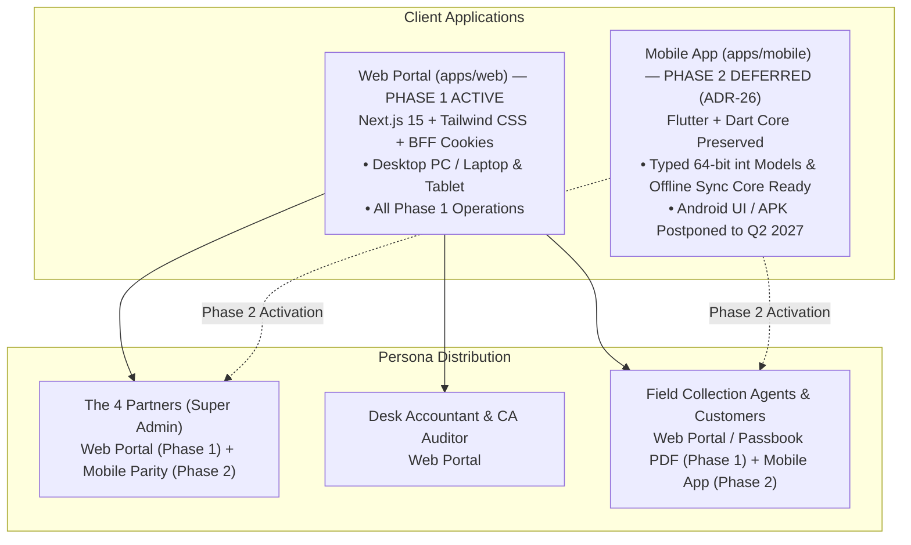

# Kumaran Chits — Product Requirements Document (PRD)

> **Product**: **Kumaran Chits**  
> **Company**: **Kumaran Finance**  
> **Jurisdiction**: Tamil Nadu, India  
> **Status**: Working Specification (`CONFIRMED-BY-DEVELOPER`)  
> **Status Labels Used**: `CONFIRMED-BY-DEVELOPER`, `PROPOSED`, `OPEN`, `UNVERIFIED-LEGAL`

---

## 1. Product Goals & Scope

### 1.1 Goal
Provide a reliable, robust, single-company chit-fund operations platform for **Kumaran Finance**, supporting branch staff, field collection agents, accountants, partners, and customers across Tamil Nadu.

### 1.2 Data Scope & Onboarding (`CONFIRMED-BY-DEVELOPER`)
1. **Fresh Start for New Chit Schemes**: Launching new chit groups from Month 1 onward.
2. **Mid-Cycle Onboarding for Active Ongoing Chits**: Seamlessly importing active running chit groups currently tracked in physical notebooks and paper receipts (no soft copies/Excel in current business; `CONFIRMED-BY-DEVELOPER`). Captures past winners, historical payments, and generates future due schedules.
3. **No Dead Data**: Closed or archived chits from past years are not imported into the operational database.
4. **Currency Integrity**: All financial amounts across all modules are stored and calculated strictly as **whole integer Rupees (₹)**. Paise are never used in Kumaran Finance operations (`CONFIRMED-BY-DEVELOPER`).
5. **Operational Platform Scope**: The web operations portal (`apps/web`) and backend API (`apps/api`) represent the active production scope. The Flutter mobile UI and Android APK build are **postponed** per explicit business owner approval; all backend mobile API endpoints and contracts are preserved for future activation.

---

## 2. The 10 Core Functional Modules

### Module 1: Company & Branch Management (`CONFIRMED-BY-DEVELOPER`)
- **Single-Company Tenancy**: Dedicated database for **Kumaran Finance** (zero redundant `company_id` columns; `CONFIRMED-BY-DEVELOPER`).
- **Branch Hierarchy**: Supports Kumaran Finance's 1 active physical branch today, while architecturally supporting dynamic $N$ branch offices for future expansion.
- **Bilingual Branch Metadata**: Branch names, addresses, and contacts maintained in both English and Tamil for receipt rendering.
- **Data Scoping**: Localized data boundaries by assigned branch for operational staff.

### Module 2: Users & Permissions (Dynamic Persona RBAC) (`CONFIRMED-BY-DEVELOPER`)
- **Dynamic Capacity ($N$ Persons Per Persona)**:
  - The software supports an arbitrary, dynamic number ($N$) of users assigned to any persona.
  - Headcounts are **never static or hardcoded**. The system accommodates any number of partners, managers, accountants, collection agents, customers, and auditors at present and in the future.
- **The Standardized Personas & Operating Reality**:
  1. `SUPER_ADMIN` (`isPartner: true` vs. `isPartner: false`, `ADR-21`): Verified business partners (`isPartner: true`) hold full financial Maker/Checker authority (auction finalization, corrections, payout authorization, reversals, defaulter removals). Administrative IT Super Admins (`isPartner: false`) manage users, settings, immutable audit logs, and BullMQ queues, but are strictly blocked from financial authorizations (`assertVerifiedPartner`). The **4 partners directly run branch operations**; no external Branch Manager is hired.
  2. `BRANCH_MANAGER`: Operational branch head persona (optional/future expansion). Currently fulfilled directly by the 4 partners.
  3. `ACCOUNTANT`: Manages collections verification, bank reconciliation, day books, cash handovers, and voucher prep. **Can be assigned to field collection agents performing dual office accounting roles**.
  4. `COLLECTION_AGENT`: Field staff for doorstep collections, offline recording, and cash handover submission (Web Portal in Phase 1; Flutter Android UI deferred to Phase 2 per `ADR-26`).
  5. `CUSTOMER`: Subscribers viewing digital passbooks, dividend savings, upcoming dues, and making online UPI payments (backend APIs preserved; Flutter Mobile UI deferred to Phase 2 per `ADR-26`).
  6. `AUDITOR`: Independent auditor with read-only access to ledgers, auction records, and statutory reports (excluding Super-Admin-only audit logs and BullMQ queues).
- **Enforced Maker-Checker Dual Controls (`ADR-21`, `ADR-22`, `ADR-25`)**:
  - High-risk operations (payment reversals, auction finalization/correction, prize disbursements, Month $N$ settlements, defaulter removals, cash handovers, UPI claim verification) strictly enforce `maker_user_id != checker_user_id` at application and PostgreSQL 17 `CHECK` constraint levels (`CONFIRMED-BY-DEVELOPER`).
  - Partner-to-Partner workflow: One verified partner initiates an entry (Maker) $\to$ Another verified partner reviews and finalizes (Checker).

### Module 3: Customer Management & KYC (`CONFIRMED-BY-DEVELOPER`)
- **Unique Customer Code**: System-generated identifier (e.g., `KC-CUST-00101`).
- **Bilingual Profiles**: Customer names captured in English and Tamil.
- **Lightweight Notebook-Style Intake (`CONFIRMED-BY-DEVELOPER`)**:
  - Full name (English and optional Tamil), mobile phone number, physical address, and nominee details.
  - Known local subscribers are onboarded immediately without forced identity paperwork.
  - Optional Fields: Masked Aadhaar (last 4 digits only, e.g., `4821`), PAN number, and document uploads are strictly optional and never mandatory.
- **Document Storage**: Optional identity and agreement scans stored in secure private S3-compatible storage (Cloudflare R2, MinIO, or private S3) with time-limited presigned access links.

### Module 4: Chit Scheme Management (New & Ongoing) (`CONFIRMED-BY-DEVELOPER`)
- **Scheme Parameters**: Chit Value ($V$), Duration Months ($N$), Total Tickets ($M = N$), Base Monthly Installment ($I_{base} = V / N$). All values in whole integer Rupees (₹).
- **Foreman Commission**: Configurable default of **4.00%**, copied and frozen onto the chit group record upon activation (`CONFIRMED-BY-DEVELOPER`).
- **Fixed 1/4 (25%) Auction Discount Ceiling (`CONFIRMED-BY-DEVELOPER`)**:
  - Discount ceiling is fixed strictly at **one-fourth (1/4 or 25.00%) of total chit value** ($D_{max} = \frac{V}{4} = 0.25 \times V$).
  - System rejects any entered bid discount exceeding 1/4 of total chit value ($D \le \frac{V}{4}$).
  - Minimum floor: Bid discount cannot be lower than foreman commission ($D \ge C_f = 0.04 \times V$).
- **Month 1 Rule (`CONFIRMED-BY-DEVELOPER`)**:
  - One company representative acts as a customer (holds 1 ticket).
  - Full first-month pool is collected and taken by the company.
  - **NO auction** is conducted in Month 1; dividend is ₹0.
- **Final Month (Month $N$) Rule (`CONFIRMED-BY-DEVELOPER`)**:
  - **NO auction** is conducted in Month $N$.
  - The company retains the 4.00% foreman commission ($C_f$) and automatically deducts the final month's payable base installment ($I_{\text{base}}$) plus any prior arrears:
    $$\text{Final Net Settlement Payout} = V - C_f - \text{finalMonthDeduction} - \text{priorArrears}$$
  - If Month $N$ installment is unpaid, $\text{finalMonthDeduction} = I_{\text{base}}$ (₹5,000 on a ₹1,00,000 chit), net payout is strictly **₹91,000** ($100,000 - 4,000 - 5,000$), and Month $N$ `InstallmentDue` is atomically marked `PAID`.
  - If Month $N$ installment was already paid in advance or at branch desk (`monthNDue.status === 'PAID'`), $\text{finalMonthDeduction} = 0$, preventing double collection and resulting in strictly **₹96,000** net payout (`FIN-B`).
  - Executed strictly via **2-stage Maker-Checker settlement (`ADR-25` / `CR-DISB-02`)**: Stage 1 `POST /disbursements/group/:chitGroupId/prepare-final-settlement` (Maker staff) $\to$ Stage 2 `POST /disbursements/group/:chitGroupId/approve-final-settlement` (Checker Partner, `isPartner: true`, `maker != checker`), releasing funds with a formal settlement voucher.
- **Initialization Lifecycle**:
  - `NEW_GROUP`: Standard lifecycle starting from Month 1.
  - `ONGOING_GROUP`: Mid-cycle onboarding from physical paper notebooks (e.g., entering at Month 7) with historical winner discounts and opening balances.

### Module 5: Subscriber Enrollment & Ticket Limits (`CONFIRMED-BY-DEVELOPER`)
- Enrolls verified customers into specific chit schemes with unique ticket numbers (1 to $N$).
- **Ticket Limit Policy (`CONFIRMED-BY-DEVELOPER`)**:
  - A customer may join multiple chit groups.
  - A customer **cannot hold 2 or more tickets in the same chit group** (Max 1 ticket per customer per scheme).
- **3-Month Consecutive Arrears & Company Removal Rights (`CONFIRMED-BY-DEVELOPER`)**:
  - The software tracks consecutive missed monthly installments per ticket.
  - If a subscriber fails to pay for **3 continuous (consecutive) months**, the company has the full right and authority to **remove the customer from the chit group**.
  - **Two-Partner Dual Control (`SEC-B` / `ADR-22`)**: Partner A requests removal (`POST /tickets/:id/remove-defaulter/request`), placing the ticket into `PENDING_REMOVAL_APPROVAL`. Independent Partner B approves (`POST /tickets/:id/remove-defaulter/approve` $\to$ `REMOVED_DEF_3M`) or rejects (`POST /tickets/:id/remove-defaulter/reject` $\to$ `DEFAULT_3_MONTHS`) with strict `maker != checker` enforcement backed by PostgreSQL constraint `chk_ticket_removal_maker_checker`.
  - **Fail-Closed Exit Settlement Policy (`Q25`)**: Exit settlement calculations (`POST /tickets/:id/settle-removal`) fail closed with HTTP 400 `UNAPPROVED_SETTLEMENT_POLICY` until the exact statutory damages formula is confirmed in writing by the business owner.
  - Prized tickets are strictly immutable and reject defaulter removal with HTTP 400 `PRIZED_TICKET_IMMUTABLE`.
- Real-time tracking of Prized vs. Non-Prized status per ticket.

### Module 6: Installments & Due Schedules (`CONFIRMED-BY-DEVELOPER`)
- **Net Installment Calculation**:
  - For All Subscribers (Including Auction Winners & Past Prized Winners):
    $$I_{net} = I_{base} - Div_{ticket}$$
    (e.g., if base is ₹10,000 and dividend is ₹2,100, every subscriber including the auction winner pays ₹7,900 next month; applies uniformly across all schemes; `CONFIRMED-BY-DEVELOPER`).
- **Statuses**: `UNPAID`, `PAID`, `OVERDUE`. Partial payments are strictly prohibited under the single discrete payment rule (`CONFIRMED-BY-DEVELOPER`). Zero late fees or penalty interest (`Q23`).
- All installment and dividend values calculated in clean **whole integer Rupees**.

### Module 7: Field Collections & Cash Handover (`CONFIRMED-BY-DEVELOPER`)
- Offline-resilient collection APIs and Dart sync core (`POST /collections/record`, `POST /collections/sync-offline-queue`) supporting dynamic $N$ field agents; Phase 1 operates via the Web Portal while Flutter Android UI screens are deferred to Phase 2 (`ADR-26`).
- **Single Discrete Payment Rule (`CONFIRMED-BY-DEVELOPER`)**:
  - Each installment month accepts strictly one payment matching the net installment due.
  - Double payments for the same month will never happen in business operations.
  - The concept of "Advance Balance" is completely eliminated from the product.
- **End-of-Day Cash Handover & Dual Agent/Accountant Guard (`CONFIRMED-BY-DEVELOPER`)**:
  - Agent records physical cash collected during field rounds and submits handover batch (`POST /collections/cash-handover/submit`).
  - Desk Accountant, Branch Manager, or Partner verifies physical cash and acknowledges handover (`POST /collections/cash-handover/acknowledge`) before transactions close.
  - **Hard Guard**: `collector_user_id != acknowledger_user_id` (`chk_payment_cash_handover_maker_checker`) + cross-branch Anti-BOLA. An agent who also performs accounting tasks can never acknowledge their own collected cash.

### Module 8: Payments, Reversals, & Bilingual Receipts (`CONFIRMED-BY-DEVELOPER`)
- **Payment Modes**: Cash, UPI, Bank Transfer (NEFT/RTGS/IMPS), and Cheque.
- **Zero-Fee Native 1-Tap UPI Intent & UTR Verification Protocol (ADR-19)**:
  - **Direct Bank Settlement**: Settle directly into Kumaran Finance's Karur Vysya Bank (KVB) current account with **strictly ₹0 third-party gateway fees** (No Razorpay/Cashfree/2% MDR fee).
  - **1-Tap Deep-Linking**: Server helper `GET /installments/:dueId/upi-intent` generates standard `upi://pay?pa=...` intent containing exact BigInt installment amount, customer name, and unique chit scheme note (with sequential due enforcement `PRIOR_INSTALLMENT_UNPAID`).
  - **Customer Bank UTR Claim Submission**: Customer enters their 12-digit bank UTR reference (`POST /payments/upi-claim`), creating a `Payment` record in `INITIATED` status.
  - **Bank UTR Anti-Duplication Constraint**: PostgreSQL 17 `@unique` index on `transactionRef` strictly blocks duplicate claims or reuse of the same bank UTR.
  - **Maker-Checker Dual Control Claim Verification**: Desk Accountant, Branch Manager, or Partner reviews the pending UPI claim (`GET /payments/pending-upi-claims`), cross-checks the physical KVB bank statement, and approves (`POST /payments/:id/verify-upi-claim`), transitioning status to `SUCCESS`, invalidating Day Book cache, and marking the installment `PAID`. Strictly enforces `maker_user_id != checker_user_id` and branch isolation.
- **Bilingual Receipts & Notification Architecture (V1 Scope — `ADR-23`, `ADR-26`)**:
  - Formatted in both English and Tamil with sequential branch-scoped numbering (e.g., `KC-REC-PRD-2026-00045`).
  - Hand-written and signed directly in customer's physical paper passbook booklet; downloadable digital A5 PDFs available on-demand (pre-rendered asynchronously via `JOB_DISPATCH_PAYMENT_RECEIPT` with `paymentId`).
  - **Phase 1 Production Channel (`ADR-23`)**: Automated operational notifications (Payments, Upcoming Auctions, Post-Auction Dividends, 3-Month Default warnings) and OTPs run strictly via **Indian TRAI DLT SMS (MSG91)**. WhatsApp simulation channels are purged (`KFC-NOT-001`), and FCM Mobile Push code (`notification.service.ts`) is preserved for Phase 2 Flutter activation (`ADR-26`).
  - **Authentication**: OTP delivered strictly via Telecom DLT SMS and managed securely in Redis (`auth:otp:<phone>`) with a 300-second (5-minute) TTL and atomic Lua 3-attempt brute-force lockout (`F13`).
  - **Help Desk**: Direct phone calls to Perundurai Head Office (`0424-2223333`); WhatsApp Business API parked in V1.
- **Prize Payout Vouchers (V1 Scope)**:
  - Supports Cheque (`ACCOUNT_PAYEE_CHEQUE`), NEFT/RTGS/IMPS, and Cash (`CONFIRMED-BY-DEVELOPER`). Enforces zero artificial cash blocks or limits; full hard cash disbursements permitted for any amount with statutory IT Act §40A(3) advisories for cash $> ₹10,000$.
  - Requires company safety proof checklist verification (`agreementSigned`, `nomineeSigned`, `blankChequeDetails`, `securityDocS3Key`; `CONFIRMED-BY-DEVELOPER`).
  - Property documents are completely eliminated; security proof is evaluated case-by-case by the company and is **not mandatory** across the board (`CONFIRMED-BY-DEVELOPER`).
- **Payment Reversals (`KFC-SEC-001`, `KFC-PDF-001`)**:
  - Never delete a posted payment from the ledger.
  - Reversal initiation (`POST /payments/:id/request-reversal`) is strictly restricted to **Super Admin (`Partner A, isPartner: true`)**; Branch Manager and Accountant roles are blocked.
  - Reversal approval (`POST /payments/:id/approve-reversal`) and rejection (`POST /payments/:id/reject-reversal`) are strictly restricted to independent **Super Admin (`Partner B, isPartner: true`)** with hard dual control (`maker_user_id != checker_user_id`, `chk_reversal_maker_checker`).
  - Reversed receipts dynamically render a bold red diagonal watermark `ரத்து செய்யப்பட்டது / CANCELLED` (-35°, 28pt bold, `#DC2626`, opacity `0.28`).

### Module 9: In-Office Staff-Recorded Auction Engine (`CONFIRMED-BY-DEVELOPER`)
- **Offline Auction Recording & Finalization**:
  - Auctions are conducted offline at the branch by staff/foreman in the presence of members.
  - Software validates and records results entered by staff; finalization is strictly reserved for verified **Super Admin Partners (`isPartner: true`)** under `maker_user_id != checker_user_id`.
- **Validation Rules & Pre-Conditions**:
  1. Bid discount $\ge$ Foreman commission (4.00%).
  2. Bid discount $\le$ Fixed 1/4 (25.00%) ceiling of the total chit value ($D \le \frac{V}{4}$).
  3. **Whole-Rupee Dividend Divisibility (`KFC-FIN-002`)**: Total dividend $(D - C_f)$ must be cleanly divisible by total tickets $M$ without remainder ($(D - C_f) \pmod M == 0$). Bids failing this are rejected fail-closed with HTTP 400 `NON_DIVISIBLE_DIVIDEND`.
  4. **Auction Ineligibility for Unpaid Dues & Pending Removal (`CONFIRMED-BY-DEVELOPER`, `DEF-M9-ENG-01`)**: Any subscriber who has not paid their installment due for that month (`consecutiveUnpaidMonths > 0`) or has a pending defaulter removal request (`removalRequestedByUserId != null`) is **strictly ineligible to participate or bid**.
- **Finalized Auction Correction Workflow (`KFC-FIN-005`, `M9-DUAL-DEF-01..05`)**:
  - Allows correcting clerical errors (winning ticket, bid discount) via full 2-partner workflow (`POST /auctions/:id/correction/request` $\to$ `approve` or `reject`). Blocked if prize money is already disbursed (`DISBURSED_PRIZE_IMMUTABLE`) or if any Month $N+1$ due is already paid (`ALREADY_PAID_DUES_EXIST`). Active pending corrections lock all 3 prize disbursement stages (`PENDING_CORRECTION_LOCKOUT`), and sub-ceiling corrections ($D < V/4$) purge stale tie-bidders.
- **Tie-Breaker Protocol (`CONFIRMED-BY-DEVELOPER`)**:
  - **Option A (Physical Paper Token Draw)**: When multiple members bid the maximum 1/4 ceiling discount, the Foreman draws paper tokens physically at the branch in front of members.
  - Staff enters unique paper token numbers and the drawn winning ticket into the software. (No autonomous digital lottery draws).
- **Financial Commitment**:
  - Automatically calculates Prize Money ($P = V - D$), Foreman Commission ($C_f = V \times 0.04$), Total Dividend ($Div_{total} = D - C_f$), and per-ticket dividend allocated equally across all members.
  - Month 1 and Month $N$ have **NO auctions** (`CONFIRMED-BY-DEVELOPER`).

### Module 10: Dashboards, Statutory Registers & Real-Time Approvals (`CONFIRMED-BY-DEVELOPER` / `UNVERIFIED-LEGAL`)
- **Executive & Branch Dashboards (`/reports/dashboard`)**: Active chits, daily/monthly collections, vault safe cash, arrears aging buckets (excluding `REMOVED_DEF_3M` and `SURRENDERED` tickets), and branch summaries.
- **8-Queue Pending Approvals Hub & Real-Time SSE Stream (`/reports/pending-approvals`, `/reports/approvals-stream`)**: Aggregates all 8 Maker-Checker queues with live SSE push (`@BypassEnvelope()`, mid-flight session/role verification, graceful DB-error heartbeat fallback).
- **Accountant & Auditor Reports**: Day book (`/reports/day-book`), Form XXII physical cash book (strictly `CASH`-only, approved cash reversals as outflows on `reversedAt`, field handover vault entry at `cashHandoverAcknowledgedAt ?? createdAt`), defaulters aging (`/reports/defaulters`), and immutable audit logs (`/reports/audit-logs`, strictly `SUPER_ADMIN` only).
- **Subscriber Passbook (`/reports/form-xxi`)**: Continuous $1..N$ digital passbook with exact 64-bit `BigInt` cumulative running totals, KC-09 arrears offset provenance, and downloadable bilingual PDFs.
- **Statutory Registers (`UNVERIFIED-LEGAL`)**: Form XVII (Minutes with 21-day IST countdown & Option A tie-break tokens), Form XXI (Subscriber Ledger), and Form XXII (Cash Book) layout labels retained as `UNVERIFIED-LEGAL` until physical specimen copies from the Registrar are verified.

---

## 3. Client Applications & Device Delivery Architecture (`CONFIRMED-BY-DEVELOPER` / `ADR-26`)

The platform is architected for two client frontends sharing a 100% unified NestJS backend API, with **Phase 1 focused exclusively on the Web Operations Portal** and **Flutter Android UI deferred to Phase 2 (Q2 2027)** per `ADR-26`:

1. **Web Operations Portal (`apps/web/` — Phase 1 Production)**:
   - **Target Users**: The 4 Partners (Super Admin), Desk Accountant, Field Staff (counter/desk), and CA Auditor.
   - **Tech Stack**: Next.js 15 (App Router + BFF HttpOnly Cookies), React 19, TypeScript, Tailwind CSS, TanStack React Query, Zustand.
   - **Key Capabilities**: 20-month physical notebook onboarding grid, Form XXII 12-column daily cashbook, 8-queue real-time SSE approval banner, dual-control document comparison, authenticated BFF PDF/CSV statutory exports.
2. **Mobile Application (`apps/mobile/` — Dart Core Preserved; Flutter UI Deferred to Phase 2 per `ADR-26`)**:
   - **Preserved Phase 1 Assets**: Typed whole-rupee 64-bit `int` Dart models (`api_models.dart`), single-flight 401 refresh mutex (`AuthSessionManager`), offline SQLite sync core, and all mobile backend endpoints (`/auth/mobile/*`, `/collections/sync-offline-queue`, `/installments/:dueId/upi-intent`, `/tickets/:ticketId/passbook`).
   - **Deferred Phase 2 UI Scope**: Flutter Android screens, biometric unlock UI, Bluetooth thermal printing, FCM push activation, and Play Store APK/AAB packaging.
3. **Cross-Device Maker-Checker Enforcement**:
   - The backend API and PostgreSQL 17 engine constraints enforce `maker_user_id != checker_user_id` completely agnostic of client devices.
