# Kumaran Chits — Comprehensive User Stories & 6-Persona Journey Maps

> **Product**: **Kumaran Chits**  
> **Company**: **Kumaran Finance** (Head Office: Perundurai, Erode, Tamil Nadu)  
> **Scope**: 100% complete coverage across all 10 functional modules, 28 features, and all 6 standardized personas.  
> **Status**: Authoritative Product Specification (`CONFIRMED-BY-DEVELOPER`)  
> **Zero Hallucination Guarantee**: Derived strictly from confirmed business decisions (ADR-01 through ADR-18), [`financial-rules.md`](../01-business/financial-rules.md), [`permissions-matrix.md`](../01-business/permissions-matrix.md), [`completed-modules-api-registry.md`](../03-architecture/completed-modules-api-registry.md), and verified NestJS controller implementations.

---

## 1. Feature Catalog & 6-Persona Interaction Matrix

The platform encompasses **10 Core Functional Modules** broken down into **28 Granular Features**. Every feature is mapped to the exact personas interacting with it:

| # | Module / Feature Name | Super Admin (Partners) | Branch Manager | Desk Accountant | Field Collection Agent | Customer (Subscriber) | Auditor (CA) |
|---|---|:---:|:---:|:---:|:---:|:---:|:---:|
| **M1** | **Authentication & Security** | | | | | | |
| 1.1 | Web Login + Microsoft Authenticator 2FA | Actor | Actor | Actor | — | — | Actor |
| 1.2 | Mobile App 6-digit MPIN Quick Unlock & Biometrics | Actor (Parity)| — | Actor (Dual) | Actor | Actor | — |
| 1.3 | Session Management & Instant Logout | Actor | Actor | Actor | Actor | Actor | Actor |
| **M2** | **Branch & Staff Management** | | | | | | |
| 2.1 | Single Branch Configuration (`PRD`) | Actor | View | View | — | — | View |
| 2.2 | Staff Profile & Multi-Role Assignment | Actor | View | — | — | — | View |
| **M3** | **Customer & Nominee Intake** | | | | | | |
| 3.1 | Customer Intake (`KC-CUST-XXXXX`) & Tamil Names | Actor | Actor | Limited | Lead Intake | Self-profile | View |
| 3.2 | Masked Aadhaar (Last 4) & PAN Verification | Checker | Maker | Maker | — | Upload | View |
| 3.3 | Nominee Relationship & Signature Linking | Actor | Actor | Actor | Lead Intake | View/Edit | View |
| **M4** | **Chit Scheme Management** | | | | | | |
| 4.1 | Fresh Chit Group Creation (4% Commission Lock) | Actor | Review | Review | — | View | View |
| 4.2 | Mid-Cycle Intake from Physical Notebooks | Checker | Maker | Maker | — | — | View |
| 4.3 | Fixed 1/4 (25%) Discount Ceiling Enforcement | System | System | System | System | System | System |
| 4.4 | Month 1 & Month $N$ Special Rule Execution | Actor | Actor | View | — | View | View |
| **M5** | **Ticket Allocation & Membership** | | | | | | |
| 5.1 | Ticket Assignment (Strictly 1 Ticket per Customer) | Actor | Actor | — | — | Request | View |
| 5.2 | 3-Month Arrears Tracking & Company Removal Rights | Checker | Maker | Review | Field Notice | View Warning | View |
| **M6** | **Installment Schedules & Dividends** | | | | | | |
| 6.1 | Due Schedule Generation with Universal Dividends | Actor | Actor | Review | View Dues | View Dues | View |
| 6.2 | Single Discrete Payment Validation (No Partial/Adv) | System | System | System | System | System | System |
| **M7** | **Field Collections & Cash Handover** | | | | | | |
| 7.1 | Doorstep Cash Collection & Passbook Signature | Actor | Actor | Actor | Actor | Payee | View |
| 7.2 | Offline Collection Queue & Auto-Sync | — | — | — | Actor | — | — |
| 7.3 | Evening Cash Handover (`collector != acknowledger`)| Checker | Checker | Checker | Maker | — | View |
| **M8** | **In-Office Auctions & Tie-Breakers** | | | | | | |
| 8.1 | Pre-Auction Defaulter Ineligibility Check | System | System | System | — | System | View |
| 8.2 | In-Office Bidding & Record-Bid (Maker) | Maker | Maker | — | — | Attendee | View |
| 8.3 | Physical Paper Token Tie-Break Draw (Option A) | Actor | Actor | Witness | — | Witness | View |
| 8.4 | Auction Finalization (`maker != checker`) | Checker | — | — | — | View Result | View |
| **M9** | **Prize Disbursement & Safety Proof** | | | | | | |
| 9.1 | Safety Proof Checklist (Agreements/Cheques/Notes) | Checker | Maker | Maker | — | Submitter | View |
| 9.2 | Dual-Control Prize Payout Authorization | Checker | — | Voucher Prep| — | Recipient | View |
| **M10**| **Accounting, Reports & Audit Trail** | | | | | | |
| 10.1| Day Book, Cash Book & Handover Reconciliation | Actor | Branch Scope| Global Scope| — | — | Read-only |
| 10.2| Bilingual Receipts (Push Notification / SMS Fallback) | Trigger | Trigger | Trigger | Trigger | Receiver | View |
| 10.3| Immutable Append-Only Audit Trail | Global | Branch Scope| Read-only | — | Own History | Global |

---

## 2. Detailed Persona Profiles

### Persona 1: Super Admin / Owner (The 4 Partners)
- **Profile**: The 4 equal partners of Kumaran Finance operating from Head Office (Perundurai, Erode).
- **Client Platforms**: **100% Full Feature Parity on BOTH Platforms** — Desktop Web Portal (`apps/web/`) AND Android Smartphone Mobile App (`apps/mobile/`).
- **Core Mindset**: Safeguarding capital, preventing internal fraud, ensuring statutory compliance, and expanding the customer base with instant pocket approvals.
- **Dual Role & Cross-Device Invariant**: Acts as **Operational Maker** (entering auction bids, safety proof, reversals) or **Final Checker** (finalizing auctions, payment reversals, prize payouts, cash handover). **Must never approve their own entries** (`maker != checker`), regardless of client device.

### Persona 2: Branch Manager
- **Profile**: Operational head of the Perundurai branch office. In current business, the **4 partners fulfill all branch manager duties directly**; the software treats it as a scoped role for future expansion.
- **Client Platform**: Web Portal (`apps/web/`).
- **Core Mindset**: Customer intake accuracy, ticket allocation, auction facilitation, and staff coordination.
- **Governing Boundary**: Operational authority only. **Strictly blocked from releasing funds or altering ledgers** (`permissions-matrix.md` §6).

### Persona 3: Desk Accountant
- **Profile**: Office financial recordkeeper and cashier. Can also be a field collection agent wearing the accountant hat during office hours (`roles: [COLLECTION_AGENT, ACCOUNTANT]`).
- **Client Platform**: Web Portal (`apps/web/`) + Mobile App (`apps/mobile/`).
- **Core Mindset**: Rupee-accurate day books, zero cashier shortage, verifying physical cash against collection batches, and preparing payment vouchers.

### Persona 4: Field Collection Agent
- **Profile**: 2 to 3 field staff conducting daily/monthly doorstep collections in Perundurai and surrounding Erode rural agricultural areas.
- **Client Platform**: Android Smartphone running the Flutter Mobile App (`apps/mobile/`) + Customer Physical Notebook/Passbook.
- **Core Mindset**: Speed at doorstep (< 30 seconds), zero typing errors, working without mobile internet (offline resilience), and handing over physical cash safely at 5:00 PM.

### Persona 5: Customer / Chit Subscriber
- **Profile**: Local farmers, weavers, traders, and salaried individuals in Tamil Nadu enrolled in 1 or more chits.
- **Client Platform**: Android Smartphone (Customer Mobile App in Tamil/English) or Physical Paper Passbook.
- **Core Mindset**: Transparency on dividend deductions, knowing exact net amount payable, immediate official receipt for every rupee paid, and fairness during auctions.

### Persona 6: Independent Auditor (Chartered Accountant)
- **Profile**: External Chartered Accountant reviewing company books for statutory audits and registrar filings.
- **Client Platform**: Web Portal (`apps/web/`) (Strictly Read-Only).
- **Core Mindset**: Verifying zero rupee discrepancies, inspecting signed auction minutes, and verifying that forensic audit logs match financial balances.

---

## 3. Dedicated 6-Persona End-to-End User Journey Maps

```mermaid
flowchart TD
    subgraph J1["Journey 1: Super Admin / Partner Lifecycle"]
        SA_Start["Morning 2FA Login & KPI Dashboard"] --> SA_Sch["Activate Fresh / Mid-Cycle Schemes"]
        SA_Sch --> SA_Auc["Conduct Monthly Auction & Option A Paper Draw"]
        SA_Auc --> SA_Chk["Checker Approval: Payouts, Reversals, Finalize"]
        SA_Chk --> SA_Vault["Evening Vault Reconciliation & Day Book Sign-off"]
    end

    subgraph J2["Journey 2: Field Collection Agent Route"]
        CA_Start["1-Sec Biometric / MPIN Unlock"] --> CA_Dues["Load Assigned Route Dues (/collections/dues)"]
        CA_Dues --> CA_Pay["Doorstep Round: Exact Inet Cash + Passbook Sign"]
        CA_Pay --> CA_Off["Rural Offline Queuing (UUID Idempotency)"]
        CA_Off --> CA_Sync["Auto-Sync Batch upon Cellular Recovery"]
        CA_Sync --> CA_Hand["Evening Vault Cash Handover Submit (Maker)"]
    end

    subgraph J3["Journey 3: Desk Accountant Day"]
        ACC_Start["2FA Login & Day Book Opening Cash Check"] --> ACC_Ctr["Counter Walk-in Cash Collection & Receipt"]
        ACC_Ctr --> ACC_Intake["Transcribe Ongoing Paper Notebook Chits"]
        ACC_Intake --> ACC_Count["Count & Acknowledge Field Agent Cash (Checker)"]
        ACC_Count --> ACC_Vouch["Verify Safety Proof & Prep Voucher (Maker)"]
        ACC_Vouch --> ACC_Close["Balance Day Book & Form XXII Cash Book"]
    end

    subgraph J4["Journey 4: Customer Subscriber Lifecycle"]
        CUST_Start["SMS OTP Onboarding & 6-Digit MPIN Setup"] --> CUST_Pass["View Digital Passbook & Dividend Savings"]
        CUST_Pass --> CUST_Pay["Pay Agent at Doorstep & Receive Instant SMS/Push"]
        CUST_Pay --> CUST_Auc["Attend Branch Auction & Witness Tie-Break"]
        CUST_Auc --> CUST_Win["Win Auction: Submit Safety Proof Checklist"]
        CUST_Win --> CUST_Disb["Receive Prize Money via Bank Transfer / Cheque"]
    end

    subgraph J5["Journey 5: Branch Manager Facility Operations"]
        BM_Start["Web Login & Branch Dashboard"] --> BM_Intake["Register Customer (KC-CUST-XXXXX) & Aadhaar Last 4"]
        BM_Intake --> BM_Alloc["Allocate Ticket (ADR-13: 1 Ticket per Customer)"]
        BM_Alloc --> BM_Pre["Verify Zero-Arrears Bidders (Sec 16(1))"]
        BM_Pre --> BM_Bid["Record Winning Bid up to 1/4 Ceiling (Maker)"]
        BM_Bid --> BM_Rep["Monitor Branch Defaulters Aging & Collections"]
    end

    subgraph J6["Journey 6: Independent Auditor Forensic Audit"]
        AUD_Start["2FA Login & Read-Only Dashboard"] --> AUD_Logs["Inspect Immutable AuditLog Table & Diffs"]
        AUD_Logs --> AUD_XXII["Audit Form XXII Cash Book vs. Safe Cash"]
        AUD_Logs --> AUD_XVII["Audit Form XVII Minutes & Pre-Auction Eligibility"]
        AUD_XVII --> AUD_XXI["Audit Form XXI 20-Month Continuous Ledgers"]
        AUD_XXI --> AUD_Sign["Statutory Audit Verification Sign-off"]
    end
```

---

## 4. Granular User Stories by Persona and Feature

### 4.1 Super Admin (The 4 Partners) User Stories

#### US-SA-1: Web Login with 2FA & Executive KPI Review
- **As a**: Super Admin (Managing Partner)
- **I want to**: Log in via Web Portal or Mobile App using my phone, password, and Microsoft Authenticator TOTP to view the executive dashboard
- **So that**: Company financial health, active chit groups, safe cash balance, and pending approvals are visible in real time.
- **Acceptance Criteria**:
  - **Given** valid credentials on `/auth/web/login`,
  - **When** 2FA is active, system returns `requireTotp: true` with a 5-minute `tempToken`;
  - **When** valid 6-digit TOTP is submitted to `/auth/web/verify-totp`, system issues 15-min access JWT and 7-day refresh token;
  - **Then** `/reports/dashboard` returns total active chits, total subscribers, collected today, and pending approval counters.

#### US-SA-2: Fresh Chit Scheme Creation with Permanent 4% Commission Freeze
- **As a**: Super Admin (Partner)
- **I want to**: Create a new chit group ($V$, Duration $N$, Tickets $N$) with foreman commission permanently locked at 4.00%
- **So that**: Scheme parameters cannot be altered or corrupted mid-cycle.
- **Acceptance Criteria**:
  - **Given** Chit Value = ₹1,00,000, Duration = 20 months,
  - **When** I submit to `POST /chits`,
  - **Then** `foremanCommissionRate` is locked to `4.00`, base installment is $I_{base} = \text{₹}5,000$, and discount ceiling is $D_{max} = \frac{V}{4} = \text{₹}25,000$ in whole integer Rupees (`BigInt`).

#### US-SA-3: Mid-Cycle Physical Notebook Scheme Activation (Checker)
- **As a**: Super Admin / Partner B (Checker)
- **I want to**: Review historical winner bids and member payment grids transcribed by Partner A (Maker) and activate the ongoing scheme
- **So that**: Historical physical paper records transition accurately with strict dual control.
- **Acceptance Criteria**:
  - **Given** an ongoing chit group transcribed from Month 1 to 6 in `DRAFT` status,
  - **When** Partner B reviews the physical notebook against the screen and calls `POST /chits/:id/activate`,
  - **Then** system verifies all $N$ tickets are assigned, activates the scheme, generates Month 7 dues, and asserts `maker_user_id != checker_user_id`.

#### US-SA-4: Multi-Role Staff Privilege Assignment
- **As a**: Super Admin (Partner)
- **I want to**: Assign multiple roles to staff (e.g. `[COLLECTION_AGENT, ACCOUNTANT]`) or reset passwords
- **So that**: Field staff assisting with office accounting are authorized across both platforms without duplicate accounts.
- **Acceptance Criteria**:
  - **Given** I am editing a staff user profile on `PATCH /users/:id/roles`,
  - **When** I submit `roles: ['COLLECTION_AGENT', 'ACCOUNTANT']`,
  - **Then** the database updates `roles: Role[]` array;
  - **Error Case**: System rejects revoking Super Admin role from self on `/users/:id/roles`.

#### US-SA-5: Execution of 3-Month Defaulter Removal Rights & Substitution
- **As a**: Super Admin (Partner)
- **I want to**: Remove a subscriber who has defaulted for 3 consecutive months and allocate the seat to a substitute subscriber
- **So that**: The chit group collection pool is safeguarded against chronic default (ADR-07 & ADR-12).
- **Acceptance Criteria**:
  - **Given** Ticket #7 has `consecutiveUnpaidMonths >= 3`,
  - **When** Partner calls `POST /tickets/:id/remove-defaulter`, ticket status updates to `REMOVED_DEF_3M`;
  - **When** Partner calls `POST /tickets/:id/substitute` with new customer ID, a new ticket is issued under the same number, and exit settlement voucher is generated with 4% damages deduction.

#### US-SA-6: Dual-Control Auction Finalization (Checker)
- **As a**: Super Admin / Partner B (Checker)
- **I want to**: Verify and finalize the winning auction bid recorded by Partner A (Maker)
- **So that**: No single partner can unilaterally commit an auction result.
- **Acceptance Criteria**:
  - **Given** Partner A recorded winning bid discount ₹25,000 on `POST /auctions/:id/record-bid` (Maker),
  - **When** Partner B inspects the bid and calls `POST /auctions/:id/finalize` (Checker),
  - **Then** system commits auction to `COMPLETED`, generates next month's net dues ($I_{net} = \text{₹}3,950$), and strictly enforces `conductedByUserId != checkerUserId`.

#### US-SA-7: Dual-Control Prize Payout Authorization (Checker)
- **As a**: Super Admin / Partner B (Checker)
- **I want to**: Authorize the prize payout voucher prepared by Accountant / Partner A (Maker) after inspecting safety proof scans
- **So that**: Company money leaves the bank account only with verified dual authorization.
- **Acceptance Criteria**:
  - **Given** safety proof checklist is verified by Maker on `POST /disbursements/:id/verify-safety-proof`,
  - **When** Partner B inspects 15-minute presigned document URLs and calls `POST /disbursements/:id/authorize-payout`,
  - **Then** system marks status `AUTHORIZED_BY_CHECKER` and asserts `verifiedByUserId != checkerUserId`;
  - **Error Case**: System throws `403 Forbidden` if a Branch Manager attempts to authorize payout.

#### US-SA-8: Dual-Control Payment Reversal Approval (Checker)
- **As a**: Super Admin / Partner B (Checker)
- **I want to**: Approve a payment reversal request initiated by Accountant or Partner A (Maker)
- **So that**: Accounting ledger corrections are strictly verified by an independent partner.
- **Acceptance Criteria**:
  - **Given** reversal was requested with reason code on `POST /payments/:id/reversal` by Maker,
  - **When** Partner B calls `POST /payments/:id/reversal/approve`,
  - **Then** system sets payment status to `REVERSED`, reverts installment due back to `UNPAID`, recalculates arrears, and asserts `initiatedByUserId != checkerUserId`.

---

### 4.2 Branch Manager User Stories

#### US-BM-1: Bilingual Customer Profile Creation (`KC-CUST-XXXXX`)
- **As a**: Branch Manager
- **I want to**: Register a new customer profile with auto-generated code (`KC-CUST-XXXXX`) and bilingual names (English + தமிழ்)
- **So that**: Receipts, passbooks, and statutory minutes display the customer's legal name accurately.
- **Acceptance Criteria**:
  - **Given** customer details submitted to `POST /customers`,
  - **When** request is processed,
  - **Then** system assigns branch ID, generates sequential `KC-CUST-00001`, saves English and Tamil names, and stores masked `aadhaarLast4` (4 digits only).

#### US-BM-2: Ticket Assignment under ADR-13 (Strictly 1 Ticket per Customer)
- **As a**: Branch Manager
- **I want to**: Assign an available ticket number to a verified customer in a draft chit group
- **So that**: The scheme fills its capacity while enforcing the single-ticket policy.
- **Acceptance Criteria**:
  - **Given** Chit Group `KCA-1L-20M-01` in `DRAFT` status,
  - **When** I submit `ticketNumber: 5` and `customerId: cust-123` to `POST /chits/:id/tickets`,
  - **Then** ticket is allocated successfully;
  - **Error Case**: If customer already holds Ticket #2 in the same group, system rejects with `409 Conflict: Customer already holds a ticket in this chit group` (`@@unique([chitGroupId, customerId])`).

#### US-BM-3: Pre-Auction Defaulter Guard & In-Office Bid Recording (Maker)
- **As a**: Branch Manager (Operational Maker)
- **I want to**: Check eligible bidders and record the in-branch winning auction bid discount ($D \le V/4$)
- **So that**: Defaulters are excluded from bidding and the ceiling is enforced.
- **Acceptance Criteria**:
  - **Given** an active auction in Month 4,
  - **When** calling `GET /auctions/:id/eligible-bidders`,
  - **Then** system returns only subscribers with zero unpaid arrears (`consecutiveUnpaidMonths === 0`);
  - **When** calling `POST /auctions/:id/record-bid` with winning ticket and discount ₹24,000,
  - **Then** status updates to `SCHEDULED` and tags `conductedByUserId = branchManagerId`.

#### US-BM-4: Physical Paper Token Tie-Break Recording (Option A)
- **As a**: Branch Manager
- **I want to**: Record the winning ticket drawn physically via paper tokens when multiple members bid the 1/4 ceiling
- **So that**: The in-branch physical draw is recorded with zero autonomous software lotteries.
- **Acceptance Criteria**:
  - **Given** 3 members bid maximum ceiling ₹25,000,
  - **When** paper tokens are drawn physically in front of attendees,
  - **When** calling `POST /auctions/:id/tie-break` with tied tickets list and winning ticket ID,
  - **Then** system records tie bidders, marks winning ticket, and prepares auction for Checker finalization.

#### US-BM-5: Branch Defaulters Aging & Dues Overview
- **As a**: Branch Manager
- **I want to**: Inspect overdue installments and arrears aging across chit groups in my branch
- **So that**: Field collection agents can be directed to follow up with delinquent subscribers.
- **Acceptance Criteria**:
  - **Given** I call `GET /reports/defaulters` or `GET /installments/group/:id/month/:m`,
  - **Then** the result is automatically scoped to `where: { branchId: user.branchId }`, displaying total overdue amount and consecutive missed months.

---

### 4.3 Desk Accountant User Stories

#### US-ACC-1: Day Book Opening Cash & Safe Balance Verification
- **As a**: Desk Accountant
- **I want to**: Verify the opening cash balance in the branch safe at 8:30 AM against yesterday's closing cash
- **So that**: Branch vault books start with zero rupee discrepancy.
- **Acceptance Criteria**:
  - **Given** yesterday's closing cash in safe was ₹1,24,500,
  - **When** I view `GET /reports/day-book`,
  - **Then** opening cash displays exactly ₹1,24,500 in whole integer Rupees (`BigInt`).

#### US-ACC-2: Office Counter Cash Collection & Bilingual Receipt Generation
- **As a**: Desk Accountant
- **I want to**: Record a walk-in subscriber payment at the office counter and issue an instant bilingual digital receipt
- **So that**: Walk-in payments are credited to the discrete monthly installment immediately.
- **Acceptance Criteria**:
  - **Given** subscriber owes Month 4 net installment ₹3,950,
  - **When** I submit `POST /payments` with `paymentMethod: CASH` and `amount: 3950`,
  - **Then** payment status is `SUCCESS`, due is marked `PAID`, sequential receipt `KC-REC-PRD-2026-XXXXX` is generated, and cash handover status is set to `ACKNOWLEDGED` (directly in office safe).

#### US-ACC-3: Mid-Cycle Notebook Historical Winner & Dues Transcription (Maker)
- **As a**: Desk Accountant (Maker)
- **I want to**: Transcribe historical auction winners and member payment records from physical paper notebooks into the digital wizard
- **So that**: Ongoing groups transition into the software with audited past records.
- **Acceptance Criteria**:
  - **Given** a 20-month group currently at Month 5 in the physical notebook,
  - **When** I enter member allocations and past auction winners (Months 1-4) on `POST /chits/onboard-ongoing`,
  - **Then** system validates historical discounts $\le V/4$, creates historical auctions and winners, and leaves scheme in `DRAFT` for Partner B Checker activation.

#### US-ACC-4: Masked Aadhaar & PAN KYC Review
- **As a**: Desk Accountant
- **I want to**: Inspect uploaded KYC documents (Aadhaar scan, PAN, Photo) and verify the customer profile
- **So that**: Regulatory KYC compliance is satisfied before prize disbursement.
- **Acceptance Criteria**:
  - **Given** customer documents uploaded to S3,
  - **When** I inspect documents via 15-minute presigned URLs and call `PATCH /customers/:id/kyc-status` with `isKycVerified: true`,
  - **Then** customer profile is flagged verified with timestamp and staff user ID.

#### US-ACC-5: Physical Currency Counting & Cash Handover Acknowledgment
- **As a**: Desk Accountant (Checker for Cash Handover)
- **I want to**: Count physical currency notes handed over by Field Collection Agents and acknowledge the batch into the branch vault
- **So that**: Cash in hand matches app receipts to the exact Rupee.
- **Acceptance Criteria**:
  - **Given** Field Agent submitted a handover batch of ₹45,000 across 12 cash receipts,
  - **When** I count the notes and call `POST /collections/acknowledge-handover` with `acknowledgedAmount: 45000`,
  - **Then** payments transition to `ACKNOWLEDGED`, vault safe cash increases by ₹45,000, and system strictly enforces `collectorUserId != acknowledgerUserId`.

#### US-ACC-6: Safety Proof Checklist Verification & Voucher Preparation (Maker)
- **As a**: Desk Accountant (Disbursement Maker)
- **I want to**: Verify the physical safety proof checklist (signed winner agreement, nominee signature, signed blank cheques, promissory notes) and prepare the payout voucher
- **So that**: Payout vouchers are documented with zero property paperwork (ADR-15).
- **Acceptance Criteria**:
  - **Given** an auction winner claiming prize pool ₹75,000,
  - **When** I verify checklist on `POST /disbursements/:id/verify-safety-proof` and upload scanned agreement to S3,
  - **Then** status updates to `VERIFIED_BY_MAKER`, tags `verifiedByUserId`, and enqueues push notification alert to Super Admins for Checker authorization.

#### US-ACC-7: Payment Reversal Request Initiation (Maker)
- **As a**: Desk Accountant (Reversal Maker)
- **I want to**: Request a payment reversal when a counter entry was made in error (e.g. wrong ticket number)
- **So that**: Reversal requests are documented with justification notes before ledger changes take effect.
- **Acceptance Criteria**:
  - **Given** Payment `pay-123` recorded in error,
  - **When** I call `POST /payments/:id/reversal` with reason `WRONG_TICKET_NUMBER` and explanation notes,
  - **Then** reversal record is created in `REQUESTED` status, payment remains `SUCCESS` until approved, and system enqueues alert to Super Admins for Checker authorization.

#### US-ACC-8: Evening Day Book & Form XXII Cash Book Balancing
- **As a**: Desk Accountant
- **I want to**: Generate the Day Book and Form XXII Cash Book at 5:45 PM to verify that safe cash matches the mathematical equation
- **So that**: Daily branch operations close with zero cashier shortage or excess.
- **Acceptance Criteria**:
  - **Given** opening cash ₹1,00,000, counter collections ₹15,000, field handover ₹45,000, petty expenses ₹2,000,
  - **When** I view `GET /reports/form-xxii`,
  - **Then** Closing Cash = $\text{₹}1,00,000 + \text{₹}60,000 - \text{₹}2,000 = \text{₹}1,58,000$, matching physical currency in the branch safe to the exact Rupee.

---

### 4.4 Field Collection Agent User Stories

#### US-CA-1: 1-Second Biometric / 6-Digit MPIN Quick Unlock
- **As a**: Field Collection Agent
- **I want to**: Unlock the mobile app in 1 second using fingerprint biometrics or a 6-digit MPIN
- **So that**: I can start recording collections immediately at customer doorsteps without network delays.
- **Acceptance Criteria**:
  - **Given** MPIN configured during onboarding,
  - **When** I submit phone and 6-digit MPIN to `POST /auth/mobile/login-mpin`,
  - **Then** system validates bcrypt hash and issues access session;
  - **Error Case**: 5 consecutive failed MPIN attempts auto-locks the account.

#### US-CA-2: Morning Route Dues Inspection (`/collections/dues`)
- **As a**: Field Collection Agent
- **I want to**: View all pending and overdue installments assigned to my route before heading into the field
- **So that**: I know the exact subscriber names, phone numbers, addresses, and net amounts payable today.
- **Acceptance Criteria**:
  - **Given** I open the mobile app at 9:00 AM,
  - **When** calling `GET /collections/dues`,
  - **Then** system returns all `UNPAID` and `OVERDUE` dues for active tickets, sorted by due date and customer name.

#### US-CA-3: Doorstep Collection & Customer Paper Passbook Sign-off (< 30s)
- **As a**: Field Collection Agent
- **I want to**: Search a customer by code/name, tap "Record Cash", sign their physical notebook, and issue a digital receipt in under 30 seconds
- **So that**: Doorstep rounds are fast, respectful of customer time, and follow traditional notebook customs.
- **Acceptance Criteria**:
  - **Given** customer owes Month 4 net installment ₹3,950,
  - **When** I submit `POST /collections` with `amount: 3950` and `paymentMethod: CASH`,
  - **Then** app confirms payment in < 300ms, assigns receipt `KC-REC-PRD-2026-XXXXX`, agent writes date/amount/signature in customer's physical paper passbook, and triggers instant push notification (or SMS).

#### US-CA-4: Single Discrete Payment Enforcement (Zero Partials / Zero Advances)
- **As a**: Field Collection Agent
- **I want to**: Have the app enforce single discrete payments matching the exact net installment due ($I_{net}$)
- **So that**: Disputed partial amounts, fractional paise, or messy advance balances are never entered.
- **Acceptance Criteria**:
  - **Given** net installment due is ₹3,950,
  - **When** agent attempts to record ₹2,000 (partial) or ₹5,000 (advance),
  - **Then** system rejects with `400 Bad Request: PARTIAL_PAYMENTS_NOT_ALLOWED: Payment must exactly match the net installment due of ₹3,950`.

#### US-CA-5: Rural Offline Collection Queuing with UUID Idempotency
- **As a**: Field Collection Agent
- **I want to**: Record cash collections when operating in rural agricultural areas with zero cellular reception
- **So that**: Collection rounds continue uninterrupted without network dependency.
- **Acceptance Criteria**:
  - **Given** mobile device has zero cellular network,
  - **When** agent records collection of ₹3,950,
  - **Then** app stores record locally in encrypted SQLite with a cryptographically unique `idempotencyKey` (UUIDv4) and timestamps the physical collection time;
  - **Then** agent signs the customer's physical passbook as usual.

#### US-CA-6: Automatic Offline Batch Sync upon Network Restoration
- **As a**: Field Collection Agent
- **I want to**: Have the mobile app automatically sync queued offline collections to the server when cellular connection is restored
- **So that**: All collected payments are committed to the central database with zero manual re-entry and zero duplicate payments.
- **Acceptance Criteria**:
  - **Given** 8 collections queued offline,
  - **When** cellular connection returns, app calls `POST /collections/sync-offline`,
  - **Then** server processes batch with item-level isolation, deduplicates via `idempotencyKey`, generates sequential receipts, and returns sync summary (`successCount: 8, failureCount: 0`).

#### US-CA-7: Daily Collections Summary Review
- **As a**: Field Collection Agent
- **I want to**: Inspect my daily collection summary at 4:30 PM before heading back to the office
- **So that**: Total cash collected in my physical bag matches the app summary.
- **Acceptance Criteria**:
  - **Given** I call `GET /collections/daily-summary`,
  - **Then** response displays total payments count, total cash collected (e.g. ₹45,000), cash pending handover, and detailed list of customer names and receipt numbers.

#### US-CA-8: Evening Physical Cash Handover Submission (`collector != acknowledger`)
- **As a**: Field Collection Agent (Maker)
- **I want to**: Submit my physical cash handover batch at the branch office counter
- **So that**: Cash custody transitions formally to the branch vault.
- **Acceptance Criteria**:
  - **Given** ₹45,000 collected across 12 customers in `PENDING_HANDOVER` state,
  - **When** I submit on `POST /collections/submit-handover`,
  - **Then** system aggregates payment IDs and displays summary for Desk Accountant / Partner B;
  - **Hard Guard**: Agent cannot acknowledge their own handover (`collectorUserId != acknowledgerUserId`).

---

### 4.5 Customer / Chit Subscriber User Stories

#### US-CUST-1: Self-Onboarding via Mobile SMS OTP & 6-Digit MPIN Setup
- **As a**: Customer (Chit Subscriber)
- **I want to**: Log into the Customer Mobile App using my registered phone number and SMS OTP, then set up a 6-digit MPIN
- **So that**: I can securely access my personal chit passbook anytime.
- **Acceptance Criteria**:
  - **Given** registered phone number,
  - **When** calling `POST /auth/mobile/request-otp`, system sends 6-digit SMS OTP via Indian DLT gateway with 300s TTL;
  - **When** calling `POST /auth/mobile/verify-otp`, system verifies code and returns `setupToken`;
  - **When** calling `POST /auth/mobile/set-mpin`, 6-digit MPIN is configured and full session tokens are issued.

#### US-CUST-2: Bilingual Profile Verification & Nominee Designation
- **As a**: Customer (Subscriber)
- **I want to**: View my profile details in Tamil and English, and designate my nominee with relationship and phone
- **So that**: Emergency claims and prize settlements are protected.
- **Acceptance Criteria**:
  - **Given** I am logged into the Customer App,
  - **When** I view `GET /customers/:id`, profile displays name in English and Tamil;
  - **When** I submit nominee details to `POST /customers/:id/nominees`, nominee is linked to my profile;
  - **Anti-IDOR**: Customer can only view/edit their own profile (`user.phone === customer.phone`).

#### US-CUST-3: Universal Dividend Deduction Tracking ($I_{net} = I_{base} - Div$)
- **As a**: Customer (Subscriber — Prized or Non-Prized)
- **I want to**: See the exact dividend earned from the monthly auction deducted equally from my gross installment
- **So that**: I pay the discounted net amount ($I_{net}$) next month and track total dividend savings.
- **Acceptance Criteria**:
  - **Given** Chit Value = ₹1,00,000, 20 members, Base Installment = ₹5,000,
  - **When** Month 3 auction winning discount is ₹25,000 (Commission = ₹4,000, Dividend Pool = ₹21,000),
  - **Then** dividend per ticket is $\text{₹}21,000 / 20 = \text{₹}1,050$,
  - **Then** my net payable due on `GET /tickets/:id/dues` is exactly $I_{net} = \text{₹}5,000 - \text{₹}1,050 = \text{₹}3,950$ (applied equally to all members, including past winners).

#### US-CUST-4: Real-Time Digital Passbook (Form XXI Schedule & Receipts)
- **As a**: Customer (Subscriber)
- **I want to**: View my 20-month continuous digital passbook showing monthly dues, paid dates, and receipt numbers
- **So that**: I have complete transparency on my chit investment without needing to carry the physical paper passbook.
- **Acceptance Criteria**:
  - **Given** I open the Passbook screen calling `GET /tickets/:id/passbook`,
  - **Then** app displays all months 1..$N$, gross due, dividend deduction, net payable, paid amount, payment method, receipt number, and total paid summary.

#### US-CUST-5: Instant Free Push Notification / DLT SMS Payment Confirmation
- **As a**: Customer (Subscriber)
- **I want to**: Receive an immediate push notification on my smartphone (or SMS on keypad phone) the moment cash is paid to the collection agent
- **So that**: I have an instant digital audit trail that my cash was deposited into company books.
- **Acceptance Criteria**:
  - **Given** collection recorded by field agent,
  - **When** transaction commits, BullMQ background job triggers notification,
  - **Then** customer phone receives push alert: *"ரூ. 3,950 கட்டணம் பெறப்பட்டது. ரசீது எண்: KC-REC-PRD-2026-00012 / Payment of Rs. 3,950 received. Receipt: KC-REC-PRD-2026-00012"*.

#### US-CUST-6: In-Person Branch Auction Participation & Paper Token Tie-Break
- **As a**: Customer (Subscriber)
- **I want to**: Attend the monthly in-office auction, bid up to the 1/4 ceiling, and witness physical paper token draws if there is a tie
- **So that**: Auctions are 100% fair, transparent, and legally sound.
- **Acceptance Criteria**:
  - **Given** I have zero arrears on Month 4,
  - **When** auction opens, I am eligible to bid up to ceiling ₹25,000;
  - **When** multiple members bid ceiling, Foreman writes paper tokens in front of us and draws one;
  - **Then** winner ticket is entered into system and displayed on branch screen and mobile app.

#### US-CUST-7: Prize Winner Payout Claim & Safety Proof Submission
- **As a**: Customer (Prize Winner)
- **I want to**: View my prize money breakdown, sign the safety agreement with nominee, and provide signed blank cheques
- **So that**: My prize money is released promptly without demanding property documents (ADR-15).
- **Acceptance Criteria**:
  - **Given** I won Month 3 auction with prize pool ₹75,000,
  - **When** I view `GET /disbursements/auction/:id`, status displays `PENDING_SAFETY_PROOF`;
  - **When** I sign agreement and submit cheques at branch, staff verifies checklist;
  - **When** Partner B authorizes payout, status updates to `AUTHORIZED_BY_CHECKER` and payment is released via bank transfer.

#### US-CUST-8: Digital Passbook PDF & Payment Receipt PDF Download
- **As a**: Customer (Subscriber)
- **I want to**: Download bilingual A5 PDF receipts and 20-month Form XXI passbook statements directly from the app
- **So that**: I have official, stamped PDF records for personal accounting or income tax proofs.
- **Acceptance Criteria**:
  - **Given** a paid installment,
  - **When** I call `GET /pdf/receipt/:paymentId` or `GET /pdf/passbook/:ticketId`,
  - **Then** server streams bilingual PDF with embedded Noto Sans Tamil fonts;
  - **Anti-IDOR**: Server asserts `user.phone === ticket.customer.phone` before streaming.

---

### 4.6 Independent Auditor (Chartered Accountant) User Stories

#### US-AUD-1: Forensic Audit Trail Inspection (`AuditLog` Filters & Diffs)
- **As a**: Independent Chartered Accountant / Statutory Auditor
- **I want to**: Inspect the append-only `AuditLog` table with multi-criteria filters (user, entity, action, date range)
- **So that**: All high-risk financial modifications, payment reversals, and payout approvals can be forensically audited with before-and-after snapshots.
- **Acceptance Criteria**:
  - **Given** I am logged in with `AUDITOR` role,
  - **When** I call `GET /reports/audit-logs`,
  - **Then** system returns full forensic log entries showing actor ID, timestamp, IP address, old value JSON, and new value JSON;
  - **Zero-Write**: System blocks any attempt to modify or delete audit log entries.

#### US-AUD-2: Statutory Form XXII Cash Book Safe Balance Verification
- **As a**: Independent Auditor
- **I want to**: Inspect the Form XXII Cash Book to verify that physical safe cash balances to the exact Rupee across every business day
- **So that**: Compliance with Section 23 of the Chit Funds Act, 1982 is verified.
- **Acceptance Criteria**:
  - **Given** daily branch transactions,
  - **When** calling `GET /reports/form-xxii`,
  - **Then** report computes:
    $$\text{Closing Safe Cash} = \text{Opening Cash} + \text{Inflows} - \text{Outflows}$$
    matching physical cash in the safe with zero unexplained variance.

#### US-AUD-3: Statutory Form XVII Auction Minutes & Section 16(1) Bidder Eligibility Audit
- **As a**: Independent Auditor
- **I want to**: Inspect Form XVII auction minutes and verify that subscribers in arrears were excluded from bidding
- **So that**: Compliance with Section 16(1) of the Chit Funds Act, 1982 and ADR-07 is confirmed.
- **Acceptance Criteria**:
  - **Given** an auction in Month 4,
  - **When** calling `GET /auctions/:id/eligible-bidders`,
  - **Then** system returns list of non-prized subscribers with zero arrears at the time of auction;
  - **When** calling `GET /reports/form-xvii` or `GET /auctions/:id/minutes`,
  - **Then** report displays auction date, winning bid, discount ceiling ($D \le V/4$), commission, dividend breakdown, tie-breaker paper draw records, and Foreman signatures.

#### US-AUD-4: Statutory Form XXI 20-Month Continuous Member Ledger Audit
- **As a**: Independent Auditor
- **I want to**: Audit the Form XXI ledger across all 20 tickets in a chit group
- **So that**: Dividend deductions, monthly collections, and arrears calculations conform to statutory accounting rules.
- **Acceptance Criteria**:
  - **Given** Chit Group `KCA-1L-20M-01`,
  - **When** calling `GET /reports/form-xxi` with `chitGroupId`,
  - **Then** system returns continuous 20-month schedule for all tickets, asserting math conservation:
    $$\text{Collections} + \text{Dividends} = V, \quad \text{Commission} + \text{Dividends} = D$$

#### US-AUD-5: Staff User & Branch Assignment Inspection (Verifying Maker $\ne$ Checker IDs)
- **As a**: Independent Auditor
- **I want to**: Inspect the staff user directory and role assignments in read-only mode
- **So that**: Maker-Checker separation of duties (`maker_user_id != checker_user_id`) can be verified against physical partner and staff identities.
- **Acceptance Criteria**:
  - **Given** I am auditing dual-control actions in audit logs,
  - **When** calling `GET /users` or `GET /users/:id`,
  - **Then** system returns staff user profile, branch assignment, and active roles (`SUPER_ADMIN`, `BRANCH_MANAGER`, `ACCOUNTANT`, `COLLECTION_AGENT`);
  - **Zero-Write**: Auditor is blocked from creating, editing, or resetting users (`403 Forbidden`).

#### US-AUD-6: Zero Mutation Immunity (Asserting Read-Only Privileges across All 47 Write Endpoints)
- **As a**: Independent Auditor / System Guardian
- **I want to**: Ensure the `AUDITOR` role is strictly blocked from all 47 mutation routes (`@Post`, `@Patch`, `@Delete`)
- **So that**: An auditor can never alter financial records, approve transactions, or execute state changes.
- **Acceptance Criteria**:
  - **Given** an authenticated user with `AUDITOR` role,
  - **When** attempting any `@Post`, `@Patch`, or `@Delete` endpoint across all 18 controllers,
  - **Then** `RolesGuard` immediately rejects the request with `403 Forbidden: Insufficient role permissions`.

---

## 5. Verification & Zero-Compromise Invariants Checklist

Every feature, user story, and API endpoint must be verified against these 6 non-negotiable architectural rules:

- [ ] **Super Admin Rule**: High-risk financial actions (auction finalize, reversals, payouts) strictly enforce `maker != checker` regardless of client device.
- [ ] **Accountant Rule**: Cash handover requires `collector != acknowledger`; physical cash must match receipt sums.
- [ ] **Field Agent Rule**: Doorstep collection enforces single discrete payment ($I_{net}$) with zero partial payments and zero advance balances.
- [ ] **Customer Rule**: Universal dividend is credited equally to ALL members including auction winner.
- [ ] **Auditor Rule**: Full read-only access to statutory ledgers with zero mutation privileges.
- [ ] **Whole Rupee Rule**: All monetary values across all screens and stories use 64-bit integer Rupees (`BigInt`).
