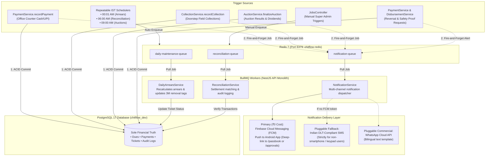

# Kumaran Chits — BullMQ Architecture & Background Jobs Guide

> **Product**: **Kumaran Chits** (Kumaran Finance, Perundurai, Tamil Nadu)  
> **Role of BullMQ**: **Asynchronous Job Processing, Scheduled Crons & Event-Driven Notifications**  
> **Broker Engine**: Redis 7 on Port `6379` (`chitflow-redis`)  
> **Authoritative Invariant**: **PostgreSQL 17 is the sole source of financial truth.** BullMQ background workers never hold independent financial authority. All money movements are executed in ACID database transactions, with downstream notifications offloaded asynchronously.

---

## 1. Quick-Recall Cheat Sheet (30-Second Summary)

If you need to quickly recall what BullMQ does in Kumaran Chits:

| Queue Name | Job Identifier | Worker Service | Trigger Source | Delivery / Purpose |
|---|---|---|---|---|
| **`daily-maintenance-queue`** | `process-daily-arrears` | [`DailyArrearsService`](file:///u:/Kumaran-finance/apps/api/src/jobs/services/daily-arrears.service.ts) | Automated `00:01 AM IST` Cron or Admin API | Scans unpaid dues past grace period, updates `consecutiveUnpaidMonths`, and flags 3-month consecutive defaulters (ADR-07). |
| **`reconciliation-queue`** | `run-daily-reconciliation` | [`ReconciliationService`](file:///u:/Kumaran-finance/apps/api/src/jobs/services/reconciliation.service.ts) | Automated `06:00 AM IST` Cron or Admin API | Reconciles payment gateway settlement batches against internal payment records to detect ghost drops. |
| **`notification-queue`** | `dispatch-payment-receipt` | [`NotificationService`](file:///u:/Kumaran-finance/apps/api/src/jobs/services/notification.service.ts) | Post-commit from Counter & Doorstep collections | Dispatches bilingual payment receipt alerts via **Mobile Push (FCM)** with fallback to **Keypad SMS**. |
| **`notification-queue`** | `scan-pre-auction-reminders` | [`AuctionReminderSchedulerService`](file:///u:/Kumaran-finance/apps/api/src/jobs/services/auction-reminder-scheduler.service.ts) | Automated `09:00 AM IST` Cron | Scans upcoming auctions (3 days ahead) and enqueues broadcast reminder jobs. |
| **`notification-queue`** | `dispatch-auction-reminder` | [`NotificationService`](file:///u:/Kumaran-finance/apps/api/src/jobs/services/notification.service.ts) | Triggered by pre-auction scan or Admin API | Dispatches bilingual date, time, and ceiling reminders to eligible subscribers. |
| **`notification-queue`** | `dispatch-auction-result` | [`NotificationService`](file:///u:/Kumaran-finance/apps/api/src/jobs/services/notification.service.ts) | Triggered upon auction finalization | Broadcasts winning discount, dividend per ticket, and next month's net due ($I_{net}$) to all members. |
| **`notification-queue`** | `dispatch-approval-alert` | [`NotificationService`](file:///u:/Kumaran-finance/apps/api/src/jobs/services/notification.service.ts) | Post-commit from Payment Reversal & Safety Proof Verification | Dispatches high-priority **FCM Push Alerts** to active Partners (`SUPER_ADMIN` / `BRANCH_MANAGER`), strictly excluding `maker_user_id`. |
| **`notification-queue`** | `dispatch-default-warning` | [`NotificationService`](file:///u:/Kumaran-finance/apps/api/src/jobs/services/notification.service.ts) | Triggered by arrears scan | Dispatches arrears warnings when a subscriber falls into overdue status. |

---

## 2. System Architecture & Queue Topology



---

## 3. The 3 Dedicated Production Queues

### 3.1 `daily-maintenance-queue` (Midnight Arrears & 3M Default Tagging)
- **Schedule**: Every night at **00:01 AM IST** (`CRON_DAILY_ARREARS = '1 0 * * *'`).
- **Worker Logic** ([`daily-arrears.service.ts`](file:///u:/Kumaran-finance/apps/api/src/jobs/services/daily-arrears.service.ts)):
  1. Queries all `InstallmentDue` records where `dueDate < NOW()` and `status IN ('UNPAID', 'OVERDUE')`.
  2. Updates overdue statuses in PostgreSQL within the branch scope.
  3. Groups overdue dues by subscriber ticket to calculate continuous unpaid cycles.
  4. Updates `SubscriberTicket.consecutiveUnpaidMonths`.
  5. When `consecutiveUnpaidMonths >= 3`, tags the subscriber ticket to enable company removal rights under **ADR-07 & ADR-12**.
  6. Emits `AuditLog` records tracking arrears recalculation.

### 3.2 `reconciliation-queue` (Daily Payment Settlement Audit)
- **Schedule**: Every morning at **06:00 AM IST** (`CRON_SETTLEMENT_RECONCILIATION = '0 6 * * *'`).
- **Worker Logic** ([`reconciliation.service.ts`](file:///u:/Kumaran-finance/apps/api/src/jobs/services/reconciliation.service.ts)):
  1. Takes settlement records from digital payment gateways / bank accounts.
  2. Matches transaction references against PostgreSQL `public."Payment"`.
  3. Verifies exact whole-rupee matching between gateway settlements and recorded allocations.
  4. Flags discrepancies and unrecorded settlements for Desk Accountant and Auditor review.

### 3.3 `notification-queue` (Event-Driven Receipts & Auction Broadcasts)
Handles all outgoing subscriber communications without blocking HTTP request threads:
1. **Payment Receipts (`JOB_DISPATCH_PAYMENT_RECEIPT`)**:
   - Enqueued immediately after a transaction commits in [`PaymentService`](file:///u:/Kumaran-finance/apps/api/src/payment/payment.service.ts) and [`CollectionService`](file:///u:/Kumaran-finance/apps/api/src/collection/collection.service.ts).
   - Payload includes: `recipientPhone`, `fcmToken`, `amountPaid`, `chitCode`, `ticketNumber`, `receiptNumber`, `transactionTimestamp`, and `passbookAppUrl`.
2. **Pre-Auction Broadcasts (`JOB_SCAN_PRE_AUCTION_REMINDERS` & `JOB_DISPATCH_AUCTION_REMINDER`)**:
   - Scans auctions scheduled 3 days ahead.
   - Broadcasts auction date, start time, branch venue, and ceiling discount to non-prized members.
3. **Auction Results Broadcast (`JOB_DISPATCH_AUCTION_RESULT`)**:
   - Enqueued immediately after transaction commits in [`AuctionService.finalizeAuction()`](file:///u:/Kumaran-finance/apps/api/src/auction/auction.service.ts).
   - Broadcasts the winning ticket number, bid discount, dividend credit per ticket, and next month's net installment ($I_{net} = I_{base} - Div$) to all subscribers in the group via free FCM push (primary) or DLT SMS (keypad fallback).
4. **Maker-Checker High-Priority Partner Push Alerts (`JOB_DISPATCH_APPROVAL_ALERT`)**:
   - Enqueued immediately after transaction commits in:
     - [`PaymentService.requestReversal()`](file:///u:/Kumaran-finance/apps/api/src/payment/payment.service.ts) (`approvalType: 'REVERSAL_APPROVAL'`)
     - [`DisbursementService.verifySafetyProof()`](file:///u:/Kumaran-finance/apps/api/src/disbursement/disbursement.service.ts) (`approvalType: 'DISBURSEMENT_APPROVAL'`)
   - Queries active Partners (`SUPER_ADMIN` / `BRANCH_MANAGER`) with registered `fcmToken`, strictly excluding the Maker (`id != payload.excludeUserId`) so maker never receives an approval request for their own action.
   - Dispatches priority push notification with deep-link payload for immediate mobile biometric approval.
5. **Arrears & Default Warnings (`JOB_DISPATCH_DEFAULT_WARNING`)**:
   - Dispatches statutory reminder notices when a member enters arrears.

### 3.4 Process Bulkhead Isolation & Producer/Worker Scaling (`ENABLE_BULLMQ_WORKERS`)

In monolithic development and single-container deployments, the NestJS process runs both producers and workers (`ENABLE_BULLMQ_WORKERS=true` by default).

Under production high concurrency and traffic spikes:
- **API Producer Process**: Configure `ENABLE_BULLMQ_WORKERS=false`. The API container initializes BullMQ queues to submit jobs, but never spins up background worker threads. This isolates API response latency from background worker CPU/memory consumption.
- **Dedicated Worker Containers**: Spin up standalone containers with `ENABLE_BULLMQ_WORKERS=true`. These processes consume and execute jobs from Redis without binding to HTTP ingress ports.

---

## 4. Cost-Controlled Delivery Channel Hierarchy

In physical chit-fund operations, indiscriminate SMS dispatch creates substantial recurring costs. Kumaran Chits enforces a strict delivery priority hierarchy:

```mermaid
flowchart TD
    Job["JOB_DISPATCH_PAYMENT_RECEIPT Payload"] --> CheckFCM{"Does Customer have\nan active FCM Token?"}
    CheckFCM -->|Yes (Smartphone User)| Push["1. Primary: Mobile Push (FCM)\n• Free of cost (₹0 SMS spend)\n• Instant deep-link to /passbook\n• Bilingual Title & Body"]
    CheckFCM -->|No (Keypad Phone User)| SMS["2. Fallback: Indian DLT-Compliant SMS\n• Reserved exclusively for keypad phones\n• Template-registered message\n• Zero promotional marketing spam"]
    Push --> Audit["Audit Trail Logged in NotificationService.sentLog"]
    SMS --> Audit
```

1. **Free Push Notification (FCM)**: Always preferred if `payload.fcmToken` exists. Links directly to the digital passbook screen in the Flutter mobile app.
2. **Keypad SMS Fallback**: Used **only** when the customer does not have a registered smartphone app token.
3. **Zero SMS Spam**: SMS is strictly forbidden for promotional broadcasts or marketing.

---

## 5. Automated IST Cron Schedules ([`cron-schedules.constant.ts`](file:///u:/Kumaran-finance/apps/api/src/jobs/constants/cron-schedules.constant.ts))

All repeatable schedules use the `Asia/Kolkata` (`TIMEZONE_IST`) timezone:

| Schedule Name | Cron Expression | IST Execution Time | Queue Assigned | Handler Job |
|---|---|---|---|---|
| `REPEATABLE_JOB_DAILY_ARREARS` | `1 0 * * *` | `00:01 AM IST` | `daily-maintenance-queue` | `process-daily-arrears` |
| `REPEATABLE_JOB_SETTLEMENT_RECONCILIATION` | `0 6 * * *` | `06:00 AM IST` | `reconciliation-queue` | `run-daily-reconciliation` |
| `REPEATABLE_JOB_PRE_AUCTION_REMINDERS` | `0 9 * * *` | `09:00 AM IST` | `notification-queue` | `scan-pre-auction-reminders` |

Registered automatically in [`BullMqQueueProvider.registerRepeatableJobs()`](file:///u:/Kumaran-finance/apps/api/src/jobs/providers/bullmq-queue.provider.ts) via `upsertJobScheduler`.

---

## 6. Visual Monitoring: Bull Board Dashboard

Bull Board provides a graphical UI for monitoring BullMQ queue health without requiring CLI access:

- **Route**: `http://localhost:3000/admin/queues`
- **Authentication**: HTTP Basic Auth
  - **Username**: `admin` (or `BULL_BOARD_USER`)
  - **Password**: `chitflow_secret` (or `BULL_BOARD_PASSWORD`)
- **Capabilities**:
  - Live inspection of `active`, `waiting`, `completed`, and `failed` job tabs.
  - Visual review of JSON payloads and error stack traces.
  - One-click manual "Retry" for failed notification jobs.
  - View standing repeatable crons and next scheduled run timestamps.

---

## 7. Management REST API Endpoints ([`jobs.controller.ts`](file:///u:/Kumaran-finance/apps/api/src/jobs/jobs.controller.ts))

Super Admin, Branch Managers, and Accountants can inspect and trigger jobs via authenticated HTTP endpoints:

| Endpoint | Method | Role Required | Purpose |
|---|:---:|---|---|
| `/api/v1/jobs/queue-status` | `GET` | Staff / Auditor | Returns real-time job counts (waiting, active, completed, failed) across all 3 queues. |
| `/api/v1/jobs/repeatable-schedules` | `GET` | Super Admin / Auditor | Lists active BullMQ cron schedules and next run times. |
| `/api/v1/jobs/notification-audit-logs` | `GET` | Super Admin / Auditor | Returns recent dispatches across Push, SMS, and WhatsApp. |
| `/api/v1/jobs/run-daily-arrears` | `POST` | Super Admin / Manager | Triggers synchronous on-demand arrears evaluation. |
| `/api/v1/jobs/enqueue-daily-arrears` | `POST` | Super Admin | Enqueues arrears evaluation job to `daily-maintenance-queue`. |
| `/api/v1/jobs/run-reconciliation` | `POST` | Super Admin / Accountant | Triggers synchronous on-demand payment reconciliation. |
| `/api/v1/jobs/enqueue-reconciliation` | `POST` | Super Admin / Accountant | Enqueues settlement reconciliation to `reconciliation-queue`. |
| `/api/v1/jobs/send-auction-reminder/:id/:m` | `POST` | Super Admin / Manager | Broadcasts reminder for a specific chit group auction. |
| `/api/v1/jobs/run-pre-auction-scan` | `POST` | Super Admin / Manager | Triggers manual pre-auction scan for upcoming auctions. |

---

## 8. Non-Negotiable Architectural Guardrails: What BullMQ DOES NOT Do

| Prohibited Anti-Pattern | Why It Is Strictly Prohibited | Authoritative System |
|---|---|---|
| **Authorizing Money Movements** | A background job must never independently disburse prize money or execute payment reversals. | **NestJS Controller + Dual Control** (`maker != checker`) |
| **Executing Core Financial Mutations** | Recording payments or generating monthly dues occurs synchronously in NestJS with ACID transactions. BullMQ only receives the post-commit receipt dispatch. | **PostgreSQL 17** (`PaymentService`, `InstallmentService`) |
| **Autonomous Tie-Break Draws** | Auction ceiling ties must be resolved by physical paper tokens drawn in front of members at the branch office (Option A). Software workers cannot pick winners. | **Branch Foreman Physical Draw** |
| **Indiscriminate Marketing SMS** | SMS incurs per-message DLT charges and disturbs subscribers. It is restricted to OTP and keypad phone receipt fallbacks. | **FCM Mobile App Push (Primary)** |

---

## 9. Verification Proofs (Live Terminal Evidence)

Verified live during [`verify-lifecycle-6.ts`](file:///u:/Kumaran-finance/apps/api/scripts/lifecycle/verify-lifecycle-6.ts), [`verify-lifecycle-7.ts`](file:///u:/Kumaran-finance/apps/api/scripts/lifecycle/verify-lifecycle-7.ts), and [`verify-lifecycle-11.ts`](file:///u:/Kumaran-finance/apps/api/scripts/lifecycle/verify-lifecycle-11.ts):

### Proof 1: Post-Commit Receipt Dispatch (Lifecycle 6 & 7)
```text
[BullMqQueueProvider] Enqueued job 'dispatch-payment-receipt' on queue 'notification-queue'
Payload: {
  recipientPhone: "9876543220",
  amountPaid: "3950",
  receiptNumber: "KC-REC-PRD-2026-00014",
  passbookAppUrl: "https://app.kumaranfinance.in/passbook/e6dbbcdf-..."
}
```

### Proof 2: Queue Status Report (`GET /api/v1/jobs/queue-status`)
```json
{
  "success": true,
  "data": {
    "queues": [
      { "queueName": "daily-maintenance-queue", "isRedisConnected": true, "waitingCount": 0, "activeCount": 0, "completedCount": 2, "failedCount": 0 },
      { "queueName": "notification-queue", "isRedisConnected": true, "waitingCount": 0, "activeCount": 0, "completedCount": 4, "failedCount": 0 },
      { "queueName": "reconciliation-queue", "isRedisConnected": true, "waitingCount": 0, "activeCount": 0, "completedCount": 1, "failedCount": 0 }
    ],
    "timestamp": "2026-10-24T11:45:00.000Z"
  }
}
```

### Proof 3: Active Repeatable IST Schedulers (`GET /api/v1/jobs/repeatable-schedules`)
```json
{
  "success": true,
  "data": [
    { "key": "daily-arrears-evaluation", "name": "daily-arrears-evaluation", "pattern": "1 0 * * *", "tz": "Asia/Kolkata" },
    { "key": "pre-auction-reminders", "name": "pre-auction-reminders", "pattern": "0 9 * * *", "tz": "Asia/Kolkata" },
    { "key": "daily-settlement-reconciliation", "name": "daily-settlement-reconciliation", "pattern": "0 6 * * *", "tz": "Asia/Kolkata" }
  ]
}
```

### Proof 4: Bull Board Authenticated Access (`GET /admin/queues`)
```bash
$ curl -I -u "admin:chitflow_secret" http://127.0.0.1:3000/admin/queues
HTTP/1.1 200 OK
Content-Type: text/html; charset=utf-8
```

### Proof 5: Live Auction Results Broadcast Dispatch (Lifecycle 4)
```text
[AuctionService] Enqueued auction result notification for group KC-LIVE-20M-01 Month 2 (20 subscribers)
[NotificationService] Broadcasted auction results to 20 subscribers (0 Push, 20 SMS) for Chit KC-LIVE-20M-01 Month 2
[BullMQ Queue Status]: Completed job 'dispatch-auction-result' successfully on 'notification-queue'.
```

### Proof 6: Maker-Checker High-Priority Approval Push Alerts (Lifecycle 7 & 8)
```text
[PaymentService] Enqueued reversal approval alert for Payment ddbd39b6-ae0a-4751-9075-84dccf108028
[DisbursementService] Enqueued disbursement approval alert for Auction 9adf153f-a30f-44de-bc54-39bb3c952822
[NotificationService] Dispatched high-priority approval push alerts to active partner(s) (maker excluded)
```

---

## 7. Queue Resilience, Concurrency Tuning & Priority Scheduling (`CONFIRMED-BY-DEVELOPER`)

Under high load and bursty end-of-month collections, BullMQ queues enforce 4 operational resilience policies:

### 7.1 Worker Concurrency & Stalled Job Recovery
* **`notificationWorker` (`concurrency: 5`)**: Configured with 5 concurrent workers to handle parallel network I/O for MSG91 DLT SMS and Firebase FCM push dispatches, eliminating sequential worker bottlenecks.
* **`maintenanceWorker` & `reconciliationWorker` (`concurrency: 2`)**: Configured with 2 parallel threads for midnight arrears and gateway audits.
* **Stalled Job Protection**: Workers enforce `lockDuration: 30000` (30s) and `stalledInterval: 30000` (30s) to reclaim orphaned tasks if a container restarts mid-execution.

### 7.2 Deterministic `jobId` Deduplication (At-Least-Once Delivery Safety)
All enqueued jobs pass explicit deterministic `jobId` keys via `BullMqQueueProvider.addJob(..., { jobId })` using hyphenated identifiers (since BullMQ v6 forbids `:` inside custom job IDs; `BullMqQueueProvider` also normalizes any colons automatically). BullMQ drops or skips identical job IDs if already queued:
* **Payment Receipts**: `jobId: receipt-${receiptNumber}`
* **Reversal Alerts**: `jobId: approval-alert-reversal-${reversalId}`
* **Disbursement Alerts**: `jobId: approval-alert-disbursement-${auctionId}`
* **Auction Results**: `jobId: auction-result-${auctionId}-m${installmentMonth}`
* **Pre-Auction Broadcasts**: `jobId: auction-reminder-${chitGroupId}-m${month}`

### 7.3 3-Tier Priority Scheduling (Starvation Prevention)
BullMQ prioritizes jobs with lower numerical priority values (`1` runs before `10`):
1. **Priority 1 (Critical Real-Time)**:
   * Real-time Payment Receipts (`JOB_DISPATCH_PAYMENT_RECEIPT`)
   * Maker-Checker Partner Approval Push Alerts (`JOB_DISPATCH_APPROVAL_ALERT`)
2. **Priority 5 (Operational / Medium)**:
   * Post-Auction Results & Dividend Summaries (`JOB_DISPATCH_AUCTION_RESULT`)
3. **Priority 10 (Background / Bulk)**:
   * Pre-Auction Upcoming Reminders (`JOB_DISPATCH_AUCTION_REMINDER`)
   * Daily Arrears Default Warnings (`JOB_DISPATCH_DEFAULT_WARNING`)

### 7.4 Bounded Failed-Job (DLQ) Retention & Pruning Policy (`DEF-DB-06`)
* **Centralized Defaults (`createDefaultBullMqJobOptions`)**: All 3 BullMQ queues (`daily-maintenance-queue`, `notification-queue`, `reconciliation-queue`) are constructed in `BullMqQueueProvider.onModuleInit` with `defaultJobOptions` (`attempts: 3`, exponential backoff `1000ms`, `removeOnComplete: true`, and `removeOnFail: { count: 500, age: 604800 }`), ensuring both ad-hoc `addJob` enqueues and repeatable IST cron schedules (`upsertJobScheduler`) inherit bounded Redis retention.
* **BullMQ Native Retention (Bull Board Compatible)**: Instead of creating secondary shadow DLQ queues, permanently failed jobs stay inspectable and 1-click retryable inside Bull Board (`/admin/queues`) while BullMQ automatically prunes any failed job exceeding **500 entries per queue** or **7 days (`604800` seconds)** upon subsequent failure transitions.
* **Terminal `[DLQ]` Diagnostic Logging**: All 3 workers attach a shared `.on('failed')` listener (`handleWorkerJobFailure`) that emits a `warn` log on intermediate retries and an `[DLQ]` `error` log when `attemptsMade >= maxAttempts`.

