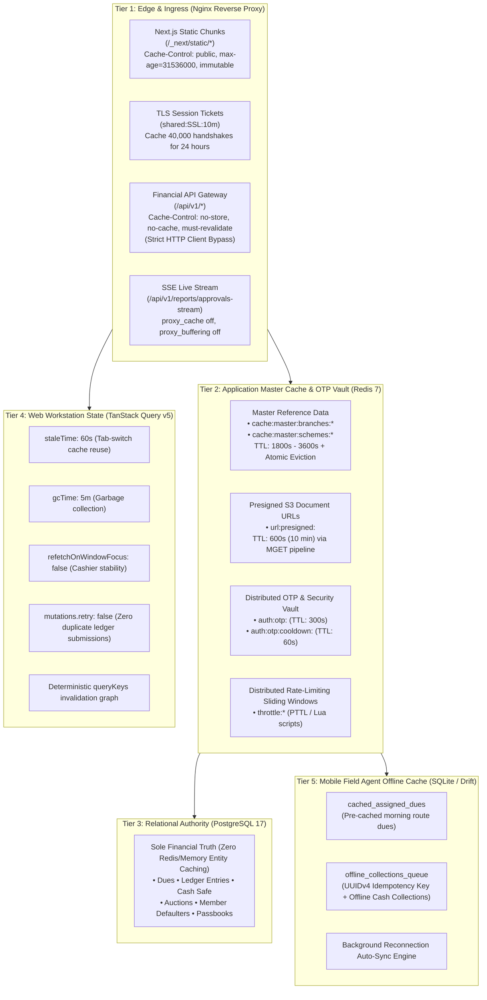
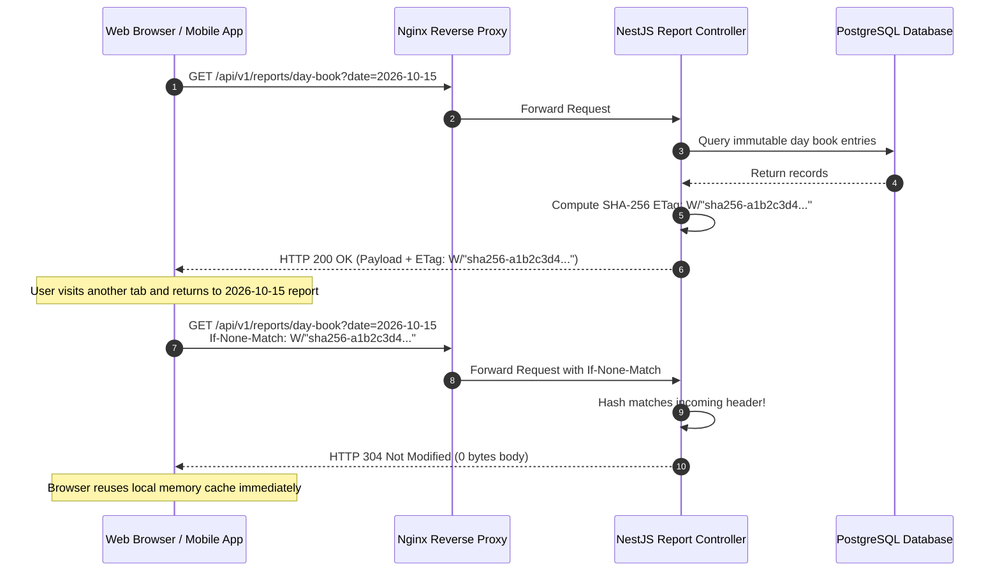
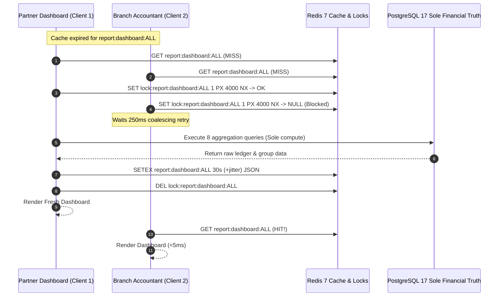

# Kumaran Chits — Caching Architecture & Operational Specification

> **Product**: **Kumaran Chits** (Kumaran Finance, Perundurai, Tamil Nadu)  
> **Target Audience**: AI Agents, Backend/Frontend Engineers, DevOps, Security Auditors  
> **Mandatory Financial Invariant**: **PostgreSQL 17 is the sole source of financial truth.** Redis never stores authoritative financial ledger balances, member savings, or prized payout states. All caching is non-authoritative, time-bounded, and fail-open.

---

## 1. Executive Summary & 5-Tier Caching Topology

Kumaran Chits employs a defense-in-depth, 5-tier caching hierarchy designed to maximize UI responsiveness and minimize database load while strictly upholding the Indian Chit Funds Act statutory compliance:



---

## 2. Master TTL & Cache Policy Inventory

| Tier | Resource / Key Pattern | Engine / Header | TTL / Lifetime | Eviction Trigger | Failure Mode |
|---|---|---|---|---|---|
| **Tier 1: Edge** | Static Next.js Bundles (`/_next/static/*`) | `Cache-Control` | `31,536,000s` (1 year) | Immutable content hash | N/A |
| **Tier 1: Edge** | TLS Session Handshakes | Nginx Shared Memory | `86,400s` (1 day) | LRU memory eviction | Full TLS handshake |
| **Tier 1: Edge** | Financial APIs (`/api/v1/*`) | `Cache-Control` | `0s` (`no-store`) | Always bypassed | Direct upstream |
| **Tier 1: Edge** | Live SSE Approval Stream | Nginx Buffering | `0s` (`off`) | Instant delivery | Live TCP stream |
| **Tier 2: Redis** | Master Branch Directory (`cache:master:branches:*`) | Redis `String` (JSON) | `3,600s` (1 hour) | `POST /branches` or update | Fail-open to Postgres |
| **Tier 2: Redis** | Master Scheme Catalog (`cache:master:schemes:*`) | Redis `String` (JSON) | `1,800s` (30 mins) | Scheme create/update/activate | Fail-open to Postgres |
| **Tier 2: Redis** | Presigned S3 URLs (`url:presigned:<key>`) | Redis `String` | `600s` (10 mins) | `StorageService.deleteFile` | Generate fresh S3 URL |
| **Tier 2: Redis** | Distributed SMS OTP (`auth:otp:<phone>`) | Redis `String` (JSON) | `300s` (5 mins) | Verified or 3 failed attempts | Lockout penalty |
| **Tier 2: Redis** | SMS Request Cooldown (`auth:otp:cooldown:<phone>`) | Redis `String` | `60s` (1 min) | Natural expiration | Fallback in-memory map |
| **Tier 2: Redis** | Rate Limiting Windows (`throttle:*`) | Redis Lua | Dynamic (60s–900s) | Natural window sliding | Memory fallback |
| **Tier 2: Redis** | Executive Dashboard KPIs (`report:dashboard:<branchId|ALL>`) | Redis `String` (BigInt Safe) | `30s` | Payment / Reversal / Handover commit | Fail-open to Postgres |
| **Tier 2: Redis** | Live Approvals Stream Summary (`report:approvals:<branchId|ALL>`) | Redis `String` | `15s` | Payment / Reversal / Handover commit | Fail-open to Postgres |
| **Tier 2: Redis** | Daybook Hot-Read Reports (`cache:reports:daybook:<branchId>:<date>`) | Redis `String` (BigInt Safe) | `60s` (1 min) | Payment / Reversal approval commit | Fail-open to Postgres |
| **Tier 2: HTTP** | Closed Historical Reports (`Day Book`, `Form XXII`) | HTTP `ETag` + `304` | Conditional | Content SHA-256 change | Full JSON serialization |
| **Tier 4: Web** | Workstation Server State (TanStack Query) | Browser Memory | `staleTime: 60s` | `queryClient.invalidateQueries` | Fresh background fetch |
| **Tier 5: Mobile** | Assigned Field Dues (`cached_assigned_dues`) | SQLite (Local) | Daily Field Round | Synchronized morning download | Offline inspection |
| **Tier 5: Mobile** | Unsynced Collections (`offline_collections_queue`) | SQLite (Local) | Persistent | Network sync confirmation | Retries indefinitely |

---

## 3. Tier 2: Master Reference Data Caching Architecture

### 3.1 Design Principles
1. **Cache-Aside with Fail-Open Resilience**:
   All Redis reads are wrapped in safety blocks. If the Redis server restarts, experiences network partition, or exceeds latency thresholds, the application logs a warning and queries PostgreSQL directly without throwing errors.
2. **Atomic Invalidation on Mutations**:
   Whenever administrative users execute write operations (e.g. creating a new branch, configuring a new chit scheme, or activating a chit group), all affected Redis cache keys are atomically evicted using Redis `DEL`.
3. **BigInt & Decimal Safe Serialization**:
   All monetary amounts and IDs are serialized into ISO-standard JSON strings with exact whole-rupee precision to prevent floating-point truncation.

### 3.2 Key Naming Standard
- `cache:master:branches:all` — Complete list of all branch offices.
- `cache:master:branches:active` — Active branch offices only.
- `cache:master:branch:<id>` — Single branch office detail.
- `cache:master:schemes:all` — General chit scheme catalog.
- `cache:master:scheme:<id>` — Chit scheme detail with configuration.

### 3.3 Daybook & Report Hot-Read Hybrid Caching
To protect PostgreSQL 17 from query storms during peak morning and closing reconciliation hours when multiple partners, accountants, and branch managers query real-time registers:
- **Key Pattern**: `cache:reports:daybook:${branchId}:${date}`
- **TTL**: 60 seconds (prevents cache staleness).
- **Instant Event Invalidation**: Whenever a payment is collected at the counter, recorded via doorstep sync, or reversed under dual-control checker approval, `PaymentService.invalidateDaybookCache()` executes `DEL` across affected branch keys, ensuring instant sub-10ms response times without serving stale financial balances.
- **BigInt Serialization**: Financial aggregates containing 64-bit integer BigInts are converted with a designated replacer/reviver schema to maintain whole-rupee precision.

---

## 4. HTTP ETag & 304 Conditional Caching for Closed Reports

Historical financial records (such as Day Books, Form XXII Cash Books, and Form XVII Auction Minutes for past closed dates) are legally immutable under the Indian Chit Funds Act once reconciled.

### 4.1 Handshake Protocol


---

## 5. Tier 5: Mobile Offline SQLite & Idempotent Collection Queue

Field collection agents collect subscription payments in rural areas with intermittent cellular reception around Perundurai and Erode.

### 5.1 SQLite Local Database Schema

```sql
-- 1. Pre-cached assigned dues for the agent's morning route
CREATE TABLE IF NOT EXISTS cached_assigned_dues (
    due_id TEXT PRIMARY KEY,
    ticket_id TEXT NOT NULL,
    chit_group_id TEXT NOT NULL,
    chit_group_code TEXT NOT NULL,
    customer_id TEXT NOT NULL,
    customer_name TEXT NOT NULL,
    customer_phone TEXT NOT NULL,
    route_name TEXT,
    installment_month INTEGER NOT NULL,
    due_amount INTEGER NOT NULL,       -- BigInt whole rupees
    dividend_amount INTEGER NOT NULL,  -- BigInt whole rupees
    net_payable INTEGER NOT NULL,      -- BigInt whole rupees
    due_status TEXT NOT NULL,          -- UNPAID, PAID
    due_date TEXT NOT NULL,
    cached_at TEXT NOT NULL
);

-- 2. Offline collections queue awaiting server sync
CREATE TABLE IF NOT EXISTS offline_collections_queue (
    queue_id TEXT PRIMARY KEY,
    due_id TEXT NOT NULL,
    ticket_id TEXT NOT NULL,
    amount_collected INTEGER NOT NULL,  -- BigInt whole rupees
    payment_method TEXT NOT NULL,       -- CASH
    collected_at TEXT NOT NULL,
    idempotency_key TEXT UNIQUE NOT NULL, -- UUIDv4 generated at payment confirmation
    receipt_number_provisional TEXT NOT NULL,
    sync_status TEXT NOT NULL,          -- PENDING, SYNCING, FAILED, SYNCED
    retry_count INTEGER DEFAULT 0,
    last_error TEXT
);
```

### 5.2 Idempotency & Conflict Resolution Invariants
1. **UUIDv4 Idempotency Key**: Generated on the agent's Android device at the exact millisecond the customer hands over cash. It is never regenerated on retry.
2. **Server Deduplication**: When connectivity restores and the sync engine posts the queued items to `/api/v1/collections`, the backend validates the `Idempotency-Key` header. If the transaction was already processed, the backend returns HTTP 200/409 with the existing receipt number, preventing duplicate collections.
3. **Safe Queue Drainage**: An item is deleted from `offline_collections_queue` **only after** the server returns a successful HTTP confirmation.

---

## 6. Cache Stampede (Thundering Herd) & Distributed Mutex Locking

When heavy aggregation reports (such as the Executive Dashboard with 8 live queries or Day Book with multi-payment mode totals) expire, multiple concurrent requests from partners, branch accountants, and auditors could simultaneously trigger redundant database queries.



### 6.1 Mutex Guard & Coalescing Protocol
1. **Atomic Lock Acquisition**: `SET lock:<cacheKey> 1 PX 4000 NX` guarantees that exactly one process computes the aggregate from PostgreSQL.
2. **Wait-and-Retry Coalescing**: Competing requests pause for 250ms and re-query Redis. In over 99% of cases, the freshly computed cache is served without hitting PostgreSQL.
3. **Guaranteed Release**: Lock keys are released inside `finally` blocks, and carry a 4,000ms safety TTL to prevent deadlocks in case of unexpected process termination.

---

## 7. Cache Avalanche & Centralized TTL Jitter Math

### 7.1 Problem
When identical TTL values are used across hundreds of entities (e.g. 1 hour for all branches, 30 minutes for all chit groups), application restart or morning synchronization at 09:00 AM causes all cache keys to expire simultaneously. The resulting avalanche floods PostgreSQL with duplicate reads.

### 7.2 Jitter Engine Implementation
The centralized `withTtlJitter(baseSeconds, jitterFraction = 0.15)` utility applies a $\pm 15\%$ uniform pseudo-random variance:
$$\text{TTL}_{\text{jittered}} = \max\left(1, \text{baseSeconds} + \Delta\right), \quad \Delta \in [-\lfloor 0.15 \times \text{base} \rfloor, +\lfloor 0.15 \times \text{base} \rfloor]$$

| Cache Category | Base TTL | Jitter Range ($\pm 15\%$) | Protected Layer |
|---|---|---|---|
| Master Branch Directory | 3,600s (1 hr) | 3,060s – 4,140s | PostgreSQL Branch lookups |
| Master Chit Schemes | 1,800s (30 min) | 1,530s – 2,070s | Chit group & ticket joins |
| Executive Dashboard | 30s | 26s – 34s | Multi-aggregate KPI metrics |
| Day Book Journal | 60s | 51s – 69s | Payment collection aggregates |
| S3 Presigned URLs | 600s (10 min) | 510s – 690s | S3 Storage Presign API |

---

## 8. Cache Penetration & Negative Caching Sentinel

### 8.1 Threat Model
Repetitive lookups for non-existent UUIDs or deleted entities bypass traditional caching layers and execute full indexed index scans on PostgreSQL every time, creating vector for resource starvation.

### 8.2 Negative Caching Sentinel
When `BranchService.findById` or `ChitService.findOne` encounters a missing ID:
1. It writes a negative sentinel `{ "__notFound": true }` to Redis with a short **60-second TTL**.
2. Subsequent requests for the same non-existent ID read the sentinel and throw `NotFoundException` immediately without hitting PostgreSQL.
3. Upon entity creation or intake, the key is evicted atomically via `redis.del`, ensuring new valid entities are accessible without delay.

---

## 9. Redis Memory Bounds, `volatile-lru` Eviction & Concurrency Bulkheads

### 9.1 Redis Memory Ceiling & Queue Preservation
In production, Redis is shared between master caches, rate limiters, distributed locks, and BullMQ background workers (`notification-queue`, `daily-arrears-queue`).
- **Memory Ceiling**: `--maxmemory 512mb` enforces an absolute RAM boundary.
- **Eviction Policy**: `--maxmemory-policy volatile-lru` restricts key eviction strictly to keys configured with an explicit TTL (`EX`).
- **BullMQ Queue Safety**: Because BullMQ queues (delayed jobs, parent-child flows, stream records) do not carry Redis TTLs, `volatile-lru` guarantees persistent queues are never evicted, preventing job loss.

### 9.2 Fail-Open Concurrency Bulkhead
If Redis goes offline or experiences a network partition:
- Master reference reads (branches, schemes) fall back directly to PostgreSQL.
- Heavy dashboard aggregations enter **Fail-Open Bulkhead Mode**:
  - Max **3 concurrent fallback computations** are permitted simultaneously on PostgreSQL.
  - When all 3 slots are occupied, subsequent requests receive the last known in-memory snapshot (`lastKnownDashboardSnapshot`), safeguarding PostgreSQL connection pools (150 connections) from sudden saturation.

---

## 10. Financial Non-Negotiables & Statutory Safety Rules

1. **Zero Entity Caching of Financial Balances**:
   Under ADR-01 and Chit Funds Act §22, dues, subscriber balances, auction winner payouts, and cash in safe must **never be cached in Redis or in-memory**. Every financial mutation or verification must execute directly against PostgreSQL 17 inside an ACID transaction (`SERIALIZABLE` or `READ COMMITTED` with row locks).
2. **Maker $\ne$ Checker Isolation**:
   Cached user roles or session claims must never bypass server-side database checks for Maker-Checker dual control (`maker_user_id !== checker_user_id`).
3. **Fail-Open Policy for Master Data**:
   If Redis goes offline, the system continues operating normally by falling back to PostgreSQL for branch and scheme reads.
4. **PostgreSQL as Sole Financial Truth**:
   Redis serves purely as an ephemeral performance and rate-limiting tier; financial ledgers and audit records reside permanently in PostgreSQL 17.
