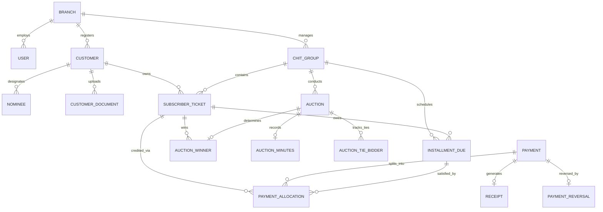

# Kumaran Chits — Database Schema & Entity-Relationship Design

> **Product**: **Kumaran Chits** (Kumaran Finance)  
> **Architecture Decision**: Based on **ADR-01**, this schema is a **strict single-company database**. No redundant `company_id` columns exist.  
> **Key Architectural Mandates (`CONFIRMED-BY-DEVELOPER`)**:
> 1. **Whole Rupee Arithmetic**: All monetary currency values are stored as 64-bit integer Rupees (`BigInt`). Paise are never used in Kumaran Finance operations.
> 2. **Dynamic Personas ($N$ Users per Role)**: The system supports an arbitrary, dynamic number of users per persona; headcounts are never static.
> 3. **Ticket Limit Constraint**: Database-level unique constraint prevents any single customer from holding 2 or more tickets in the same chit group (`@@unique([chitGroupId, customerId])`).
> 4. **Commission Snapshotting**: 4.00% default with immutable group-level and auction-level freezes.
> 5. **Company Safety Proof Recordkeeping**: Flexible security checklist (signed agreements, nominee signatures, blank cheques, promissory notes) on prize winners. Property documents eliminated; collateral is non-mandatory.
> 6. **Fixed 1/4 Discount Ceiling & Physical Tie-Breaks**: Maximum auction discount fixed at strictly 1/4 (25%) of total chit value with support for in-branch physical paper token tie-breaks.
> 7. **Single Discrete Payments & Zero Advance Balance**: Each installment month accepts strictly one payment; zero double payments and zero advance balance concept.

---

## 1. High-Level Entity Relationship Diagram (ERD)



---

## 2. Complete Prisma Schema Specification

```prisma
datasource db {
  provider = "postgresql"
  url      = env("DATABASE_URL")
}

generator client {
  provider = "prisma-client-js"
}

// -------------------------------------------------------------
// 1. Branch & Staff Management (Single Company: Kumaran Finance)
// -------------------------------------------------------------

model Branch {
  id          String   @id @default(uuid())
  code        String   @unique // e.g., "HO", "PRD"
  name        String   // "Head Office - Perundurai"
  nameTamil   String?  // "தலைமை கிளை - பெருந்துறை"
  address     String
  phone       String
  isActive    Boolean  @default(true)
  createdAt   DateTime @default(now())
  updatedAt   DateTime @updatedAt

  users       User[]
  chits       ChitGroup[]
  customers   Customer[]
  receipts    Receipt[]
}

// Supports dynamic N persons per persona across present and future
enum Role {
  SUPER_ADMIN      // Partners / Proprietor (full oversight, final checker approval)
  BRANCH_MANAGER   // Operational branch head (maker for auctions, member intake)
  ACCOUNTANT       // Financial verification, day books, reconciliations, voucher prep
  COLLECTION_AGENT // Doorstep field collections, mobile app
  CUSTOMER         // Chit subscribers viewing personal passbook & paying online
  AUDITOR          // Independent chartered accountant (read-only audit views)
}

model User {
  id               String    @id @default(uuid())
  branchId         String?
  branch           Branch?   @relation(fields: [branchId], references: [id])
  name             String
  phone            String    @unique
  email            String?   @unique
  passwordHash     String
  roles            Role[]    // Supports multiple roles (e.g., [COLLECTION_AGENT, ACCOUNTANT] or [SUPER_ADMIN])
  isActive         Boolean   @default(true)
  totpSecret       String?   // RFC 6238 TOTP secret for Microsoft Authenticator 2FA
  isTotpEnabled    Boolean   @default(false)
  mpinHash         String?   // 6-digit MPIN bcrypt hash for mobile quick unlock
  refreshTokenHash String?   // Hashed refresh token for active session revocation
  lastLoginAt      DateTime?
  createdAt        DateTime  @default(now())
  updatedAt        DateTime  @updatedAt

  collections      Payment[] @relation("AgentPayments")
  auditLogs        AuditLog[]
}

// -------------------------------------------------------------
// 2. Customer & KYC Management
// -------------------------------------------------------------

model Customer {
  id           String             @id @default(uuid())
  branchId     String
  branch       Branch             @relation(fields: [branchId], references: [id])
  customerCode String             @unique // e.g., "KC-CUST-00101"
  fullName     String
  fullNameTamil String?
  phone        String             @unique
  altPhone     String?
  addressLine1 String
  addressLine2 String?
  city         String
  pincode      String
  panNumber    String?
  aadhaarLast4 String?            // Storing only masked last 4 digits for data minimization
  isKycVerified Boolean           @default(false)
  createdAt    DateTime           @default(now())
  updatedAt    DateTime           @updatedAt

  nominees     Nominee[]
  documents    CustomerDocument[]
  tickets      SubscriberTicket[]
}

model Nominee {
  id           String    @id @default(uuid())
  customerId   String
  customer     Customer  @relation(fields: [customerId], references: [id], onDelete: Cascade)
  fullName     String
  relationship String    // "Spouse", "Son", "Father"
  phone        String
  aadhaarLast4 String?
  createdAt    DateTime  @default(now())
}

model CustomerDocument {
  id           String    @id @default(uuid())
  customerId   String
  customer     Customer  @relation(fields: [customerId], references: [id], onDelete: Cascade)
  docType      String    // "AADHAAR_FRONT", "PAN", "PHOTO", "SIGNATURE"
  s3Key        String    // Private S3 object key
  fileName     String
  verified     Boolean   @default(false)
  uploadedAt   DateTime  @default(now())
}

// -------------------------------------------------------------
// 3. Chit Groups, Mid-Cycle Onboarding & Fixed 1/4 Ceiling
// -------------------------------------------------------------

enum ChitStatus {
  DRAFT
  REGISTERED // Sanction order recorded
  ACTIVE     // In progress
  COMPLETED  // All installments finished
  CLOSED     // Accounts reconciled and closed
}

enum InitializationMode {
  NEW_GROUP      // Starts from Month 1
  ONGOING_GROUP  // Mid-cycle onboarding from physical paper notebooks (e.g. at Month 7)
}

model ChitGroup {
  id                     String                  @id @default(uuid())
  branchId               String
  branch                 Branch                  @relation(fields: [branchId], references: [id])
  groupCode              String                  @unique // e.g., "KCA-1L-20M-01"
  groupName              String                  // "₹1 Lakh 20 Months Group A"
  groupNameTamil         String?
  chitValue              BigInt                  // Whole integer Rupees (e.g., 100000)
  durationMonths         Int                     // 20
  totalTickets           Int                     // 20
  baseInstallment        BigInt                  // Whole integer Rupees: chitValue / durationMonths (e.g., 5000)
  
  // Commission Snapshot Pattern: 4.00% default, frozen per group
  foremanCommissionRate  Decimal                 @default(4.00) @db.Decimal(5, 2)
  
  // Fixed 1/4 (25%) Discount Ceiling: chitValue / 4
  maxDiscountCeiling     BigInt                  // Whole integer Rupees: chitValue / 4 (e.g., 25000)
  
  // Mid-cycle onboarding support
  initMode               InitializationMode      @default(NEW_GROUP)
  onboardedAtMonth       Int                     @default(1) // e.g., 7 if onboarded at Month 7
  
  status                 ChitStatus              @default(DRAFT)
  sanctionOrderNumber    String?                 // Regulatory reference from Chit Registrar
  sanctionDate           DateTime?
  startDate              DateTime
  endDate                DateTime
  createdAt              DateTime                @default(now())
  updatedAt              DateTime                @updatedAt

  tickets                SubscriberTicket[]
  auctions               Auction[]
  dues                   InstallmentDue[]
}

model SubscriberTicket {
  id                      String           @id @default(uuid())
  chitGroupId             String
  chitGroup               ChitGroup        @relation(fields: [chitGroupId], references: [id])
  customerId              String
  customer                Customer         @relation(fields: [customerId], references: [id])
  ticketNumber            Int              // 1 to 20
  isPrized                Boolean          @default(false)
  prizedAuctionId         String?
  openingBalance          BigInt           @default(0) // Whole integer Rupees for mid-cycle onboarding
  consecutiveUnpaidMonths Int              @default(0) // Tracks continuous unpaid months (triggers removal rights at 3)
  joiningDate             DateTime         @default(now())
  status                  String           @default("ACTIVE") // ACTIVE, DEFAULT_3_MONTHS, REMOVED_DEF_3M, SURRENDERED
  removedAt               DateTime?        // Timestamp if removed by company after 3 continuous months arrears
  removedByUserId         String?          // Partner / Super Admin who authorized removal

  dues                    InstallmentDue[]
  allocations             PaymentAllocation[]
  winningAuction          AuctionWinner?
  tieBids                 AuctionTieBidder[]

  @@unique([chitGroupId, ticketNumber])
  // Architectural Constraint: Prevents a single customer from holding 2 or more tickets in the SAME chit group
  @@unique([chitGroupId, customerId])
}

// -------------------------------------------------------------
// 4. In-Office Staff-Recorded Auction Engine & Tie-Breakers
// -------------------------------------------------------------

enum AuctionStatus {
  SCHEDULED
  COMPLETED
  MINUTES_FILED
}

model Auction {
  id                     String           @id @default(uuid())
  chitGroupId            String
  chitGroup              ChitGroup        @relation(fields: [chitGroupId], references: [id])
  installmentMonth       Int              // Month 1 to 20 (Month 1 & Month N have NO auction)
  auctionDate            DateTime
  status                 AuctionStatus    @default(SCHEDULED)
  isHistoricalEntry      Boolean          @default(false) // True if imported during mid-cycle onboarding
  
  // Auction financial snapshots (Strictly whole integer Rupees)
  bidDiscount            BigInt?          // Whole Rupees
  foremanCommissionRate  Decimal?         @db.Decimal(5, 2) // Rate frozen at auction time (4.00%)
  foremanCommissionAmount BigInt?         // Exact whole ₹ amount
  totalDividend          BigInt?          // Whole Rupees: bidDiscount - commission
  dividendPerTicket      BigInt?          // Whole Rupees: divided equally across all tickets in group (including winner)
  prizeMoney             BigInt?          // Whole Rupees: chitValue - bidDiscount
  
  conductedByUserId      String?          // Staff/Manager who entered the result (Maker)
  finalizedByUserId      String?          // Partner/Super Admin who approved result (Checker)
  createdAt              DateTime         @default(now())
  updatedAt              DateTime         @updatedAt

  winner                 AuctionWinner?
  tieBidders             AuctionTieBidder[]
  minutes                AuctionMinutes?

  @@unique([chitGroupId, installmentMonth])
}

enum DisbursementMode {
  ACCOUNT_PAYEE_CHEQUE
  BANK_TRANSFER_NEFT
  BANK_TRANSFER_RTGS
  BANK_TRANSFER_IMPS
  CASH
}

model AuctionWinner {
  id                     String            @id @default(uuid())
  auctionId              String            @unique
  auction                Auction           @relation(fields: [auctionId], references: [id])
  ticketId               String            @unique
  ticket                 SubscriberTicket  @relation(fields: [ticketId], references: [id])
  wasTieBreakWinner      Boolean           @default(false)
  
  // Company Safety Proof Checklist (Recordkeeper pattern)
  isSecurityRequired     Boolean           @default(false) // Evaluated case-by-case (not mandatory)
  securityType           String?           // "BLANK_CHEQUE", "SIGNED_AGREEMENT", "PROMISSORY_NOTE", "OTHER"
  blankChequeDetails     String?           // Bank name, cheque numbers, account holder name
  agreementSigned        Boolean           @default(false) // Winner agreement signature
  nomineeSigned          Boolean           @default(false) // Nominee signature
  securityDocS3Key       String?           // Scanned papers, signed cheques, agreements
  verifiedByUserId       String?           // Staff / Branch Manager (Maker)
  
  disbursementStatus     String            @default("PENDING_VERIFICATION") // PENDING_VERIFICATION, APPROVED, DISBURSED
  disbursementMode       DisbursementMode? // Cheque, NEFT/RTGS/IMPS, Cash
  disbursedAmount        BigInt?           // Whole integer Rupees
  authorizedByUserId     String?           // Super Admin / Partner (Checker)
  disbursedAt            DateTime?
  paymentReference       String?           // Cheque number, Bank UTR, or Cash voucher receipt number
}

model AuctionTieBidder {
  id                 String           @id @default(uuid())
  auctionId          String
  auction            Auction          @relation(fields: [auctionId], references: [id], onDelete: Cascade)
  ticketId           String
  ticket             SubscriberTicket @relation(fields: [ticketId], references: [id])
  bidDiscount        BigInt           // All tied at ceiling (Whole Rupees)
  tokenNumber        Int?             // Physical paper token drawn at branch
  isWinner           Boolean          @default(false)
}

model AuctionMinutes {
  id                 String   @id @default(uuid())
  auctionId          String   @unique
  auction            Auction  @relation(fields: [auctionId], references: [id])
  subscribersPresent Int
  minutesText        String   @db.Text
  signedByForeman    Boolean  @default(false)
  filedAtRegistrar   Boolean  @default(false)
  createdAt          DateTime @default(now())
}

// -------------------------------------------------------------
// 5. Installment Dues, Payments, & Bilingual Receipts
// -------------------------------------------------------------

enum DueStatus {
  UNPAID
  PAID
  OVERDUE
}

model InstallmentDue {
  id                 String              @id @default(uuid())
  chitGroupId        String
  chitGroup          ChitGroup           @relation(fields: [chitGroupId], references: [id])
  ticketId           String
  ticket             SubscriberTicket    @relation(fields: [ticketId], references: [id])
  installmentMonth   Int                 // Month 1 to 20
  dueDate            DateTime
  grossAmount        BigInt              // Base installment in whole Rupees (e.g., 5000)
  dividendDeduction  BigInt              @default(0) // Allocated dividend in whole Rupees
  netPayableAmount   BigInt              // grossAmount - dividendDeduction
  paidAmount         BigInt              @default(0)
  status             DueStatus           @default(UNPAID)
  createdAt          DateTime            @default(now())
  updatedAt          DateTime            @updatedAt

  allocations        PaymentAllocation[]

  @@unique([ticketId, installmentMonth])
}

enum PaymentMethod {
  CASH
  UPI
  BANK_TRANSFER
  CHEQUE
}

enum PaymentStatus {
  INITIATED
  SUCCESS
  FAILED
  REVERSED
}

model Payment {
  id                 String              @id @default(uuid())
  branchId           String
  recordedByUserId   String
  recordedByUser     User                @relation("AgentPayments", fields: [recordedByUserId], references: [id])
  customerId         String
  amount             BigInt              // Whole integer Rupees
  paymentMethod      PaymentMethod
  paymentStatus      PaymentStatus       @default(INITIATED)
  idempotencyKey     String?             @unique
  transactionRef     String?             // UPI Ref, Cheque number, Bank UTR
  chequeStatus                     String?             // PENDING, CLEARED, BOUNCED
  cashHandoverStatus               String?             // PENDING_HANDOVER, ACKNOWLEDGED
  cashHandoverAcknowledgedByUserId String?             // Partner / Cashier who counted and verified physical cash
  cashHandoverAcknowledgedAt       DateTime?
  createdAt                        DateTime            @default(now())

  allocations        PaymentAllocation[]
  receipt            Receipt?
  reversal           PaymentReversal?
}

model PaymentAllocation {
  id                 String           @id @default(uuid())
  paymentId          String
  payment            Payment          @relation(fields: [paymentId], references: [id])
  ticketId           String
  ticket             SubscriberTicket @relation(fields: [ticketId], references: [id])
  installmentDueId   String
  due                InstallmentDue   @relation(fields: [installmentDueId], references: [id])
  amountAllocated    BigInt           // Whole integer Rupees
}

model Receipt {
  id                 String   @id @default(uuid())
  branchId           String
  branch             Branch   @relation(fields: [branchId], references: [id])
  paymentId          String   @unique
  payment            Payment  @relation(fields: [paymentId], references: [id])
  receiptNumber      String   @unique // e.g., "KC-REC-PRD-2026-00045"
  issuedAt           DateTime @default(now())
  isBilingual        Boolean  @default(true) // Generates English + Tamil receipt
  pdfS3Key           String?
}

model PaymentReversal {
  id                 String   @id @default(uuid())
  paymentId          String   @unique
  payment            Payment  @relation(fields: [paymentId], references: [id])
  reason             String
  initiatedByUserId  String   // Maker
  approvedByUserId   String   // Checker (Super Admin / Partner) - maker != checker
  reversedAt         DateTime @default(now())
}

// -------------------------------------------------------------
// 6. Immutable Audit Trail
// -------------------------------------------------------------

model AuditLog {
  id                 String   @id @default(uuid())
  userId             String?
  user               User?    @relation(fields: [userId], references: [id])
  action             String   // e.g., "AUCTION_FINALIZED", "TIE_BREAK_DRAWN", "PAYMENT_REVERSED"
  entityType         String   // "Payment", "Auction", "ChitGroup"
  entityId           String
  ipAddress          String?
  oldValue           Json?
  newValue           Json?
  timestamp          DateTime @default(now())

  @@index([entityType, entityId])
  @@index([timestamp])
}
```
