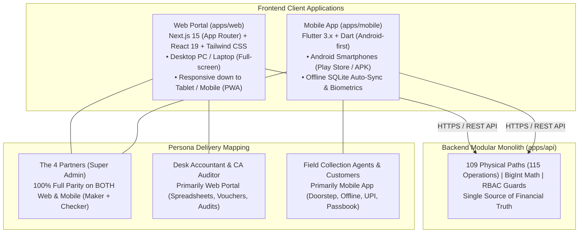
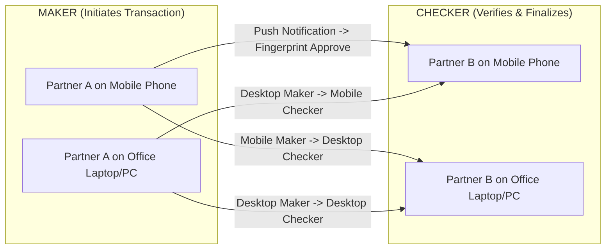

# Kumaran Chits — Frontend & Client Applications Architecture

> **Product**: **Kumaran Chits** (Kumaran Finance, Perundurai, Tamil Nadu)  
> **Status**: Authoritative Architectural Specification (`CONFIRMED-BY-DEVELOPER`)  
> **Key Architecture Decisions**: [ADR-01 through ADR-19](../01-business/decision-log.md), [permissions-matrix.md](../01-business/permissions-matrix.md), [financial-rules.md](../01-business/financial-rules.md)  
> **Core Mandate**: The 4 Partners (Super Admin) have **100% full operational parity on BOTH Web and Mobile frontends for BOTH Maker and Checker roles**. The backend is completely device-agnostic (`maker_user_id != checker_user_id`).
>
> [!NOTE]
> **Implementation Status**: This document defines the authoritative architectural blueprint and screen catalog for the Web Portal (`apps/web/`) and Mobile Application (`apps/mobile/`).
> - **Web Portal Implementation Ledger**: All web modules, screen catalogs, and verification proofs are documented under [`docs/web/`](../web/README.md). Foundation & Authentication are **100% Complete & Verified** with 42/42 passing unit tests.
> - **Backend REST API tier** (`apps/api/`) is **100% complete** with 587/587 passing tests (35 suites) recorded in [`completed-modules-api-registry.md`](./completed-modules-api-registry.md).

---

## 1. Executive Summary & Dual-Platform Topology

The Kumaran Chits frontend tier comprises two specialized client applications operating against a **100% unified NestJS backend REST API** ([`apps/api/`](../03-architecture/api-spec.md)):



---

## 2. Persona-to-Platform Delivery Matrix (`CONFIRMED-BY-DEVELOPER`)

The choice of platform is governed by **physical working environment, information density, and mobility requirements**:

| Persona | Primary Client | Secondary Client | Rationale & Operational Role |
|---|:---:|:---:|---|
| **Super Admin / Owner (The 4 Partners)** | **Web Portal** (`apps/web`) | **Mobile App** (`apps/mobile`) | **100% Feature Parity on BOTH Platforms**. Full authority to act as Maker or Checker on any device. Mobile provides instant push-notification approvals and camera cheque uploads; Web provides full-screen cashbooks and spreadsheet onboarding. |
| **Branch Manager** *(Latent)* | **Web Portal** (`apps/web`) | — | Branch-scoped scheme review, customer intake, and auction facilitation. |
| **Desk Accountant** | **Web Portal** (`apps/web`) | Mobile App (Dual Role) | High-volume transcription of 20-month physical paper notebooks into digital grids, Form XXII daily cashbook, bank reconciliation, voucher preparation. |
| **Field Collection Agent** | **Mobile App** (`apps/mobile`) | Web Portal (Dual Role) | Android smartphone on motorbike rounds. 1-second fingerprint unlock, doorstep collections under 30 seconds, offline SQLite sync in rural 4G dead zones, evening cash handover. |
| **Customer / Chit Subscriber** | **Mobile App** (`apps/mobile`) | Web Passbook (Optional) | Android smartphone. Bilingual (Tamil + English) passbook, 1-tap UPI installment payments (GPay/PhonePe), dividend savings tracker, auction schedule & results. |
| **Auditor (Chartered Accountant)** | **Web Portal** (`apps/web`) | — | Read-only forensic general ledgers, 12-column Form XXII Cash Book, Form XXI Ledgers, immutable audit logs. Large-screen spreadsheet review and A4 PDF/CSV exports. |

---

## 3. Cross-Device Maker-Checker Engine (`CONFIRMED-BY-DEVELOPER`)

The fundamental architectural invariant:
$$\text{maker\_user\_id} \neq \text{checker\_user\_id}$$
is enforced strictly at the NestJS API and PostgreSQL database levels. The backend is **completely device-agnostic**, unlocking all 4 cross-device permutations:



### High-Risk Workflows Supported Across Devices:
1. **In-Office Auction Finalization**:
   - **Maker**: Partner A records the winning ticket, bid discount, and tie-breaker paper lot draw on **Mobile** (in auction hall) or **Web** (at office desk).
   - **Checker**: Partner B verifies discount ceiling ($D \le V/4$) and finalizes on **Mobile** or **Web**.
2. **Prize Money Disbursement**:
   - **Maker**: Desk Accountant prepares payout voucher and fills Company Safety Proof checklist on **Web**, or Partner A snaps photos of signed blank cheques using their **Mobile camera**.
   - **Checker**: Partner B receives push notification on **Mobile**, inspects cheque/agreement photos, and authorizes payout with biometric fingerprint confirmation.
3. **Evening Field Cash Handover**:
   - **Collector**: Field agent submits daily collection tally on **Mobile** (`apps/mobile`).
   - **Acknowledger**: Partner physically counts cash at branch counter and taps **"Acknowledge Cash Received"** on **Mobile** or **Web** (`collector_user_id != acknowledger_user_id`).
4. **Payment Reversals**:
   - **Maker**: Partner A or Accountant requests reversal with mandatory justification on **Web** or **Mobile**.
   - **Checker**: Partner B reviews ledger impact and approves on **Web** or **Mobile**.

---

## 4. Web Portal Architecture (`apps/web/`)

The Web Portal is the high-density workstation for office administration, accounting, notebook onboarding, and statutory reporting.

### 4.1 Tech Stack
- **Framework**: **Next.js 15 (App Router)** with **React 19** and **TypeScript** (strict mode).
- **Styling**: **Tailwind CSS v4** + **Shadcn UI / Radix UI primitives**.
- **Icons**: **Lucide React**.
- **Data Fetching & Server Cache**: **TanStack React Query v5** (optimistic updates, automatic cache invalidation).
- **Client State**: **Zustand** (sidebar state, active branch filter, modal states).
- **Form Handling & Validation**: **React Hook Form** + **Zod** (schemas mirroring backend NestJS DTOs).
- **Data Visualization**: **Recharts** (daily cash collection trends, arrear aging distribution).
- **PDF Generation & Printing**: Native HTML5 print stylesheet (`@media print`) + `@react-pdf/renderer` for bilingual client-side receipts.

### 4.2 Web Portal Route & Screen Catalog

```text
apps/web/src/app/
├── (auth)/
│   ├── login/page.tsx                     # 10-digit Phone/Password login
│   └── 2fa/page.tsx                       # RFC 6238 Microsoft Authenticator TOTP verification
├── (dashboard)/
│   ├── layout.tsx                         # Sidebar, Topbar with branch badge, Profile, Inactivity timer
│   ├── page.tsx                           # Executive Dashboard (Cash pulse, arrear alerts, Form XVII countdown)
│   ├── schemes/
│   │   ├── page.tsx                       # Active & Draft Chit Scheme list
│   │   ├── new/page.tsx                   # Fresh scheme creation wizard (4% commission, sanction order)
│   │   ├── [id]/page.tsx                  # Scheme details, ticket roster, auction schedule
│   │   └── onboard/page.tsx               # Mid-Cycle Physical Notebook Onboarding Grid (400-cell spreadsheet)
│   ├── customers/
│   │   ├── page.tsx                       # Customer directory with Tamil name search
│   │   ├── new/page.tsx                   # Lightweight intake (Name, Phone, Address, Nominee)
│   │   └── [id]/page.tsx                  # Customer 360 profile, subscribed tickets, digital passbook
│   ├── auctions/
│   │   ├── page.tsx                       # Scheduled & completed auction list
│   │   └── [id]/live/page.tsx             # In-Office Auction Console (1/4 ceiling validator, Option A tie-break)
│   ├── disbursements/
│   │   ├── page.tsx                       # Prize payouts pending verification & authorization
│   │   └── [id]/voucher/page.tsx          # Safety Proof Checklist (Agreements/Cheques) + Voucher Auth
│   ├── collections/
│   │   ├── page.tsx                       # Daily agent collection logs & route tracking
│   │   └── handover/page.tsx              # Evening Cash Handover verification & vault sign-off
│   ├── reversals/
│   │   └── page.tsx                       # Payment reversal requests & Maker-Checker approval table
│   ├── branches/
│   │   ├── page.tsx                       # Company branch directory (PRD, ERD) with active status
│   │   └── new/page.tsx                   # Branch creation console with bilingual Tamil name
│   ├── users/
│   │   ├── page.tsx                       # Staff user administration, RBAC role assignment & status toggle
│   │   └── new/page.tsx                   # Staff onboarding console with branch link & temporary password
│   └── reports/
│       ├── page.tsx                       # Statutory reports index
│       ├── cash-book/page.tsx             # Form XXII Chit Cash Book (12-column daily ledger)
│       ├── minutes/page.tsx               # Form XVII Auction Minutes with Registrar filing status
│       ├── ledger/page.tsx                # Form XXI Subscriber Ledger
│       └── audit-logs/page.tsx            # Immutable append-only audit trail viewer
```

---

### 4.4 Server State Caching & SSR Route Dynamic Policies
1. **Next.js 15 App Router Route Dynamic Configurations**:
   - In [`apps/web/src/app/layout.tsx`](file:///u:/Kumaran-finance/apps/web/src/app/layout.tsx), root exports `export const dynamic = 'force-dynamic'` and `export const revalidate = 0`.
   - Prevents static build-time caching of financial ledgers, ensuring live transactional state on every page load.
2. **TanStack Query v5 Workstation Policies** ([`apps/web/src/providers/query-provider.tsx`](file:///u:/Kumaran-finance/apps/web/src/providers/query-provider.tsx)):
   - `staleTime: 60 * 1000` (1 minute): In-flight tab navigation reuses fresh cache.
   - `gcTime: 5 * 60 * 1000` (5 minutes): Inactive cache memory garbage-collected.
   - `refetchOnWindowFocus: false`: Prevents disruptive refetches while desk accountants count cash or enter collections.
   - `mutations: { retry: false }`: Strictly prohibits auto-retrying financial mutations to prevent duplicate ledger postings.
3. **Deterministic Cache Key Factory** ([`apps/web/src/lib/query-keys.ts`](file:///u:/Kumaran-finance/apps/web/src/lib/query-keys.ts)):
   - Type-safe key registry across 12 domains (`branches`, `tickets`, `installments`, `auctions`, `disbursements`, `reports`, `collections`, `payments`, `reversals`).
   - Mutations systematically trigger `queryClient.invalidateQueries` to evict stale cache subtrees immediately upon successful server commit.

---

## 5. Mobile Application Architecture (`apps/mobile/`)

The Mobile Application is the portable, offline-resilient operational tool for Field Agents, Customers, and the 4 Partners.

### 5.1 Tech Stack
- **Framework**: **Flutter 3.x** with **Dart** (Android-first).
- **Architecture**: Feature-First Clean Architecture (Presentation $\to$ Domain $\to$ Data).
- **State Management**: **Riverpod** (compile-safe dependency injection & reactive state).
- **Local Persistence & Offline Queue**: **Drift (SQLite)** + **Flutter Secure Storage** (Android Keystore encryption).
- **Networking**: **Dio** with interceptors for JWT token refresh, network retry, and idempotency headers.
- **Biometrics**: **`local_auth`** (Fingerprint & Face biometric unlock via Android BiometricPrompt).
- **Push Notifications**: **`firebase_messaging`** (FCM) for real-time Maker-Checker approval alerts.
- **UPI Deep-Linking**: **`url_launcher`** / Android Intent (`upi://pay`) for seamless switching to GPay, PhonePe, Paytm.
- **Camera & Media**: **`image_picker`** + **`image_cropper`** for capturing signed blank cheques and agreements.

### 5.2 Mobile Screen Catalog by Persona

```text
apps/mobile/lib/
├── core/
│   ├── database/                          # Drift SQLite offline storage & sync queue
│   ├── network/                           # Dio HTTP client, JWT interceptor, refresh logic
│   ├── security/                          # Biometric local_auth & Android Keystore integration
│   └── theme/                             # Material 3 bilingual typography & color tokens
├── features/
│   ├── auth/                              # Phone OTP registration -> 6-digit MPIN -> Biometric prompt
│   ├── partner_console/                   # 100% PARITY FOR THE 4 PARTNERS
│   │   ├── screens/executive_pulse.dart   # Live collections, vault cash balance, 3-month arrear alerts
│   │   ├── screens/approval_queue.dart    # 1-Tap Maker-Checker approval queue (Handover, Payouts, Reversals)
│   │   ├── screens/auction_console.dart   # Bid discount entry, 1/4 ceiling guard, paper lot token draw
│   │   ├── screens/safety_checklist.dart  # Camera capture for signed blank cheques & agreement authorization
│   │   └── screens/report_share.dart      # View Form XXII / Passbooks & on-demand PDF/Excel export
│   ├── field_agent/                       # FIELD COLLECTION AGENT WORKFLOWS
│   │   ├── screens/route_dues.dart        # Today's assigned customer route sorted by area
│   │   ├── screens/quick_collect.dart     # Collect cash (< 30s), passbook sign reminder, Push/SMS receipt
│   │   ├── screens/offline_queue.dart     # Pending sync transactions recorded in rural 4G dead zones
│   │   └── screens/cash_handover.dart     # End-of-day cash collection tally submission
│   └── customer/                          # SUBSCRIBER SELF-SERVICE
│       ├── screens/my_passbook.dart       # Bilingual passbook (English + தமிழ்), dividends, net due
│       ├── screens/pay_due.dart           # 1-tap UPI deep-linking to GPay / PhonePe / Paytm
│       └── screens/auction_results.dart   # Live auction outcomes, winning discounts, dividend credited
```

---

## 6. Monorepo Shared Logic Strategy

To eliminate duplicate business logic between the Web Portal (TypeScript) and Mobile App (Dart), the monorepo adheres to **3 sharing principles**:

1. **Backend as the Authoritative Spec**:
   - [`apps/api/`](../03-architecture/api-spec.md) publishes OpenAPI 3.0 specifications ([`openapi-spec.json`](../03-architecture/openapi-spec.json)).
   - TypeScript frontend types for `apps/web/` are generated directly from backend DTOs.
   - Dart models for `apps/mobile/` are generated via OpenAPI generator or mapped from concrete JSON payloads in [`api-request-response-catalog.md`](../03-architecture/api-request-response-catalog.md).
2. **Centralized Financial Math & Invariants**:
   - Both Web and Mobile apply the identical validation rules documented in [`financial-rules.md`](../01-business/financial-rules.md):
     - Bid discount ceiling: $D \le \frac{V}{4}$.
     - Bid discount floor: $D \ge C_f = V \times 0.04$.
     - Net installment due: $I_{net} = I_{base} - Div_{ticket}$.
     - Single discrete payment: Disallow double payments or partial payments.
3. **Whole-Rupee Currency Display Standard**:
   - Both frontends enforce **whole integer Rupees (₹)**.
   - Web: `Intl.NumberFormat('en-IN', { maximumFractionDigits: 0 }).format(amount)`.
   - Mobile: `NumberFormat.currency(locale: 'en_IN', symbol: '₹', decimalDigits: 0).format(amount)`.
   - Decimal fractions (`.00`) and paise are strictly prohibited from all UI views.

---

## 7. Frontend Security & Session Guardians

| Guardian | Web Portal (`apps/web`) | Mobile App (`apps/mobile`) |
|---|---|---|
| **Authentication Token** | Stored in secure `HttpOnly`, `SameSite=Strict`, `Secure` cookies. | Stored in encrypted Android Keystore via `flutter_secure_storage`. |
| **Two-Factor Authentication** | Mandatory RFC 6238 TOTP via **Microsoft Authenticator** for office staff. | 6-digit cryptographic MPIN + Android BiometricPrompt (Fingerprint). |
| **Session Inactivity** | 20-minute client-side inactivity timer with automatic session termination. | App backgrounding locks screen; requires biometric touch to resume. |
| **Maker-Checker UI Guard** | Buttons for "Finalize Auction", "Authorize Payout", and "Approve Reversal" are disabled if `current_user_id == maker_user_id`. | Approval cards display *"You initiated this action (Maker) — awaiting another partner's authorization"*. |
| **Network Security** | Enforced TLS 1.3 / HTTPS; Content Security Policy (CSP) blocking unauthorized scripts. | SSL Pinning against backend API public key certificate. |

---

## 8. Definition of Done for Frontend Screens

Before any frontend screen (Web or Mobile) is marked complete, it must satisfy:
1. [ ] Monetary values are formatted strictly in whole integer Rupees (`₹`, zero paise).
2. [ ] All API mutations handle network errors and surface bilingual error toasts (English + தமிழ்).
3. [ ] Sensitive Maker-Checker actions disable authorization buttons when `user.id == maker.id`.
4. [ ] Forms validate input client-side using Zod / Dart validators matching backend DTO schemas.
5. [ ] Responsive layout adapts cleanly without horizontal overflow or clipped text.
6. [ ] Audit logs capture user identity, timestamp, and client user-agent for all submitted mutations.
