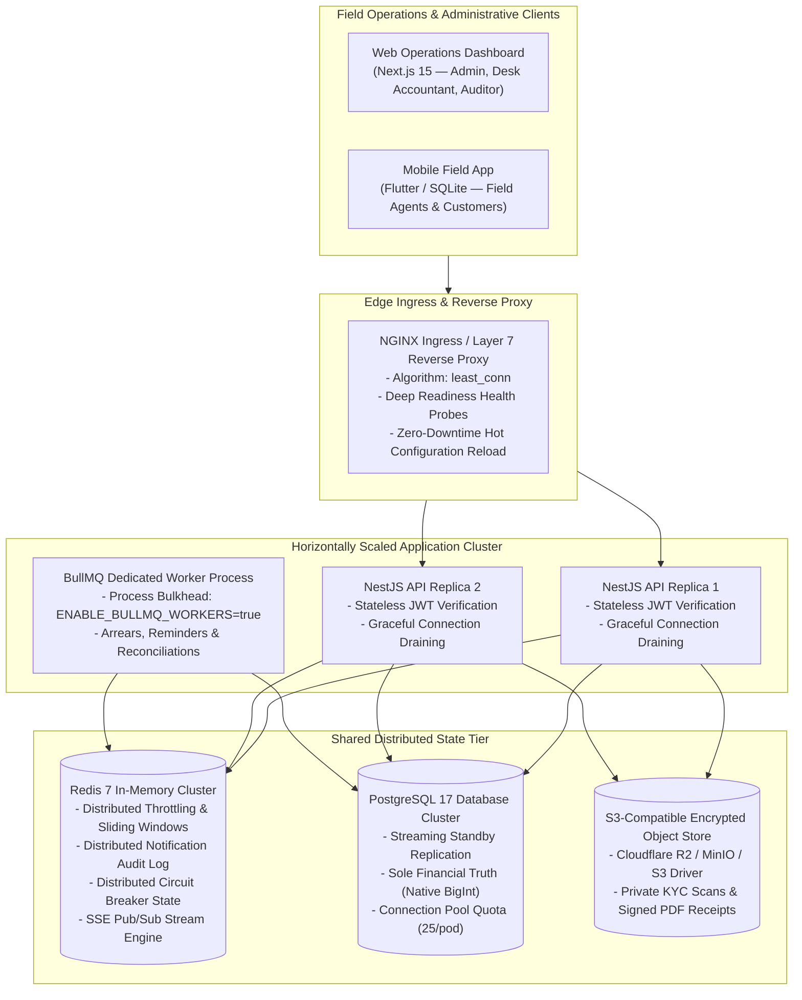

# Kumaran Chits — Horizontal Scaling, High Availability & Multi-Instance Architecture

> **Product**: **Kumaran Chits**  
> **Company**: **Kumaran Finance** (Head Office: Perundurai, Erode, Tamil Nadu)  
> **Compliance & Invariants**: Strictly conforms to the 10 Invariant Architectural Guardrails (`CONFIRMED-BY-DEVELOPER`), whole-rupee math (`BigInt`), Maker $\ne$ Checker separation of duties, and zero hallucination policy.

---

## 1. Architectural Overview & Topology

Kumaran Chits is built as a horizontally scalable modular monolith designed for seamless multi-instance operation behind modern Layer 7 load balancers (NGINX Ingress 1.27+ / Reverse Proxy). 

The platform guarantees stateful integrity across horizontal instances while maintaining high throughput during peak chit fund operational periods (such as monthly collection rush hours on the 10th to 15th of every month, scheduled branch chit auctions, and partner disbursement approvals).



---

## 2. Stateless Authentication & Distributed Session Management

To completely eliminate sticky session dependencies and session loss across instances:

1. **Stateless JWT Tokens**:
   - Access tokens have a 15-minute lifespan and are cryptographically verified using `JWT_SECRET` (HMAC SHA-256) on every incoming request without querying the database or local memory.
   - Any API replica holding the identical `JWT_SECRET` validates requests interchangeably.
2. **PostgreSQL Refresh Token Rotation (RFC 6819)**:
   - Refresh tokens are hashed via `crypto.scryptSync` and stored in PostgreSQL (`User.refreshTokenHash` / `Customer.refreshTokenHash`).
   - Token refresh requests can land on any instance; all validate against the shared database row.
   - Logout immediately sets `refreshTokenHash = null`, revoking access across all replicas simultaneously.
3. **Distributed OTP Authentication**:
   - OTP state during customer and field agent logins is stored exclusively in Redis (`auth:otp:<phone>` and `auth:otp:cooldown:<phone>`) with atomic Lua operations and strict TTL expiration. Zero OTP state exists on local server disks.

---

## 3. Deep Health Probing & Ingress Load Balancing

Standard shallow health checks (which only report process existence) create severe failure vulnerabilities if an instance exhausts its database connection pool or loses connectivity to Redis. Kumaran Chits implements deep health probing:

### 3.1 Probe Endpoints Specification
- **Readiness Probe (`GET /health/readiness` or `GET /health`)**:
  - Probes PostgreSQL: Executes `SELECT 1` with a 2000ms timeout.
  - Probes Redis: Executes `client.ping()` with a 1500ms timeout.
  - **Healthy Status (HTTP 200)**:
    ```json
    {
      "status": "ok",
      "service": "chitflow-api",
      "database": "connected",
      "redis": "connected",
      "sentryActive": true,
      "time": "2026-11-07T14:40:00.000Z"
    }
    ```
  - **Degraded Status (HTTP 503 Service Unavailable)**:
    ```json
    {
      "statusCode": 503,
      "message": {
        "status": "error",
        "service": "chitflow-api",
        "errors": ["Database probe failed: Connection terminated unexpectedly"],
        "checks": { "database": "error", "redis": "connected" },
        "time": "2026-11-07T14:40:00.000Z"
      }
    }
    ```
  - **Ingress Reaction**: Load balancers (Nginx / ALB) automatically remove the instance from active rotation, shielding customers from failed payments or logins.
- **Liveness Probe (`GET /health/liveness`)**:
  - Pure process health check verifying Node.js event-loop responsiveness without querying backing databases. Used by orchestrators to avoid restarting healthy containers during transient database spikes.

### 3.2 Ingress Balancing Algorithm & Passive Failover
Nginx upstream uses `least_conn` with passive failure detection:
```nginx
upstream api_upstream {
    least_conn;
    server api:3000 max_fails=3 fail_timeout=10s;
    keepalive 32;
}
```

---

## 4. Elimination of In-Memory State & Cache Drift

To guarantee 100% consistency when scaling horizontally, in-memory state is synchronized via Redis:

1. **Distributed Notification Audit Log**:
   - Dispatched SMS, WhatsApp, and Push alerts are recorded to Redis capped list `audit:notifications` via atomic `LPUSH` + `LTRIM 0 199` with a 7-day TTL.
   - Any replica or auditor querying `getDistributedNotificationLog()` accesses the unified audit trail regardless of which container processed the dispatch.
2. **Distributed Circuit Breaker Coordination**:
   - Third-party downstream gateways (MSG91 SMS Gateway, FCM Push) employ a distributed circuit breaker.
   - When 5 consecutive failures trip the breaker on Replica A, it broadcasts the trip timestamp to Redis key `circuit:MSG91_SMS_GATEWAY:open_until`.
   - Replica B immediately syncs the `OPEN` state from Redis and fast-fails, preventing stampedes against degraded external services.
3. **Master Metadata Caching**:
   - Master branch details and chit scheme configurations are cached in shared Redis (`cache:master:*`) with automated invalidation on administrative updates.
4. **Distributed Throttling**:
   - Throttling buckets use a Redis sliding window storage (`RedisThrottlerStorage`), preventing clients from bypassing rate limits by alternating requests between replicas.

---

## 5. Storage Durability & Strict S3 Driver Guardrail

- In production (`NODE_ENV === 'production'`), `STORAGE_DRIVER` is strictly enforced to `s3` via startup validation in `env.validation.ts`.
- Local disk uploads (`./storage/uploads`) are prohibited in production to prevent document fragmentation where a KYC scan uploaded to Replica A is unreachable from Replica B.
- Presigned URLs (15-minute validity) are generated statelessly and cached in shared Redis (`url:presigned:<key>`) for 10 minutes to deliver sub-millisecond retrieval on repeat views.

---

## 6. Database Connection Pool Quota Math

PostgreSQL 17 is configured with `max_connections = 150` and `shared_buffers = 512MB`. Connection pool budgets are explicitly bounded:

$$\text{Total Used Connections} = (\text{Replicas} \times \text{connection\_limit}) + \text{Worker Connections} + \text{Admin Reserve}$$

| Component | Connection Quota | Sizing Math |
|---|---|---|
| **API Replica 1** | 25 | `connection_limit=25&pool_timeout=10` in `DATABASE_URL` |
| **API Replica 2** | 25 | `connection_limit=25&pool_timeout=10` in `DATABASE_URL` |
| **Dedicated BullMQ Worker** | 15 | Managed worker connection pool |
| **Active Pool Total** | **65** | $25 + 25 + 15 = 65$ connections (43.3% of capacity) |
| **Admin & DRP Reserve** | **85** | Reserved for Prisma migrations, nightly `pg_dump`, and CA auditor queries |
| **PostgreSQL Maximum** | **150** | Configured in `postgres -c max_connections=150` |

---

## 7. Zero-Downtime Deployment & Graceful Connection Draining

To achieve continuous 24/7 availability during code deployments:

1. **Graceful Connection Draining (`main.ts`)**:
   - Enabled via `app.enableShutdownHooks()`.
   - On receiving `SIGTERM` or `SIGINT`, the process waits 2 seconds (allowing ingress probes to mark the node draining), stops accepting new HTTP connections, and grants active requests up to 15 seconds to complete.
   - Closes Prisma connection pools and Redis sockets cleanly before process exit.
2. **Automated Blue-Green Hot Switchover**:
   - Executed via [`infra/scripts/zero-downtime-deploy.sh`](file:///u:/Kumaran-finance/infra/scripts/zero-downtime-deploy.sh) (Linux) or [`infra/scripts/zero-downtime-deploy.ps1`](file:///u:/Kumaran-finance/infra/scripts/zero-downtime-deploy.ps1) (Windows):
     1. Builds updated image.
     2. Starts target container.
     3. Polls `/health/readiness` until HTTP 200 is confirmed.
     4. Executes Nginx hot reload (`nginx -s reload`).
     5. Allows 15s connection drain before stopping the old container.

---

## 8. Autoscaling Policies & Auction-Day Pre-Warming

### 8.1 Autoscaling & Resource Monitoring
- **Metric 1: Average CPU Utilization**: Scale out or alert when CPU exceeds **60%** for 2 consecutive 1-minute intervals.
- **Metric 2: Target Response Time**: Scale out or alert when Application Latency exceeds **500ms** (p95) on `/api/`.
- **Warm Headroom**: Minimum 2 worker processes running behind NGINX load balancer.
- **Cooldown Periods**: Scale-out cooldown = 60s; Scale-in cooldown = 300s.

### 8.2 Scheduled Capacity for Branch Auction Days
- Monthly chit auctions are held at scheduled dates/times (e.g., 2nd Saturday or specific branch evenings).
- An automated cron or scheduler triggers scheduled capacity preparation:
  - **30 minutes prior to auction start**: Pre-warms cluster from 2 to 4 active worker processes.
  - **2 hours after auction completion**: Scales back to baseline 2 replicas.
