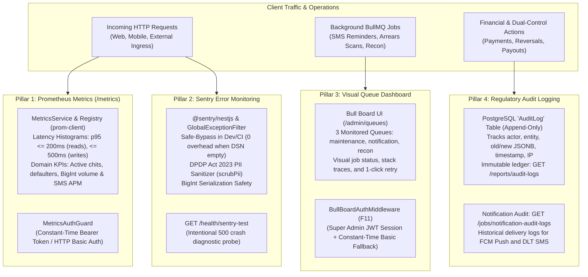
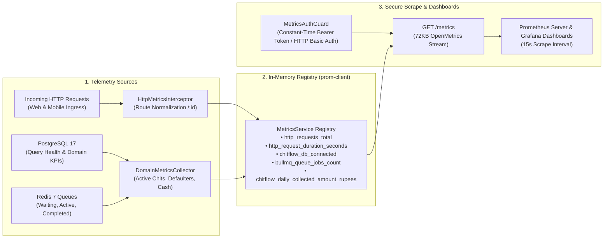
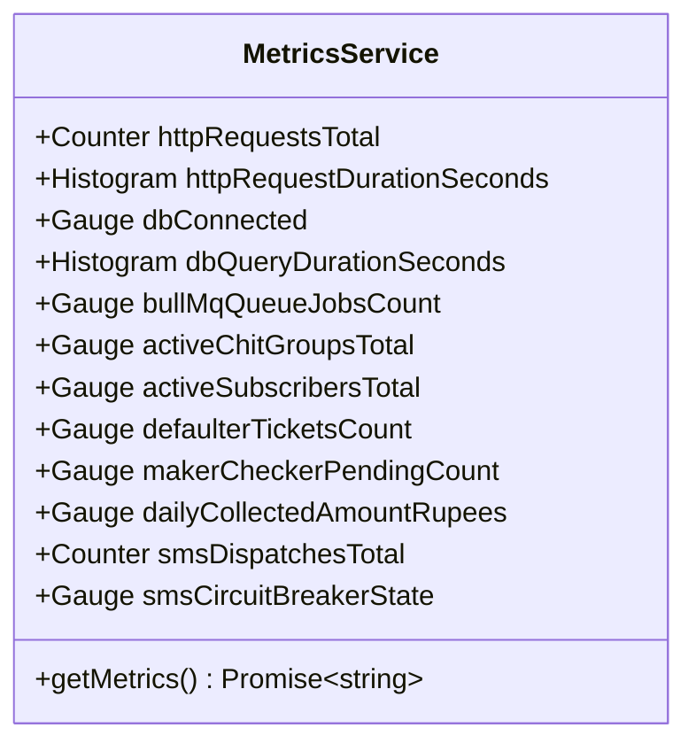
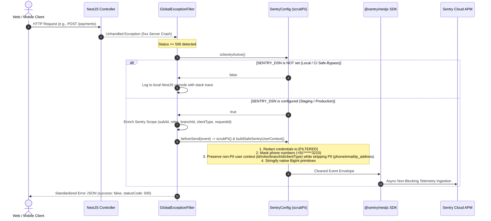
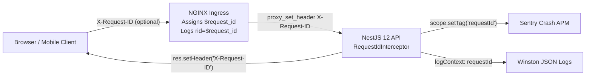
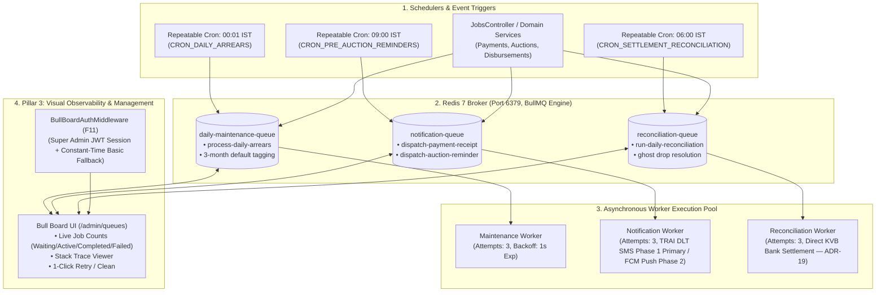
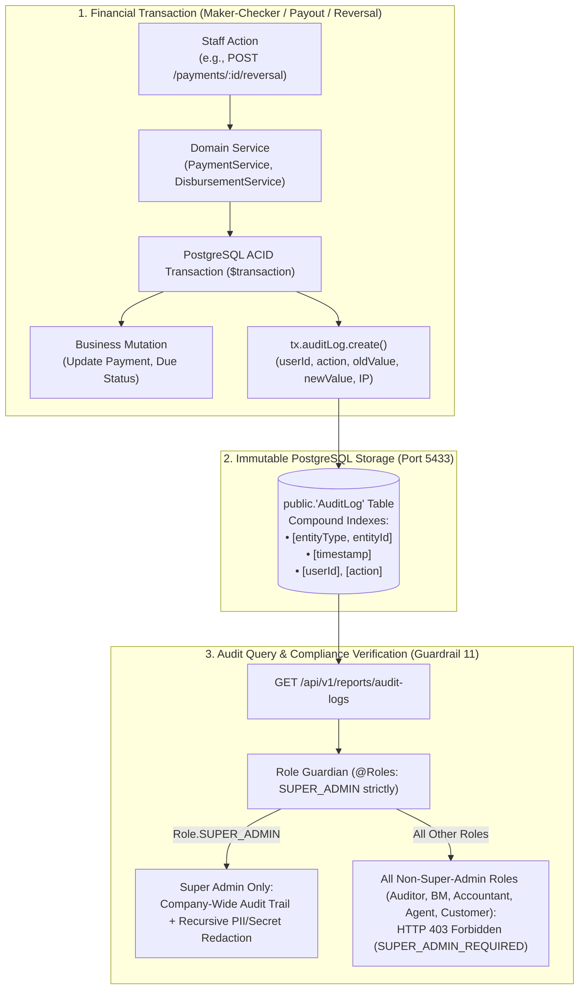

# Observability, Monitoring & Audit Architecture — Master Specification

> **Product**: **Kumaran Chits** (Chit Fund Operations Management System)  
> **Company**: **Kumaran Finance** (Perundurai, Erode District, Tamil Nadu)  
> **Target Audience**: Core Engineering, Security Architects, Compliance Auditors, Vibe Coders & Beginners  
> **Status**: **100% IMPLEMENTED, VERIFIED & LIVE IN REPOSITORY**  
> **Classification**: Core Architectural Document (Companion to [`payment-architecture.md`](payment-architecture.md) and [`security-and-access-guardians.md`](security-and-access-guardians.md))

---

## 1. Executive Summary & Plain-English Overview

In a chit fund platform handling subscribers' hard-earned money, backend operations cannot be a black box. Observability turns your backend from a dark, closed room into a **transparent glass house** where every request, error, background job, and cash mutation is measured, alerted, and permanently recorded.

All four observability pillars in Kumaran Chits are designed to operate at **₹0 cost (100% free / open source)**, with no mandatory paid third-party dependencies.



---

### The Beginner's Guide: The 4 Pillars as a Car Analogy

For a vibe coder or beginner, think of your backend server like a car driving on a highway:

| Pillar | Real-World Analogy | What Problem It Solves | Cost |
|---|---|---|:---:|
| **1. Prometheus (`/metrics`)** | **The Speedometer & Gas Tank Gauge** | Measures how fast the app responds in milliseconds ($p95 \le 200\text{ ms}$) and how much work the server is doing right now. | **₹0 (Free / Open Source)** |
| **2. Sentry (`@sentry/nestjs`)** | **The "Check Engine" Warning Buzzer** | When code crashes, it immediately catches the error, tells you the exact line number, and alerts you before customers notice. | **₹0 (Free Tier / Safe-Bypass)** |
| **3. Bull Board (`/admin/queues`)** | **The Delivery Tracking Screen** | Shows a visual webpage of background tasks (e.g. 500 SMS messages: 480 sent, 20 queued, 0 failed). Allows 1-click retry. | **₹0 (Free / Open Source)** |
| **4. PostgreSQL `AuditLog`** | **The Bank's 24/7 CCTV Camera** | Permanently records who touched the money, who reversed a payment, and who approved a prize disbursement. Nobody can cheat or deny their actions. | **₹0 (Free / Postgres Table)** |

---

## 2. Pillar 1: Prometheus Metrics Exporter (`GET /metrics`)

Managed by [`MetricsModule`](file:///u:/Kumaran-finance/apps/api/src/metrics/metrics.module.ts) using the official `prom-client` library.

### 2.1 Architecture & Cardinality Protection



* **Endpoint**: `GET /metrics` (Exempt from response wrapper via `@BypassEnvelope()`, emits `Cache-Control: no-store`).
* **Security**: Strictly protected by constant-time SHA-256 `crypto.timingSafeEqual` authentication via [`MetricsAuthGuard`](file:///u:/Kumaran-finance/apps/api/src/metrics/guards/metrics-auth.guard.ts) supporting both Bearer Token (`METRICS_BEARER_TOKEN`) and RFC 7617 HTTP Basic Authentication (`METRICS_USER` / `METRICS_PASSWORD`, supporting `:` in passwords). Enforces strict fail-closed credentials in every environment except explicit `development` or `test` (including unset `NODE_ENV`, `production`, `staging`, `uat`), disables dev `admin:chitflow_secret` fallback whenever `METRICS_BEARER_TOKEN` is configured, and rejects whitespace-padded default secrets. Unauthenticated scrapes return `401 Unauthorized` with a matching `WWW-Authenticate` header.
* **URL Route Normalization ([`HttpMetricsInterceptor`](file:///u:/Kumaran-finance/apps/api/src/metrics/interceptors/http-metrics.interceptor.ts))**:
  - In high-throughput APIs, dynamic paths like `/api/v1/customers/550e8400-e29b-41d4-a716-446655440000` or scanner 404 probes create unbounded metric labels, leading to **Prometheus high-cardinality memory exhaustion**.
  - `HttpMetricsInterceptor` prefers Express matched route templates (`req.route.path`), collapses unmatched `404` scanner paths to `__unmatched__`, normalizes UUIDs, numeric IDs, long hex/opaque tokens, domain codes (`KC-REC-*`, `KC-VOU-*`, `KC-CUST-*`, `KCA-*`), and storage wildcards (`/storage/file/:key`), enforces a hard `200`-route fallback cardinality cap (`__other__`), captures true controller exception status codes via `tap({ error })`, and isolates telemetry inside `try/catch`.
  - Self-metrics exclusion: Requests to `/metrics`, `/health`, `/api/docs`, and `/admin/queues` are ignored to prevent telemetry feedback loops.

### 2.2 Complete Exported Metrics Catalog (12 Custom Metrics + Process Defaults)



| Metric Name | Type | Labels | Description & SLA Compliance |
|---|---|---|---|
| `http_requests_total` | Counter | `method`, `route`, `status_code` | Total HTTP requests processed across all endpoints. |
| `http_request_duration_seconds` | Histogram | `method`, `route`, `status_code` | Latency distribution. Buckets: `[0.01, 0.05, 0.1, 0.2, 0.5, 1.0, 2.0, 5.0]` tailored for **NFR §3** ($p95 \le 200\text{ ms}$ for reads, $\le 500\text{ ms}$ for financial writes). |
| `chitflow_db_connected` | Gauge | — | `1` = PostgreSQL healthy; `0` = database unreachable. |
| `chitflow_db_query_duration_seconds` | Histogram | `model`, `action` | Database query execution time in seconds. |
| `bullmq_queue_jobs_count` | Gauge | `queue`, `status` | Job count per queue (`daily-maintenance-queue`, `notification-queue`, `reconciliation-queue`) and state (`waiting`, `active`, `completed`, `failed`, `delayed`). |
| `chitflow_active_chit_groups_total` | Gauge | — | Total running chit schemes. |
| `chitflow_active_subscribers_total` | Gauge | — | Total active subscriber tickets across all groups. |
| `chitflow_defaulter_tickets_count` | Gauge | `bucket` | Count of overdue subscribers in `1_MONTH` or `3_MONTH_REMOVAL` buckets. |
| `chitflow_maker_checker_pending_count` | Gauge | `type` | Pending dual-control tasks (`PAYMENT_REVERSAL`, `PRIZE_DISBURSEMENT`). |
| `chitflow_daily_collected_amount_rupees`| Gauge | — | Cumulative collections recorded today in **whole integer Rupees (`BigInt`)**. |
| `kumaran_sms_dispatches_total` | Counter | `provider`, `template`, `status` | External TRAI DLT SMS dispatch counts (`success`, `fallback_success`, `circuit_open`, `failure`, `bypassed`, [`metrics.service.ts:126`](file:///u:/Kumaran-finance/apps/api/src/metrics/services/metrics.service.ts#L126)). |
| `kumaran_sms_circuit_breaker_state` | Gauge | `provider` | SMS gateway circuit breaker state (`0 = CLOSED`, `1 = HALF_OPEN`, `2 = OPEN`, [`metrics.service.ts:133`](file:///u:/Kumaran-finance/apps/api/src/metrics/services/metrics.service.ts#L133)). |
| `nodejs_*` | Process | — | Standard V8 heap size, memory RSS, and event-loop lag metrics. |

### 2.3 Prometheus Scrape Configuration (`prometheus.yml`)
```yaml
scrape_configs:
  - job_name: 'kumaran-chits-api'
    scrape_interval: 15s
    scrape_timeout: 10s
    metrics_path: '/metrics'
    basic_auth:
      username: 'admin'
      password: '${PROMETHEUS_METRICS_SCRAPE_SECRET}' # Set in deployment; default rejected in prod
    static_configs:
      - targets: ['api:3000']
```

### 2.4 Production Grafana PromQL Recipes
* **95th Percentile Read Latency ($p95 \le 200\text{ ms}$)**:
  ```promql
  histogram_quantile(0.95, sum(rate(http_request_duration_seconds_bucket{method="GET"}[5m])) by (le))
  ```
* **95th Percentile Financial Mutation Latency ($p95 \le 500\text{ ms}$)**:
  ```promql
  histogram_quantile(0.95, sum(rate(http_request_duration_seconds_bucket{method=~"POST|PUT|PATCH"}[5m])) by (le))
  ```
* **Failed Background Queue Jobs Alert**:
  ```promql
  sum(bullmq_queue_jobs_count{status="failed"}) by (queue) > 0
  ```
* **High Background Queue Backlog Alert (Sustained Waiting > 50)**:
  ```promql
  sum(bullmq_queue_jobs_count{status="waiting"}) by (queue) > 50
  ```

---

## 3. Pillar 2: Sentry Error Monitoring & Crash Tracking (`@sentry/nestjs`)

Configured in [`apps/api/src/common/sentry/sentry.config.ts`](file:///u:/Kumaran-finance/apps/api/src/common/sentry/sentry.config.ts) and wired into [`GlobalExceptionFilter`](file:///u:/Kumaran-finance/apps/api/src/common/filters/global-exception.filter.ts).

### 3.1 Architectural Guarantees & Exception Pipeline



1. **Safe-Bypass Mode (Zero Cost in Dev & CI)**:
   - When `SENTRY_DSN` is empty or omitted, Sentry initialization exits immediately (`initSentry() === false`).
   - The application runs with **0 external network requests, 0 latency overhead, and 0 crashes**.
2. **Indian DPDP Act 2023 Compliance ([`scrubPii`](file:///u:/Kumaran-finance/apps/api/src/common/sentry/sentry.config.ts#L40))**:
   - Every event passes through `beforeSend` before transmission to external APM.
   - Sensitive credentials are redacted to `[FILTERED]`: `password`, `mpin`, `refreshToken`, `token`, `totpSecret`, `aadhaar`, `pan`, `bankAccountNumber`, `chequeNumber`, `authkey`.
   - Indian mobile numbers are normalized and masked: `9842143210` $\to$ `+91******3210`.
3. **Whole-Rupee `BigInt` Serialization Safety**:
   - Standard JSON serialization crashes when encountering JavaScript `bigint` primitives (`TypeError: Do not know how to serialize a BigInt`).
   - `scrubPii()` recursively converts all `bigint` values to strings before Sentry builds the event envelope.
4. **4xx vs. 5xx Error Separation**:
   - Normal client validation errors (`400 Bad Request`, `401 Unauthorized`, `403 Forbidden`, `404 Not Found`) are returned to the user without sending alerts to Sentry.
   - Only true unhandled server-side crashes ($\ge 500$) trigger Sentry incident alerts.

### 3.2 Health & Container Readiness Probes

Kumaran Chits implements multi-tier health probes adhering strictly to cloud-native orchestrator standards:

| Endpoint | Type | Purpose | Backing Checks |
|---|---|---|---|
| `GET /health` | Deep Readiness | Probes whether API can safely accept financial mutations | PostgreSQL pool (`SELECT 1`, timeout: 2000ms) + Redis queue broker (`PING`, timeout: 1500ms). Returns 200 or 503. |
| `GET /health/readiness` | Deep Readiness Alias | Explicit alias for Kubernetes / Docker Compose / ALB healthcheck | Identical to `/health`. Used by Docker Compose to prevent premature routing. |
| `GET /health/liveness` | Shallow Liveness | Probes whether the Node.js event loop is running | Returns HTTP 200 `{ status: 'alive' }` without downstream DB checks to prevent restart loops during transient DB spikes. |
| `GET /health/sentry-test` | Crash Diagnostic | Intentional 500 crash probe | Throws `InternalServerErrorException` to verify Sentry event capture in staging. |

#### Docker Compose Native Health Check:
The API service in `infra/docker/docker-compose.fullstack.yml` is monitored via native Docker health checks:
```yaml
healthcheck:
  test: ["CMD-SHELL", "wget --no-verbose --tries=1 --spider http://127.0.0.1:3000/health/readiness || exit 1"]
  interval: 10s
  timeout: 5s
  retries: 5
  start_period: 15s
```
Dependent services (`web` and `nginx`) strictly wait on `api: condition: service_healthy` before initiating traffic routing.

---

### 3.3 End-to-End Request ID Trace Correlation (`X-Request-ID`)

To maintain full end-to-end trace correlation without requiring heavy distributed tracing clusters (e.g. Jaeger or OpenTelemetry collectors), Kumaran Chits utilizes the HTTP **`X-Request-ID`** standard:



1. **NGINX Ingress Generation**: NGINX assigns a unique `$request_id` (32-character hexadecimal string) to every incoming HTTP connection, logs `rid="$request_id"` in `access.log`, and proxies `X-Request-ID` upstream.
2. **NestJS `RequestIdInterceptor`**: Injects or preserves `X-Request-ID`, attaches `req.requestId`, and echoes the header on the outgoing HTTP response.
3. **Sentry & Exception Filter**: `GlobalExceptionFilter` enriches Sentry error scopes with `scope.setTag('requestId', headerRequestId || req.requestId)` and normalized `buildSafeSentryUserContext(req.user)` attribution (mapping RFC 7519 `JwtPayload.sub` to Sentry `user.id` and preserving `roles`, `branchId`, and `clientType` without DPDP PII) so crashes correlate cleanly to NGINX log entries and staff/customer sessions.

---

### 3.4 Frontend Client-Side Error Telemetry & Incident IDs

To ensure unhandled React rendering crashes and browser runtime errors are not lost, Next.js 15 (`apps/web`) integrates a dedicated client-side error reporter:

1. **Incident Code Generation (`ERR-KUM-XXXXXX`)**:
   Every error caught by React error boundaries (`global-error.tsx`, `error.tsx`, and `(dashboard)/error.tsx`) generates a deterministic or unique 6-character hex incident code (e.g. `ERR-KUM-A8F29D`).
2. **Context Telemetry**:
   Gathers timestamp, current route URL, userAgent, error digest, and message. Dispatches to Sentry if active or logs structured diagnostic info to the console.
3. **Actionable UI Action**:
   The user interface displays the incident reference code on screen alongside a **"Copy / நகலெடு"** button, allowing subscribers, accountants, or partners to immediately copy and report the incident code to IT support.

---

## 4. Pillar 3: Visual Background Queue Telemetry (Bull Board)

Managed by [`BullBoardService`](file:///u:/Kumaran-finance/apps/api/src/jobs/bull-board/bull-board.service.ts) using `@bull-board/api` and `@bull-board/express`.



### 4.1 Dashboard Capabilities
* **Route**: `http://localhost:3000/admin/queues/`
* **Access Control (`F11` Hardened)**: Protected by [`BullBoardAuthMiddleware`](file:///u:/Kumaran-finance/apps/api/src/jobs/bull-board/bull-board-auth.middleware.ts) enforcing active **`SUPER_ADMIN` JWT sessions** (via `Authorization: Bearer`, `?token=`, or `access_token` / `jwt` cookie with Redis revocation checks) plus constant-time SHA-256 HTTP Basic Auth fallback (rejecting insecure default `chitflow_secret`).
* **Monitored Queues**:
  1. `daily-maintenance-queue`: Midnight arrears calculation and 3-month default tagging.
  2. `notification-queue`: DLT SMS and FCM push dispatch for receipts and auction reminders.
  3. `reconciliation-queue`: Daily cash book balancing and bank reconciliation.
* **Administrative Controls**:
  - Live inspection of `waiting`, `active`, `completed`, `failed`, and `delayed` jobs.
  - Full stack-trace viewer for failed jobs with input payload inspection.
  - One-click **Retry** and **Clean** buttons to recover from network hiccups without running database scripts.
* **Offline Fallback**: If Redis is temporarily offline during testing, `BullBoardService` boots gracefully in fallback mode without crashing the NestJS server.

---

## 5. Pillar 4: Regulatory & Financial Audit Logging

Operating records in Kumaran Chits are permanently tracked for compliance with the Tamil Nadu Chit Funds Act and statutory auditing guidelines.



### 5.1 Database Schema (`public."AuditLog"`, [`schema.prisma:471-485`](file:///u:/Kumaran-finance/apps/api/prisma/schema.prisma#L471-L485))
```prisma
model AuditLog {
  id         String   @id @default(uuid())
  userId     String?
  user       User?    @relation(fields: [userId], references: [id])
  action     String   // e.g., "AUCTION_FINALIZED", "TIE_BREAK_DRAWN", "PAYMENT_REVERSED"
  entityType String   // "Payment", "Auction", "ChitGroup"
  entityId   String
  ipAddress  String?
  oldValue   Json?
  newValue   Json?
  timestamp  DateTime @default(now())

  @@index([entityType, entityId])
  @@index([timestamp])
}
```

### 5.2 Audited Financial & Dual-Control Actions (Sections 67 & 38, Chit Funds Act 1982)
Every critical mutation in the codebase automatically writes an append-only entry to `AuditLog` with structured JSON before/after diffs (`oldValue` / `newValue`). [`RequestContextMiddleware`](file:///u:/Kumaran-finance/apps/api/src/common/context/request-context.middleware.ts) (`AsyncLocalStorage`) captures the Express `TRUST_PROXY`-resolved and normalized client IP address (`::ffff:` stripped) along with `X-Request-ID` before Guards/Controllers run, and [`PrismaService`](file:///u:/Kumaran-finance/apps/api/src/prisma/prisma.service.ts) uses a Prisma `$extends` query hook on `auditLog.create` / `createMany` so both direct and interactive `$transaction` audit records automatically persist `ipAddress` (safely leaving `null` for non-HTTP background jobs) without duplicating IP plumbing across services. (`X-Request-ID` is likewise propagated on Nginx `/api/v1/reports/approvals-stream` SSE ingress and Web BFF headers.)

| Action Code | Triggering Workflow | Maker-Checker Actor & Captured Diff |
|---|---|---|
| `USER_LOGIN` | Staff or Customer authentication | Caller user ID + resolved IP address |
| `PAYMENT_RECORDED` | Cash or UPI payment entry | Desk Accountant / Field Agent ID, amount, receipt no., due ID |
| `PAYMENT_REVERSAL_REQUESTED` | Maker initiates reversal request | Maker user ID + reason code |
| `PAYMENT_REVERSAL_REJECTED` | Partner Checker rejects reversal | Partner Checker user ID + rejection notes |
| `PAYMENT_REVERSED` / `PAYMENT_REVERSAL_APPROVED` | Partner Checker authorizes reversal & due rollback | Partner Checker user ID + restored due ID + receipt cancellation watermark |
| `AUCTION_FINALIZED` / `AUCTION_CORRECTION_REQUESTED` / `AUCTION_CORRECTION_APPROVED` | Monthly auction finalization & dual-control correction (`KFC-FIN-005`) | Partner Maker & Partner Checker IDs, winning ticket, discount, universal dividends |
| `SAFETY_PROOF_DOCUMENT_UPLOADED` / `SAFETY_PROOF_VERIFIED` | Safety checklist & blank cheques/agreement verified | Maker user ID, cheque numbers, nominee, S3 key |
| `DISBURSEMENT_AUTHORIZED` / `DISBURSEMENT_COMMITTED` | Partner authorizes & cashier releases prize payout (incl. TOCTOU arrears offset) | Partner Checker (`maker != checker`) & disbursing officer IDs, payout ref |
| `DEFAULTER_REMOVAL_REQUESTED` / `DEFAULTER_REMOVAL_APPROVED` | Statutory 3-consecutive-month default ticket removal (ADR-07) | Partner Maker & Partner Checker IDs, ticket/customer IDs |
| `CASH_HANDOVER_SUBMITTED` / `CASH_HANDOVER_ACKNOWLEDGED` | Field agent daily route cash handover & desk acknowledgment | Agent Maker & Accountant/Manager Checker IDs, cash total |
| `CUSTOMER_DOCUMENT_DELETED` | KYC scan purged from storage | Authorizing admin user ID |

### 5.3 Audit Query Endpoints & Access Boundaries
* **`GET /api/v1/reports/audit-logs`**:
  - Paginated (`1 <= limit <= 100`) audit trail with filters by `action`, `entityType`, `userId`, and strict IST (`Asia/Kolkata`, `UTC+05:30`) date range (`fromDate <= toDate`).
  - **Super Admin Exclusive Access (Guardrail 11)**: Restricted strictly to `Role.SUPER_ADMIN` across controller and service layers. Non-Super-Admin roles (Auditors, Customers, Accountants, Branch Managers, Collection Agents) receive `403 Forbidden`.
  - **Secret & PII Redaction**: `oldValue` / `newValue` JSON snapshots are recursively sanitized via `sanitizeAuditPayload()` (redacting passwords, hashes, TOTP secrets/URIs, MPINs, refresh/access/FCM tokens, OTPs, JWTs, auth keys, bank account numbers, and cheque numbers, and masking all PAN & Aadhaar variants while preserving `aadhaarLast4`) before returning.
* **`GET /api/v1/jobs/notification-audit-logs`**:
  - Detailed audit trail of all outbound TRAI DLT SMS and FCM Push messages, including recipient phone numbers, template IDs, message bodies, timestamps, and delivery status (`DELIVERED` / `FAILED`). Restricted strictly to `Role.SUPER_ADMIN`.

### 5.4 Storage Lifecycle, Database Triggers & Retention Guarantees
* **Financial & Regulatory Audit Trail (`AuditLog`)**:
  - **Storage Engine**: PostgreSQL 17 ACID Table (`chitflow_dev`, Port 5433).
  - **Database-Engine Append-Only Immutability**: Beyond having zero `PUT`/`PATCH`/`DELETE` endpoints or Prisma mutations, migration [`20261114010000_audit_log_complete_immutability/migration.sql`](file:///u:/Kumaran-finance/apps/api/prisma/migrations/20261114010000_audit_log_complete_immutability/migration.sql) enforces PostgreSQL `ENABLE ALWAYS` triggers **`trg_prevent_audit_log_mutation`** (`BEFORE UPDATE OR DELETE`, raising `'AuditLog records are strictly append-only...'`) and **`trg_prevent_audit_log_truncate`** (`BEFORE TRUNCATE`), plus `REVOKE UPDATE, DELETE, TRUNCATE ON "AuditLog" FROM PUBLIC`. Verified live against PostgreSQL 17 in **`CONCURR-INV-26`** ([`concurrency-postgres.spec.ts:2335`](file:///u:/Kumaran-finance/apps/api/test/unit/concurrency-postgres.spec.ts#L2335)).
  - **Survivability**: Survives all server restarts, deployments, and Docker restarts. Meets the 5-year statutory recordkeeping mandate under Sections 67 & 38 of the Chit Funds Act, 1982.
* **Outbound Notification Dispatch Logs (`audit:notifications` + `sentLog`)**:
  - **Storage Engine**: Dual-written in [`NotificationService`](file:///u:/Kumaran-finance/apps/api/src/jobs/services/notification.service.ts#L37-L54) to a bounded 200-entry local ring buffer (`MAX_LOG_SIZE = 200`) **and** shared Redis capped list **`audit:notifications`** (`LPUSH` + `LTRIM 0 199`, 7-day TTL `604800s`) for multi-replica visibility across horizontal containers.
  - **Purpose**: Real-time delivery verification, E2E test assertions, and diagnostic queue inspection (`GET /api/v1/jobs/notification-audit-logs`).
  - **Statutory Dispute Path**: Can be linked to an append-only `NotificationLog` table in PostgreSQL if multi-year SMS delivery proofs are required by legal counsel.

---

## 6. System Probes & Real-Time SSE Streams

* **Deep Readiness Probes (`GET /health` & `GET /health/readiness`)** ([`health.controller.ts:31-141`](file:///u:/Kumaran-finance/apps/api/src/health/health.controller.ts#L31-L141)):
  - Unauthenticated, `@SkipThrottle()` endpoints probing PostgreSQL (`SELECT 1`, 2000ms timeout) and Redis (`PING`, 1500ms timeout).
  - Returns HTTP `200 OK` `{ "status": "ok", "service": "chitflow-api", "database": "connected", "redis": "connected", "sentryActive": false, "time": "..." }` or HTTP `503 Service Unavailable` if any backing dependency fails.
* **Shallow Liveness Probe (`GET /health/liveness`)** ([`health.controller.ts:143-157`](file:///u:/Kumaran-finance/apps/api/src/health/health.controller.ts#L143-L157)):
  - Returns HTTP `200 OK` `{ "status": "alive", "service": "chitflow-api", "time": "..." }` without touching PostgreSQL or Redis to avoid false restart loops during transient DB spikes.
* **Real-Time Maker-Checker SSE Stream (`GET /api/v1/reports/approvals-stream`)**:
  - Long-lived Server-Sent Events (SSE) connection pushing pending approvals in real-time to connected web dashboards.
  - Configured with Nginx reverse proxy headers `proxy_buffering off; chunked_transfer_encoding on; proxy_read_timeout 24h;` to eliminate gateway dropouts.

---

## 7. Concrete Verification Proofs & Results

All components are verified via automated unit test suites, real PostgreSQL 17 trigger proofs, Web audit register tests, and live server E2E executions:

### 7.1 Automated Jest Unit & Trigger Proofs (**83 / 83 Observability Suite Tests Passing** + Trigger & Web Proofs)

```text
PASS test/unit/metrics.spec.ts           (13 tests)
PASS test/unit/sentry.spec.ts            (16 tests)
PASS test/unit/bull-board.spec.ts        (7 tests)
PASS test/unit/report.spec.ts            (47 tests, including AuditLog RBAC & redaction)
PASS test/unit/concurrency-postgres.spec.ts (CONCURR-INV-26: PostgreSQL AuditLog triggers)
PASS apps/web/test/audit-register.spec.ts   (Read-only audit UI, persona isolation, diff rendering)

Observability Core Suites: 4 passed (83 / 83 tests passing)
```

#### Key Test Assertions:
1. `metrics.spec.ts`: Default process metrics initialized; `http_requests_total` increments; `MetricsAuthGuard` rejects unauthenticated requests with `401`; route normalizer masks dynamic UUIDs to `:id`.
2. `sentry.spec.ts`: Safe-bypass mode confirmed when `SENTRY_DSN` is empty; DPDP PII sanitizer scrubs passwords, tokens, Aadhaar, and masks phone numbers; `bigint` primitives stringified.
3. `bull-board.spec.ts`: `BullBoardAuthMiddleware` rejects missing or invalid credentials with `401`; valid admin credentials pass; service initializes in clean fallback when Redis is offline.
4. `report.spec.ts`: `AuditLog` queries enforce strict `Role.SUPER_ADMIN` exclusive access (403 for Auditor, Branch Manager, Accountant, Collection Agent, Customer), strict IST date ranges, `1 <= limit <= 100` pagination, and recursive secret/PII redaction in `oldValue`/`newValue`.

---

### 7.2 Live Server End-to-End Proofs (Live Postgres, Redis 7 & NestJS)

#### Proof 1: Observability Probes, Guards & Scrapes ([`verify-lifecycle-11.ts`](file:///u:/Kumaran-finance/apps/api/scripts/lifecycle/verify-lifecycle-11.ts))
* **Step 2 (`GET /health`)**: Status `200 OK`, response `{ status: 'ok', service: 'chitflow-api', sentryActive: false }`.
* **Step 3 (`GET /health/sentry-test`)**: Status `500 Internal Server Error`, intentional diagnostic crash captured cleanly by `GlobalExceptionFilter` with sanitized envelope (`code: 'INTERNAL_SERVER_ERROR'`).
* **Step 4A & 4B (`GET /metrics`)**:
  - `4A (Negative Guard)`: Request without Basic Auth blocked with `401 Unauthorized` (`WWW-Authenticate: Basic realm="Prometheus Metrics"`).
  - `4B (Authenticated Scrape)`: With configured Basic Auth returns `200 OK` (72,039 characters). Verified gauges: `http_requests_total`, `chitflow_db_connected 1`, `bullmq_queue_jobs_count`, `chitflow_daily_collected_amount_rupees`. (Insecure default password is fail-fast rejected in production per `env.validation.ts`).
* **Step 5A & 5B (`GET /admin/queues/`)**:
  - `5A (Negative Guard)`: Request without Super Admin JWT session or configured Basic Auth blocked with `401 Unauthorized` (`WWW-Authenticate: Basic realm="Kumaran Chits Queue Monitor"`).
  - `5B (Authenticated Dashboard)`: With Super Admin JWT session (Bearer, `?token=`, or cookie) or configured Basic Auth returns `200 OK` (`text/html; charset=utf-8`) rendering Bull Board management UI. (F11 Hardened).
* **Step 12 (`GET /api/v1/jobs/repeatable-schedules`)**: Confirmed 3 active BullMQ cron schedules in Redis (`1 0 * * *`, `0 6 * * *`, `0 9 * * *` with Asia/Kolkata timezone).
* **Step 13 (`GET /api/v1/jobs/queue-status`)**: Confirmed health and job depth counts across all 3 queues (`daily-maintenance-queue`, `notification-queue`, `reconciliation-queue`).
* **Step 14A (`GET /api/v1/jobs/notification-audit-logs`)**: Retrieved outbound Push (`FCM`) and DLT SMS dispatch logs.
* **Step 14B (`GET /api/v1/reports/audit-logs`)**: Retrieved financial audit logs; validated against live PostgreSQL database count query:
  ```sql
  SELECT count(*) FROM public."AuditLog";
  -- Output: 90 rows verified
  ```

#### Proof 2: Live Financial Audit Trail ([`verify-lifecycle-7.ts`](file:///u:/Kumaran-finance/apps/api/scripts/lifecycle/verify-lifecycle-7.ts))
* **Reversal Rejection Audit**:
  ```sql
  SELECT action, "entityId", "userId" FROM public."AuditLog" 
  WHERE "entityId" = '84413ed8...' AND action = 'PAYMENT_REVERSAL_REJECTED';
  -- Output: PAYMENT_REVERSAL_REJECTED | 84413ed8... | ebf67759-bf05-4fa6-b653-577b3f144900
  ```
* **Reversal Approval Audit**:
  ```sql
  SELECT action, "entityId", "userId" FROM public."AuditLog" 
  WHERE "entityId" = '652ad723...' AND action = 'PAYMENT_REVERSED';
  -- Output: PAYMENT_REVERSED | 652ad723... | ebf67759-bf05-4fa6-b653-577b3f144900
  ```

---

## 8. Summary Matrix

| Pillar | Technology | Endpoint / Route | Security Guard | Cost | Status |
|---|---|---|---|:---:|:---:|
| **1. Metrics** | `prom-client` | `GET /metrics` | `MetricsAuthGuard` (Constant-Time Bearer / Basic Auth) | **₹0** | ✅ 100% Verified |
| **2. Error Tracking** | `@sentry/nestjs` | `GET /health/sentry-test` | Safe-Bypass / DPDP Sanitizer | **₹0** | ✅ 100% Verified |
| **3. Queue UI** | `@bull-board/express` | `GET /admin/queues/` | `BullBoardAuthMiddleware` (Super Admin JWT / Basic Auth) | **₹0** | ✅ 100% Verified |
| **4. Audit Logs** | PostgreSQL `AuditLog` | `GET /reports/audit-logs` | `JwtAuthGuard` + Super Admin Only + Payload Redaction | **₹0** | ✅ 100% Verified |
| **Readiness / Liveness** | Core NestJS | `GET /health`, `/health/readiness`, `/health/liveness` | Public (`@SkipThrottle()`) Deep DB+Redis / Shallow Probes | **₹0** | ✅ 100% Verified |
| **Live Alert Stream**| Server-Sent Events | `GET /reports/approvals-stream` | `JwtAuthGuard` + Active Session/Expiry/Branch-Scope Assertion (F15) | **₹0** | ✅ 100% Verified |
