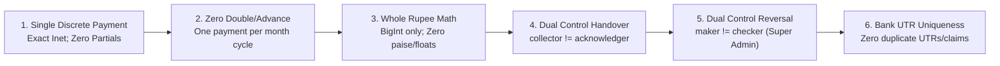
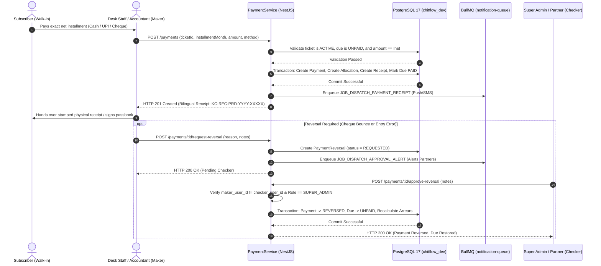
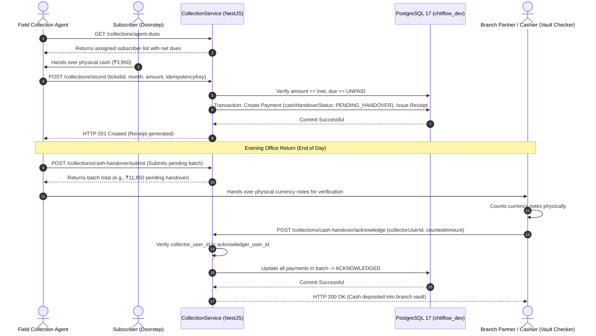

# Payment, Collections & Dual-Control Architecture Guide

> **Product**: **Kumaran Chits** (Official Chit Fund Operations Platform)  
> **Company**: **Kumaran Finance** (Head Office: Perundurai, Erode, Tamil Nadu)  
> **Target Audience**: Core Engineers, DevOps, New Contributors, Accountants, and Auditors  
> **Primary Source Code**:  
> - Core Payments: [`apps/api/src/payment/`](file:///u:/Kumaran-finance/apps/api/src/payment/)  
> - Field Collections: [`apps/api/src/collection/`](file:///u:/Kumaran-finance/apps/api/src/collection/)  
> - Bilingual PDF Canvas: [`apps/api/src/pdf/`](file:///u:/Kumaran-finance/apps/api/src/pdf/)  
> - Background Queues: [`apps/api/src/jobs/`](file:///u:/Kumaran-finance/apps/api/src/jobs/)  
> **Verified Automated Tests**:  
> - [`apps/api/test/unit/payment.spec.ts`](file:///u:/Kumaran-finance/apps/api/test/unit/payment.spec.ts) (20/20 PASS)  
> - [`apps/api/test/unit/collection.spec.ts`](file:///u:/Kumaran-finance/apps/api/test/unit/collection.spec.ts) (16/16 PASS)  
> - [`apps/api/test/unit/pdf.spec.ts`](file:///u:/Kumaran-finance/apps/api/test/unit/pdf.spec.ts) (28/28 PASS)  
> **Live E2E Verification Scripts**:  
> - [`apps/api/scripts/lifecycle/verify-lifecycle-6.ts`](file:///u:/Kumaran-finance/apps/api/scripts/lifecycle/verify-lifecycle-6.ts) (Lifecycle 6: Collections & Vault Handover)  
> - [`apps/api/scripts/lifecycle/verify-lifecycle-7.ts`](file:///u:/Kumaran-finance/apps/api/scripts/lifecycle/verify-lifecycle-7.ts) (Lifecycle 7: Counter Payments & Dual-Control Reversals)

---

## 1. Executive Summary & Operating Context

In physical chit-fund operations across Perundurai and rural Erode, Tamil Nadu:
- **Operating Footprint**: 1 Central Branch Office (Head Office - Perundurai), 4 Working Partners, and 2 to 3 Field Collection Agents.
- **Physical Primacy**: Business records historically exist in physical handwritten notebooks and physical subscriber passbooks. Software serves as the strict, tamper-proof digital accounting truth and statutory register.
- **Payment Modalities**:
  1. **Office Counter Payments**: Walk-in subscribers paying cash, presenting cheques, or scanning the branch UPI QR code.
  2. **Doorstep Field Collections**: Agents collecting cash or cheque instruments during daily motorcycle collection rounds.
  3. **Direct Bank Transfers**: Subscribers transferring via NEFT/RTGS/IMPS with transaction UTR references recorded by staff.
  4. **Native One-Tap UPI Intent Payments (ADR-19)**: Direct-to-bank settlement to Kumaran Finance KVB current account via NPCI deep-link (`upi://pay`) with **₹0 gateway fees**, unique bank UTR tracking, and Maker != Checker staff verification.

---

## 2. The 6 Core Invariant Guardrails (CONFIRMED-BY-DEVELOPER)

All payment operations in Kumaran Chits are mathematically and architecturally bound to 6 strict invariants:



1. **Exact Net Installment ($I_{net}$) Invariant (ADR-07)**:
   - For any active chit scheme, every subscriber in that scheme (including prior auction winners) pays the identical discounted net installment:
     $$I_{net} = I_{base} - Div_{ticket}$$
   - Any payment with `amount < Inet` is immediately rejected with HTTP 400 (`PARTIAL_PAYMENTS_NOT_ALLOWED`).
   - Any payment with `amount > Inet` is rejected. The concept of an "Advance Balance" is completely eliminated from the product.
2. **Zero Double Payments Invariant (ADR-07)**:
   - An installment due accepts strictly one payment. If an installment is already `PAID`, subsequent attempts are blocked with HTTP 400 (`INSTALLMENT_ALREADY_PAID`).
3. **Pure Whole-Rupee Math Invariant (ADR-02)**:
   - All amounts are stored and calculated as 64-bit signed integers (`BigInt` in Prisma, native `bigint` in TypeScript). Decimal paise and floating-point math are strictly prohibited in financial code.
4. **Dual-Control Cash Handover Invariant (PRD Module 7)**:
   - Cash collected in the field remains in `PENDING_HANDOVER` until physically counted and deposited into the branch vault.
   - The application strictly enforces `collector_user_id != acknowledger_user_id`. An agent who collected cash cannot acknowledge their own cash.
5. **Maker-Checker Dual Control on Reversals (ADR-08 & Operations SOP §2)**:
   - Posted payments are immutable and never deleted.
   - If an error occurs (cheque bounce, wrong ticket, duplicate bank entry), a Maker initiates a reversal request (`POST /payments/:id/request-reversal`).
   - A separate Partner (Super Admin) acts as Checker (`POST /payments/:id/approve-reversal`).
   - The application strictly enforces `maker_user_id != checker_user_id`. The user who requested the reversal cannot approve or reject it.
6. **Bank UTR Anti-Duplication Invariant (ADR-19)**:
   - Every non-null bank UTR or cheque reference string (`transactionRef`) is strictly unique across the entire database (`Payment_transactionRef_key`).
   - Reusing a bank UTR throws `ConflictException` (HTTP 409 `DUPLICATE_TRANSACTION_REF`).
   - Nulls are permitted infinitely for cash transactions.


---

## 3. End-to-End Payment Lifecycles

### 3.1 Office Counter Payment Workflow (Lifecycle 7)



### 3.2 Doorstep Field Collection & Vault Handover Workflow (Lifecycle 6)



### 3.3 Customer Native One-Tap UPI & Verification Lifecycle (Lifecycle 7B / ADR-19)

```mermaid
sequenceDiagram
    autonumber
    actor Customer as Subscriber (Mobile App)
    participant UPIApp as GPay / PhonePe / Paytm / BHIM
    participant API as PaymentService (NestJS)
    participant DB as PostgreSQL 17 (chitflow_dev)
    actor Accountant as Desk Staff / Cashier (Checker)
    participant Queue as BullMQ (notification-queue)

    Customer->>API: GET /installments/:dueId/upi-intent
    API->>DB: Validate due is UNPAID & verify caller identity (Anti-BOLA)
    API-->>Customer: HTTP 200 OK (NPCI URI: upi://pay?pa=kumaranfinance@kvb&am=Inet&tn=...)
    Customer->>UPIApp: 1-Tap Deep-Link launches UPI app with locked ₹ amount
    Customer->>UPIApp: Enters secret UPI PIN
    UPIApp-->>Customer: Payment Successful (Direct credit to KVB Account; 12-digit Bank UTR)
    Customer->>API: POST /payments/upi-claim (dueId, utrNumber, notes)
    API->>DB: Check UTR uniqueness in Payment.transactionRef & verify no duplicate claim
    API->>DB: Transaction: Create Payment (status = INITIATED), Create Allocation
    DB-->>API: Commit Successful
    API-->>Customer: HTTP 201 Created ("Claim recorded pending bank verification")

    Note over Accountant,DB: Accounting Desk Verification (Maker != Checker)

    Accountant->>API: GET /payments/pending-upi-claims
    API-->>Accountant: Returns pending claims with customer name, due amount & UTR
    Accountant->>Accountant: Opens KVB NetBanking / Mobile App; checks ₹ credit matching UTR
    Accountant->>API: POST /payments/:id/verify-upi-claim (verificationNotes)
    API->>API: Enforce Maker != Checker (Submitter != Accountant)
    API->>DB: Transaction: Payment -> SUCCESS, Issue Sequential Receipt, Mark Due -> PAID
    DB-->>API: Commit Successful
    API->>Queue: Enqueue JOB_DISPATCH_PAYMENT_RECEIPT (Push/SMS)
    API-->>Accountant: HTTP 200 OK (Receipt KC-REC-PRD-YYYY-XXXXX issued)
    Queue-->>Customer: Instant Push Notification & Digital Passbook updated to PAID!
```

---

## 4. Database Models & Schema Proofs

Defined in [`apps/api/prisma/schema.prisma`](file:///u:/Kumaran-finance/apps/api/prisma/schema.prisma):

```prisma
model Payment {
  id                               String              @id @default(uuid())
  branchId                         String
  recordedByUserId                 String
  recordedByUser                   User                @relation("AgentPayments", fields: [recordedByUserId], references: [id])
  customerId                       String
  amount                           BigInt              // Whole integer Rupees (Zero paise)
  paymentMethod                    PaymentMethod       // CASH, UPI, CHEQUE, BANK_TRANSFER
  paymentStatus                    PaymentStatus       @default(INITIATED) // INITIATED, SUCCESS, REVERSED, FAILED
  idempotencyKey                   String?             @unique
  transactionRef                   String?             @unique // UPI Ref, Cheque number, Bank UTR (Unique per bank credit)
  chequeStatus                     String?             // PENDING, CLEARED, BOUNCED
  cashHandoverStatus               String?             // PENDING_HANDOVER, ACKNOWLEDGED
  cashHandoverAcknowledgedByUserId String?             // Partner who verified physical notes
  cashHandoverAcknowledgedAt       DateTime?
  notes                            String?
  createdAt                        DateTime            @default(now())

  allocations                      PaymentAllocation[]
  receipt                          Receipt?
  reversal                         PaymentReversal?
}

model PaymentAllocation {
  id               String           @id @default(uuid())
  paymentId        String
  payment          Payment          @relation(fields: [paymentId], references: [id])
  ticketId         String
  ticket           SubscriberTicket @relation(fields: [ticketId], references: [id])
  installmentDueId String
  due              InstallmentDue   @relation(fields: [installmentDueId], references: [id])
  amountAllocated  BigInt           // Whole integer Rupees

  @@index([paymentId])
  @@index([ticketId])
  @@index([installmentDueId])
}

model Receipt {
  id            String   @id @default(uuid())
  branchId      String
  branch        Branch   @relation(fields: [branchId], references: [id])
  paymentId     String   @unique
  payment       Payment  @relation(fields: [paymentId], references: [id])
  receiptNumber String   @unique // e.g., "KC-REC-PRD-2026-00045"
  issuedAt      DateTime @default(now())
  isBilingual   Boolean  @default(true) // Formatted in English + தமிழ்
  pdfS3Key      String?  // Storage key in private S3 storage (Cloudflare R2 / MinIO)
}

model PaymentReversal {
  id                String    @id @default(uuid())
  paymentId         String    @unique
  payment           Payment   @relation(fields: [paymentId], references: [id])
  reason            String    // Reason code (e.g. CHEQUE_BOUNCE, WRONG_TICKET)
  status            String    @default("REQUESTED") // REQUESTED, APPROVED, REJECTED
  notes             String?
  initiatedByUserId String    // Maker (Accountant / Staff)
  approvedByUserId  String?   // Checker (Super Admin / Partner) - maker != checker
  reversedAt        DateTime?
  createdAt         DateTime  @default(now())
  updatedAt         DateTime  @updatedAt
}
```

---

## 5. API Endpoints & Role-Based Access Control (RBAC)

All endpoints are protected by [`JwtAuthGuard`](file:///u:/Kumaran-finance/apps/api/src/auth/guards/jwt-auth.guard.ts) and [`RolesGuard`](file:///u:/Kumaran-finance/apps/api/src/auth/guards/roles.guard.ts):

### 5.1 Payment & Reversal Endpoints ([`PaymentController`](file:///u:/Kumaran-finance/apps/api/src/payment/payment.controller.ts))

| HTTP Method & Path | Primary Role | Description & Invariant Guards |
|---|---|---|
| `POST /payments` | Accountant, Branch Manager, Super Admin | Records counter payment. Enforces exact $I_{net}$ matching and sequential bilingual receipt issuance. |
| `GET /payments` | All Staff, Auditor, Customer | Lists payments. Customers are strictly scoped to self (`customerId == ownId`). |
| `GET /payments/:id` | All Staff, Auditor, Customer | Retrieves detailed payment with allocations, receipt, and reversal metadata. |
| `GET /payments/:id/receipt` | All Staff, Auditor, Customer | Generates formatted bilingual receipt text layout (English + தமிழ்). |
| `GET /installments/:dueId/upi-intent` | Customer, All Staff | Builds standard NPCI 1-tap `upi://pay` URI locking exact whole-rupee $I_{net}$ amount and KVB account payee VPA (`kumaranfinance@kvb`). |
| `POST /payments/upi-claim` | Customer, Staff | Customer submits 12-digit bank UTR reference. Validates UTR uniqueness; records payment in `INITIATED` status pending bank check. |
| `GET /payments/pending-upi-claims` | Accountant, Branch Manager, Super Admin | Lists all pending UPI claims for Accounting Desk statement matching. |
| `POST /payments/:id/verify-upi-claim` | **Super Admin, Branch Manager, Accountant** | Confirms bank credit. Transitions payment to `SUCCESS`, issues bilingual receipt, marks due `PAID`. **Enforces `maker != checker`**. |
| `POST /payments/:id/request-reversal` | **Super Admin Strictly (Partner A)** | Maker creates reversal request with mandatory reason code. Enqueues partner push alert. |
| `POST /payments/:id/approve-reversal` | **Super Admin Strictly** | Checker approves reversal. Enforces `maker_user_id != checker_user_id`. Restores due to `UNPAID`. |
| `POST /payments/:id/reject-reversal` | **Super Admin Strictly** | Checker rejects reversal. Enforces `maker_user_id != checker_user_id`. Retains `SUCCESS`. |

### 5.2 Collections & Cash Handover Endpoints ([`CollectionController`](file:///u:/Kumaran-finance/apps/api/src/collection/collection.controller.ts))

| HTTP Method & Path | Primary Role | Description & Invariant Guards |
|---|---|---|
| `GET /collections/agent-dues` | Collection Agent, Staff | Returns list of pending and overdue subscriber dues for doorstep collection rounds. |
| `POST /collections/record` | Collection Agent, Staff | Records doorstep field collection. Generates receipt and marks cash as `PENDING_HANDOVER`. |
| `POST /collections/sync-offline-queue` | Collection Agent, Staff | Synchronizes offline queue (1–100 items) with item-level error isolation and deduplication. |
| `GET /collections/daily-summary` | Staff, Auditor | Returns daily collection register, breakdown by payment method, and pending vault cash. |
| `POST /collections/cash-handover/submit` | Collection Agent, Super Admin | Submits unhanded cash collections as an evening batch for office vault deposit. |
| `POST /collections/cash-handover/acknowledge` | **Super Admin, Branch Manager, Accountant** | Physically verifies notes and signs cash into branch vault. **Enforces `collector != acknowledger`**. |

### 5.3 Receipt Delivery Endpoints & Distinction (JSON vs. PDF)

Kumaran Chits provides two distinct endpoints for receipts, each serving a specific technical purpose:

| Endpoint | Content-Type | Response Body | Intended Usage & Device Experience |
|---|---|---|---|
| [`GET /payments/:id/receipt`](file:///u:/Kumaran-finance/apps/api/src/payment/payment.controller.ts#L134) | `application/json` | Structured JSON with calculation metadata + pre-formatted monospace bilingual text string | **Primary Digital Display**: Consumed by the Flutter Mobile App and Web Admin to render the receipt card instantly inside the customer's digital passbook view without PDF rendering overhead. |
| [`GET /pdf/receipt/:paymentId`](file:///u:/Kumaran-finance/apps/api/src/pdf/pdf.controller.ts#L33) | `application/pdf` or JSON presigned URL | Binary A5 PDF document compiled via `pdfkit` (419.53 x 595.28 pt) or 15-minute S3 download URL (`?download=true`) | **On-Demand PDF Export**: Used when a customer or auditor explicitly requests a standalone downloadable PDF receipt file. Embedded with Noto Sans Tamil typography and uploaded to private S3 storage (Cloudflare R2 / MinIO). |

> [!IMPORTANT]
> **Zero Thermal Printers Rule (ADR-11)**:  
> Field collection agents and office accountants **do not carry or use portable thermal printers**. In Kumaran Finance operations, the customer's physical paper passbook (சீட்டு பாஸ்புக்) is their primary physical proof of installment payment. The agent/cashier enters the date, amount, and signs with a pen. Loose thermal paper slips are completely eliminated. The digital PDF generator exists solely for cloud archival and on-demand customer smartphone downloads.

---

## 6. Implementation Code Proofs

### Proof 1: Exact $I_{net}$ Invariant Guard (Rejecting Partials & Doubles)
From [`apps/api/src/payment/payment.service.ts#L119-L132`](file:///u:/Kumaran-finance/apps/api/src/payment/payment.service.ts#L119-L132):

```typescript
// 4. ADR-07 Invariant Guard: Zero Double Payments
if (due.status === DueStatus.PAID) {
  throw new BadRequestException(
    `INSTALLMENT_ALREADY_PAID: Month ${dto.installmentMonth} installment has already been paid in full`,
  );
}

// 5. ADR-07 Invariant Guard: Zero Partial Payments (Exact Inet Matching)
const paymentAmount = BigInt(Math.floor(dto.amount));
if (paymentAmount !== due.netPayableAmount) {
  throw new BadRequestException(
    `PARTIAL_PAYMENTS_NOT_ALLOWED: Payment must exactly match the net installment due of ₹${due.netPayableAmount.toString()} (received: ₹${paymentAmount.toString()})`,
  );
}
```

### Proof 2: Dual Control Maker != Checker on Payment Reversal
From [`apps/api/src/payment/payment.service.ts#L615-L646`](file:///u:/Kumaran-finance/apps/api/src/payment/payment.service.ts#L615-L646):

```typescript
// 1. Enforce Super Admin Exclusivity
if (!checkerRoles.includes(Role.SUPER_ADMIN)) {
  throw new ForbiddenException(
    'REVERSAL_PERMISSION_DENIED: Only Super Admin (Partners) possess financial authority to approve payment reversals',
  );
}

// 2. Hard Guard: Maker != Checker
if (payment.reversal.initiatedByUserId === checkerUserId) {
  throw new ForbiddenException(
    'MAKER_CHECKER_VIOLATION: The user who requested the reversal cannot approve it. An independent Partner must review and commit.',
  );
}
```

### Proof 3: Dual Control Collector != Acknowledger on Cash Handover
From [`apps/api/src/collection/collection.service.ts#L363-L373`](file:///u:/Kumaran-finance/apps/api/src/collection/collection.service.ts#L363-L373):

```typescript
// Hard Guard: Dual Control Separation of Duties (collector != acknowledger)
if (dto.collectorUserId === acknowledgerUserId) {
  throw new ForbiddenException(
    'DUAL_CONTROL_VIOLATION: The field agent who collected the cash cannot acknowledge their own handover batch. An independent Cashier or Partner must count and verify currency notes.',
  );
}
```

In addition to this application guard, PostgreSQL 17 enforces this at the physical database engine level via constraint `chk_payment_cash_handover_maker_checker`:
```sql
ALTER TABLE "Payment"
ADD CONSTRAINT "chk_payment_cash_handover_maker_checker"
CHECK (
  ("cashHandoverAcknowledgedByUserId" IS NULL OR "recordedByUserId" != "cashHandoverAcknowledgedByUserId")
);
```

### Proof 4: Pessimistic Row Locking on Cash Handover (Deterministic `ORDER BY id FOR UPDATE`)
From [`apps/api/src/collection/collection.service.ts`](file:///u:/Kumaran-finance/apps/api/src/collection/collection.service.ts):

```typescript
// 0. Pessimistic Row Lock (SELECT FOR UPDATE) with deterministic ID sorting to eliminate deadlocks (40P01)
if (typeof tx.$queryRaw === 'function' && dto.paymentIds && dto.paymentIds.length > 0) {
  const sortedPaymentIds = [...new Set(dto.paymentIds)].sort();
  const lockedPayments = await tx.$queryRaw<Array<{ id: string; cashHandoverStatus: string }>>`
    SELECT id, "cashHandoverStatus" FROM "Payment" WHERE id = ANY(${sortedPaymentIds}::text[]) ORDER BY id FOR UPDATE
  `;
  if (lockedPayments && lockedPayments.length > 0) {
    for (const lp of lockedPayments) {
      if (lp.cashHandoverStatus !== 'PENDING_HANDOVER') {
        throw new BadRequestException(
          `Payment ${lp.id} has already been acknowledged or is not pending handover`,
        );
      }
    }
  }
}
```

### Proof 5: Unified 4-Tier Lock DAG & Transactional Receipt Sequence
All 4 receipt-generating paths ([`PaymentService.recordPayment`](file:///u:/Kumaran-finance/apps/api/src/payment/payment.service.ts), [`CollectionService.recordCollection`](file:///u:/Kumaran-finance/apps/api/src/collection/collection.service.ts), [`PaymentService.verifyUpiClaim`](file:///u:/Kumaran-finance/apps/api/src/payment/payment.service.ts), and [`ReconciliationService.executeReconcileSettlement`](file:///u:/Kumaran-finance/apps/api/src/jobs/services/reconciliation.service.ts)) share [`acquirePaymentConcurrencyLocks` & `generateNextReceiptNumber`](file:///u:/Kumaran-finance/apps/api/src/common/utils/receipt-sequence.util.ts) inside `withTransactionRetry`:
- Locks strictly follow **`Branch` $\to$ `SubscriberTicket` $\to$ `InstallmentDue` ($\to$ `Payment`)** before generating receipts inside the transaction, eliminating `40P01` cyclic lock inversions, `P2002` receipt collisions, and duplicate `verifyUpiClaim` / cash double-settlements.

### Proof 6: Decoupled Idempotency with Same-Branch Isolation (F09)
In `PaymentService.recordPayment` and `CollectionService.recordCollection`, idempotency caches are decoupled from shared branch purviews. When a cached idempotency key matches an existing payment, the service strictly asserts:
```typescript
if (existingPayment.recordedByUserId !== userId) {
  throw new ForbiddenException('Access denied: You can only query or replay your own payment records');
}
```
This guarantees that collection agents and cashiers cannot sniff or replay other staff members' payments even within the same physical branch office. Accounting branches are derived strictly from `ticket.chitGroup.branchId`.

---

## 7. Automated Test Verification & Live Server Proof Matrix

### 7.1 Automated Jest Unit Tests (64 / 64 Tests Passing)

```text
PASS test/unit/collection.spec.ts
PASS test/unit/payment.spec.ts
PASS test/unit/pdf.spec.ts

Test Suites: 3 passed, 3 total
Tests:       64 passed, 64 total
Time:        4.512 s
```

### 7.2 Live Server End-to-End Verification (PostgreSQL 17 & Redis 7)

Executed against local Docker cluster (`chitflow-db:5433`, `chitflow-redis:6379`, `chitflow-api:3000`):

1. **Lifecycle 6 Verification Output**:
   - `[1/6] GET /collections/agent-dues`: Successfully fetched assigned dues (`HTTP 200 OK`).
   - `[2/6] Partial Payment Guard`: Attempted ₹2,000 against ₹3,950 due $\to$ **Rejected with HTTP 400 Bad Request** (`PARTIAL_PAYMENTS_NOT_ALLOWED`).
   - `[2/6] Valid Collection Recording`: Recorded ₹3,950 CASH $\to$ **Created payment and sequential receipt `KC-REC-PRD-2026-00012`** (`HTTP 201 Created`).
   - `[3/6] Offline Queue Sync`: Batch submitted with duplicate key $\to$ **1 Synced, 1 Duplicate Ignored** (`HTTP 200 OK`).
   - `[4/6] Daily Collection Summary`: Verified register totals match recorded transactions (`HTTP 200 OK`).
   - `[5/6] Cash Handover Submission`: Agent submitted batch of ₹11,850 (`HTTP 200 OK`).
   - `[6/6] Self-Acknowledgment Guard`: Field agent attempted self-acknowledgment $\to$ **Rejected with HTTP 403 Forbidden** (`DUAL_CONTROL_VIOLATION`).
   - `[6/6] Partner Vault Deposit`: Super Admin acknowledged physical cash $\to$ **Committed into branch vault** (`HTTP 200 OK`).

2. **Lifecycle 7 Verification Output (Full 8-Step Verification)**:
   - `[1/8] POST /payments (CASH)`: Recorded counter cash payment with full fields (`idempotencyKey`, `notes`, `collectedAt`) $\to$ **`cashHandoverStatus: PENDING_HANDOVER`**, sequential receipt `KC-REC-PRD-2026-00014`, InstallmentDue updated to `PAID`, BullMQ receipt notification enqueued (`HTTP 201 Created`).
   - `[2/8] POST /payments (UPI)`: Recorded electronic UPI payment with `transactionRef: UPI-REF-998877661122` $\to$ **`cashHandoverStatus: ACKNOWLEDGED`** (direct bank credit bypasses drawer handover), InstallmentDue updated to `PAID` (`HTTP 201 Created`).
   - `[3/8] GET /payments (Paginated & Filtered)`: Filtered collections by `ticketId` and `paymentMethod=CASH` (`HTTP 200 OK`). Verified automatic customer scoping for mobile subscribers.
   - `[4/8] GET /payments/:id (Deep Relations & OWASP BOLA)`: Verified full relation graph (`customer`, `branch`, `recordedBy`, `allocations`, `receipt`). OWASP BOLA attack simulation (Customer 5 querying Customer 6 payment) **strictly blocked with HTTP 403 Forbidden**.
   - `[5/8] GET /payments/:id/receipt`: Retrieved bilingual receipt formatted in English and தமிழ் monospace layout for instant passbook display (`HTTP 200 OK`).
   - `[6/8] GET /pdf/receipt/:paymentId (A5 PDF Canvas & S3)`: Verified direct binary stream (`application/pdf`, `%PDF-`, 26,931 bytes, ISO A5 portrait) and 15-minute presigned S3 download URL (`HTTP 200 OK`).
   - `[7/8] POST /payments/:id/reject-reversal (Reversal Rejection Branch)`: Maker requested reversal on Payment B. Maker self-rejection blocked with HTTP 403 Forbidden. Checker (Partner) rejected reversal $\to$ **Payment remains `SUCCESS`, InstallmentDue remains `PAID`, `AuditLog` entry `PAYMENT_REVERSAL_REJECTED` recorded** (`HTTP 200 OK`).

   - `[8/8] POST /payments/:id/approve-reversal (Reversal Approval Branch)`: Maker requested reversal on Payment A. Maker self-approval blocked with HTTP 403 Forbidden. Checker (Partner) approved reversal $\to$ **Payment marked `REVERSED`, InstallmentDue atomically restored to `0|UNPAID`, `AuditLog` entry `PAYMENT_REVERSED` recorded** (`HTTP 200 OK`).

3. **Extended Concurrency Row-Locking Live Verification Output (`scripts/probes/verify-extended-concurrency.ps1`)**:
   - `[PROBE 1] Desk Cash Handover Contention`: Two concurrent background workers simultaneously attempted to sign off the exact same cash collection payment batch $\to$ **Worker 1 acquired row lock and succeeded (HTTP 200 OK), Worker 2 blocked and was safely rejected (HTTP 400 Bad Request: "Payment has already been acknowledged or is not pending handover")**. Final DB state verified as `ACKNOWLEDGED`.
   - `[PROBE 2] Defaulter Ticket Substitution Race`: Two concurrent background workers simultaneously attempted to assign distinct candidate replacement customers to the same vacated ticket $\to$ **Worker 1 acquired row lock and succeeded (HTTP 200 OK, Ticket restored to `ACTIVE`), Worker 2 blocked and was safely rejected (HTTP 400 Bad Request: "Subscriber substitution failed: Ticket is no longer in REMOVED_DEF_3M status")**.

---

## 8. Cross-Platform Monorepo Status (Honest Gap Analysis)

| Monorepo Layer | Current Status | State in Repository | Gap Details |
|---|:---:|---|---|
| **Backend API Engine (`apps/api`)** | **100% DONE** | Production-ready | All controllers, services, database transactions, invariant guards, and tests are complete. |
| **Bilingual PDF Generator (`apps/api/src/pdf`)** | **100% DONE** | Production-ready | On-demand A5 bilingual PDF receipt document generator with Noto Sans Tamil fonts verified. |
| **BullMQ Receipt & Alert Queues** | **100% DONE** | Production-ready | `JOB_DISPATCH_PAYMENT_RECEIPT` and `JOB_DISPATCH_APPROVAL_ALERT` wired and running. |
| **Web Admin Portal (`apps/web`)** | **100% DONE** | Production-ready | Complete Next.js 15 screens for cashier counter collections, receipt viewing, cash handover, and two-stage settlement modal workflows. |
| **Mobile Flutter App (`apps/mobile`)** | **0% PENDING** | Empty (`.gitkeep`) | Android screens for field agent collections, offline SQLite queue, and customer passbook remain to be built. |
| **Native Zero-Fee UPI Intent (ADR-19)**| **100% DONE** | Production-ready & Verified | NPCI native deep-linking (`upi://pay`), Bank UTR `@unique` constraint, customer claims & Maker != Checker verification complete. Third-party gateways strictly eliminated (₹0 MDR fee). |
| **Cheque Clearance Endpoint** | **BY WORKFLOW** | Handled via Reversal | Dedicated `PATCH /cheque-status` endpoint not created; bounced cheques are handled via `POST /payments/:id/request-reversal` with reason `CHEQUE_BOUNCE`. |

---

## 9. Cashier & Agent Daily Operations Quick Reference

### For Counter Cashier (Accountant)
1. **Subscriber Arrives**: Look up subscriber ticket using phone number or chit group code.
2. **Collect Exact Amount**: Collect exact whole-rupee amount shown as `netPayableAmount` ($I_{net}$). Never accept partial amounts or round-offs.
3. **Record in System**: Submit `POST /payments` with payment method and transaction reference (if UPI/Cheque).
4. **Issue Receipt**: System returns `KC-REC-PRD-YYYY-XXXXX`. Sign customer's physical paper passbook with receipt number and date. (No thermal printer).

### For Field Collection Agent
1. **Morning Briefing**: Fetch assigned dues list (`GET /collections/agent-dues`) on mobile app.
2. **Doorstep Collection**: Collect exact cash, enter receipt on app. If offline, the app assigns a local UUID and timestamps the collection.
3. **Evening Office Return**:
   - Reconnect to office Wi-Fi; the mobile app syncs offline queue (`POST /collections/sync-offline-queue`).
   - Submit cash handover batch (`POST /collections/cash-handover/submit`).
   - Hand physical currency notes to Partner/Cashier.
   - Wait for Partner to physically count and sign off the batch (`POST /collections/cash-handover/acknowledge`).
