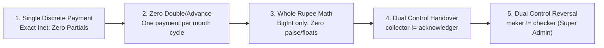
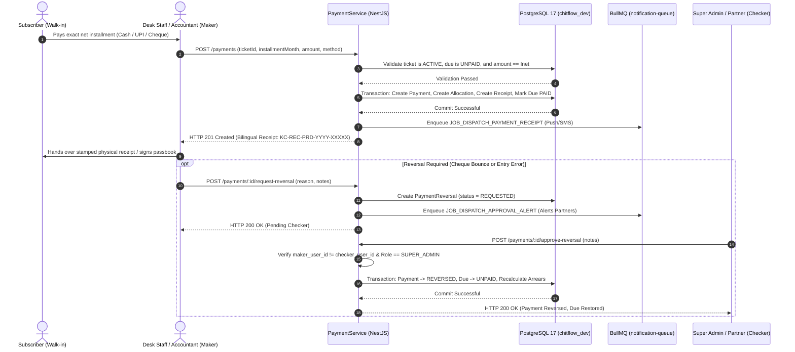
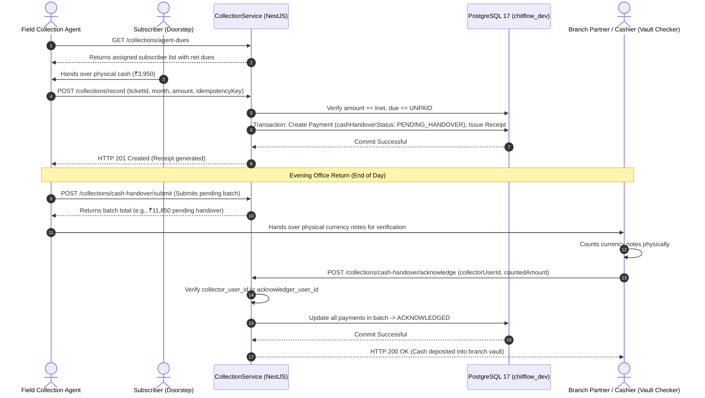

# Payment, Collections & Dual-Control Architecture Guide

> **Product**: **Kumaran Chits** (Official Chit Fund Operations Platform)  
> **Company**: **Kumaran Finance** (Head Office: Perundurai, Erode, Tamil Nadu)  
> **Target Audience**: Core Engineers, DevOps, New Contributors, Accountants, and Auditors  
> **Primary Source Code**:  
> - Core Payments: [`apps/api/src/payment/`](file:///u:/Kumaran-finance/apps/api/src/payment/)  
> - Field Collections: [`apps/api/src/collection/`](file:///u:/Kumaran-finance/apps/api/src/collection/)  
> - Bilingual PDF Canvas: [`apps/api/src/pdf/`](file:///u:/Kumaran-finance/apps/api/src/pdf/)  
> - Background Queues: [`apps/api/src/jobs/`](file:///u:/Kumaran-finance/apps/api/src/jobs/)  
> **Verified Automated Tests**:  
> - [`apps/api/test/payment.spec.ts`](file:///u:/Kumaran-finance/apps/api/test/payment.spec.ts) (20/20 PASS)  
> - [`apps/api/test/collection.spec.ts`](file:///u:/Kumaran-finance/apps/api/test/collection.spec.ts) (16/16 PASS)  
> - [`apps/api/test/pdf.spec.ts`](file:///u:/Kumaran-finance/apps/api/test/pdf.spec.ts) (28/28 PASS)  
> **Live E2E Verification Scripts**:  
> - [`apps/api/scripts/verify-lifecycle-6.ts`](file:///u:/Kumaran-finance/apps/api/scripts/verify-lifecycle-6.ts) (Lifecycle 6: Collections & Vault Handover)  
> - [`apps/api/scripts/verify-lifecycle-7.ts`](file:///u:/Kumaran-finance/apps/api/scripts/verify-lifecycle-7.ts) (Lifecycle 7: Counter Payments & Dual-Control Reversals)

---

## 1. Executive Summary & Operating Context

In physical chit-fund operations across Perundurai and rural Erode, Tamil Nadu:
- **Operating Footprint**: 1 Central Branch Office (Head Office - Perundurai), 4 Working Partners, and 2 to 3 Field Collection Agents.
- **Physical Primacy**: Business records historically exist in physical handwritten notebooks and physical subscriber passbooks. Software serves as the strict, tamper-proof digital accounting truth and statutory register.
- **Payment Modalities**:
  1. **Office Counter Payments**: Walk-in subscribers paying cash, presenting cheques, or scanning the branch UPI QR code.
  2. **Doorstep Field Collections**: Agents collecting cash or cheque instruments during daily motorcycle collection rounds.
  3. **Direct Bank Transfers**: Subscribers transferring via NEFT/RTGS/IMPS with transaction UTR references recorded by staff.

---

## 2. The 5 Core Invariant Guardrails (CONFIRMED-BY-DEVELOPER)

All payment operations in Kumaran Chits are mathematically and architecturally bound to 5 strict invariants:



1. **Exact Net Installment ($I_{net}$) Invariant (ADR-07)**:
   - For any active chit scheme, every subscriber in that scheme (including prior auction winners) pays the identical discounted net installment:
     $$I_{net} = I_{base} - Div_{ticket}$$
   - Any payment with `amount < Inet` is immediately rejected with HTTP 400 (`PARTIAL_PAYMENTS_NOT_ALLOWED`).
   - Any payment with `amount > Inet` is rejected. The concept of an "Advance Balance" is completely eliminated from the product.
2. **Zero Double Payments Invariant (ADR-07)**:
   - An installment due accepts strictly one payment. If an installment is already `PAID`, subsequent attempts are blocked with HTTP 400 (`INSTALLMENT_ALREADY_PAID`).
3. **Pure Whole-Rupee Math Invariant (ADR-02)**:
   - All amounts are stored and calculated as 64-bit signed integers (`BigInt` in Prisma, native `bigint` in TypeScript). Decimal paise and floating-point math are strictly prohibited in financial code.
4. **Dual-Control Cash Handover Invariant (PRD Module 7)**:
   - Cash collected in the field remains in `PENDING_HANDOVER` until physically counted and deposited into the branch vault.
   - The application strictly enforces `collector_user_id != acknowledger_user_id`. An agent who collected cash cannot acknowledge their own cash.
5. **Maker-Checker Dual Control on Reversals (ADR-08 & Operations SOP §2)**:
   - Posted payments are immutable and never deleted.
   - If an error occurs (cheque bounce, wrong ticket, duplicate bank entry), a Maker initiates a reversal request (`POST /payments/:id/request-reversal`).
   - A separate Partner (Super Admin) acts as Checker (`POST /payments/:id/approve-reversal`).
   - The application strictly enforces `maker_user_id != checker_user_id`. The user who requested the reversal cannot approve or reject it.

---

## 3. End-to-End Payment Lifecycles

### 3.1 Office Counter Payment Workflow (Lifecycle 7)



### 3.2 Doorstep Field Collection & Vault Handover Workflow (Lifecycle 6)



---

## 4. Database Models & Schema Proofs

Defined in [`apps/api/prisma/schema.prisma`](file:///u:/Kumaran-finance/apps/api/prisma/schema.prisma):

```prisma
model Payment {
  id                               String              @id @default(uuid())
  branchId                         String
  recordedByUserId                 String
  recordedByUser                   User                @relation("AgentPayments", fields: [recordedByUserId], references: [id])
  customerId                       String
  amount                           BigInt              // Whole integer Rupees (Zero paise)
  paymentMethod                    PaymentMethod       // CASH, UPI, CHEQUE, BANK_TRANSFER
  paymentStatus                    PaymentStatus       @default(INITIATED) // INITIATED, SUCCESS, REVERSED, FAILED
  idempotencyKey                   String?             @unique
  transactionRef                   String?             // UPI Ref, Cheque number, Bank UTR
  chequeStatus                     String?             // PENDING, CLEARED, BOUNCED
  cashHandoverStatus               String?             // PENDING_HANDOVER, ACKNOWLEDGED
  cashHandoverAcknowledgedByUserId String?             // Partner who verified physical notes
  cashHandoverAcknowledgedAt       DateTime?
  notes                            String?
  createdAt                        DateTime            @default(now())

  allocations                      PaymentAllocation[]
  receipt                          Receipt?
  reversal                         PaymentReversal?
}

model PaymentAllocation {
  id               String           @id @default(uuid())
  paymentId        String
  payment          Payment          @relation(fields: [paymentId], references: [id])
  ticketId         String
  ticket           SubscriberTicket @relation(fields: [ticketId], references: [id])
  installmentDueId String
  due              InstallmentDue   @relation(fields: [installmentDueId], references: [id])
  amountAllocated  BigInt           // Whole integer Rupees
}

model Receipt {
  id            String   @id @default(uuid())
  branchId      String
  branch        Branch   @relation(fields: [branchId], references: [id])
  paymentId     String   @unique
  payment       Payment  @relation(fields: [paymentId], references: [id])
  receiptNumber String   @unique // e.g., "KC-REC-PRD-2026-00045"
  issuedAt      DateTime @default(now())
  isBilingual   Boolean  @default(true) // Formatted in English + தமிழ்
  pdfS3Key      String?  // Storage key in private AWS S3 / MinIO
}

model PaymentReversal {
  id                String    @id @default(uuid())
  paymentId         String    @unique
  payment           Payment   @relation(fields: [paymentId], references: [id])
  reason            String    // Reason code (e.g. CHEQUE_BOUNCE, WRONG_TICKET)
  status            String    @default("REQUESTED") // REQUESTED, APPROVED, REJECTED
  notes             String?
  initiatedByUserId String    // Maker (Accountant / Staff)
  approvedByUserId  String?   // Checker (Super Admin / Partner) - maker != checker
  reversedAt        DateTime?
  createdAt         DateTime  @default(now())
  updatedAt         DateTime  @updatedAt
}
```

---

## 5. API Endpoints & Role-Based Access Control (RBAC)

All endpoints are protected by [`JwtAuthGuard`](file:///u:/Kumaran-finance/apps/api/src/auth/guards/jwt-auth.guard.ts) and [`RolesGuard`](file:///u:/Kumaran-finance/apps/api/src/auth/guards/roles.guard.ts):

### 5.1 Payment & Reversal Endpoints ([`PaymentController`](file:///u:/Kumaran-finance/apps/api/src/payment/payment.controller.ts))

| HTTP Method & Path | Primary Role | Description & Invariant Guards |
|---|---|---|
| `POST /payments` | Accountant, Branch Manager, Super Admin | Records counter payment. Enforces exact $I_{net}$ matching and sequential bilingual receipt issuance. |
| `GET /payments` | All Staff, Auditor, Customer | Lists payments. Customers are strictly scoped to self (`customerId == ownId`). |
| `GET /payments/:id` | All Staff, Auditor, Customer | Retrieves detailed payment with allocations, receipt, and reversal metadata. |
| `GET /payments/:id/receipt` | All Staff, Auditor, Customer | Generates formatted bilingual receipt text layout (English + தமிழ்). |
| `POST /payments/:id/request-reversal` | Accountant, Branch Manager, Super Admin | Maker creates reversal request with mandatory reason code. Enqueues partner push alert. |
| `POST /payments/:id/approve-reversal` | **Super Admin Strictly** | Checker approves reversal. Enforces `maker_user_id != checker_user_id`. Restores due to `UNPAID`. |
| `POST /payments/:id/reject-reversal` | **Super Admin Strictly** | Checker rejects reversal. Enforces `maker_user_id != checker_user_id`. Retains `SUCCESS`. |

### 5.2 Collections & Cash Handover Endpoints ([`CollectionController`](file:///u:/Kumaran-finance/apps/api/src/collection/collection.controller.ts))

| HTTP Method & Path | Primary Role | Description & Invariant Guards |
|---|---|---|
| `GET /collections/agent-dues` | Collection Agent, Staff | Returns list of pending and overdue subscriber dues for doorstep collection rounds. |
| `POST /collections/record` | Collection Agent, Staff | Records doorstep field collection. Generates receipt and marks cash as `PENDING_HANDOVER`. |
| `POST /collections/sync-offline-queue` | Collection Agent, Staff | Synchronizes offline queue (1–100 items) with item-level error isolation and deduplication. |
| `GET /collections/daily-summary` | Staff, Auditor | Returns daily collection register, breakdown by payment method, and pending vault cash. |
| `POST /collections/cash-handover/submit` | Collection Agent, Super Admin | Submits unhanded cash collections as an evening batch for office vault deposit. |
| `POST /collections/cash-handover/acknowledge` | **Super Admin, Branch Manager, Accountant** | Physically verifies notes and signs cash into branch vault. **Enforces `collector != acknowledger`**. |

### 5.3 Receipt Delivery Endpoints & Distinction (JSON vs. PDF)

Kumaran Chits provides two distinct endpoints for receipts, each serving a specific technical purpose:

| Endpoint | Content-Type | Response Body | Intended Usage & Device Experience |
|---|---|---|---|
| [`GET /payments/:id/receipt`](file:///u:/Kumaran-finance/apps/api/src/payment/payment.controller.ts#L134) | `application/json` | Structured JSON with calculation metadata + pre-formatted monospace bilingual text string | **Primary Digital Display**: Consumed by the Flutter Mobile App and Web Admin to render the receipt card instantly inside the customer's digital passbook view without PDF rendering overhead. |
| [`GET /pdf/receipt/:paymentId`](file:///u:/Kumaran-finance/apps/api/src/pdf/pdf.controller.ts#L33) | `application/pdf` or JSON presigned URL | Binary A5 PDF document compiled via `pdfkit` (419.53 x 595.28 pt) or 15-minute S3 download URL (`?download=true`) | **On-Demand PDF Export**: Used when a customer or auditor explicitly requests a standalone downloadable PDF receipt file. Embedded with Noto Sans Tamil typography and uploaded to private AWS S3 / MinIO storage. |

> [!IMPORTANT]
> **Zero Thermal Printers Rule (ADR-11)**:  
> Field collection agents and office accountants **do not carry or use portable thermal printers**. In Kumaran Finance operations, the customer's physical paper passbook (சீட்டு பாஸ்புக்) is their primary physical proof of installment payment. The agent/cashier enters the date, amount, and signs with a pen. Loose thermal paper slips are completely eliminated. The digital PDF generator exists solely for cloud archival and on-demand customer smartphone downloads.

---

## 6. Implementation Code Proofs

### Proof 1: Exact $I_{net}$ Invariant Guard (Rejecting Partials & Doubles)
From [`apps/api/src/payment/payment.service.ts#L119-L132`](file:///u:/Kumaran-finance/apps/api/src/payment/payment.service.ts#L119-L132):

```typescript
// 4. ADR-07 Invariant Guard: Zero Double Payments
if (due.status === DueStatus.PAID) {
  throw new BadRequestException(
    `INSTALLMENT_ALREADY_PAID: Month ${dto.installmentMonth} installment has already been paid in full`,
  );
}

// 5. ADR-07 Invariant Guard: Zero Partial Payments (Exact Inet Matching)
const paymentAmount = BigInt(Math.floor(dto.amount));
if (paymentAmount !== due.netPayableAmount) {
  throw new BadRequestException(
    `PARTIAL_PAYMENTS_NOT_ALLOWED: Payment must exactly match the net installment due of ₹${due.netPayableAmount.toString()} (received: ₹${paymentAmount.toString()})`,
  );
}
```

### Proof 2: Dual Control Maker != Checker on Payment Reversal
From [`apps/api/src/payment/payment.service.ts#L615-L646`](file:///u:/Kumaran-finance/apps/api/src/payment/payment.service.ts#L615-L646):

```typescript
// 1. Enforce Super Admin Exclusivity
if (!checkerRoles.includes(Role.SUPER_ADMIN)) {
  throw new ForbiddenException(
    'REVERSAL_PERMISSION_DENIED: Only Super Admin (Partners) possess financial authority to approve payment reversals',
  );
}

// 2. Hard Guard: Maker != Checker
if (payment.reversal.initiatedByUserId === checkerUserId) {
  throw new ForbiddenException(
    'MAKER_CHECKER_VIOLATION: The user who requested the reversal cannot approve it. An independent Partner must review and commit.',
  );
}
```

### Proof 3: Dual Control Collector != Acknowledger on Cash Handover
From [`apps/api/src/collection/collection.service.ts#L363-L373`](file:///u:/Kumaran-finance/apps/api/src/collection/collection.service.ts#L363-L373):

```typescript
// Hard Guard: Dual Control Separation of Duties (collector != acknowledger)
if (dto.collectorUserId === acknowledgerUserId) {
  throw new ForbiddenException(
    'DUAL_CONTROL_VIOLATION: The field agent who collected the cash cannot acknowledge their own handover batch. An independent Cashier or Partner must count and verify currency notes.',
  );
}
```

---

## 7. Automated Test Verification & Live Server Proof Matrix

### 7.1 Automated Jest Unit Tests (64 / 64 Tests Passing)

```text
PASS test/collection.spec.ts
PASS test/payment.spec.ts
PASS test/pdf.spec.ts

Test Suites: 3 passed, 3 total
Tests:       64 passed, 64 total
Time:        4.512 s
```

### 7.2 Live Server End-to-End Verification (PostgreSQL 17 & Redis 7)

Executed against local Docker cluster (`chitflow-db:5433`, `chitflow-redis:6379`, `chitflow-api:3000`):

1. **Lifecycle 6 Verification Output**:
   - `[1/6] GET /collections/agent-dues`: Successfully fetched assigned dues (`HTTP 200 OK`).
   - `[2/6] Partial Payment Guard`: Attempted ₹2,000 against ₹3,950 due $\to$ **Rejected with HTTP 400 Bad Request** (`PARTIAL_PAYMENTS_NOT_ALLOWED`).
   - `[2/6] Valid Collection Recording`: Recorded ₹3,950 CASH $\to$ **Created payment and sequential receipt `KC-REC-PRD-2026-00012`** (`HTTP 201 Created`).
   - `[3/6] Offline Queue Sync`: Batch submitted with duplicate key $\to$ **1 Synced, 1 Duplicate Ignored** (`HTTP 200 OK`).
   - `[4/6] Daily Collection Summary`: Verified register totals match recorded transactions (`HTTP 200 OK`).
   - `[5/6] Cash Handover Submission`: Agent submitted batch of ₹11,850 (`HTTP 200 OK`).
   - `[6/6] Self-Acknowledgment Guard`: Field agent attempted self-acknowledgment $\to$ **Rejected with HTTP 403 Forbidden** (`DUAL_CONTROL_VIOLATION`).
   - `[6/6] Partner Vault Deposit`: Super Admin acknowledged physical cash $\to$ **Committed into branch vault** (`HTTP 200 OK`).

2. **Lifecycle 7 Verification Output**:
   - `[1/4] POST /payments`: Recorded counter payment ₹3,950 $\to$ **Installment status updated to `PAID`** (`HTTP 201 Created`).
   - `[2/4] GET /payments/:id/receipt`: Retrieved bilingual receipt formatted in English and தமிழ் (`HTTP 200 OK`).
   - `[3/4] POST /payments/:id/request-reversal`: Maker submitted reversal with reason code $\to$ **Status set to `REQUESTED`** (`HTTP 200 OK`).
   - `[4/4] Self-Approval Guard`: Maker attempted self-approval $\to$ **Rejected with HTTP 403 Forbidden** (`MAKER_CHECKER_VIOLATION`).
   - `[4/4] Partner Approval`: Independent Super Admin approved reversal $\to$ **Payment marked `REVERSED`, Installment restored strictly to `UNPAID`** (`HTTP 200 OK`).

---

## 8. Cross-Platform Monorepo Status (Honest Gap Analysis)

| Monorepo Layer | Current Status | State in Repository | Gap Details |
|---|:---:|---|---|
| **Backend API Engine (`apps/api`)** | **100% DONE** | Production-ready | All controllers, services, database transactions, invariant guards, and tests are complete. |
| **Bilingual PDF Generator (`apps/api/src/pdf`)** | **100% DONE** | Production-ready | On-demand A5 bilingual PDF receipt document generator with Noto Sans Tamil fonts verified. |
| **BullMQ Receipt & Alert Queues** | **100% DONE** | Production-ready | `JOB_DISPATCH_PAYMENT_RECEIPT` and `JOB_DISPATCH_APPROVAL_ALERT` wired and running. |
| **Web Admin Portal (`apps/web`)** | **0% PENDING** | Empty (`.gitkeep`) | React/Next.js screens for cashier counter entry, receipt viewing, and handover approval remain to be built. |
| **Mobile Flutter App (`apps/mobile`)** | **0% PENDING** | Empty (`.gitkeep`) | Android screens for field agent collections, offline SQLite queue, and customer passbook remain to be built. |
| **Payment Gateway (Razorpay/PG)** | **ARCH ONLY** | Documented in `payment-integration.md` | Sandbox architecture planned for future phase; no live gateway code in API (counter & field cash are current business truth). |
| **Cheque Clearance Endpoint** | **BY WORKFLOW** | Handled via Reversal | Dedicated `PATCH /cheque-status` endpoint not created; bounced cheques are handled via `POST /payments/:id/request-reversal` with reason `CHEQUE_BOUNCE`. |

---

## 9. Cashier & Agent Daily Operations Quick Reference

### For Counter Cashier (Accountant)
1. **Subscriber Arrives**: Look up subscriber ticket using phone number or chit group code.
2. **Collect Exact Amount**: Collect exact whole-rupee amount shown as `netPayableAmount` ($I_{net}$). Never accept partial amounts or round-offs.
3. **Record in System**: Submit `POST /payments` with payment method and transaction reference (if UPI/Cheque).
4. **Issue Receipt**: System returns `KC-REC-PRD-YYYY-XXXXX`. Sign customer's physical paper passbook with receipt number and date. (No thermal printer).

### For Field Collection Agent
1. **Morning Briefing**: Fetch assigned dues list (`GET /collections/agent-dues`) on mobile app.
2. **Doorstep Collection**: Collect exact cash, enter receipt on app. If offline, the app assigns a local UUID and timestamps the collection.
3. **Evening Office Return**:
   - Reconnect to office Wi-Fi; the mobile app syncs offline queue (`POST /collections/sync-offline-queue`).
   - Submit cash handover batch (`POST /collections/cash-handover/submit`).
   - Hand physical currency notes to Partner/Cashier.
   - Wait for Partner to physically count and sign off the batch (`POST /collections/cash-handover/acknowledge`).
