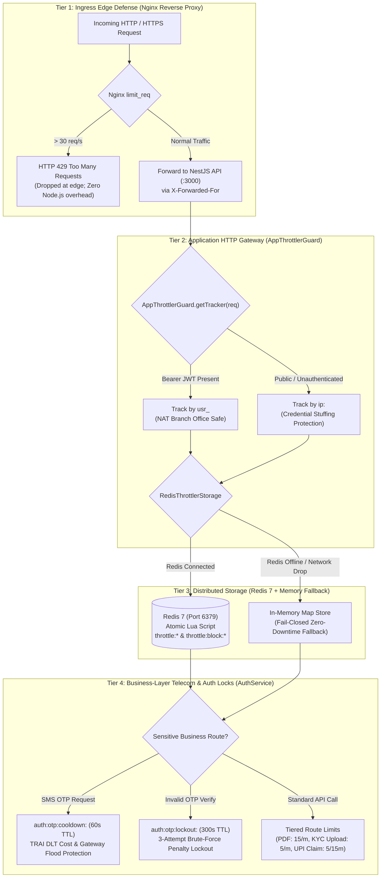

# Kumaran Chits — Rate Limiting, Throttling & Abuse Prevention Architecture

> **Product**: **Kumaran Chits** (Kumaran Finance, Perundurai, Tamil Nadu)  
> **Company Profile**: Single physical branch office (Head Office - Perundurai), 4 Managing Partners, 1 Desk Accountant, 2–3 Field Collection Agents  
> **Classification**: Core Financial Security Architecture (`CONFIRMED-BY-DEVELOPER`)  
> **Status**: **Fully Implemented & Verified with Proofs**  
> **Applicable Standards**: RBI Digital Lending & Fair Practice Guidelines, TRAI DLT Telecom Regulations, OWASP API Security Top 10 (API4:2023 Unrestricted Resource Consumption, API2:2023 Broken Authentication)

---

## 1. Executive Architecture & Multi-Tier Defense

Financial applications handle sensitive ledger dues, cash receipts, and statutory auction calculations. In Kumaran Chits, rate limiting is architected across **4 distinct defense tiers**:



---

## 2. The Branch Office NAT Problem & Solution

### 2.1 The Operational Reality
Kumaran Finance operates from **1 physical branch office in Perundurai, Erode**. In that office:
- 4 Managing Partners
- 1 Desk Accountant / Cashier
- 2 to 3 Field Collection Agents (when settling cash at the counter)

All office workstations, laptops, and mobile devices connect through the **same single office broadband WiFi router (single public NAT IP address)**.

### 2.2 The Threat of Default IP Throttling
Default NestJS throttlers identify clients exclusively by `req.ip`. If a global rate limit of **60 requests/minute per IP** is applied to authenticated routes:
- 5 active staff members loading dashboards, printing passbooks, searching customer accounts, and issuing bilingual receipts will easily generate **80–120 requests/minute combined**.
- Under default IP throttling, **the entire Perundurai branch office would be locked out with HTTP 429 during peak morning counter hours**.

### 2.3 The Architectural Solution: `AppThrottlerGuard`
In [`apps/api/src/common/throttler/app-throttler.guard.ts`](file:///u:/Kumaran-finance/apps/api/src/common/throttler/app-throttler.guard.ts), Kumaran Chits overrides `getTracker(req)`:

```typescript
private async resolveIpTracker(req: Record<string, any>): Promise<string> {
  const normalizedIp = normalizeClientIp(
    req.ip || req.ips?.[0] || req.socket?.remoteAddress,
  );
  if (normalizedIp) {
    return `ip:${normalizedIp}`;
  }
  return super.getTracker(req);
}

protected override async getTracker(req: Record<string, any>): Promise<string> {
  const url = req.originalUrl || req.url || '';
  const isPublicAuthRoute =
    url.includes('/auth/web/login') ||
    url.includes('/auth/web/verify-totp') ||
    url.includes('/auth/mobile/login-mpin') ||
    url.includes('/auth/mobile/request-otp') ||
    url.includes('/auth/mobile/verify-otp');

  if (isPublicAuthRoute) {
    return this.resolveIpTracker(req);
  }

  // 1. If req.user is already populated
  if (req.user?.sub) {
    return `usr_${req.user.sub}`;
  }

  // 2. Cryptographically verify Bearer token (rejects forged/untrusted tokens)
  const authHeader = req.headers?.authorization;
  if (typeof authHeader === 'string' && authHeader.startsWith('Bearer ') && this.jwtService) {
    try {
      const token = authHeader.slice(7).trim();
      const verified = this.jwtService.verify(token) as { sub?: string } | null;
      if (verified?.sub) {
        return `usr_${verified.sub}`;
      }
    } catch {
      // Fall back to IP on invalid / forged / expired token
    }
  }

  // 3. Fallback to normalized client IP address (public or unauthenticated calls)
  return this.resolveIpTracker(req);
}
```

#### Dual-Behavior Rules:
1. **Authenticated Requests (`Bearer <JWT>`)**: Throttled by **User UUID (`usr_<userId>`)**. Each partner, accountant, or field agent has their own independent 60 req/min quota, completely eliminating the shared-IP branch office lockout risk.
2. **Public / Unauthenticated Requests (`/auth/web/login`, `/auth/web/verify-totp`, `/auth/mobile/request-otp`)**: Throttled by **normalized Client IP (`ip:<normalizedIp>`)**. All 6 Web BFF callers forward client proxy headers (`buildBffForwardHeaders`) and Express configures `TRUST_PROXY` (`['loopback', 'linklocal', 'uniquelocal']` default), preventing failed logins behind the Next.js BFF from collapsing onto a single loopback container IP while blocking left-injected `X-Forwarded-For` spoofing and `::ffff:` split buckets (`DEF-FE-06`).

---

## 3. Tier 1: Ingress Edge Rate Limiting (Nginx Reverse Proxy)

To protect the single-threaded Node.js event loop from volumetric HTTP flood attacks, rate limiting is first applied at the Nginx reverse proxy edge before any request touches NestJS.

### 3.1 Nginx Configuration (`infra/docker/nginx/nginx.conf`)
```nginx
# Ingress Edge Rate Limiting Zones (OWASP & DoS Protection)
# Binary remote addr zone: 10MB stores ~160,000 unique IP states
limit_req_zone $binary_remote_addr zone=api_general_limit:10m rate=30r/s;
limit_req_zone $binary_remote_addr zone=api_auth_limit:10m rate=3r/s;
limit_req_status 429;
```

### 3.2 Virtual Host Rules (`infra/docker/nginx/conf.d/chitflow.conf`)
- **Auth Gateway (`/api/v1/auth/`)**:
  ```nginx
  location /api/v1/auth/ {
      limit_req zone=api_auth_limit burst=5 nodelay;
      proxy_pass http://api_upstream;
      ...
  }
  ```
  Caps auth requests to 3 requests/sec per IP with a burst allowance of 5. Any excessive flood is immediately rejected with HTTP 429 by Nginx in C, consuming zero Node.js CPU cycles.
- **General API Gateway (`/api/`)**:
  ```nginx
  location /api/ {
      limit_req zone=api_general_limit burst=30 nodelay;
      proxy_pass http://api_upstream;
      ...
  }
  ```
  Caps standard API requests to 30 requests/sec per IP with a burst allowance of 30.
- **Container Health Probe Exemption (`/health`)**:
  `location /health` contains **no `limit_req`** directives. Docker, container, and load balancer liveness/readiness probes can poll every second without risk of false 429 downtime.

---

## 4. Tier 3: Distributed Redis Storage Engine (`RedisThrottlerStorage`)

In production, Kumaran Chits runs on Docker containers. An in-memory throttler is unacceptable because multiple PM2 workers or container restarts wipe rate-limiting counters.

### 4.1 Storage Implementation (`apps/api/src/common/throttler/redis-throttler-storage.service.ts`)
Implements NestJS `@nestjs/throttler`'s `ThrottlerStorage` interface. Key features:
1. **Atomic Redis Lua Script**:
   - Executes hit increment (`INCR`), expiration (`PEXPIRE`), and block duration enforcement in a single atomic roundtrip.
   - Key topology: `throttle:<throttlerName>:<key>` (e.g. `throttle:default:usr_usr_partner_01`).
   - Block key topology: `throttle:block:<throttlerName>:<key>`.
2. **Fail-Closed In-Memory Fallback Resilience**:
   - If Redis becomes unreachable (network split or container restart), the service catches the error, logs a warning (`WARN [RedisThrottlerStorage] Redis throttler error. Falling back to memory store`), and routes to an internal `Map<string, MemoryRecord>`.
   - Never fails open and never throws 500 Internal Server Errors to clients.
3. **Automatic Sweep Cleanup**:
   - Background interval every 60 seconds sweeps and evicts expired records from memory to prevent memory leaks during extended Redis outages.
   - Unref'd timer ensures clean Node.js process shutdown.

---

## 5. Tier 4: Business-Layer Distributed OTP Cooldown & Lockout

Implemented directly in [`apps/api/src/auth/auth.service.ts`](file:///u:/Kumaran-finance/apps/api/src/auth/auth.service.ts) to protect SMS gateway costs and subscriber mobile credentials.

| Mechanism | Key / State | Threshold & Window | Failure Action | HTTP Response |
|---|---|---|---|:---:|
| **SMS Re-Request Cooldown** | `auth:otp:cooldown:<phone>` | 60 seconds (`OTP_COOLDOWN_SECONDS`) | Cooldown active | **429 Too Many Requests**<br>*"OTP recently requested. Please wait X seconds..."* |
| **Brute-Force Verification Lockout** | `auth:otp:lockout:<phone>` | 3 failed attempts (`OTP_MAX_VERIFY_ATTEMPTS`) | 5 minutes lock (`OTP_LOCKOUT_SECONDS`) | **429 Too Many Requests**<br>*"Too many invalid verification attempts. This mobile number is temporarily locked out..."* |
| **Telecom Failure Rollback** | Atomically deleted | Provider dispatch error | Cooldown & OTP session destroyed | Rollback allows instant retry without penalizing user |
| **Successful Auth Cleanup** | Atomically deleted | Verification matches | `del(auth:otp:*, cooldown, lockout)` | Resets all throttle flags immediately upon success |

---

## 6. Comprehensive Route Limits Matrix

All limits are defined in [`apps/api/src/common/constants/security.constants.ts`](file:///u:/Kumaran-finance/apps/api/src/common/constants/security.constants.ts):

| Route | HTTP Method | Scope / Controller | Production Limit | Dev Limit | Primary Security Purpose |
|---|:---:|---|:---:|:---:|---|
| `/api/v1/auth/web/login` | `POST` | [`AuthController`](file:///u:/Kumaran-finance/apps/api/src/auth/auth.controller.ts#L57) | **5 / 15 min** | 1,000 / min | Password brute-force & credential stuffing prevention |
| `/api/v1/auth/mobile/login-mpin` | `POST` | [`AuthController`](file:///u:/Kumaran-finance/apps/api/src/auth/auth.controller.ts#L269) | **5 / 15 min** | 1,000 / min | 6-digit MPIN guessing & brute-force defense |
| `/api/v1/auth/totp/disable` | `POST` | [`AuthController`](file:///u:/Kumaran-finance/apps/api/src/auth/auth.controller.ts#L219) | **5 / 15 min** | 1,000 / min | Prevents password-guessing attempts to disable 2FA |
| `/api/v1/auth/mobile/request-otp` | `POST` | [`AuthController`](file:///u:/Kumaran-finance/apps/api/src/auth/auth.controller.ts#L235) | **5 / 5 min** | 1,000 / min | Gateway flood protection (plus 60s Redis cooldown & 5/24h daily cap) |
| `/api/v1/auth/mobile/verify-otp` | `POST` | [`AuthController`](file:///u:/Kumaran-finance/apps/api/src/auth/auth.controller.ts#L252) | **5 / 5 min** | 1,000 / min | OTP guessing defense (plus 3-attempt Redis lockout) |
| `/api/v1/auth/web/verify-totp` | `POST` | [`AuthController`](file:///u:/Kumaran-finance/apps/api/src/auth/auth.controller.ts#L74) | **5 / 5 min** | 1,000 / min | Authenticator TOTP token guessing defense |
| `/api/v1/auth/totp/enable` | `POST` | [`AuthController`](file:///u:/Kumaran-finance/apps/api/src/auth/auth.controller.ts#L201) | **5 / 5 min** | 1,000 / min | 2FA setup confirmation brute-force protection |
| `/api/v1/pdf/*` | `GET` | [`PdfController`](file:///u:/Kumaran-finance/apps/api/src/pdf/pdf.controller.ts#L37) | **15 / min** | 1,000 / min | Prevents CPU & memory exhaustion from PDFKit compilation |
| `/api/v1/customers/:id/documents` | `POST` | [`CustomerController`](file:///u:/Kumaran-finance/apps/api/src/customer/customer.controller.ts#L256) | **5 / min** | 1,000 / min | Blocks legacy multipart KYC file upload flooding (10 MB max) |
| `/api/v1/storage/upload/*key` | `PUT` | [`StorageController`](file:///u:/Kumaran-finance/apps/api/src/storage/storage.controller.ts#L181) | **5 / min** | 1,000 / min | Limits direct local-fallback presigned binary uploads (`THROTTLE_UPLOAD_LIMIT`, 10 MB max) |
| `/api/v1/payments/upi-claim` | `POST` | [`PaymentController`](file:///u:/Kumaran-finance/apps/api/src/payment/payment.controller.ts#L308) | **5 / 15 min** | 1,000 / min | Prevents customer self-reported bank UTR spamming |
| `/health`, `/health/readiness`, `/health/liveness`, `/health/sentry-test` | `GET` | [`HealthController`](file:///u:/Kumaran-finance/apps/api/src/health/health.controller.ts#L19) | **`@SkipThrottle()`** | N/A | Class-level exemption guaranteeing Docker/K8s probe reliability |
| `/metrics` | `GET` | [`MetricsController`](file:///u:/Kumaran-finance/apps/api/src/metrics/controllers/metrics.controller.ts#L18) | **`@SkipThrottle()`** | N/A | Class-level exemption guaranteeing Prometheus scraper reliability |
| *All other unannotated routes* | *Any* | Global API | **60 / min** | 10,000 / min | Baseline API protection per user/IP bucket |

---

## 7. Tier 5: Client SDK & Mobile Resilience

When a rate limit is exceeded, standard HTTP 429 responses include:
- Status Code: `429 Too Many Requests`
- Header: `Retry-After: <seconds>` (e.g. `Retry-After: 60`)
- Exposed in CORS via `CORS_EXPOSED_HEADERS` in [`security.constants.ts`](file:///u:/Kumaran-finance/apps/api/src/common/constants/security.constants.ts#L79-L85).

### 7.1 TypeScript Client SDK (`@kumaran/api-client`)
- **Error Class (`packages/api-client/src/errors/api-error.ts`)**:
  ```typescript
  export class KumaranApiError extends Error {
    public readonly statusCode: number;
    public readonly retryAfterSeconds?: number;
    get isRateLimited(): boolean { return this.statusCode === 429; }
  }
  ```
- **Client Factory (`packages/api-client/src/client/client.ts`)**:
  Exposes an `onRateLimited?: (retryAfterSeconds: number) => void` hook. Automatically parses the `Retry-After` response header and triggers notifications/countdown timers.

### 7.2 Dart Mobile Core SDK (Phase 1 Core / Phase 2 Flutter UI — ADR-26)
- **Error Wrapper (`apps/mobile/lib/core/api/client/api_error.dart`)**:
  ```dart
  class KumaranApiException implements Exception {
    final int statusCode;
    final int? retryAfterSeconds;
    bool get isRateLimited => statusCode == 429;
  }
  ```
- **Mobile Client (`apps/mobile/lib/core/api/client/api_client.dart`)**:
  Extracts `retry-after` header value from HTTP responses, converting it to integer seconds and embedding it directly into `KumaranApiException`.

---

## 8. Verification & Test Proofs

The rate limiting architecture is validated by automated unit and E2E test suites with a **100% pass rate**.

### 8.1 Proof 1: Redis Distributed Storage & Memory Fallback
- **File**: [`apps/api/test/unit/redis-throttler-storage.spec.ts`](file:///u:/Kumaran-finance/apps/api/test/unit/redis-throttler-storage.spec.ts)
- **Results**:
  ```
  PASS test/unit/redis-throttler-storage.spec.ts
    RedisThrottlerStorage Unit Tests (Resilient Distributed + Memory Fallback)
      Part 1: Redis Distributed Mode
        √ THROT-REDIS-1: should call redis.eval and return parsed record when below limit (10 ms)
        √ THROT-REDIS-2: should return isBlocked=true when redis reports limit exceeded (2 ms)
        √ THROT-REDIS-3: should gracefully fallback to memory if redis.eval throws (5 ms)
      Part 2: In-Memory Resilience (Redis Offline / Down)
        √ THROT-MEM-1: should track hits and expire cleanly in memory mode (3 ms)
        √ THROT-MEM-2: separate keys must have independent hit counters (1 ms)
  ```

### 8.2 Proof 2: NAT Isolation & E2E Route Throttling
- **File**: [`apps/api/test/e2e/throttler.e2e-spec.ts`](file:///u:/Kumaran-finance/apps/api/test/e2e/throttler.e2e-spec.ts)
- **Results**:
  ```
  PASS test/e2e/throttler.e2e-spec.ts
    Throttler & Rate Limiting (e2e)
      √ /health (GET) - should be exempt from throttling via @SkipThrottle() (570 ms)
      √ /api/v1/test-auth/login (POST) - should enforce limit of 3 and return 429 with Retry-After on 4th request (39 ms)
      √ NAT Isolation Proof: Two authenticated users sharing the SAME IP do not collide (44 ms)
  ```

### 8.3 Proof 3: OTP Cooldown & Brute-Force Lockout
- **File**: [`apps/api/test/unit/otp-cooldown-lockout.spec.ts`](file:///u:/Kumaran-finance/apps/api/test/unit/otp-cooldown-lockout.spec.ts)
- **Results**:
  ```
  PASS test/unit/otp-cooldown-lockout.spec.ts (10 tests passed — including 24-hour daily OTP quota & carrier-failure rollback)
    √ OTP-RATE-1: Immediate second requestOtp within 60s MUST fail closed with HTTP 429
    √ OTP-RATE-2: requestOtp after cooldown window expiration MUST succeed cleanly
    √ OTP-RATE-3: 3 consecutive incorrect OTP entries MUST trigger 5-minute temporary lockout
    √ OTP-RATE-4: Calling requestOtp while actively locked out MUST fail closed with HTTP 429
    √ OTP-RATE-5: Calling verifyOtp while actively locked out MUST fail closed with HTTP 429
    √ OTP-RATE-6: Correct OTP verification MUST atomically clear active OTP, cooldown, and lockout states
    √ OTP-REDIS-1: Writes auth:otp:cooldown:<phone> with EX 60 and rejects subsequent requests
    √ OTP-REDIS-2: 3rd failed attempt writes auth:otp:lockout:<phone> with EX 300
  ```

---

## 9. Developer & Operational Guidelines

1. **Adding a New High-Cost Endpoint**:
   - If introducing an endpoint that compiles documents, generates cryptographic keys, or performs large batch updates, **never leave it on the global 60 req/min limit**.
   - Define a constant in [`security.constants.ts`](file:///u:/Kumaran-finance/apps/api/src/common/constants/security.constants.ts).
   - Annotate the controller method with `@Throttle({ default: { limit: YOUR_LIMIT, ttl: YOUR_TTL_MS } })`.
   - Add `@ApiResponse({ status: 429, description: '...' })` for OpenAPI Swagger documentation.
2. **Exempting Cloud Monitoring**:
   - Automated cloud monitors (health probes, Prometheus metrics) MUST be decorated with `@SkipThrottle()`. Never expose internal infrastructure scrapers to 429 dropouts.
3. **Debugging 429 Errors in Production**:
   - Inspect the `Retry-After` response header to identify the remaining cooldown duration.
   - For OTP lockout diagnostics, query Redis: `TTL auth:otp:lockout:<phone>`.
   - For throttler diagnostics, query Redis: `KEYS throttle:*` and inspect hit counters via `GET throttle:<throttlerName>:<key>`.


---

## 10. 24-Hour Rolling Daily OTP Quota Defense

To mitigate distributed SMS cost attacks that evade the 60-second cooldown window:
1. **Daily Quota Ceiling**: Enforces maximum **5 OTP requests per 24 hours** per mobile phone number.
2. **Redis Implementation**: Key `auth:otp:daily:${phone}` with a TTL of 86,400s (24h).
3. **HTTP 429 Status**: Exceeding the quota returns HTTP 429 with `Daily OTP request limit exceeded for this mobile number (maximum 5 requests per 24 hours)`.
4. **Telecom Failure Compensation**: If MSG91 dispatch throws an error or times out, the daily counter is decremented automatically (`decrementDailyOtpCount`) so users are not penalized for carrier failures.
