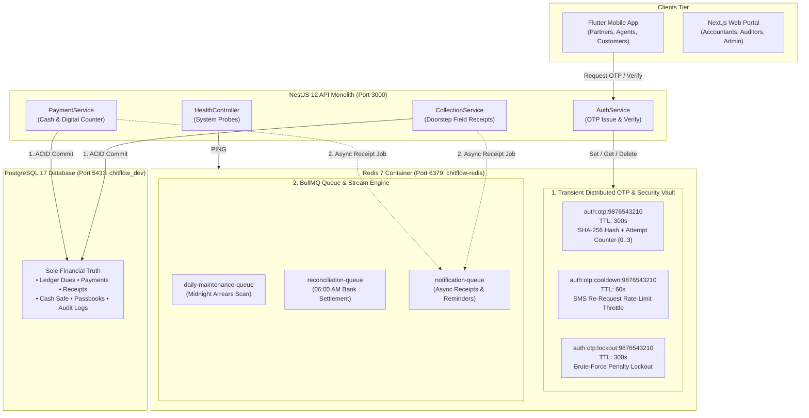

# Kumaran Chits — Redis 7 Architecture & Operational Guide

> **Product**: **Kumaran Chits** (Kumaran Finance, Perundurai, Tamil Nadu)  
> **Role of Redis**: **Distributed Transient State Vault & High-Throughput Job Queue Broker**  
> **Engine**: Redis 7 Alpine (Port `6379` via Docker, container `chitflow-redis`)  
> **Mandatory Architectural Invariant**: **PostgreSQL 17 is the sole source of financial truth.** Redis never stores authoritative financial ledger balances, member savings, or prized payout states.

---

## 1. Quick-Recall Cheat Sheet (30-Second Summary)

If you need to quickly recall what Redis does in Kumaran Chits:

| Feature / Domain | Redis Key / Data Structure | Expiry / TTL | Service Responsible | Purpose & Behavior |
|---|---|---|---|---|
| **SMS OTP Verification** | `auth:otp:<phone>` (`String` - JSON) | `300s` (5 min) | [`AuthService`](file:///u:/Kumaran-finance/apps/api/src/auth/auth.service.ts) | Stores SHA-256 hashed 6-digit OTP code, 3-attempt lockout counter, user/customer metadata. Purged atomically on verify or lockout. |
| **High-Throughput JWT Status** | `user:status:<userId>` (`String`) | `120s` (2 min) | [`JwtStrategy`](file:///u:/Kumaran-finance/apps/api/src/auth/strategies/jwt.strategy.ts), [`UserService`](file:///u:/Kumaran-finance/apps/api/src/user/user.service.ts) | Caches user/customer active status (`ACTIVE` / `INACTIVE`) to prevent DB query storm on every authenticated API request. Evicted immediately on status, role, or password mutation. |
| **Multi-Device Session Vault** | `auth:session:<userId>:<clientType>` (`String`) | `604,800s` (7 days) | [`AuthService`](file:///u:/Kumaran-finance/apps/api/src/auth/auth.service.ts) | Isolates client-specific refresh token bcrypt hashes across `WEB`, `MOBILE`, and `DESKTOP`. Prevents cross-device refresh token revocation traps while maintaining strict RFC 6819 per-client reuse detection with Postgres fallback. |
| **Distributed Rate Limiter** | `throttle:*`<br>`throttle:block:*` | Dynamic (`60s` to `900s`) | [`RedisThrottlerStorage`](file:///u:/Kumaran-finance/apps/api/src/common/throttler/redis-throttler-storage.service.ts) | Atomic Lua hit counter & sliding block windows across containers with IP/User tracking. |
| **Master Reference Data** | `cache:master:branches:*`<br>`cache:master:schemes:*` | `1800s` - `3600s` (30-60 min) | [`BranchService`](file:///u:/Kumaran-finance/apps/api/src/branch/branch.service.ts), [`ChitService`](file:///u:/Kumaran-finance/apps/api/src/chit/chit.service.ts) | Caches static branch lists and chit scheme catalogs with atomic eviction on mutation and Postgres fail-open. |
| **S3 Presigned Document URLs** | `url:presigned:<key>` (`String`) | `600s` (10 min) | [`StorageService`](file:///u:/Kumaran-finance/apps/api/src/storage/storage.service.ts) | Caches generated 15-minute S3 presigned URLs using Redis MGET pipeline with 5-minute safety margin. |
| **BullMQ Jobs & Locks** | `bull:daily-maintenance-queue:*`<br>`bull:reconciliation-queue:*`<br>`bull:notification-queue:*` | Dynamic / Managed | [`BullMqQueueProvider`](file:///u:/Kumaran-finance/apps/api/src/jobs/providers/bullmq-queue.provider.ts) | Redis Streams, Sorted Sets (`zset`), and Hashes powering background tasks and distributed mutex locks. |
| **Repeatable IST Schedulers** | `bull:*:repeat:*` (`zset`) | Standing | [`BullMqQueueProvider`](file:///u:/Kumaran-finance/apps/api/src/jobs/providers/bullmq-queue.provider.ts) | Stores cron schedules for 00:01 AM Arrears, 06:00 AM Reconciliation, and 09:00 AM Pre-Auction Broadcasts in `Asia/Kolkata` timezone. |
| **System Liveness Probe** | `PING` $\to$ `PONG` | N/A | [`HealthController`](file:///u:/Kumaran-finance/apps/api/src/health/health.controller.ts) | Reports real-time Redis ping status at `GET /health`. |
| **Prometheus APM Telemetry** | Scraped via Redis INFO | Real-time | [`MetricsService`](file:///u:/Kumaran-finance/apps/api/src/metrics/metrics.service.ts) | Collects memory usage, connected clients, and queue depths for Prometheus at `GET /metrics`. |

---

## 2. High-Level Architectural Context



---

## 3. Deep-Dive: Distributed OTP Engine (`auth:otp:*`)

Mobile onboarding for both staff (Agents/Partners) and customers relies on a 6-digit SMS OTP. Redis provides distributed, atomic state management to prevent race conditions across server instances:

### 3.1 Redis OTP Key Topology & Schema

| Redis Key | Type | TTL | Purpose | Value Stored |
|---|:---:|:---:|---|---|
| `auth:otp:<phone>` | `string` | 300s | Active OTP session with SHA-256 hashed code | JSON `OtpSessionRecord` (attempts counter, entityId, roles) |
| `auth:otp:cooldown:<phone>` | `string` | 60s | SMS Gateway Flood Throttle | Unix timestamp of issuance |
| `auth:otp:lockout:<phone>` | `string` | 300s | Brute-force penalty lock | Unix timestamp of lockout trigger |
| `auth:session:<userId>:<clientType>` | `string` | 604,800s (7d) | Concurrent client session token isolation | Bcrypt hash of client-scoped refresh token |
| `user:status:<userId>` | `string` | 120s | Fast-path JWT validation cache | `"ACTIVE"` or `"INACTIVE"` status string |
| `throttle:<name>:<key>` | `integer` | Dynamic (e.g. 60s) | Distributed HTTP rate-limiting hit counter | Total request hits in current time window |
| `throttle:block:<name>:<key>` | `string` | Dynamic (blockDuration) | Temporary block flag for abusive clients | `"1"` (active penalty lock) |

Stored at key `auth:otp:<phone>` with an exact `EX 300` TTL:

```typescript
export interface OtpSessionRecord {
  hashedOtp: string;       // 64-character SHA-256 hex digest of the 6-digit code
  expiresAt: number;       // Epoch timestamp (Date.now() + 300,000ms)
  attempts: number;        // Counter tracking invalid verification tries (0..3)
  entityId: string;        // UUID of the User or Customer record in PostgreSQL
  name: string;            // User/Customer full name
  roles: Role[];           // Assigned RBAC roles (e.g. ['COLLECTION_AGENT'] or ['CUSTOMER'])
  branchId: string | null; // Branch UUID (e.g. Head Office Perundurai)
  phone: string;           // 10-digit Indian mobile number
  isCustomer: boolean;     // Discriminator flag for session token generation
}
```

### 3.2 Security Protections Enforced in Redis

1. **SHA-256 One-Way Hash**:
   - The raw 6-digit OTP code is **never** saved in Redis. If the Redis memory dump or monitor is inspected, only the 64-character SHA-256 hash is visible.
2. **60-Second Re-Request Cooldown (`auth:otp:cooldown:<phone>`)**:
   - Upon dispatch of an SMS OTP, `auth:otp:cooldown:<phone>` is set with `EX 60`.
   - Any re-request of `POST /auth/mobile/request-otp` within 60 seconds fails closed with `HTTP 429 Too Many Requests`, returning the remaining cooldown seconds.
   - Zero downstream SMS dispatch, zero gateway fee incurred, protecting Kumaran Finance's paid MSG91 credits.
3. **5-Minute Brute-Force Lockout (`auth:otp:lockout:<phone>`)**:
   - On each failed OTP entry, `record.attempts` increments by 1.
   - On the **3rd consecutive invalid attempt**, Redis immediately sets `auth:otp:lockout:<phone>` with `EX 300` (5 minutes) and purges the active `auth:otp:<phone>` session (`redis.del`).
   - Any subsequent call to `verifyOtp` or `requestOtp` during this window fails closed with `HTTP 429 Too Many Requests`.
4. **Anti-Replay Purge & Atomic Cleanup**:
   - Upon successful verification, `redis.del('auth:otp:<phone>', 'auth:otp:cooldown:<phone>', 'auth:otp:lockout:<phone>')` is invoked immediately. A verified OTP cannot be re-used, and throttle states are reset cleanly.
5. **Seamless In-Memory Fallback**:
   - If Redis is down or starting up, [`AuthService`](file:///u:/Kumaran-finance/apps/api/src/auth/auth.service.ts) falls back to internal `Map` stores (`otpStore`, `cooldownStore`, `lockoutStore`) with identical expiry and attempt rules, ensuring zero downtime and 100% deterministic test execution.

---

## 4. Deep-Dive: Redis as BullMQ Transport

BullMQ utilizes Redis data structures directly:
- **Redis Streams (`stream`) & Hashes (`hash`)**: Store serialized job payloads (e.g., recipient phone, receipt number, formatted amount).
- **Sorted Sets (`zset`)**: Manage delayed jobs and recurring Indian Standard Time (IST) crons via timestamp scores.
- **Atomic Locks (`SET ... NX PX`)**: Ensure that cron jobs (such as the midnight arrears scan) run exactly once across the cluster without duplicate execution.

For detailed BullMQ job payloads and workers, refer to [`docs/03-architecture/bullmq-architecture.md`](bullmq-architecture.md).

---

## 5. Non-Negotiable Guardrails: What Redis DOES NOT Do

To prevent architectural degradation and ensure financial integrity, the following rules are non-negotiable:

| Prohibited Anti-Pattern | Why It Is Strictly Prohibited | Authoritative System |
|---|---|---|
| **Caching Financial Balances** | Redis memory can evict or desynchronize. In a chit fund, passbooks and cash drawers must never display stale balance data. | **PostgreSQL 17** (via ACID transactions & row locking) |
| **Storing Customer/Ticket Records** | Customer KYC, tickets, and scheme states are permanent legal records that require relational integrity and foreign-key cascades. | **PostgreSQL 17** (`public."Customer"`, `public."SubscriberTicket"`) |
| **Authorizing Money Movements** | Background workers or Redis state cannot finalize disbursements or reverse payments independently. | **NestJS RBAC & Maker-Checker Guards** (`maker_user_id != checker_user_id`) |
| **Autonomous Lottery Draws** | Tie-break token draws must happen physically in front of subscribers with paper tokens (Option A). Redis must never generate software lotteries. | **Foreman Branch Physical Draw** |

---

## 6. Infrastructure & Connection Details

### 6.1 Docker Configuration ([`docker-compose.yml`](file:///u:/Kumaran-finance/docker-compose.yml))
```yaml
chitflow-redis:
  image: redis:7-alpine
  container_name: chitflow-redis
  restart: unless-stopped
  ports:
    - '6379:6379'
  volumes:
    - redis_data:/data
  command: redis-server --appendonly yes
  healthcheck:
    test: ['CMD', 'redis-cli', 'ping']
    interval: 10s
    timeout: 5s
    retries: 5
```

### 6.2 NestJS Connection Provider ([`redis-connection.provider.ts`](file:///u:/Kumaran-finance/apps/api/src/jobs/providers/redis-connection.provider.ts))
- **Client**: `ioredis`
- **Settings**:
  - `maxRetriesPerRequest: null` (Mandatory for BullMQ blocking commands)
  - `enableReadyCheck: false`
  - Reconnect strategy: Exponential backoff with a 2,000ms ceiling.
- **Graceful Teardown**: Hooks into `OnModuleDestroy` to call `client.quit()` during zero-downtime rolling deploys.

---

## 7. Verification Proofs (Live Terminal Evidence)

Verified live against Redis 7 on port `6379` during [`verify-lifecycle-1.ts`](file:///u:/Kumaran-finance/apps/api/scripts/verify-lifecycle-1.ts):

### Step 1: Redis Key & Payload Inspection
```bash
$ docker exec chitflow-redis redis-cli GET "auth:otp:9876543210"
{
  "hashedOtp": "70d37e2ab771142dcbe8a297921a6ab902b9fec5f4b5d275deaa2cb2d0cccd01",
  "expiresAt": 1792842183820,
  "attempts": 0,
  "entityId": "ebf67759-bf05-4fa6-b653-577b3f144900",
  "name": "P. Kumaran",
  "roles": ["SUPER_ADMIN"],
  "branchId": "07c70d9d-a8aa-45d3-b34e-15a2dd0cc88c",
  "phone": "9876543210",
  "isCustomer": false
}
```

### Step 2: TTL Expiration Proof
```bash
$ docker exec chitflow-redis redis-cli TTL "auth:otp:9876543210"
(integer) 298
```

### Step 3: Brute-Force Lockout & Atomic Deletion Proof
```bash
# After 3 invalid attempts, 4th attempt rejected:
HTTP/1.1 400 Bad Request
{"statusCode": 400, "message": "Too many invalid verification attempts. Please request a new OTP."}

# Redis key confirmed wiped atomically:
$ docker exec chitflow-redis redis-cli EXISTS "auth:otp:9876543210"
(integer) 0
```
