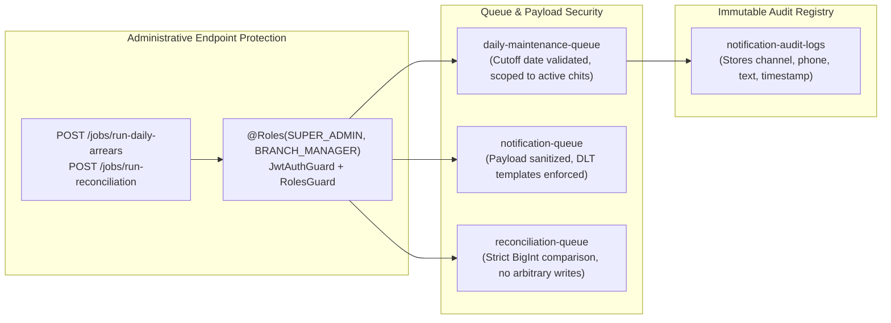
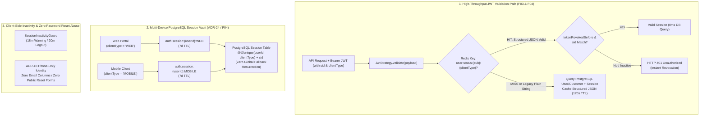

# Kumaran Chits — Security & Access Guardians (OWASP BOLA/IDOR Specification)

> **Product**: **Kumaran Chits** (Kumaran Finance, Perundurai, Erode)  
> **Target Audience**: Core Engineering, Security Auditors, and AI Pair-Programmers  
> **Classification**: Security Architecture Specification (`CONFIRMED-BY-DEVELOPER`)  
> **Mandatory Rule**: Layer 1 Role Guards (`@Roles`) alone are strictly prohibited from granting data access. Every document generation, file stream, and maintenance job must execute Layer 2 Ownership & Branch Scope verification via [`DocumentAccessHelper`](file:///u:/Kumaran-finance/apps/api/src/storage/helpers/document-access.helper.ts).

---

## 1. Threat Model: Eliminating OWASP Top 10 BOLA & IDOR

In multi-user financial platforms, **Broken Object Level Authorization (OWASP API1:2023 / BOLA)** and **Insecure Direct Object References (IDOR)** occur when an endpoint relies solely on role verification:

```mermaid
flowchart TD
    subgraph VULNERABLE_MODEL ["❌ Vulnerable Role-Only Model"]
        A1["Customer A (JWT Role: CUSTOMER)"] -->|GET /pdf/receipt/:id\n(Passes Customer B's Payment ID)| B1["RolesGuard (@Roles: CUSTOMER)"]
        B1 -->|ALLOW: Role matches 'CUSTOMER'| C1["VULNERABILITY:\nCustomer A views Customer B's financial data!"]
    end

    subgraph SECURE_MODEL ["✅ Kumaran Chits Defense-in-Depth Model"]
        A2["Customer A (JWT Role: CUSTOMER)"] -->|GET /pdf/receipt/:id\n(Passes Customer B's Payment ID)| B2["Layer 1: RolesGuard\n(Checks Role: CUSTOMER)"]
        B2 -->|Passes| C2["Layer 2: DocumentAccessHelper\n(Asserts payment.customer.phone === user.phone)"]
        C2 -->|MISMATCH DETECTED| D2["HTTP 403 Forbidden\nAccess Denied: You can only download your own receipts"]
    end
```

To eliminate this vulnerability across all 6 personas, Kumaran Chits enforces a **Defense-in-Depth Security Architecture**:
1. **Transport & Perimeter Layer**: Helmet security headers and strictly configured Cross-Origin Resource Sharing (CORS).
2. **Layer 1: Coarse-Grained RBAC** (`JwtAuthGuard`, `RolesGuard`, `@Roles(...)`): Verifies authentication validity and coarse functional permissions.
3. **Layer 2: Fine-Grained ABAC & Ownership Validation** (`DocumentAccessHelper`): Validates runtime object ownership, branch scoping, and relationship context before streaming or generating any byte of data.

### 1.1 Perimeter Defense: Transport & Cross-Origin Resource Sharing (CORS)

At the perimeter, [`apps/api/src/main.ts`](file:///u:/Kumaran-finance/apps/api/src/main.ts) enforces strict cross-origin policies:
- **Origin Whitelisting (`CORS_ALLOWED_ORIGINS`)**: Dynamic comma-separated origin configuration (`process.env.CORS_ALLOWED_ORIGINS` / `CORS_ORIGINS`). Defaults to local development endpoints (`http://localhost:3000`, `http://localhost:3001`). In staging and production environments, wildcards (`*`) are prohibited; only verified administrative and partner domains are permitted.
- **Native & Non-Browser Client Exemption**: Mobile apps (Flutter Android/iOS) and internal background jobs make requests with `origin: undefined`. These requests are permitted through while enforcing strict Bearer JWT and API signature verification.
- **Allowed Headers & Methods**: Restricts cross-origin HTTP methods strictly to `GET`, `POST`, `PUT`, `PATCH`, `DELETE`, `OPTIONS`. Permitted headers include `Content-Type`, `Authorization`, `X-Branch-Id`, `Idempotency-Key`, and `X-Request-Id`.
- **Security Headers (Helmet)**: Sets standard OWASP headers including `X-Frame-Options: SAMEORIGIN` (prevents clickjacking while allowing in-app PDF iframes), while disabling CDN-breaking content security restrictions on Swagger API documentation routes.

### 1.2 Ingress Rate Limiting & Abuse Prevention (OWASP API4:2023 Defense)

To protect system resources and eliminate Denial of Service (DoS) attack vectors:
- **Nginx Ingress Edge**: Limits requests at the reverse proxy (`limit_req_zone`: 30 req/s general, 3 req/s auth).
- **NAT-Safe AppThrottlerGuard**: Tracks authenticated calls by `usr_<userId>` (preventing shared broadband IP lockout for Perundurai branch office staff) and public calls by `ip:<client_ip>`.
- **Distributed Redis Storage**: Powered by atomic Redis Lua scripts (`throttle:*`) with seamless in-memory fallback.
- **Granular Route Limits**: Specialized throttles on PDF compilation (15/min), KYC uploads (5/min), UPI claims (5/15m), and 2FA disabling (5/15m).
- *Full Architectural Specification*: See [`docs/03-architecture/rate-limiting-and-abuse-prevention.md`](rate-limiting-and-abuse-prevention.md).

---

## 2. Component 1: Encrypted Storage Access Guardians

### 2.1 Storage Key Prefix Categories
All files stored locally or in private S3 storage (Cloudflare R2 / MinIO) adhere to strict directory namespaces:
- `kyc/{customerId}/*`: Sensitive identity scans (Aadhaar, PAN, Photo, Signature).
- `safety-proof/{auctionId}/*`: Company collateral (signed agreements, promissory notes, blank cheques).
- `minutes/{chitGroupId}/*`: Statutory Form XVII auction minutes.
- `receipts/{branchCode}/{year}/*`: Bilingual A5 subscription digital receipts.
- `vouchers/{branchCode}/{year}/*`: Bilingual A5 prize payout vouchers.
- `passbooks/{chitGroupId}/*`: Form XXI continuous 20-month member passbook statements.

### 2.2 Path-Traversal Safeguards (`StorageKeyHelper`)
Before resolving any storage key, [`StorageKeyHelper.sanitizeKey()`](file:///u:/Kumaran-finance/apps/api/src/storage/helpers/storage-key.helper.ts) executes sanitization:
- Strips directory traversal vectors (`..`, `../`, `..\`).
- Normalizes backslashes to forward slashes.
- Trims leading slashes and whitespace.
- Prevents escaping the `./storage/uploads` root sandbox or accessing foreign S3 buckets.

### 2.3 Storage Key Ownership Rules (`assertStorageKeyAccess`)
At [`StorageController.streamFile()`](file:///u:/Kumaran-finance/apps/api/src/storage/storage.controller.ts#L254-L322), requests pass directly through `DocumentAccessHelper.assertStorageKeyAccess(sanitizedKey, currentUser, this.prisma)`. Strict **Default-Deny** rejects any prefix outside `APPROVED_PREFIXES` (`kyc/`, `passbooks/`, `minutes/`, `safety-proof/`, `safety-proofs/`, `receipts/`, `vouchers/`):

| Key Category (Raw `/storage/file/*key`) | Customer | Collection Agent | Branch Manager | Accountant | Auditor | Super Admin |
|---|:---:|:---:|:---:|:---:|:---:|:---:|
| `kyc/{customerId}/*` | **Own folder only** (`sub` or `phone` match) | ❌ **Blocked (HTTP 403)** | Branch scope | Global | Global | Global |
| `safety-proof/*` / `safety-proofs/*` | ❌ **Blocked (HTTP 403)** | ❌ **Blocked (HTTP 403)** | Branch scope | Global | Global | Global |
| `minutes/*` | ❌ **Blocked (HTTP 403)** | ❌ **Blocked (HTTP 403)** | Branch scope | Global | Global | Global |
| `receipts/*` | ❌ **Blocked (HTTP 403)** *(use `/pdf/receipt/:paymentId`)* | ❌ **Blocked (HTTP 403)** *(use `/pdf/receipt/:paymentId`)* | Branch scope | Global | Global | Global |
| `vouchers/*` | ❌ **Blocked (HTTP 403)** *(use `/pdf/voucher/:auctionId`)* | ❌ **Blocked (HTTP 403)** | Branch scope | Global | Global | Global |
| `passbooks/*` | **Own ticket only** (`chitGroupId` + `ticketNumber` + `customerId` match) | ❌ **Blocked (HTTP 403)** | Branch scope | Global | Global | Global |

### 2.4 Customer KYC Document Upload & 15-Minute Presigned Viewing URLs
Direct document interactions at [`CustomerController`](file:///u:/Kumaran-finance/apps/api/src/customer/customer.controller.ts) enforce anti-IDOR checks:
- **Upload (`POST /api/v1/customers/:id/documents`)**:
  - Staff (`SUPER_ADMIN`, `BRANCH_MANAGER`, `ACCOUNTANT`, `COLLECTION_AGENT`) can upload identity scans during in-office or doorstep intake.
  - Subscribers (`CUSTOMER`) can upload identity scans **strictly for their own account** (`currentUser.sub === customerId`). Attempting to upload to a third-party `customerId` throws `403 Forbidden`.
  - File restrictions: Allowed MIME types (`image/jpeg`, `image/png`, `image/webp`, `application/pdf`), maximum size 10 MB, and path-sanitized key generation (`kyc/{customerId}/{docType}-{uuid}.{ext}`).
- **Presigned Viewing URL (`GET /api/v1/customers/:id/documents/:docId/url`)**:
  - Direct S3 bucket access is completely blocked to the public (private S3 bucket).
  - Time-limited presigned URL generated with strict 900-second (15-minute) TTL.
  - Field collection agents are blocked (`403 Forbidden`) from viewing customer KYC documents per DPDP Act 2023 least-privilege principles.
  - Subscribers (`CUSTOMER`) are restricted strictly to viewing their own documents (`currentUser.sub === customerId`).

---

## 3. Component 2: Bilingual PDF Canvas Access Guardians

Each of the 4 PDF canvas endpoints at [`PdfController`](file:///u:/Kumaran-finance/apps/api/src/pdf/pdf.controller.ts) extracts the authenticated user (`@CurrentUser() currentUser: JwtPayload`) and enforces object-level assertions in [`PdfService`](file:///u:/Kumaran-finance/apps/api/src/pdf/pdf.service.ts):

### 3.1 Subscription Receipts (`GET /pdf/receipt/:paymentId`)
- **Assertion**: [`DocumentAccessHelper.assertReceiptAccess(payment, user)`](file:///u:/Kumaran-finance/apps/api/src/storage/helpers/document-access.helper.ts#L9-L62)
- **Rules**:
  1. `CUSTOMER`: Must match `payment.allocations[0].ticket.customer.phone === user.phone`. Attempting to pass another subscriber's `paymentId` immediately throws `403 Forbidden`.
  2. `COLLECTION_AGENT`: Must match `payment.recordedByUserId === user.sub`. Field agents can only download receipts for cash collections they personally recorded.
  3. `BRANCH_MANAGER`: Must match `payment.branchId === user.branchId`. Cross-branch receipt snooping is blocked.
  4. `SUPER_ADMIN`, `ACCOUNTANT`, `AUDITOR`: Granted global oversight for accounting and statutory audits.

### 3.2 Prize Payout Vouchers (`GET /pdf/voucher/:auctionId`)
- **Assertion**: [`DocumentAccessHelper.assertVoucherAccess(winner, user)`](file:///u:/Kumaran-finance/apps/api/src/storage/helpers/document-access.helper.ts#L67-L115)
- **Rules**:
  1. `COLLECTION_AGENT`: **Strictly blocked across the board (HTTP 403)**. Field collection staff have zero operational involvement in prize money disbursements.
  2. `CUSTOMER`: Only the winning subscriber whose phone matches `winner.ticket.customer.phone === user.phone` may download the voucher.
  3. `BRANCH_MANAGER`: Scoped strictly to auctions belonging to their assigned branch.
  4. `SUPER_ADMIN`, `ACCOUNTANT`, `AUDITOR`: Authorized to verify dual-control signatures and voucher numbers.

### 3.3 Form XVII Statutory Minutes (`GET /pdf/minutes/:auctionId`)
- **Assertion**: [`DocumentAccessHelper.assertMinutesAccess(auction, user)`](file:///u:/Kumaran-finance/apps/api/src/storage/helpers/document-access.helper.ts#L120-L162)
- **Rules**:
  1. `CUSTOMER`: **Strictly blocked (HTTP 403)**. Form XVII auction minutes are internal company legal records for filing with the Chit Registrar.
  2. `COLLECTION_AGENT`: **Strictly blocked (HTTP 403)**.
  3. `BRANCH_MANAGER`: Branch-scoped.
  4. `SUPER_ADMIN`, `ACCOUNTANT`, `AUDITOR`: Authorized for statutory filing and review.

### 3.4 Form XXI 20-Month Passbook (`GET /pdf/passbook/:ticketId`)
- **Assertion**: [`DocumentAccessHelper.assertPassbookAccess(ticket, user)`](file:///u:/Kumaran-finance/apps/api/src/storage/helpers/document-access.helper.ts#L167-L215)
- **Rules**:
  1. `COLLECTION_AGENT`: **Strictly blocked (HTTP 403)**. Field agents view assigned daily dues via mobile app; full continuous historical passbooks are restricted.
  2. `CUSTOMER`: Restricted strictly to their own subscription ticket (`ticket.customer.phone === user.phone`).
  3. `BRANCH_MANAGER`: Branch-scoped.
  4. `SUPER_ADMIN`, `ACCOUNTANT`, `AUDITOR`: Authorized.

---

## 4. Component 3: BullMQ Background Queue & Worker Security

Background jobs decouple synchronous API requests from long-running tasks. Security guardians ensure queues cannot be poisoned or abused:



### 4.1 Administrative Route Restrictions ([`JobsController`](file:///u:/Kumaran-finance/apps/api/src/jobs/jobs.controller.ts))
- **Trigger Endpoints**:
  - `POST /jobs/run-daily-arrears` & `POST /jobs/run-pre-auction-scan`: Restricted strictly to `SUPER_ADMIN` and `BRANCH_MANAGER`. Customers, accountants, auditors, and collection agents receive `403 Forbidden`.
  - `POST /jobs/enqueue-daily-arrears`: Restricted strictly to `SUPER_ADMIN` only (`jobs.controller.ts:94-95`).
  - `POST /jobs/run-reconciliation` & `POST /jobs/enqueue-reconciliation`: Restricted strictly to `SUPER_ADMIN` and `ACCOUNTANT`.
  - `POST /jobs/send-auction-reminder/:chitGroupId/:month`: Restricted to `SUPER_ADMIN` and `BRANCH_MANAGER` (enforces `assertAuctionBranchAccess` + `ACTIVE` scheme + Months `2..N-1`).
- **Health & Audit Endpoints (Guardrail 11 — `SUPER_ADMIN` Strictly)**:
  - `GET /jobs/queue-status`: Restricted strictly to `SUPER_ADMIN` only (`403 Forbidden` to all other roles including `AUDITOR`).
  - `GET /jobs/notification-audit-logs`: Restricted strictly to `SUPER_ADMIN` only.
  - `GET /jobs/repeatable-schedules`: Restricted strictly to `SUPER_ADMIN` only.

### 4.2 Queue Isolation & Mathematical Precision
- **Whole Rupee Invariant in Redis**: Redis message payloads serialize monetary amounts as strings (`amountPaid: '3750'`) to prevent IEEE 754 floating-point conversion leaks during JSON serialization.
- **State Machine Guard**: `DailyArrearsService` updates `consecutiveUnpaidMonths` based strictly on sequential `InstallmentDue` records in PostgreSQL. Tickets with 3+ consecutive unpaid months are tagged `DEFAULT_3_MONTHS` per ADR-07 and emitted warning notices.

---

## 5. Master 6-Persona Security Matrix (Components 1, 2, and 3)

| Component / Resource | Super Admin | Branch Manager | Accountant | Collection Agent | Customer | Auditor |
|---|:---:|:---:|:---:|:---:|:---:|:---:|
| **Component 1: KYC Scans** | Global | Branch | Verification | ❌ Blocked | Own docs | Read-only |
| **Component 1: Safety Proof Scans** | Global | Branch | Global | ❌ Blocked | ❌ Blocked | Read-only |
| **Component 2: Receipt PDF** | Global | Branch | Global | Own recorded | Own receipt | Read-only |
| **Component 2: Payout Voucher PDF** | Global | Branch | Global | ❌ Blocked | Winner only | Read-only |
| **Component 2: Form XVII Minutes PDF** | Global | Branch | Global | ❌ Blocked | ❌ Blocked | Read-only |
| **Component 2: Form XXI Passbook PDF**| Global | Branch | Global | ❌ Blocked | Own ticket | Read-only |
| **Component 3: Trigger Daily Arrears** | Run & Enqueue | Run only | ❌ Blocked | ❌ Blocked | ❌ Blocked | ❌ Blocked |
| **Component 3: Trigger Reconciliation** | Run & Enqueue | ❌ Blocked | Run & Enqueue | ❌ Blocked | ❌ Blocked | ❌ Blocked |
| **Component 3: Queue Health & Logs** | Full | ❌ Blocked | ❌ Blocked | ❌ Blocked | ❌ Blocked | ❌ Blocked |

---

## 6. Automated Test Coverage & Verification Proofs

Every rule documented above is backed by automated negative and positive test assertions:

1. **[`apps/api/test/unit/pdf.spec.ts`](file:///u:/Kumaran-finance/apps/api/test/unit/pdf.spec.ts)**:
   - Section 4: Customer downloading own receipt (`PASS`), Customer downloading another customer receipt throws `ForbiddenException` (`PASS`), Agent downloading own collection (`PASS`), Agent downloading another agent's collection throws `ForbiddenException` (`PASS`), Branch Manager cross-branch receipt throws `ForbiddenException` (`PASS`).
   - Section 5: Winner customer accessing voucher (`PASS`), Non-winner customer throws `ForbiddenException` (`PASS`), Field agent accessing voucher throws `ForbiddenException` (`PASS`).
   - Section 6: Branch Manager accessing minutes (`PASS`), Customer accessing minutes throws `ForbiddenException` (`PASS`), Field agent accessing minutes throws `ForbiddenException` (`PASS`).
   - Section 7: Customer accessing own passbook (`PASS`), Customer accessing another passbook throws `ForbiddenException` (`PASS`), Field agent accessing passbook throws `ForbiddenException` (`PASS`).
   - Section 8: Direct storage key access rules (`PASS` across all personas).
2. **[`apps/api/test/unit/jobs.spec.ts`](file:///u:/Kumaran-finance/apps/api/test/unit/jobs.spec.ts)**:
   - Section 1: Daily arrears state machine and 3-month default tagging with warning notification (`PASS`).
   - Section 2: Smart Notification Router (Push-first for app users, DLT SMS fallback for keypad phones across payments, auctions, dividends, and defaults) verification (`PASS`).
   - Section 3: 06:00 AM settlement reconciliation, ghost drop auto-resolution, and discrepancy flagging (`PASS`).
   - Section 4: BullMQ queue health and administrative controller endpoint execution (`PASS`).
3. **[`apps/api/test/unit/auth-token-lifecycle.spec.ts`](file:///u:/Kumaran-finance/apps/api/test/unit/auth-token-lifecycle.spec.ts)**:
   - Section 1-7: Token issuance, rotation, logout, phone mutation revocation, and RFC 6819 reuse trap (`PASS`).
   - Section 8: High-throughput JWT validation caching (120s TTL) and proactive cache eviction on status mutation (`PASS`).
   - Section 9: Multi-device concurrent session isolation (`WEB` + `MOBILE`) without cross-device refresh collision (`PASS`).
4. **[`apps/web/test/session-inactivity-guard.spec.ts`](file:///u:/Kumaran-finance/apps/web/test/session-inactivity-guard.spec.ts)**:
   - 20-minute inactivity auto-logout math, 18-minute warning modal display, and countdown reset (`PASS`).

---

## 7. Component 4: Authentication & Session Management Guardians



### 7.1 High-Throughput JWT Validation Caching (120s TTL)
- **Problem Solved**: On every authenticated HTTP request, NestJS `JwtStrategy` previously queried PostgreSQL (`findUnique({ id })`) to verify `isActive`. Under heavy traffic (500+ concurrent requests), this caused connection pool saturation on PostgreSQL.
- **Implementation**: `JwtStrategy` checks the family-scoped Redis key `user:status:${payload.sub}:${payload.clientType}`. Structured entries contain active status, roles, partner identity, global revocation cutoff, and session ID. Legacy plain `ACTIVE` entries are cache misses. Revocation cutoffs and session identity are checked before accepting a structured entry.
  - On a cache miss, PostgreSQL account/session state is checked and authorization is cached for **120 seconds** (`EX 120`).
- **Proactive Invalidation**: Administrative password resets, role changes, deactivation, and reactivation clear the legacy key and all WEB/MOBILE/DESKTOP authorization keys. A replacement login clears only its family's authorization entry plus the legacy key, preserving other families.

### 7.2 Multi-Device Concurrent Session Isolation & Durable Revocation (F02 & F04)
- **Problem Solved**: Kumaran Finance partners and field agents frequently use both the **Web Portal** (for accounting, schemes, and minutes) and the **Android Mobile App** (for collections, receipts, and OTP approvals). Storing a single `refreshTokenHash` on the database row caused logging in on mobile to overwrite web's token hash. When web attempted its 15-minute background refresh, it failed the hash check, triggering the RFC 6819 token reuse trap and locking the user out of both devices. Furthermore, relying solely on Redis in-memory cutoffs allowed revoked sessions to resurrect if Redis restarted or after 15 minutes.
- **Implementation**:
  - Refresh token families are isolated per device type via Redis key `auth:session:${userId}:${clientType}` (where `clientType` is `'WEB'`, `'MOBILE'`, or `'DESKTOP'`) with a 7-day TTL (`604,800s`).
  - Durable PostgreSQL Session Vault: A dedicated `Session` table stores `(userId, clientType)` and `(customerId, clientType)` with unique constraints, ensuring each client device family maintains its own persistent hash.
  - A login issues a new session ID and uses the same millisecond timestamp for token issuance and session creation. Refresh rotates token hashes while preserving that session ID and creation timestamp, so existing unexpired access tokens remain valid within the same session.
  - Refresh persists its new hash with a conditional update matching the existing session ID, previous hash, and non-revoked state. If logout or replacement login wins the race, refresh rejects instead of recreating or reactivating the old session. Redis token hashes are published after PostgreSQL persistence succeeds.
  - Durable Revocation Anchor: `tokenRevokedBefore DateTime?` on `User` and `Customer` tables provides an authoritative cutoff checked on every token validation, guaranteeing zero session resurrection even on cold Redis or cluster restarts.
- **RFC 6819 Token Reuse Defense**:
  - Rotating a token on Web updates only `auth:session:${userId}:WEB` and its corresponding `Session` record, leaving Mobile completely unaffected.
  - If a replayed/stolen refresh token is detected on Web, **only the Web session family is revoked**, leaving the partner's Mobile collection session active.
  - Token refresh strictly binds to the signed token's embedded `clientType`, rejecting client-family mismatches.

### 7.3 Architectural Immunity Against Password-Reset Abuse & Default Credential Elimination (F16)
- **Attack Vector Inapplicable**: In generic SaaS applications, public password-reset endpoints (`/auth/forgot-password`) suffer from email enumeration, account lockout DoS, and token brute-forcing.
- **Kumaran Chits Architecture**:
  1. **Strict Phone-Only Identity (ADR-18)**: Built exclusively for Kumaran Finance. Zero email columns exist in PostgreSQL.
  2. **No Public Password Reset Form**: Subscribers and agents authenticate strictly via MSG91 6-digit SMS OTP (`/auth/mobile/request-otp` and `/auth/mobile/verify-otp`) protected by 60s cooldowns and 5-minute brute-force lockouts.
  3. **Super Admin Dual-Control Reset**: If an office staff member forgets their password, a Super Admin performs an emergency reset via [`UserService.resetPassword()`](file:///u:/Kumaran-finance/apps/api/src/user/user.service.ts), which sets a random temporary password, marks `mustChangePassword = true`, stamps `tokenRevokedBefore`, and revokes active sessions across PostgreSQL and Redis.
  4. **Elimination of Shared Default Credentials (F16)**: Creating a staff user without a password generates a unique cryptographically random temporary password with `mustChangePassword = true`. Authenticating with temporary credentials issues an `onboarding_restricted` token (rejected for business routes) requiring `POST /auth/complete-onboarding` to establish permanent credentials.

### 7.4 Client-Side 20-Minute Inactivity Guardian
- **Implementation**: [`SessionInactivityGuard`](file:///u:/Kumaran-finance/apps/web/src/components/security/session-inactivity-guard.tsx) tracks user interactions (`mousemove`, `mousedown`, `keydown`, `scroll`, `touchstart`) with a 500ms throttle.
- **18-Minute Warning**: Displays a non-intrusive warning modal showing a live 120-second countdown with an "I'm Still Here" button.
- **20-Minute Hard Logout**: Automatically purges client state and redirects to `/login?reason=timeout`.
- **Multi-Tab Sync**: Synchronized via `localStorage` storage events and broadcast channels so active work in one tab keeps all tabs alive.

### 7.5 XSS Token Exfiltration Immunity via BFF & HttpOnly Cookies (ADR-20)
- **Elimination of Client-Side Token Storage**: Storing JWT access, refresh, or intermediate 2FA challenge tokens (`tempToken`) in browser `localStorage` or `sessionStorage` has been completely eliminated. `localStorage.getItem('kc_access_token')` and `sessionStorage.getItem('kc_temp_token')` return `null`.
- **HttpOnly Cookie Enclosure**:
  - `kc_access_token` (15-minute TTL) and `kc_refresh_token` (7-day TTL) are issued with `HttpOnly; SameSite=Lax; Path=/` and protocol-aware `Secure` (`COOKIE_SECURE` env or HTTPS / `X-Forwarded-Proto: https`).
  - During staff 2FA login (`DEF-FE-08`), the intermediate 5-minute HS256 challenge JWT (`tokenType: 'totp_pending'`) is likewise enclosed exclusively inside the `HttpOnly; SameSite=Lax; Path=/` cookie `kc_totp_pending_token` (300s TTL) and omitted from `/api/auth/login` response JSON. `/api/auth/verify-totp` extracts it solely from that cookie (ignoring client body fields), keeps it intact across mistyped 6-digit code retries, and expires it cleanly on verification success, expired/invalid pending JWTs, or Back-to-Login cancellation (`/api/auth/logout`). Edge Middleware ([`edge-auth.ts`](file:///u:/Kumaran-finance/apps/web/src/lib/edge-auth.ts)) cryptographically validates `kc_totp_pending_token` (`tokenType === 'totp_pending'`) prior to rendering `/2fa`, while `/api/auth/session` returns only a non-secret `pendingTotp: boolean` flag for reload recovery.
  - Browser JavaScript (`document.cookie`) has zero programmatic access to these cookies, guaranteeing complete immunity against token exfiltration via XSS or compromised npm dependencies.
- **Edge Navigation Guarding (0ms FOUC Elimination)**:
  - [`apps/web/src/middleware.ts`](file:///u:/Kumaran-finance/apps/web/src/middleware.ts) delegates to [`evaluateEdgeAuth`](file:///u:/Kumaran-finance/apps/web/src/lib/edge-auth.ts) at the Edge prior to page rendering (bypassing `/_next`, `/api`, `/bff`, static file extensions; enforcing Edge auth across all `(dashboard)/*` and `/print/*` routes). Edge Middleware verifies `kc_access_token` (`tokenType === 'access'`) and expiry fallback `kc_refresh_token` (`tokenType === 'refresh'`) cryptographically via Web Crypto (`jose.jwtVerify` HS256 with shared `JWT_SECRET`), ignores spoofable client `kc_session_active` flags, fails closed if `JWT_SECRET` is unset, sanitizes open redirects, and enforces canonical RBAC route gates from [`route-permissions.ts`](file:///u:/Kumaran-finance/apps/web/src/lib/route-permissions.ts).
  - Any request targeting `/(dashboard)/*` or `/print/*` without valid cryptographically verified JWT session cookies is immediately redirected to `/login?redirect=...` (clearing stale cookies symmetrically via `shouldUseSecureCookies`), while authenticated users lacking route permissions redirect safely to `/?error=forbidden` (or `/login?error=forbidden` for non-staff roles like `CUSTOMER` to prevent redirect loops).
- **Transparent Server-Side API Proxy, Unbuffered SSE & Coalesced Silent Token Rotation (DEF-FE-01 & DEF-FE-02 Fixed)**:
  - Web client requests target the isolated Next.js BFF prefix (`/bff/api/v1/*`), separating cookie-authenticated browser traffic from Bearer-authenticated Mobile `/api/v1/*` ingress in Nginx.
  - The shared Next.js BFF proxy ([`bff-api-proxy.ts`](file:///u:/Kumaran-finance/apps/web/src/lib/bff-api-proxy.ts), mounted at [`/bff/api/v1/[...path]/route.ts`](file:///u:/Kumaran-finance/apps/web/src/app/bff/api/v1/[...path]/route.ts)) reads `kc_access_token` (or proactively refreshes if expired while `kc_refresh_token` exists), injects `Authorization: Bearer <token>`, forwards `text/event-stream` SSE responses without buffering (`arrayBuffer` bypass, `X-Accel-Buffering: no`, and abort propagation), and mirrors `SameSite`/`Secure` flags across `/bff` and [`/api/auth/session`](file:///u:/Kumaran-finance/apps/web/src/app/api/auth/session/route.ts) when clearing expired cookies.
  - [`useApprovalsStream`](file:///u:/Kumaran-finance/apps/web/src/hooks/use-approvals-stream.ts) connects directly to `/bff/api/v1/reports/approvals-stream` using `credentials: 'same-origin'` HttpOnly cookies (no `getStoredAccessToken()` early-return) and halts reconnect loops if a 401 re-hydration confirms the session ended.
  - Concurrent 401 bursts across `/api/v1/*`, `/api/auth/session`, and `/api/auth/logout` are deduplicated via [`bff-token-refresh.ts`](file:///u:/Kumaran-finance/apps/web/src/lib/bff-token-refresh.ts) (SHA-256 in-flight promise coalescing + 2s cookie-handoff micro-cache purged immediately on logout), paired with contention-scoped distributed Redis lock coalescing in [`AuthService.refreshToken`](file:///u:/Kumaran-finance/apps/api/src/auth/auth.service.ts).
  - [`apps/web/src/lib/bff-forward-headers.ts`](file:///u:/Kumaran-finance/apps/web/src/lib/bff-forward-headers.ts) (`buildBffForwardHeaders`) preserves `X-Forwarded-For`, `X-Real-IP`, `X-Forwarded-Proto`, `X-Forwarded-Host`, `User-Agent`, and `X-Request-ID` across all 6 Next.js BFF → NestJS callers (`/bff/api/v1/*`, `/api/v1/*`, `/api/auth/login`, `/api/auth/verify-totp`, `/api/auth/logout`, `/api/auth/session`, and `executeBffRefresh`). On the API side, Express binds `TRUST_PROXY` (`parseTrustProxySetting`, defaulting to `['loopback', 'linklocal', 'uniquelocal']`) so both 1-hop (`Mobile -> Nginx -> API`) and 2-hop (`Browser -> Nginx -> BFF -> API`) chains resolve the real public client IP while ignoring left-injected spoofed `X-Forwarded-For` headers (`DEF-FE-06`).
  - Sequential token replays continue to trigger immediate RFC 6819 session family revocation, while permanent 401 expiry clears dead browser cookies cleanly to avoid redirect loops.

### 7.6 Verified Partner Identity & Two-Partner Dual Control (SEC-A, SEC-B, ADR-21, ADR-27 & `KFC-SEC-001..004`)
- **Problem Solved**: Previously, administrative IT Super Admin and business partners were co-mingled under `Role.SUPER_ADMIN` with a secondary boolean `isPartner`. This created cognitive ambiguity in staff administration and route permissions.
- **SEC-A & ADR-27 Implementation**: Elevated `Role.PARTNER` to a first-class enum role and completely removed the legacy `isPartner` boolean column across PostgreSQL 17, Prisma ORM, and DTOs. High-liability financial mutations strictly verify `user.roles.includes(Role.PARTNER)`. Administrative IT accounts (`Role.SUPER_ADMIN`) are strictly barred from financial authorizations and chit operations.
- **Strict Partner Exclusivity Controls**:
  - **`KFC-SEC-001` (Payment Reversal Initiation)**: `POST /payments/:id/request-reversal` is restricted strictly to `@Roles(Role.PARTNER)` (`payment.controller.ts:222`). `ACCOUNTANT`, `BRANCH_MANAGER`, and `SUPER_ADMIN` receive `403 Forbidden`.
  - **`KFC-SEC-003` (Auction Finalization)**: `POST /auctions/:id/finalize` is restricted strictly to `@Roles(Role.PARTNER)`; `BRANCH_MANAGER` and `SUPER_ADMIN` are strictly blocked (`403 Forbidden`).
  - **`KFC-SEC-004` (Prized Ticket Immutability)**: `InstallmentService` blocks defaulter removal and subscriber substitution on any prized ticket (`isPrized: true`) with `400 Bad Request` (`PRIZED_TICKET_IMMUTABLE`).
- **SEC-B Two-Partner Defaulter Removal Dual Control**:
  1. **Maker Request**: Partner A initiates removal (`POST /tickets/:id/remove-defaulter/request`), placing ticket in `PENDING_REMOVAL_APPROVAL` and barring it from auction bids (`removalRequestedByUserId != null`).
  2. **Checker Resolution**: Independent Partner B either approves (`POST /tickets/:id/remove-defaulter/approve`) or rejects (`POST /tickets/:id/remove-defaulter/reject`, reverting status to `DEFAULT_3_MONTHS`).
  3. **Hard Guard**: Both service logic and PostgreSQL `CHECK` constraint `chk_ticket_removal_maker_checker` (`20261117170000`) enforce `ticket.removalRequestedByUserId !== approvingPartnerUserId` (`maker != checker`), rejecting self-approvals with `HTTP 403 Forbidden` / SQLSTATE `23514`.
  4. **Exit Settlement Fail-Closed**: Under Q25, financial exit settlement calculation fails closed with `HTTP 400 UNAPPROVED_SETTLEMENT_POLICY` until the exact statutory damages formula is confirmed in writing by the business owner.

### 7.7 Month N Maturity Settlement Dual-Control & Database Check Constraints (F05, F12 & `CR-DISB-02/05`)
- **Problem Solved**: Month N maturity payouts previously relied on a single-stage execution where the caller was simultaneously recorded as Maker and Checker. Furthermore, migrations lacked database-level check constraints enforcing `maker_user_id != checker_user_id`.
- **Implementation**:
  1. **Two-Stage Settlement Lifecycle (`requirePreparedSettlement: true`, `CR-DISB-02`)**:
     - **Stage 1 (Maker Preparation)**: `POST /disbursements/group/:id/prepare-final-settlement` (Roles: `SUPER_ADMIN`, `BRANCH_MANAGER`, `ACCOUNTANT`). Calculates Month N arrears, base installment deduction, 4.00% commission, and net prize payable. Creates pending settlement record with `conductedByUserId = makerUserId` and winner `disbursementStatus = 'VERIFIED_BY_MAKER'`.
     - **Stage 2 (Checker Approval)**: `POST /disbursements/group/:id/approve-final-settlement` (Roles: `PARTNER`, `ADR-27`). All HTTP settlement paths pass `requirePreparedSettlement: true`, reading authoritative Maker identity from the prepared record, re-verifying live arrears (`ARREARS_STATE_CHANGED` on drift), enforcing **`maker_user_id != checker_user_id`** (`HTTP 403 MAKER_CHECKER_VIOLATION`), and committing payout, Month N auction `COMPLETED`, winner `DISBURSED`, ticket `isPrized = true`, and scheme `COMPLETED`.
  2. **All 8 Live PostgreSQL 17 Engine-Level `CHECK` Constraints + Case-Insensitive UTR Index**:
     - Deployed across migrations `20261115060000`, `20261117170000`, `20261118110000`, and `20261118124500`:
       1. `chk_payment_cash_handover_maker_checker`: `recordedByUserId != cashHandoverAcknowledgedByUserId`.
       2. `chk_auction_maker_checker`: State-aware `conductedByUserId <> finalizedByUserId` across **both** `COMPLETED` and `MINUTES_FILED` states (Month 1 company pool & `isHistoricalEntry = true` exempt).
       3. `chk_auction_non_negative_amounts`: All 5 auction BigInt monetary snapshots `>= 0`.
       4. `chk_auction_minutes_attendees`: `subscribersPresent >= 1`.
       5. `chk_winner_maker_checker`: State-aware Maker presence on `VERIFIED_BY_MAKER` and `verifiedByUserId <> authorizedByUserId` across **both** `AUTHORIZED_BY_CHECKER` and `DISBURSED` (ternary NULL-trap protected).
       6. `chk_winner_positive_disbursed_amount`: `disbursedAmount IS NULL OR disbursedAmount > 0`.
       7. `chk_reversal_maker_checker`: `initiatedByUserId != approvedByUserId` on `APPROVED` reversals.
       8. `chk_ticket_removal_maker_checker`: `removalRequestedByUserId != removedByUserId` on `SubscriberTicket`.
       9. `uq_auction_winner_non_cash_payment_ref` *(Partial Unique Index)*: `UNIQUE (UPPER(BTRIM("paymentReference")))` across all live `DISBURSED` Cheque/NEFT/RTGS/IMPS payouts (`CR-DISB-05`).
     - Even if an application bug or maintenance script attempts a self-approval or duplicate UTR, PostgreSQL rejects the mutation at the database engine level with SQLSTATE `23514` / `23505`.

### 7.8 Passbook Ownership, Customer Scoping & Domain Branch Derivation (F06, F07, F08, F09)
- **F06 (Storage Guardians & Passbook Ownership)**:
  - `DocumentAccessHelper.assertStorageKeyAccess` explicitly parses `passbooks/{chitGroupId}/ticket-{ticketNumber}.pdf` keys. Customers are restricted strictly to tickets they own in PostgreSQL (`where: { chitGroupId, ticketNumber, customerId: user.sub }`).
  - Branch Managers accessing `passbooks/`, `kyc/`, `minutes/`, `safety-proof/`, `receipts/`, or `vouchers/` must match the branch assigned to the chit scheme or customer profile by resolving the owning record in PostgreSQL.
  - Direct presigned upload generation (`POST /storage/presigned-upload-url` for `kyc/` and `safety-proof/`, plus local fallback `PUT /storage/upload/*key` with 120s timeout and 10 MB ceiling) verifies branch ownership before issuing upload credentials or accepting writes.
  - Strict **Default-Deny**: Any unapproved storage key prefix (e.g. `temp/`, `exports/`, unrecognized categories) triggers immediate `HTTP 403 Forbidden`.
- **F07 (Customer Scoping & Response Allowlists)**:
  - Customer listing (`findAll`) and detail (`findOne`) pass caller context:
    - Branch Managers are scoped strictly to `where.branchId = currentUser.branchId`.
    - Collection Agents are scoped strictly to customers holding active tickets in the agent's branch.
    - Customers are scoped strictly to `where.id = currentUser.sub`.
  - For Collection Agents, `panNumber` is completely omitted (`undefined`) from all customer views.
  - Sensitive internal tokens (`refreshTokenHash`, `fcmToken`, `tokenRevokedBefore`) are stripped from all API outputs. Non-admin staff receive masked PAN numbers (`ABXXXXX34F`).
- **F08 (Chit & Auction Group Scoping & PII Masking)**:
  - Both group auction listing (`GET /auctions/group/:chitGroupId`) and single auction detail (`GET /auctions/:id`) enforce chit group membership: customers who do not own a ticket in the scheme are rejected with `HTTP 403 Forbidden`.
  - Branch Managers are restricted strictly to chit groups belonging to their assigned branch.
  - For all non-admin viewers, fellow subscribers' phone numbers are masked as `+91 ******0000` across all auction winner and tie-bidder views.
- **F09 (Domain Branch Derivation & Same-Branch Idempotency Isolation)**:
  - Payment and collection writes (`CollectionService.recordCollection`, `PaymentService.recordPayment`) derive accounting branches strictly from the authoritative domain record (`ticket.chitGroup.branchId`), eliminating arbitrary caller branch injection.
  - Decoupled same-branch idempotency protection: collection agents and cashiers cannot query or replay payments recorded by another staff member even within the same branch. An attempt to replay another user's cached idempotency record returns `HTTP 403 Forbidden: Access denied: You can only query or replay your own payment records`.

### 7.9 Authentication Lifecycle & Token Vault Hardening (Phase 1)
- **Next.js Edge `/onboarding` Route Gate (F16)**: Edge middleware evaluates dedicated `kc_onboarding_token` (`tokenType: 'onboarding_restricted'`). Unauthenticated users with a valid restricted token can set their password, while requests without valid onboarding credentials redirect to `/login?reason=missing_temp_token`.
- **Device-Family Scoped Status Caching (F04)**: Redis cache keys in `JwtStrategy` are scoped per device family (`user:status:${sub}:${clientType}`), eliminating cross-family cache contamination. `validateAuthenticatedAccessToken` validates the persisted PostgreSQL `Session` row for the client family.
- **Session Identity Binding (`sid`) (F04)**: Access and refresh tokens carry a cryptographic session UUID (`sid`). Login updates the PostgreSQL `Session` record with the new `sid`. Any access token issued prior to logout or replacement login is immediately rejected (`session.id !== payload.sid`), eliminating session resurrection.
- **Atomic TOTP Challenge Claim Lua Script (F10)**: In `authService.enableTotp()`, challenge consumption executes an atomic compare-and-delete Lua script. Concurrent confirmation requests fail-closed: exactly one request claims the challenge, while concurrent requests receive `400 Bad Request` without double-writing or factor collision.

### 7.10 Concurrency, Queues & Mobile Client Resilience (F11, F13, F14, F15)
- **F11 (Bull Board Super Admin Session Authentication & Metrics Hardening)**:
  - Mounted under `/admin/queues`, [`BullBoardAuthMiddleware`](file:///u:/Kumaran-finance/apps/api/src/jobs/bull-board/bull-board-auth.middleware.ts) primarily requires an active `Role.SUPER_ADMIN` JWT access token (extracted from `Authorization: Bearer`, `?token=` query param, or `access_token` / `jwt` cookies) and verifies live account activity plus fast-path Redis (`auth:revoked:${sub}`) & PostgreSQL (`tokenRevokedBefore`) revocation cutoffs.
  - Optional secondary Basic Auth fallback is allowed **only** if `BULL_BOARD_USER` and `BULL_BOARD_PASSWORD` are explicitly configured to non-default values (strictly rejecting `'chitflow_secret'`), verified via SHA-256 + `crypto.timingSafeEqual`. `MetricsAuthGuard` similarly enforces explicit non-default credentials.
- **F13 (Atomic Concurrency-Safe OTP Verification via Redis Lua Script)**:
  - In `AuthService.verifyOtp`, the non-atomic read-modify-write sequence has been replaced with an atomic Redis Lua script (`verifyOtpLua`).
  - Evaluates lockout status, existence, expiration, SHA-256 hash comparison, attempt increment, 3-attempt lockout trigger (`auth:otp:lockout:<phone>`, 300s TTL), and single-use session consumption in 1 single atomic Redis execution.
  - Concurrency immunity: parallel brute-force guesses cannot bypass attempt tracking, and concurrent valid guesses cannot consume the same OTP session twice.
- **F14 (Mobile Client Single-Flight Refresh Mutex & Transparent 401 Replay)**:
  - Dart `AuthSessionManager` implements a single-flight refresh mutex (`_inFlightRefresh`), ensuring multiple concurrent 401 responses coalesce into exactly one `/auth/refresh` request with `clientType: 'MOBILE'`.
  - `KumaranMobileApiClient.request` automatically triggers single-flight rotation on 401, invokes `onTokenRefreshed` to persist updated tokens, and replays the original HTTP request transparently with re-entrancy prevention (`isRetry: true`).
- **F15 (SSE Approvals Stream Authorization Lifecycle Guard & Module 10 Hardening)**:
  - `GET /reports/approvals-stream` ([`ReportController.streamPendingApprovals`](file:///u:/Kumaran-finance/apps/api/src/report/report.controller.ts#L97-L161)) carries `@BypassEnvelope()` (`DEF-M10-SSE-01`), `@SetTimeout(0)`, `@Header('X-Accel-Buffering', 'no')`, and `@Header('Cache-Control', 'no-cache, no-transform')`.
  - On each 15-second tick, `ReportService.resolveLiveStreamUser(currentUser)` runs inside `try/catch` (`DEF-M10-SSE-02`): it validates `now < exp`, fast-path Redis & PostgreSQL revocation cutoffs, persisted multi-device `Session` identity (`sid`, `revokedAt`, `expiresAt`), live `user.isActive`, current RBAC roles (`PARTNER`, `SUPER_ADMIN`, `BRANCH_MANAGER`, `ACCOUNTANT`, `AUDITOR`), and fail-closed non-empty & unchanged `branchId` (`BRANCH_SCOPE_CHANGED`) for pure `BRANCH_MANAGER` subscribers.
  - Auth/scope failures (`UnauthorizedException` / `ForbiddenException`) are rethrown immediately to terminate the stream (eliminating zombie data leaks), whereas transient query errors log a warning and emit a safe `{ type: 'HEARTBEAT' }` keepalive frame.

---

## 8. Complete F01–F16 Security Hardening Ledger, AuditLog IP Propagation & Verification Evidence

All 16 findings from the November 2026 Security & Authorization Audit (**1 Critical, 12 High, 3 Medium**) are **100% resolved and regression-tested**:

| Finding | Severity | Root Cause Eliminated | Permanent Hardening Control |
|:---:|:---:|---|---|
| **F01** | Critical | `totp_pending` token bypassing 2FA via `mobile/set-mpin` | `validateAuthenticatedAccessToken` enforces `tokenType: 'access'`, `tokenRevokedBefore`, `mustChangePassword`, and single-use `mpin_setup` consumption. |
| **F02** | High | Admin password reset leaving Redis sessions active | Single transactional `$transaction` in `UserService.resetPassword`/`updateRoles` revoking PostgreSQL `Session` rows, stamping `tokenRevokedBefore`, and evicting Redis keys. |
| **F03** | High | Role demotion retaining old JWT privileges until 15m expiry | Structured family-scoped Redis cache (`user:status:{sub}:{clientType}`) synchronizing live roles (including `Role.PARTNER` vs `Role.SUPER_ADMIN`); legacy `'ACTIVE'` string treated as cache miss. |
| **F04** | High | Scoped logout resurrecting refresh session via global DB hash | Dedicated PostgreSQL `Session` Vault (`(userId, clientType)` / `(customerId, clientType)` + `sid`); global `user.refreshTokenHash` fallback completely removed. |
| **F05** | High | Single-partner Month $N$ final settlement (`maker == checker`) | Two-stage `prepare-final-settlement` + `approve-final-settlement` (`requirePreparedSettlement: true`, `maker != checker` in code & DB). |
| **F06** | High | Raw `/storage/file/*key` bypassing passbook ownership & branch scope | Strict `APPROVED_PREFIXES` default-deny, PostgreSQL passbook ticket ownership & branch resolution, and `403` on raw `receipts/*`/`vouchers/*` for customers & agents. |
| **F07** | High | Unscoped customer list/detail exposing `refreshTokenHash`/`fcmToken`/PAN | Caller-scoped queries (`branchId` / active-ticket branch), explicit field allowlists stripping auth hashes & push tokens, PAN omitted for agents & masked for non-admin staff. |
| **F08** | High | Alternate ticket/auction views exposing fellow subscribers' phones | Group membership & branch scoping across `GET /auctions/*` & `GET /chits/:id/tickets` + phone masking (`+91 ******0000`) for non-admin viewers. |
| **F09** | High | Payment/collection writes accepting caller branch & cross-user replay | Domain accounting branch derived strictly from `ticket.chitGroup.branchId` (`CROSS_BRANCH_FORBIDDEN`); same-branch idempotency bound strictly to `recordedByUserId`. |
| **F10** | High | Replacing active TOTP secret with access token alone | Atomic Redis Lua compare-and-delete TOTP enrollment claim + bounded 3 retries + password verification required for factor replacement. |
| **F11** | High | Bull Board detached from Super Admin identity + default credentials | `BullBoardAuthMiddleware` enforces live `SUPER_ADMIN` JWT + revocation checks; default credentials (`admin:chitflow_secret`) permanently rejected. |
| **F12** | High | Absent DB-level maker-checker `CHECK` constraints | 8 PostgreSQL 17 `CHECK` constraints + case-insensitive partial unique payout UTR index (`20261115060000`–`20261118124500`). |
| **F13** | Medium | Non-atomic OTP verification race condition | Atomic Redis Lua `verifyOtpLua` script combining lockout check, hash compare, attempt increment, 3-fail 5m lockout, and single-use consumption. |
| **F14** | Medium | Mobile client 401 refresh cascade | Single-flight `_inFlightRefresh` mutex in Dart `AuthSessionManager` (`clientType: 'MOBILE'`) with transparent request replay. |
| **F15** | Medium | Open SSE stream outliving logout/demotion/expiry | `resolveLiveStreamUser` per 15s tick inside `try/catch` + `@BypassEnvelope()` (`ReportController.streamPendingApprovals`). |
| **F16** | High | Shared default staff password without forced change | Cryptographically random temp password + `mustChangePassword: true` + `kc_onboarding_token` (`15m`) + `/onboarding` Edge route gate. |

### 8.1 Automatic Non-Repudiation & `AsyncLocalStorage` IP Propagation
- [`RequestContextMiddleware`](file:///u:/Kumaran-finance/apps/api/src/common/context/request-context.middleware.ts) binds `requestId`, resolved proxy client `ipAddress` (via Express `TRUST_PROXY` + `buildBffForwardHeaders`), and `userAgent` into Node.js `AsyncLocalStorage`.
- [`PrismaService`](file:///u:/Kumaran-finance/apps/api/src/prisma/prisma.service.ts) Prisma Client extension automatically injects the verified `ipAddress` into every `auditLog.create` / `auditLog.createMany` write; PostgreSQL triggers (`20261114010000`) block `UPDATE`, `DELETE`, and `TRUNCATE` permanently.

### 8.2 Verified Security Regression Suites
- [`adversarial-security-invariants.spec.ts`](file:///u:/Kumaran-finance/apps/api/test/unit/adversarial-security-invariants.spec.ts): 20/20 adversarial tests (all dual-control pairs, `KFC-SEC-003` Branch Manager block, `ADR-13` ticket limit, RFC 6819 token replay, 3-attempt OTP lockout, Anti-BOLA boundaries).
- [`phase1-security-remediation.spec.ts`](file:///u:/Kumaran-finance/apps/api/test/unit/phase1-security-remediation.spec.ts), [`phase2-security-remediation.spec.ts`](file:///u:/Kumaran-finance/apps/api/test/unit/phase2-security-remediation.spec.ts), [`phase4-concurrency-queues-sse.spec.ts`](file:///u:/Kumaran-finance/apps/api/test/unit/phase4-concurrency-queues-sse.spec.ts): 100% passing.
- [`08-maker-checker-db-constraints.e2e-spec.ts`](file:///u:/Kumaran-finance/apps/api/test/e2e/08-maker-checker-db-constraints.e2e-spec.ts) & [`07-postgres-redis-lifecycle.e2e-spec.ts`](file:///u:/Kumaran-finance/apps/api/test/e2e/07-postgres-redis-lifecycle.e2e-spec.ts): Live PostgreSQL 17 & Redis 7 verification passing.
- [`apps/mobile/test/auth_refresh_test.dart`](file:///u:/Kumaran-finance/apps/mobile/test/auth_refresh_test.dart) & [`apps/web/test/rbac-navigation.spec.ts`](file:///u:/Kumaran-finance/apps/web/test/rbac-navigation.spec.ts): 100% passing within the verified monorepo baseline (**1,226 API** + **376 Web** + **10 SDK** + **6 Dart suites**).

