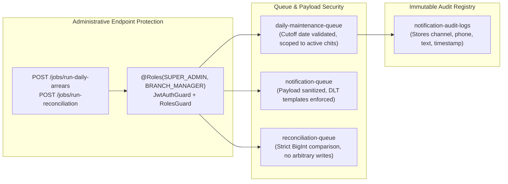
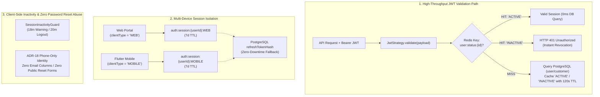

# Kumaran Chits — Security & Access Guardians (OWASP BOLA/IDOR Specification)

> **Product**: **Kumaran Chits** (Kumaran Finance, Perundurai, Erode)  
> **Target Audience**: Core Engineering, Security Auditors, and AI Pair-Programmers  
> **Classification**: Security Architecture Specification (`CONFIRMED-BY-DEVELOPER`)  
> **Mandatory Rule**: Layer 1 Role Guards (`@Roles`) alone are strictly prohibited from granting data access. Every document generation, file stream, and maintenance job must execute Layer 2 Ownership & Branch Scope verification via [`DocumentAccessHelper`](file:///u:/Kumaran-finance/apps/api/src/storage/helpers/document-access.helper.ts).

---

## 1. Threat Model: Eliminating OWASP Top 10 BOLA & IDOR

In multi-user financial platforms, **Broken Object Level Authorization (OWASP API1:2023 / BOLA)** and **Insecure Direct Object References (IDOR)** occur when an endpoint relies solely on role verification:

```mermaid
flowchart TD
    subgraph VULNERABLE_MODEL ["❌ Vulnerable Role-Only Model"]
        A1["Customer A (JWT Role: CUSTOMER)"] -->|GET /pdf/receipt/:id\n(Passes Customer B's Payment ID)| B1["RolesGuard (@Roles: CUSTOMER)"]
        B1 -->|ALLOW: Role matches 'CUSTOMER'| C1["VULNERABILITY:\nCustomer A views Customer B's financial data!"]
    end

    subgraph SECURE_MODEL ["✅ Kumaran Chits Defense-in-Depth Model"]
        A2["Customer A (JWT Role: CUSTOMER)"] -->|GET /pdf/receipt/:id\n(Passes Customer B's Payment ID)| B2["Layer 1: RolesGuard\n(Checks Role: CUSTOMER)"]
        B2 -->|Passes| C2["Layer 2: DocumentAccessHelper\n(Asserts payment.customer.phone === user.phone)"]
        C2 -->|MISMATCH DETECTED| D2["HTTP 403 Forbidden\nAccess Denied: You can only download your own receipts"]
    end
```

To eliminate this vulnerability across all 6 personas, Kumaran Chits enforces a **Defense-in-Depth Security Architecture**:
1. **Transport & Perimeter Layer**: Helmet security headers and strictly configured Cross-Origin Resource Sharing (CORS).
2. **Layer 1: Coarse-Grained RBAC** (`JwtAuthGuard`, `RolesGuard`, `@Roles(...)`): Verifies authentication validity and coarse functional permissions.
3. **Layer 2: Fine-Grained ABAC & Ownership Validation** (`DocumentAccessHelper`): Validates runtime object ownership, branch scoping, and relationship context before streaming or generating any byte of data.

### 1.1 Perimeter Defense: Transport & Cross-Origin Resource Sharing (CORS)

At the perimeter, [`apps/api/src/main.ts`](file:///u:/Kumaran-finance/apps/api/src/main.ts) enforces strict cross-origin policies:
- **Origin Whitelisting (`CORS_ALLOWED_ORIGINS`)**: Dynamic comma-separated origin configuration (`process.env.CORS_ALLOWED_ORIGINS` / `CORS_ORIGINS`). Defaults to local development endpoints (`http://localhost:3000`, `http://localhost:3001`). In staging and production environments, wildcards (`*`) are prohibited; only verified administrative and partner domains are permitted.
- **Native & Non-Browser Client Exemption**: Mobile apps (Flutter Android/iOS) and internal background jobs make requests with `origin: undefined`. These requests are permitted through while enforcing strict Bearer JWT and API signature verification.
- **Allowed Headers & Methods**: Restricts cross-origin HTTP methods strictly to `GET`, `POST`, `PUT`, `PATCH`, `DELETE`, `OPTIONS`. Permitted headers include `Content-Type`, `Authorization`, `X-Branch-Id`, `Idempotency-Key`, and `X-Request-Id`.
- **Security Headers (Helmet)**: Sets standard OWASP headers including `X-Frame-Options: SAMEORIGIN` (prevents clickjacking while allowing in-app PDF iframes), while disabling CDN-breaking content security restrictions on Swagger API documentation routes.

### 1.2 Ingress Rate Limiting & Abuse Prevention (OWASP API4:2023 Defense)

To protect system resources and eliminate Denial of Service (DoS) attack vectors:
- **Nginx Ingress Edge**: Limits requests at the reverse proxy (`limit_req_zone`: 30 req/s general, 3 req/s auth).
- **NAT-Safe AppThrottlerGuard**: Tracks authenticated calls by `usr_<userId>` (preventing shared broadband IP lockout for Perundurai branch office staff) and public calls by `ip:<client_ip>`.
- **Distributed Redis Storage**: Powered by atomic Redis Lua scripts (`throttle:*`) with seamless in-memory fallback.
- **Granular Route Limits**: Specialized throttles on PDF compilation (15/min), KYC uploads (5/min), UPI claims (5/15m), and 2FA disabling (5/15m).
- *Full Architectural Specification*: See [`docs/03-architecture/rate-limiting-and-abuse-prevention.md`](rate-limiting-and-abuse-prevention.md).

---

## 2. Component 1: Encrypted Storage Access Guardians

### 2.1 Storage Key Prefix Categories
All files stored locally or in private S3 storage (Cloudflare R2 / MinIO) adhere to strict directory namespaces:
- `kyc/{customerId}/*`: Sensitive identity scans (Aadhaar, PAN, Photo, Signature).
- `safety-proof/{auctionId}/*`: Company collateral (signed agreements, promissory notes, blank cheques).
- `minutes/{chitGroupId}/*`: Statutory Form XVII auction minutes.
- `receipts/{branchCode}/{year}/*`: Bilingual A5 subscription digital receipts.
- `vouchers/{branchCode}/{year}/*`: Bilingual A5 prize payout vouchers.
- `passbooks/{chitGroupId}/*`: Form XXI continuous 20-month member passbook statements.

### 2.2 Path-Traversal Safeguards (`StorageKeyHelper`)
Before resolving any storage key, [`StorageKeyHelper.sanitizeKey()`](file:///u:/Kumaran-finance/apps/api/src/storage/helpers/storage-key.helper.ts) executes sanitization:
- Strips directory traversal vectors (`..`, `../`, `..\`).
- Normalizes backslashes to forward slashes.
- Trims leading slashes and whitespace.
- Prevents escaping the `./storage/uploads` root sandbox or accessing foreign S3 buckets.

### 2.3 Storage Key Ownership Rules (`assertStorageKeyAccess`)
At [`StorageController.streamFile()`](file:///u:/Kumaran-finance/apps/api/src/storage/storage.controller.ts#L27-L52), requests pass directly through `DocumentAccessHelper.assertStorageKeyAccess(sanitizedKey, currentUser)`:

| Key Category | Customer | Collection Agent | Branch Manager | Accountant | Auditor | Super Admin |
|---|:---:|:---:|:---:|:---:|:---:|:---:|
| `kyc/{customerId}/*` | **Own folder only** (`sub` or `phone` match) | ❌ **Blocked (HTTP 403)** | Branch scope | Global | Global | Global |
| `safety-proof/*` | ❌ **Blocked (HTTP 403)** | ❌ **Blocked (HTTP 403)** | Branch scope | Global | Global | Global |
| `minutes/*` | ❌ **Blocked (HTTP 403)** | ❌ **Blocked (HTTP 403)** | Branch scope | Global | Global | Global |
| `receipts/*` | Own receipts | Collected receipts | Branch scope | Global | Global | Global |
| `vouchers/*` | Winning voucher | ❌ **Blocked (HTTP 403)** | Branch scope | Global | Global | Global |
| `passbooks/*` | Own passbook | ❌ **Blocked (HTTP 403)** | Branch scope | Global | Global | Global |

### 2.4 Customer KYC Document Upload & 15-Minute Presigned Viewing URLs
Direct document interactions at [`CustomerController`](file:///u:/Kumaran-finance/apps/api/src/customer/customer.controller.ts) enforce anti-IDOR checks:
- **Upload (`POST /api/v1/customers/:id/documents`)**:
  - Staff (`SUPER_ADMIN`, `BRANCH_MANAGER`, `ACCOUNTANT`, `COLLECTION_AGENT`) can upload identity scans during in-office or doorstep intake.
  - Subscribers (`CUSTOMER`) can upload identity scans **strictly for their own account** (`currentUser.sub === customerId`). Attempting to upload to a third-party `customerId` throws `403 Forbidden`.
  - File restrictions: Allowed MIME types (`image/jpeg`, `image/png`, `image/webp`, `application/pdf`), maximum size 10 MB, and path-sanitized key generation (`kyc/{customerId}/{docType}-{uuid}.{ext}`).
- **Presigned Viewing URL (`GET /api/v1/customers/:id/documents/:docId/url`)**:
  - Direct S3 bucket access is completely blocked to the public (private S3 bucket).
  - Time-limited presigned URL generated with strict 900-second (15-minute) TTL.
  - Field collection agents are blocked (`403 Forbidden`) from viewing customer KYC documents per DPDP Act 2023 least-privilege principles.
  - Subscribers (`CUSTOMER`) are restricted strictly to viewing their own documents (`currentUser.sub === customerId`).

---

## 3. Component 2: Bilingual PDF Canvas Access Guardians

Each of the 4 PDF canvas endpoints at [`PdfController`](file:///u:/Kumaran-finance/apps/api/src/pdf/pdf.controller.ts) extracts the authenticated user (`@CurrentUser() currentUser: JwtPayload`) and enforces object-level assertions in [`PdfService`](file:///u:/Kumaran-finance/apps/api/src/pdf/pdf.service.ts):

### 3.1 Subscription Receipts (`GET /pdf/receipt/:paymentId`)
- **Assertion**: [`DocumentAccessHelper.assertReceiptAccess(payment, user)`](file:///u:/Kumaran-finance/apps/api/src/storage/helpers/document-access.helper.ts#L9-L62)
- **Rules**:
  1. `CUSTOMER`: Must match `payment.allocations[0].ticket.customer.phone === user.phone`. Attempting to pass another subscriber's `paymentId` immediately throws `403 Forbidden`.
  2. `COLLECTION_AGENT`: Must match `payment.recordedByUserId === user.sub`. Field agents can only download receipts for cash collections they personally recorded.
  3. `BRANCH_MANAGER`: Must match `payment.branchId === user.branchId`. Cross-branch receipt snooping is blocked.
  4. `SUPER_ADMIN`, `ACCOUNTANT`, `AUDITOR`: Granted global oversight for accounting and statutory audits.

### 3.2 Prize Payout Vouchers (`GET /pdf/voucher/:auctionId`)
- **Assertion**: [`DocumentAccessHelper.assertVoucherAccess(winner, user)`](file:///u:/Kumaran-finance/apps/api/src/storage/helpers/document-access.helper.ts#L67-L115)
- **Rules**:
  1. `COLLECTION_AGENT`: **Strictly blocked across the board (HTTP 403)**. Field collection staff have zero operational involvement in prize money disbursements.
  2. `CUSTOMER`: Only the winning subscriber whose phone matches `winner.ticket.customer.phone === user.phone` may download the voucher.
  3. `BRANCH_MANAGER`: Scoped strictly to auctions belonging to their assigned branch.
  4. `SUPER_ADMIN`, `ACCOUNTANT`, `AUDITOR`: Authorized to verify dual-control signatures and voucher numbers.

### 3.3 Form XVII Statutory Minutes (`GET /pdf/minutes/:auctionId`)
- **Assertion**: [`DocumentAccessHelper.assertMinutesAccess(auction, user)`](file:///u:/Kumaran-finance/apps/api/src/storage/helpers/document-access.helper.ts#L120-L162)
- **Rules**:
  1. `CUSTOMER`: **Strictly blocked (HTTP 403)**. Form XVII auction minutes are internal company legal records for filing with the Chit Registrar.
  2. `COLLECTION_AGENT`: **Strictly blocked (HTTP 403)**.
  3. `BRANCH_MANAGER`: Branch-scoped.
  4. `SUPER_ADMIN`, `ACCOUNTANT`, `AUDITOR`: Authorized for statutory filing and review.

### 3.4 Form XXI 20-Month Passbook (`GET /pdf/passbook/:ticketId`)
- **Assertion**: [`DocumentAccessHelper.assertPassbookAccess(ticket, user)`](file:///u:/Kumaran-finance/apps/api/src/storage/helpers/document-access.helper.ts#L167-L215)
- **Rules**:
  1. `COLLECTION_AGENT`: **Strictly blocked (HTTP 403)**. Field agents view assigned daily dues via mobile app; full continuous historical passbooks are restricted.
  2. `CUSTOMER`: Restricted strictly to their own subscription ticket (`ticket.customer.phone === user.phone`).
  3. `BRANCH_MANAGER`: Branch-scoped.
  4. `SUPER_ADMIN`, `ACCOUNTANT`, `AUDITOR`: Authorized.

---

## 4. Component 3: BullMQ Background Queue & Worker Security

Background jobs decouple synchronous API requests from long-running tasks. Security guardians ensure queues cannot be poisoned or abused:



### 4.1 Administrative Route Restrictions
- **Trigger Endpoints**:
  - `POST /jobs/run-daily-arrears` & `POST /jobs/enqueue-daily-arrears`: Restricted strictly to `SUPER_ADMIN` and `BRANCH_MANAGER`. Customers and collection agents receive `403 Forbidden`.
  - `POST /jobs/run-reconciliation` & `POST /jobs/enqueue-reconciliation`: Restricted strictly to `SUPER_ADMIN` and `ACCOUNTANT`.
  - `POST /jobs/send-auction-reminder/:chitGroupId/:month`: Restricted to `SUPER_ADMIN` and `BRANCH_MANAGER`.
- **Health & Audit Endpoints**:
  - `GET /jobs/queue-status`: Restricted to `SUPER_ADMIN`, `BRANCH_MANAGER`, and `AUDITOR`.
  - `GET /jobs/notification-audit-logs`: Restricted strictly to `SUPER_ADMIN` and `AUDITOR`.

### 4.2 Queue Isolation & Mathematical Precision
- **Whole Rupee Invariant in Redis**: Redis message payloads serialize monetary amounts as strings (`amountPaid: '3750'`) to prevent IEEE 754 floating-point conversion leaks during JSON serialization.
- **State Machine Guard**: `DailyArrearsService` updates `consecutiveUnpaidMonths` based strictly on sequential `InstallmentDue` records in PostgreSQL. Tickets with 3+ consecutive unpaid months are tagged `DEFAULT_3_MONTHS` per ADR-07 and emitted warning notices.

---

## 5. Master 6-Persona Security Matrix (Components 1, 2, and 3)

| Component / Resource | Super Admin | Branch Manager | Accountant | Collection Agent | Customer | Auditor |
|---|:---:|:---:|:---:|:---:|:---:|:---:|
| **Component 1: KYC Scans** | Global | Branch | Verification | ❌ Blocked | Own docs | Read-only |
| **Component 1: Safety Proof Scans** | Global | Branch | Global | ❌ Blocked | ❌ Blocked | Read-only |
| **Component 2: Receipt PDF** | Global | Branch | Global | Own recorded | Own receipt | Read-only |
| **Component 2: Payout Voucher PDF** | Global | Branch | Global | ❌ Blocked | Winner only | Read-only |
| **Component 2: Form XVII Minutes PDF** | Global | Branch | Global | ❌ Blocked | ❌ Blocked | Read-only |
| **Component 2: Form XXI Passbook PDF**| Global | Branch | Global | ❌ Blocked | Own ticket | Read-only |
| **Component 3: Trigger Daily Arrears** | Yes | Yes (Branch) | No | No | No | No |
| **Component 3: Trigger Reconciliation** | Yes | No | Yes | No | No | No |
| **Component 3: Queue Health & Logs** | Full | Status only | Status only | No | No | Read-only |

---

## 6. Automated Test Coverage & Verification Proofs

Every rule documented above is backed by automated negative and positive test assertions:

1. **[`apps/api/test/pdf.spec.ts`](file:///u:/Kumaran-finance/apps/api/test/pdf.spec.ts)**:
   - Section 4: Customer downloading own receipt (`PASS`), Customer downloading another customer receipt throws `ForbiddenException` (`PASS`), Agent downloading own collection (`PASS`), Agent downloading another agent's collection throws `ForbiddenException` (`PASS`), Branch Manager cross-branch receipt throws `ForbiddenException` (`PASS`).
   - Section 5: Winner customer accessing voucher (`PASS`), Non-winner customer throws `ForbiddenException` (`PASS`), Field agent accessing voucher throws `ForbiddenException` (`PASS`).
   - Section 6: Branch Manager accessing minutes (`PASS`), Customer accessing minutes throws `ForbiddenException` (`PASS`), Field agent accessing minutes throws `ForbiddenException` (`PASS`).
   - Section 7: Customer accessing own passbook (`PASS`), Customer accessing another passbook throws `ForbiddenException` (`PASS`), Field agent accessing passbook throws `ForbiddenException` (`PASS`).
   - Section 8: Direct storage key access rules (`PASS` across all personas).
2. **[`apps/api/test/jobs.spec.ts`](file:///u:/Kumaran-finance/apps/api/test/jobs.spec.ts)**:
   - Section 1: Daily arrears state machine and 3-month default tagging with warning notification (`PASS`).
   - Section 2: Smart Notification Router (Push-first for app users, DLT SMS fallback for keypad phones across payments, auctions, dividends, and defaults) verification (`PASS`).
   - Section 3: 06:00 AM settlement reconciliation, ghost drop auto-resolution, and discrepancy flagging (`PASS`).
   - Section 4: BullMQ queue health and administrative controller endpoint execution (`PASS`).
3. **[`apps/api/test/auth-token-lifecycle.spec.ts`](file:///u:/Kumaran-finance/apps/api/test/auth-token-lifecycle.spec.ts)**:
   - Section 1-7: Token issuance, rotation, logout, phone mutation revocation, and RFC 6819 reuse trap (`PASS`).
   - Section 8: High-throughput JWT validation caching (120s TTL) and proactive cache eviction on status mutation (`PASS`).
   - Section 9: Multi-device concurrent session isolation (`WEB` + `MOBILE`) without cross-device refresh collision (`PASS`).
4. **[`apps/web/test/session-inactivity-guard.spec.ts`](file:///u:/Kumaran-finance/apps/web/test/session-inactivity-guard.spec.ts)**:
   - 20-minute inactivity auto-logout math, 18-minute warning modal display, and countdown reset (`PASS`).

---

## 7. Component 4: Authentication & Session Management Guardians



### 7.1 High-Throughput JWT Validation Caching (120s TTL)
- **Problem Solved**: On every authenticated HTTP request, NestJS `JwtStrategy` previously queried PostgreSQL (`findUnique({ id })`) to verify `isActive`. Under heavy traffic (500+ concurrent requests), this caused connection pool saturation on PostgreSQL.
- **Implementation**: [`JwtStrategy`](file:///u:/Kumaran-finance/apps/api/src/auth/strategies/jwt.strategy.ts) checks Redis key `user:status:${payload.sub}` first.
  - If `'ACTIVE'`, request passes instantly with **zero DB queries**.
  - If `'INACTIVE'`, request is immediately rejected with `401 Unauthorized`.
  - If a cache miss occurs, PostgreSQL is queried and the result is cached for **120 seconds** (`EX 120`).
- **Proactive Invalidation**: When a staff user's status is toggled, roles updated, or password changed in [`UserService`](file:///u:/Kumaran-finance/apps/api/src/user/user.service.ts), `redis.del('user:status:${userId}')` is invoked immediately, guaranteeing instant access termination across the cluster.

### 7.2 Multi-Device Concurrent Session Isolation
- **Problem Solved**: Kumaran Finance partners and field agents frequently use both the **Web Portal** (for accounting, schemes, and minutes) and the **Android Mobile App** (for collections, receipts, and OTP approvals). Storing a single `refreshTokenHash` on the database row caused logging in on mobile to overwrite web's token hash. When web attempted its 15-minute background refresh, it failed the hash check, triggering the RFC 6819 token reuse trap and locking the user out of both devices.
- **Implementation**: Refresh token families are isolated per device type via Redis key `auth:session:${userId}:${clientType}` (where `clientType` is `'WEB'`, `'MOBILE'`, or `'DESKTOP'`) with a 7-day TTL (`604,800s`).
- **RFC 6819 Token Reuse Defense**:
  - Rotating a token on Web updates only `auth:session:${userId}:WEB`, leaving Mobile completely unaffected.
  - If a replayed/stolen refresh token is detected on Web, **only the Web session family is revoked**, leaving the partner's Mobile collection session active.
  - When Redis is unavailable or on cold start, the system transparently falls back to the database `refreshTokenHash` column.

### 7.3 Architectural Immunity Against Password-Reset Abuse
- **Attack Vector Inapplicable**: In generic SaaS applications, public password-reset endpoints (`/auth/forgot-password`) suffer from email enumeration, account lockout DoS, and token brute-forcing.
- **Kumaran Chits Architecture**:
  1. **Strict Phone-Only Identity (ADR-18)**: Built exclusively for Kumaran Finance. Zero email columns exist in PostgreSQL.
  2. **No Public Password Reset Form**: Subscribers and agents authenticate strictly via MSG91 6-digit SMS OTP (`/auth/mobile/request-otp` and `/auth/mobile/verify-otp`) protected by 60s cooldowns and 5-minute brute-force lockouts.
  3. **Super Admin Dual-Control Reset**: If an office staff member forgets their password, a Super Admin performs an emergency reset via [`UserService.resetPassword()`](file:///u:/Kumaran-finance/apps/api/src/user/user.service.ts), which purges all active refresh tokens in Redis and DB, requiring the staff member to configure a new password on their next login.

### 7.4 Client-Side 20-Minute Inactivity Guardian
- **Implementation**: [`SessionInactivityGuard`](file:///u:/Kumaran-finance/apps/web/src/components/security/session-inactivity-guard.tsx) tracks user interactions (`mousemove`, `mousedown`, `keydown`, `scroll`, `touchstart`) with a 500ms throttle.
- **18-Minute Warning**: Displays a non-intrusive warning modal showing a live 120-second countdown with an "I'm Still Here" button.
- **20-Minute Hard Logout**: Automatically purges client state and redirects to `/login?reason=timeout`.
- **Multi-Tab Sync**: Synchronized via `localStorage` storage events and broadcast channels so active work in one tab keeps all tabs alive.

### 7.5 XSS Token Exfiltration Immunity via BFF & HttpOnly Cookies (ADR-20)
- **Elimination of Client-Side Token Storage**: Storing JWT access, refresh, or intermediate 2FA challenge tokens (`tempToken`) in browser `localStorage` or `sessionStorage` has been completely eliminated. `localStorage.getItem('kc_access_token')` and `sessionStorage.getItem('kc_temp_token')` return `null`.
- **HttpOnly Cookie Enclosure**:
  - `kc_access_token` (15-minute TTL) and `kc_refresh_token` (7-day TTL) are issued with `HttpOnly; SameSite=Lax; Path=/` and protocol-aware `Secure` (`COOKIE_SECURE` env or HTTPS / `X-Forwarded-Proto: https`).
  - During staff 2FA login (`DEF-FE-08`), the intermediate 5-minute HS256 challenge JWT (`tokenType: 'totp_pending'`) is likewise enclosed exclusively inside the `HttpOnly; SameSite=Lax; Path=/` cookie `kc_totp_pending_token` (300s TTL) and omitted from `/api/auth/login` response JSON. `/api/auth/verify-totp` extracts it solely from that cookie (ignoring client body fields), keeps it intact across mistyped 6-digit code retries, and expires it cleanly on verification success, expired/invalid pending JWTs, or Back-to-Login cancellation (`/api/auth/logout`). Edge Middleware ([`edge-auth.ts`](file:///u:/Kumaran-finance/apps/web/src/lib/edge-auth.ts)) cryptographically validates `kc_totp_pending_token` (`tokenType === 'totp_pending'`) prior to rendering `/2fa`, while `/api/auth/session` returns only a non-secret `pendingTotp: boolean` flag for reload recovery.
  - Browser JavaScript (`document.cookie`) has zero programmatic access to these cookies, guaranteeing complete immunity against token exfiltration via XSS or compromised npm dependencies.
- **Edge Navigation Guarding (0ms FOUC Elimination)**:
  - [`apps/web/src/middleware.ts`](file:///u:/Kumaran-finance/apps/web/src/middleware.ts) delegates to [`evaluateEdgeAuth`](file:///u:/Kumaran-finance/apps/web/src/lib/edge-auth.ts) at the Edge prior to page rendering (bypassing `/_next`, `/api`, `/bff`, static file extensions; enforcing Edge auth across all `(dashboard)/*` and `/print/*` routes). Edge Middleware verifies `kc_access_token` (`tokenType === 'access'`) and expiry fallback `kc_refresh_token` (`tokenType === 'refresh'`) cryptographically via Web Crypto (`jose.jwtVerify` HS256 with shared `JWT_SECRET`), ignores spoofable client `kc_session_active` flags, fails closed if `JWT_SECRET` is unset, sanitizes open redirects, and enforces canonical RBAC route gates from [`route-permissions.ts`](file:///u:/Kumaran-finance/apps/web/src/lib/route-permissions.ts).
  - Any request targeting `/(dashboard)/*` or `/print/*` without valid cryptographically verified JWT session cookies is immediately redirected to `/login?redirect=...` (clearing stale cookies symmetrically via `shouldUseSecureCookies`), while authenticated users lacking route permissions redirect safely to `/?error=forbidden` (or `/login?error=forbidden` for non-staff roles like `CUSTOMER` to prevent redirect loops).
- **Transparent Server-Side API Proxy, Unbuffered SSE & Coalesced Silent Token Rotation (DEF-FE-01 & DEF-FE-02 Fixed)**:
  - Web client requests target the isolated Next.js BFF prefix (`/bff/api/v1/*`), separating cookie-authenticated browser traffic from Bearer-authenticated Mobile `/api/v1/*` ingress in Nginx.
  - The shared Next.js BFF proxy ([`bff-api-proxy.ts`](file:///u:/Kumaran-finance/apps/web/src/lib/bff-api-proxy.ts), mounted at [`/bff/api/v1/[...path]/route.ts`](file:///u:/Kumaran-finance/apps/web/src/app/bff/api/v1/[...path]/route.ts)) reads `kc_access_token` (or proactively refreshes if expired while `kc_refresh_token` exists), injects `Authorization: Bearer <token>`, forwards `text/event-stream` SSE responses without buffering (`arrayBuffer` bypass, `X-Accel-Buffering: no`, and abort propagation), and mirrors `SameSite`/`Secure` flags across `/bff` and [`/api/auth/session`](file:///u:/Kumaran-finance/apps/web/src/app/api/auth/session/route.ts) when clearing expired cookies.
  - [`useApprovalsStream`](file:///u:/Kumaran-finance/apps/web/src/hooks/use-approvals-stream.ts) connects directly to `/bff/api/v1/reports/approvals-stream` using `credentials: 'same-origin'` HttpOnly cookies (no `getStoredAccessToken()` early-return) and halts reconnect loops if a 401 re-hydration confirms the session ended.
  - Concurrent 401 bursts across `/api/v1/*`, `/api/auth/session`, and `/api/auth/logout` are deduplicated via [`bff-token-refresh.ts`](file:///u:/Kumaran-finance/apps/web/src/lib/bff-token-refresh.ts) (SHA-256 in-flight promise coalescing + 2s cookie-handoff micro-cache purged immediately on logout), paired with contention-scoped distributed Redis lock coalescing in [`AuthService.refreshToken`](file:///u:/Kumaran-finance/apps/api/src/auth/auth.service.ts).
  - [`apps/web/src/lib/bff-forward-headers.ts`](file:///u:/Kumaran-finance/apps/web/src/lib/bff-forward-headers.ts) (`buildBffForwardHeaders`) preserves `X-Forwarded-For`, `X-Real-IP`, `X-Forwarded-Proto`, `X-Forwarded-Host`, `User-Agent`, and `X-Request-ID` across all 6 Next.js BFF → NestJS callers (`/bff/api/v1/*`, `/api/v1/*`, `/api/auth/login`, `/api/auth/verify-totp`, `/api/auth/logout`, `/api/auth/session`, and `executeBffRefresh`). On the API side, Express binds `TRUST_PROXY` (`parseTrustProxySetting`, defaulting to `['loopback', 'linklocal', 'uniquelocal']`) so both 1-hop (`Mobile -> Nginx -> API`) and 2-hop (`Browser -> Nginx -> BFF -> API`) chains resolve the real public client IP while ignoring left-injected spoofed `X-Forwarded-For` headers (`DEF-FE-06`).
  - Sequential token replays continue to trigger immediate RFC 6819 session family revocation, while permanent 401 expiry clears dead browser cookies cleanly to avoid redirect loops.
