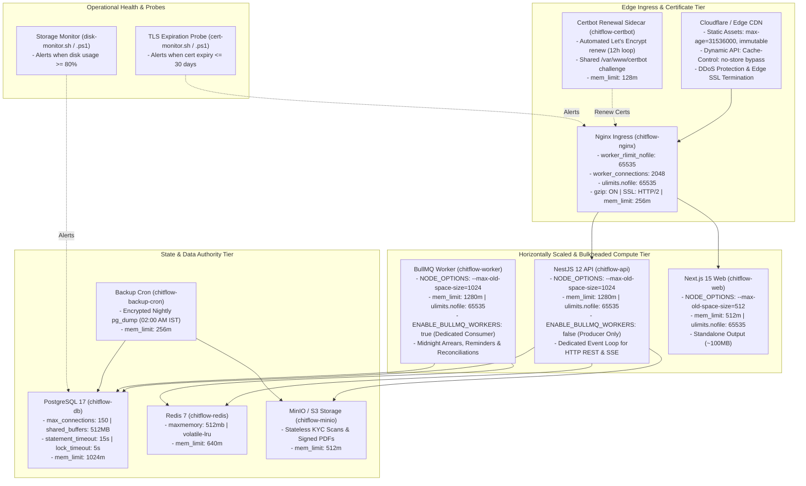

# Kumaran Chits — Server & Infrastructure Resilience Specification

> **Product**: **Kumaran Chits**  
> **Company**: **Kumaran Finance** (Head Office: Perundurai, Erode, Tamil Nadu)  
> **Audience**: Core Engineering, DevOps Engineers, Cloud Architects, AI Coding Agents  
> **Compliance & Guardrails**: Strictly enforces the 10 Invariant Architectural Guardrails (`CONFIRMED-BY-DEVELOPER`), pure whole-rupee math (`BigInt`), Maker $\ne$ Checker separation of duties, and PostgreSQL 17 as the sole source of financial truth.

---

## 1. Executive Summary & Infrastructure Topology

This specification establishes the production server, container, and cloud infrastructure hardening architecture for **Kumaran Chits**. It guarantees high availability, deterministic memory behavior, and fault isolation under high concurrent load during monthly collection spikes (10th–15th of each month in Perundurai), live branch auctions, and partner disbursement approvals.



---

## 2. The 9 Hardened Infrastructure Pillars

### 2.1 Pillar 1: CPU Saturation Prevention & Process Bulkheading
- **The Vulnerability**: Background BullMQ tasks (midnight arrears sweeps, bulk notification dispatch, payment reconciliation) running inside the same process as the HTTP REST API can saturate the single Node.js event loop, causing API latencies to spike and blocking branch cashier counters.
- **Bulkheading Architecture**:
  - The API service (`chitflow-api`) operates strictly with `ENABLE_BULLMQ_WORKERS=false`. It functions purely as a queue producer and dedicates 100% of its single-threaded event loop to incoming HTTP requests and live SSE streams.
  - A separate dedicated worker container (`chitflow-worker`) runs with `ENABLE_BULLMQ_WORKERS=true`. It has no public ingress ports and consumes background jobs in isolation.
- **Compute Sizing & Horizontal Scaling**:
  - Autoscaling or process orchestration triggers additional API worker replicas when average CPU utilization $\ge 60\%$ or p95 response time exceeds $500\text{ms}$ for 2 consecutive minutes.
  - Auction-day scheduled pre-warming scales the API compute tier from 2 to 4 active workers 30 minutes prior to scheduled branch auctions.

### 2.2 Pillars 2 & 3: Memory Leaks, Bounded Caches & Container OOM Ceilings (Exit 137)
- **The Vulnerability**: Without explicit V8 heap limits, Node.js can expand heap beyond physical container limits, triggering the Linux kernel Out-Of-Memory (OOM) killer (`exit code 137`) without an application error log.
- **Deterministic V8 Heap & Headroom Math**:
  - **NestJS API & Worker**: `NODE_OPTIONS="--max-old-space-size=1024"`. Container memory ceiling is set to `mem_limit: 1280m`.
    $$\text{Off-Heap Buffer} = 1280\text{MB} - 1024\text{MB} = 256\text{MB}$$
    This $256\text{MB}$ headroom safely accommodates Prisma engine binaries, OpenSSL buffers, and libuv thread stacks, preventing OOM kills.
  - **Next.js Web**: `NODE_OPTIONS="--max-old-space-size=512"`. Container memory ceiling is set to `mem_limit: 512m`.
- **Bounded In-Memory Caches**:
  - In `ReportService`, the in-memory dashboard snapshot buffer enforces a strict FIFO/LRU ceiling of **20 entries** (`MAX_SNAPSHOT_CACHE_ENTRIES = 20`), preventing unbounded memory leaks during prolonged server uptime.
- **Container Memory Allocation Matrix**:

| Service | Container Name | V8 Heap (`max-old-space-size`) | Container `mem_limit` | Headroom / Buffer |
|---|---|:---:|:---:|:---:|
| `api` | `chitflow-api` | 1024 MB | **1280m** | 256 MB off-heap |
| `worker` | `chitflow-worker` | 1024 MB | **1280m** | 256 MB off-heap |
| `web` | `chitflow-web` | 512 MB | **512m** | Standalone Node ~100MB |
| `db` | `chitflow-db` | N/A (PostgreSQL) | **1024m** | 512MB shared_buffers |
| `redis` | `chitflow-redis` | N/A (Redis 7) | **640m** | 512mb maxmemory |
| `minio` | `chitflow-minio` | N/A (Go binary) | **512m** | S3 object buffering |
| `nginx` | `chitflow-nginx` | N/A (C binary) | **256m** | SSL & proxy buffering |
| `backup-cron`| `chitflow-backup-cron` | N/A (Alpine) | **256m** | pg_dump pipeline |
| `certbot` | `chitflow-certbot` | N/A (Python) | **128m** | Renewal runner |

### 2.3 Pillar 4: Host & Volume Disk Space Depletion Protection
- **Container Log Limits**: Docker Compose applies a global logging constraint across all containers:
  ```yaml
  logging: &default-logging
    driver: json-file
    options:
      max-size: "50m"
      max-file: "5"
  ```
  This caps disk logging at a strict maximum of $250\text{MB}$ per container ($5 \times 50\text{MB}$).
- **Stateless Storage Architecture**: KYC identity documents and bilingual PDF receipts stream directly to S3 / MinIO storage. Zero ephemeral customer documents are written to local disk.
- **Automated Retention Pruning**: Nightly database snapshots in S3 are automatically pruned after **30 days** via `backup-cron-job.sh`. Local compressed dumps are pruned after 7 days.
- **Automated Host Storage Monitor**:
  - Monitored via [`infra/scripts/disk-monitor.sh`](file:///u:/Kumaran-finance/infra/scripts/disk-monitor.sh) (Linux) and [`infra/scripts/disk-monitor.ps1`](file:///u:/Kumaran-finance/infra/scripts/disk-monitor.ps1) (Windows).
  - Triggers a **Critical Alert** whenever storage usage reaches or exceeds **80% capacity** (`THRESHOLD_PERCENT=80`).

### 2.4 Pillar 5: Bandwidth Saturation & Edge CDN Architecture
- **Origin Compression**: Nginx enables `gzip on;` with `gzip_comp_level 5;` and `gzip_types text/plain text/css application/json application/javascript application/xml;`.
- **Edge CDN Distribution (Cloudflare / Reverse Proxy CDN)**:
  - Deployed in front of Nginx Ingress or application entrypoint.
  - **Static Asset Behaviors** (`/_next/static/*`, `/static/*`, images, fonts): Cached at edge locations across India with `Cache-Control: public, max-age=31536000, immutable`.
  - **Dynamic API Behaviors** (`/api/*`): Passes requests through directly with `Cache-Control: no-store, no-cache, must-revalidate` (TTL = 0).
  - **Document Downloads**: Customer passbooks and receipts are accessed via 15-minute temporary presigned S3 URLs, offloading high-bandwidth downloads from the API origin server.

### 2.5 Pillar 6: File Descriptors & Socket Connection Hardening
- **The Vulnerability**: Nginx reverse proxying uses 2 file descriptors per client connection (client socket + upstream socket). With default OS file descriptor limits (1024), Nginx exhausts file handles under 500 concurrent connections, terminating active 24-hour SSE approval streams.
- **Hardening Parameters**:
  - Nginx configuration ([`infra/docker/nginx/nginx.conf`](file:///u:/Kumaran-finance/infra/docker/nginx/nginx.conf)):
    ```nginx
    worker_rlimit_nofile 65535;
    events {
        worker_connections 2048;
        multi_accept on;
        use epoll;
    }
    ```
  - Docker Compose `ulimits` applied to `nginx`, `api`, `worker`, and `web`:
    ```yaml
    ulimits:
      nofile:
        soft: 65535
        hard: 65535
    ```

### 2.6 Pillar 7: Automated SSL/TLS Lifecycle Management
- **Automated Renewal Sidecar**:
  - `chitflow-certbot` runs alongside `nginx` in Docker Compose using the official `certbot/certbot:latest` image.
  - Executes a continuous renewal loop checking certificate status every 12 hours:
    ```sh
    trap exit TERM; while :; do certbot renew --webroot -w /var/www/certbot --quiet; sleep 12h & wait ${!}; done;
    ```
  - Shared named volume `certbot_challenge` connects Nginx's `location /.well-known/acme-challenge/` to Certbot's webroot.
- **Automated Expiration Alert Probes**:
  - Monitored via [`infra/scripts/cert-monitor.sh`](file:///u:/Kumaran-finance/infra/scripts/cert-monitor.sh) (Linux) and [`infra/scripts/cert-monitor.ps1`](file:///u:/Kumaran-finance/infra/scripts/cert-monitor.ps1) (Windows).
  - Inspects `fullchain.pem` validity and triggers a **Critical Alert** if certificate expiration is within **30 days** (`SSL_EXPIRY_THRESHOLD_SECONDS=2592000`).

### 2.7 Pillar 8: Infrastructure Resource Quotas & Service Limits
- **Flat-Fee Linux VPS & Database Resource Policy**:
  - Production utilizes a dedicated 4 vCPU / 8GB–16GB RAM Linux VPS (Hostinger Mumbai or DigitalOcean Bangalore) running PostgreSQL 17, Redis 7, Nginx, and NestJS in isolated Docker containers with hard memory caps (`mem_limit`).
  - Container memory allocations are pinned to prevent memory contention or OOM issues during auction rush hours.
- **Resource Monitoring & Proactive Alarms**:
  - Node Exporter / Prometheus alerts configured at **80% of disk storage**, **80% of RAM**, and **85% sustained CPU load**.
- **SMS DLT Gateway Balance Guardian**:
  - SMS gateway (Indian DLT) credit balance is monitored via automated threshold alerts.
  - When SMS credits fall below 500 units, the system automatically falls back to free **Firebase Cloud Messaging (FCM) Push Notifications** and Web Push, ensuring customers continue receiving payment confirmations without interruption.

### 2.8 Pillar 9: Off-Site Redundancy & Disaster Recovery (DRP)
- **High Availability & Redundancy**:
  - Application instances run in Docker containers managed with auto-restart policies (`restart: unless-stopped`) and health probes.
  - Database operates with continuous WAL archiving and automated midnight encrypted dumps (`backup-cron`).
- **Off-Site Disaster Recovery (DRP)**:
  - S3-compatible cloud storage (Cloudflare R2, MinIO, or S3) replicates all KYC scans and bilingual PDF receipts off-server with zero egress fees.
  - Nightly encrypted database snapshots (02:00 AM IST) are transferred to off-site object storage (`S3_BUCKET`).
- **Recovery Invariants**:
  - **Recovery Point Objective (RPO)**: $\le 15\text{ minutes}$ (via continuous PostgreSQL WAL archiving).
  - **Recovery Time Objective (RTO)**: $\le 2\text{ hours}$ (verified via quarterly automated drill `pnpm run db:drp:drill`).

---

## 3. Operational Runbook & Verification Commands

### 3.1 Inspecting Infrastructure Configuration
```powershell
# Validate Docker Compose topology and memory limits
docker compose -f infra/docker/docker-compose.fullstack.yml config

# Verify API and worker tests
pnpm --filter api test test/jobs.spec.ts test/bull-board.spec.ts
```

### 3.2 Running Storage and SSL Expiration Probes
```powershell
# Run host storage capacity monitor
powershell -ExecutionPolicy Bypass -File infra/scripts/disk-monitor.ps1 -DriveLetter U

# Run SSL certificate expiration monitor (30-day alert threshold)
powershell -ExecutionPolicy Bypass -File infra/scripts/cert-monitor.ps1

# Linux / Bash equivalent
./infra/scripts/disk-monitor.sh /
./infra/scripts/cert-monitor.sh infra/docker/nginx/ssl/live/fullchain.pem
```

### 3.3 Triggering Manual Certbot Renewal
```bash
# Force Certbot renewal check inside the sidecar container
docker compose -f infra/docker/docker-compose.fullstack.yml exec certbot certbot renew --webroot -w /var/www/certbot

# Reload Nginx to load renewed certificates
docker compose -f infra/docker/docker-compose.fullstack.yml exec nginx nginx -s reload
```

### 3.4 Zero-Downtime Deployment with Automated Rollback Trap
Deployments preserve the previous image tag as `chitflow-api:previous`. If deep health checks (`/health/readiness`) fail after 30 attempts (60s), the script automatically executes a rollback to `chitflow-api:previous` and alerts the operator:
```bash
# Linux / Production Server
bash infra/scripts/zero-downtime-deploy.sh

# Windows Server / Admin Terminal
.\infra\scripts\zero-downtime-deploy.ps1
```

### 3.5 One-Click Emergency Operator Rollback
If a critical runtime defect is detected post-deployment, on-call operators can instantly revert to the previous verified release with zero dropped connections:
```bash
# Linux / Production Server
bash infra/scripts/rollback.sh

# Windows Server / Admin Terminal
.\infra\scripts\rollback.ps1
```
