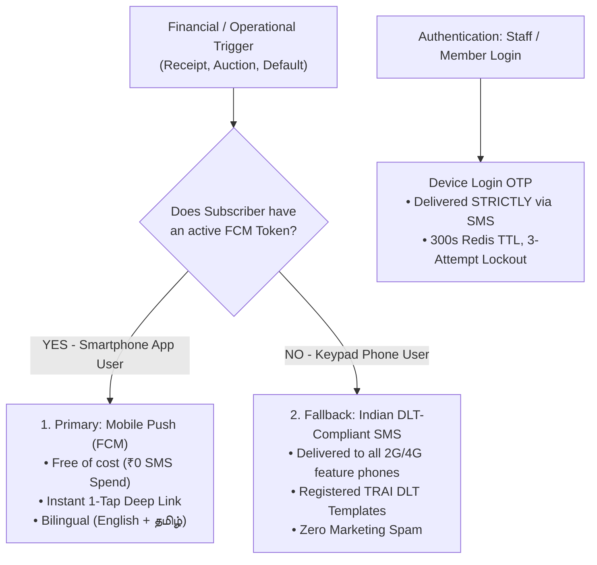
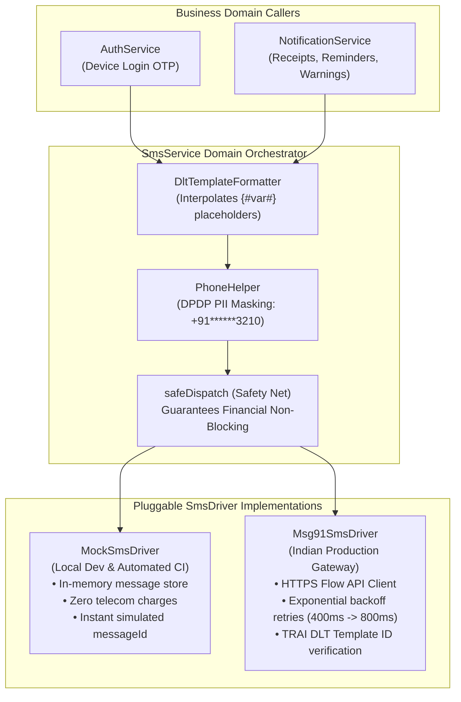

# SMS Architecture & Indian Telecom DLT Compliance Guide

> **Product**: **Kumaran Chits** (Official Chit Fund Operations Platform)  
> **Company**: **Kumaran Finance** (Head Office: Perundurai, Erode, Tamil Nadu)  
> **Regulatory Standard**: Telecom Regulatory Authority of India (TRAI) Distributed Ledger Technology (DLT) Regulations & Indian Digital Personal Data Protection (DPDP) Act 2023  
> **Target Audience**: Core Engineers, DevOps, New Contributors, and Auditors  
> **Code Call Sites**: [`apps/api/src/notification/`](file:///u:/Kumaran-finance/apps/api/src/notification/) & [`apps/api/src/jobs/services/notification.service.ts`](file:///u:/Kumaran-finance/apps/api/src/jobs/services/notification.service.ts)

---

## 1. Executive Summary & Operating Context

In physical chit-fund operations across Perundurai and rural Erode, Tamil Nadu, customer demographics span two distinct device groups:
1. **Modern Smartphone Users**: Middle-aged and younger subscribers, field collection agents, accountants, and the 4 Partners.
2. **Keypad Feature Phone Users**: Older rural subscribers, agricultural workers, and small traders who use basic 2G/voice feature phones with zero Android/FCM push capabilities.

To guarantee **100% communication reach** while eliminating runaway telecom costs, Kumaran Chits enforces a strict **Cost-Controlled Channel Hierarchy**:



- **Mobile App Push Notifications (FCM)** serve as the **Primary, ₹0-Cost Channel** for all smartphone subscribers.
- **Telecom DLT SMS** serves as the **Pluggable Statutory Fallback** for keypad phones, ensuring legal receipt delivery and auction compliance.
- **Device Login OTP** is delivered **strictly via SMS** (never via Push) for banking-grade multi-factor security.

---

## 2. Pluggable Driver Architecture

The SMS engine is designed around the **Dependency Inversion Principle**. Business domains never interact directly with telecom vendors. Instead, they interact with the injectable [`SmsService`](file:///u:/Kumaran-finance/apps/api/src/notification/services/sms.service.ts) which delegates to the active driver bound to `SMS_DRIVER_TOKEN`.



### 2.1 The 3 Non-Negotiable Core Invariants

1. **Financial Non-Blocking Guarantee**: Telecom timeouts, gateway network partitions, or credit exhaustion must **never abort, delay, or roll back** ACID database transactions. `SmsService.safeDispatch()` catches all gateway exceptions, records structured warning telemetry, and returns a safe failure response.
2. **DPDP Act 2023 PII Protection**: Recipient phone numbers are strictly masked (`+91******3210`) using `PhoneHelper.maskPhone()` before being written to console logs, error traces, or application telemetry.
3. **TRAI DLT Exact-Match Compliance**: Outbound messages strictly interpolate approved dynamic values into pre-registered DLT templates (`{#var#}`). Messages deviating from approved templates are blocked at the gateway level.

---

## 3. The 5 Operational SMS Events

| Event # | Operational Event | Trigger Source | DLT Template ID | Delivery Rule |
|:---:|---|---|---|---|
| **1** | **Device Login OTP** | `AuthService.requestOtp()` | `1407169823412093847` | **SMS Only** (Direct delivery to all phones; 5-min TTL in Redis). |
| **2** | **Payment Receipt** | `PaymentService` & `CollectionService` | `1407169823412093848` | **Keypad Fallback** (Only sent if subscriber has no registered `fcmToken`). |
| **3** | **Upcoming Auction Reminder** | Daily 09:00 AM IST Cron (`AuctionReminderSchedulerService`) | `1407169823412093849` | **Keypad Fallback** (Only sent if subscriber has no registered `fcmToken`). |
| **4** | **Auction Results & Dividend** | `AuctionService.finalizeAuction()` post-commit | Group Broadcast Template | **Keypad Fallback** (Only sent if subscriber has no registered `fcmToken`). |
| **5** | **3-Month Default Warning** | Midnight Arrears Cron (`DailyArrearsService`) | `1407169823412093850` | **Keypad Fallback** (Statutory notice before membership cancellation). |

---

## 4. TRAI DLT Template Catalog & Text Specifications

Registered under Principal Entity **Kumaran Finance** with 6-character Alpha Header: **`KMRCHT`**.

### 4.1 Template 1: Device Verification / Staff Login OTP
- **DLT Template ID**: `1407169823412093847`
- **Category**: Service Implicit (OTP / Transactional)
- **Registered Bilingual Text**:
  ```text
  Kumaran Chits: Your one-time verification code is {#var#}. Valid for 5 minutes. Do not share this OTP with anyone. / உங்கள் சரிபார்ப்பு குறியீடு {#var#}. யாருடனும் பகிர வேண்டாம்.
  ```
- **Variables**: `{#var#}` = 6-digit numeric OTP.

### 4.2 Template 2: Payment Receipt Confirmation
- **DLT Template ID**: `1407169823412093848`
- **Category**: Service Implicit
- **Registered Text**:
  ```text
  Kumaran Chits: Received Rs.{#var#} for Chit {#var#}, Ticket #{#var#} on {#var#}. Receipt: {#var#}. View passbook: {#var#}
  ```
- **Variables**:
  - `var1`: Amount in whole integer Rupees (e.g., `3,950`)
  - `var2`: Chit scheme code (e.g., `KC-LIVE-20M-01`)
  - `var3`: Ticket number (e.g., `5`)
  - `var4`: Transaction timestamp (ISO/IST string)
  - `var5`: Sequential receipt number (e.g., `KC-REC-PRD-2026-00014`)
  - `var6`: Passbook URL link

### 4.3 Template 3: Upcoming Monthly Auction Reminder
- **DLT Template ID**: `1407169823412093849`
- **Category**: Service Implicit
- **Registered Text**:
  ```text
  Kumaran Chits: Auction for Chit {#var#} Month {#var#} is scheduled on {#var#} at {#var#}. Venue: {#var#}. Contact: {#var#}
  ```
- **Variables**:
  - `var1`: Chit scheme code
  - `var2`: Installment month number
  - `var3`: Auction date
  - `var4`: Auction start time
  - `var5`: Branch venue name
  - `var6`: Branch contact number

### 4.4 Template 4: 3-Month Arrears / Default Warning Notice
- **DLT Template ID**: `1407169823412093850`
- **Category**: Service Explicit (Statutory Default Notice)
- **Registered Text**:
  ```text
  Kumaran Chits: Urgent: Ticket #{#var#} in Chit {#var#} has {#var#} months overdue (Rs.{#var#}). Clear dues to avoid membership cancellation. Contact: {#var#}
  ```
- **Variables**:
  - `var1`: Ticket number
  - `var2`: Chit scheme code
  - `var3`: Consecutive unpaid months count (e.g., `3`)
  - `var4`: Total overdue amount in whole Rupees
  - `var5`: Branch phone number

### 4.5 Template 5: Post-Auction Results & Dividend Credit
- **Broadcast Text**:
  ```text
  Kumaran Chits: Chit {chitCode} Month {month} Auction won at Rs.{discount} discount. Dividend credit: Rs.{dividend}. Next month installment: Rs.{netPayable}.
  ```
- **Enforces**: Pure whole-rupee math and universal dividend deduction ($I_{net} = I_{base} - Div$).

---

## 5. Environment Configuration

Defined and validated via [`env.validation.ts`](file:///u:/Kumaran-finance/apps/api/src/config/env.validation.ts):

```env
# SMS Engine Configuration
SMS_DRIVER=mock                      # 'mock' (local dev & testing) or 'msg91' (production)
SMS_SENDER_ID=KMRCHT                 # 6-character TRAI DLT approved header
SMS_MAX_RETRIES=2                    # In-memory retries for transient HTTP 500 / 429
SMS_RETRY_BASE_DELAY_MS=400          # Exponential backoff base (400ms -> 800ms)
SMS_REQUEST_TIMEOUT_MS=15000         # Socket timeout in milliseconds

# Required when SMS_DRIVER=msg91:
MSG91_AUTH_KEY=your_msg91_authkey_here
MSG91_DLT_TE_ID=1401160000000000000
MSG91_DLT_OTP_TEMPLATE_ID=1407169823412093847
MSG91_DLT_RECEIPT_TEMPLATE_ID=1407169823412093848
MSG91_DLT_AUCTION_TEMPLATE_ID=1407169823412093849
MSG91_DLT_DEFAULT_TEMPLATE_ID=1407169823412093850
```

---

## 6. Verification Proofs (100% Tested)

### 6.1 Unit & Integration Test Suite ([`test/unit/sms.spec.ts`](file:///u:/Kumaran-finance/apps/api/test/unit/sms.spec.ts))

Run command:
```bash
$ pnpm --filter api test test/unit/sms.spec.ts
```

Output:
```text
PASS test/unit/sms.spec.ts
  Component 3: Pluggable SMS Drivers & DLT Notification Suite
    1. PhoneHelper (MSISDN Normalization & DPDP Masking)
      ✓ should format 10-digit Indian numbers to 12-digit MSISDN (91XXXXXXXXXX) (3 ms)
      ✓ should normalize numbers with leading 0 to 12-digit MSISDN (1 ms)
      ✓ should normalize international formatted strings (+91, spaces, hyphens)
      ✓ should validate legitimate Indian mobile numbers (starts with 6, 7, 8, 9) (1 ms)
      ✓ should mask phone number preserving country code and last 4 digits per DPDP Act
    2. DltTemplateFormatter (TRAI DLT Template Interpolation)
      ✓ should sequentially replace {#var#} placeholders with supplied values
      ✓ should map positional variable arrays to MSG91 JSON key-value pairs
      ✓ should handle empty or undefined templates cleanly
    3. MockSmsDriver (Sandbox & Bypass Execution)
      ✓ should record outbound messages in memory and return bypassed result (2 ms)
      ✓ should clear stored messages upon clear() call
    4. Msg91SmsDriver (TRAI DLT HTTP Flow Client)
      ✓ should reject dispatch if DLT template ID is omitted (1 ms)
      ✓ should format MSG91 flow JSON payload and handle successful response (2 ms)
      ✓ should retry on HTTP 500 error and eventually succeed or fail gracefully (22 ms)
      ✓ should return failure if max retries are exhausted on 500/network error (47 ms)
    5. SmsService (Domain Orchestrator & Invariant Guards)
      ✓ should format and dispatch OTP SMS with registered template ID (209 ms)
      ✓ should format and dispatch payment receipt SMS with whole Rupee currency (7 ms)
      ✓ should format and dispatch upcoming auction reminder SMS (2 ms)
      ✓ should format and dispatch statutory default warning SMS (2 ms)
      ✓ GUARANTEE: Driver failure must NEVER throw an uncaught exception (Financial Non-Blocking) (2 ms)
    6. NotificationService with Pluggable SmsService Integration
      ✓ should trigger both DLT SMS and record bilingual receipts (1 ms)
      ✓ should broadcast auction reminder SMS to all subscribers (1 ms)
      ✓ should dispatch statutory default warning SMS to delinquent subscriber (1 ms)

Test Suites: 1 passed, 1 total
Tests:       22 passed, 22 total
```

### 6.2 Live Server Execution Proof (Lifecycle 7 Step 1)

During live server execution of [`verify-lifecycle-7.ts`](file:///u:/Kumaran-finance/apps/api/scripts/lifecycle/verify-lifecycle-7.ts):
```text
[Nest] LOG [MockSmsDriver] [MockSmsDriver] Bypassed SMS to +91******0105 (Template: 1407169823412093848):
"Kumaran Chits: Received Rs.3,950 for Chit KC-LIVE-20M-01, Ticket #5 on 2026-10-24T14:21:11.027Z. Receipt: KC-REC-PRD-2026-00014. View passbook: https://app.kumaranfinance.in/passbook/ed087ad5-ee76-481b-bc65-6de55ba61db0"
[Nest] LOG [NotificationService] Dispatched bilingual receipt notifications to 9842100105 for Receipt KC-REC-PRD-2026-00014
```

---

## 7. Ambiguous Failure & Telecom 504 Gateway Timeout Chaos Invariants

> **Mandate**: Upstream and downstream Indian telecom SMS gateway congestion (HTTP 504 Gateway Timeout, HTTP 408, packet loss) MUST NEVER block, delay, or roll back financial transactions in PostgreSQL.

### 7.1 Financial Ledger Non-Blocking Guarantee
In [`PaymentService.recordPayment`](file:///u:/Kumaran-finance/apps/api/src/payment/payment.service.ts) and [`CollectionService.recordCollection`](file:///u:/Kumaran-finance/apps/api/src/collection/collection.service.ts):
1. **Atomic DB Commit**: `Payment`, `PaymentAllocation`, `InstallmentDue` (`status: PAID`), and `Receipt` commit in an isolated transaction.
2. **Decoupled Fire-and-Forget Enqueue**: `JOB_DISPATCH_PAYMENT_RECEIPT` is pushed to BullMQ's `notification-queue` inside a non-blocking `try/catch` wrapper.
3. **Sub-100ms Teller Response**: Even if the Indian telecom gateway times out for 30 seconds or drops packets, the cashier's API call commits in **<100ms** with `HTTP 201 Created`.

### 7.2 Multi-Tier Resilience & Exponential Backoff
1. **Driver Level**: [`Msg91SmsDriver.postWithRetry`](file:///u:/Kumaran-finance/apps/api/src/notification/drivers/msg91-sms.driver.ts#L120) classifies HTTP 504 as `isRetryable`, applying exponential backoff:
   $$\text{delay} = \text{retryBaseDelayMs} \times 2^{\text{attempt}}$$
2. **Queue Level**: BullMQ worker retries failed notification jobs up to **3 times** with exponential backoff (`delay: 1000ms`).
3. **Zero-Cost Primary Channel**: Customers with registered `fcmToken` receive free Mobile App Push Notifications (`PushService`), completely bypassing external telecom SMSC routes.

### 7.3 Chaos Test & Live Probe Proofs
- **Automated Chaos Integration Spec ([`test/unit/chaos-network-disconnect.spec.ts`](file:///u:/Kumaran-finance/apps/api/test/unit/chaos-network-disconnect.spec.ts))**:
  * `CHAOS-SMS-1`: Telecom 504 timeout simulated $\to$ Transaction commits in **<500ms**, `InstallmentDue` verified `PAID`, `Receipt` generated, zero rollback.
  * `CHAOS-SMS-2`: Driver exponential backoff verified $\to$ 2 timeouts followed by successful 3rd attempt, returns `success: true`.
  * `CHAOS-SMS-3`: Mobile App Push fallback verified $\to$ Dispatches cleanly via FCM when SMS carrier is offline.
- **Live Docker Container Probe ([`scripts/probes/verify-chaos-network-disconnect.ps1`](file:///u:/Kumaran-finance/scripts/probes/verify-chaos-network-disconnect.ps1))**:

---

## 8. SMS Gateway Cost Protection: OTP Request Cooldown & Distributed Lockout

> **Threat Model**: Automated bots or malicious actors invoking `POST /auth/mobile/request-otp` in a rapid loop can rapidly drain Kumaran Finance's paid MSG91 commercial SMS credits. Similarly, cycling brute-force attempts without penalty could bypass 3-attempt restrictions.

### 8.1 60-Second SMS Re-Request Cooldown (`auth:otp:cooldown:<phone>`)
1. **Zero-Spend Throttling**: When an OTP is dispatched, Redis key `auth:otp:cooldown:<phone>` is set with `EX 60`.
2. **Immediate Fail-Closed**: Any repeated call to `requestOtp` within 60 seconds is rejected immediately with `HTTP 429 Too Many Requests`:
   ```json
   {
     "statusCode": 429,
     "error": {
       "code": "HTTP_EXCEPTION",
       "message": "OTP recently requested. Please wait 59 seconds before requesting a new code."
     }
   }
   ```
3. **Gateway Protection**: Zero downstream HTTP requests are sent to MSG91, consuming 0 SMS credits.

### 8.2 5-Minute Distributed Brute-Force Lockout (`auth:otp:lockout:<phone>`)
1. **3-Strike Penalty**: On the 3rd consecutive incorrect OTP submission in `verifyOtp`, the system immediately writes `auth:otp:lockout:<phone>` with `EX 300` (5 minutes) and destroys the active session (`auth:otp:<phone>`).
2. **Bidirectional Lockdown**: During the 300-second lockout window, both `requestOtp` and `verifyOtp` are strictly blocked with `HTTP 429 Too Many Requests`.
3. **Atomic Purge on Success**: When a subscriber or staff member successfully verifies their OTP, all three keys (`auth:otp:<phone>`, `auth:otp:cooldown:<phone>`, `auth:otp:lockout:<phone>`) are atomically purged via `redis.del`.

### 8.3 Verification & Live Penetration Proofs
- **Automated Integration Spec ([`test/unit/otp-cooldown-lockout.spec.ts`](file:///u:/Kumaran-finance/apps/api/test/unit/otp-cooldown-lockout.spec.ts))**:
  * `OTP-RATE-1`: Immediate second request within 60s rejected with HTTP 429.
  * `OTP-RATE-2`: Request after 60s cooldown passes succeeds cleanly.
  * `OTP-RATE-3`: 3rd invalid attempt triggers 5-minute lockout.
  * `OTP-RATE-4`: Requesting OTP during active lockout fails closed with HTTP 429.
  * `OTP-RATE-5`: Verifying OTP during active lockout fails closed with HTTP 429.
  * `OTP-RATE-6`: Correct verification atomically wipes session, cooldown, and lockout keys.
  * `OTP-REDIS-1` & `OTP-REDIS-2`: Distributed Redis key presence and TTL verification.
- **Live Docker Penetration Probe ([`scripts/probes/verify-otp-cooldown-lockout.ps1`](file:///u:/Kumaran-finance/scripts/probes/verify-otp-cooldown-lockout.ps1))**:
  * Probe 1: Cooldown HTTP 429 confirmed on port 3000.
  * Probe 2: 3-attempt lockout penalty confirmed on port 3000.
  * Probe 3: Direct Redis query confirms `ttl auth:otp:lockout:9876543210` = 300s, `auth:otp:9876543210` = nil.
  * Probe 4: Both endpoints blocked during lockout.
  * Probe 5: Clean key lifecycle verified.

  * `CHAOS-PROBE-2`: Cash payment on live container port 3000 committed in **201ms** with consistent database ledger state (`100% Pass`).


---

## 9. 24-Hour Rolling Daily Quotas, Socket Hardening & Multi-Provider Failover

### 9.1 Rolling 24-Hour Daily OTP Quota (`auth:otp:daily:<phone>`)
To permanently defeat slow-interval SMS wallet drainage attacks (e.g., requesting 1 OTP every 61 seconds):
1. **Daily Limit Cap**: Maximum **5 OTP requests per 24 hours** per phone number.
2. **Redis Lifecycle**: `INCR auth:otp:daily:<phone>` sets an initial expiration of `EX 86400` (24 hours).
3. **Rejection Behavior**: 6th attempt within 24 hours fails closed with `HTTP 429 Too Many Requests`:
   ```json
   {
     "statusCode": 429,
     "error": {
       "code": "HTTP_EXCEPTION",
       "message": "Daily OTP request limit exceeded for this mobile number (maximum 5 requests per 24 hours). Please try again tomorrow or contact branch staff."
     }
   }
   ```
4. **Telecom Failure Rollback**: If MSG91 encounters downstream network timeout or DLT failure, the counter is atomically decremented (`decrementDailyOtpCount`) so users are not penalized.

### 9.2 Socket-Level Timeout & Connection Cleanup (5,000ms)
- `SMS_REQUEST_TIMEOUT_MS` defaults to `5000` (5 seconds).
- Sockets bind explicit timeouts (`socket.setTimeout(5000)`). On timeout or socket disconnect, `req.destroy()` is executed immediately to free OS file descriptors and keep BullMQ notification queues fluid.

### 9.3 Multi-Provider SMS Failover (`SMS_BACKUP_DRIVER_TOKEN`)
- [`SmsService`](../../apps/api/src/notification/services/sms.service.ts) accepts an optional backup driver.
- When primary driver dispatch fails or trips the `MSG91_SMS_GATEWAY` circuit breaker `OPEN`, the dispatcher automatically attempts delivery via the secondary backup driver without throwing unhandled exceptions.

### 9.4 Prometheus APM Telemetry & Alerting
- `kumaran_sms_dispatches_total`: Tracks count of SMS dispatches by provider, DLT template, and status (`success`, `fallback_success`, `circuit_open`, `failure`).
- `kumaran_sms_circuit_breaker_state`: Exposes gateway state gauge (`0 = CLOSED`, `1 = HALF_OPEN`, `2 = OPEN`).
