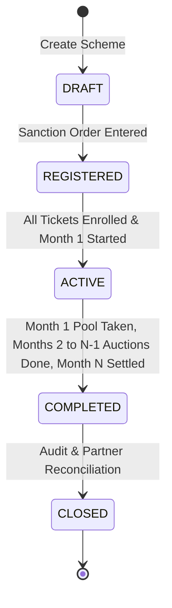
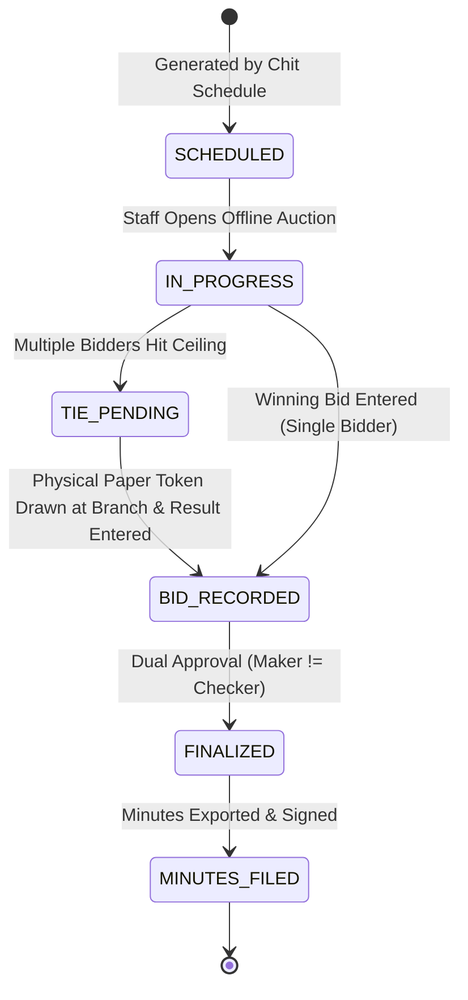
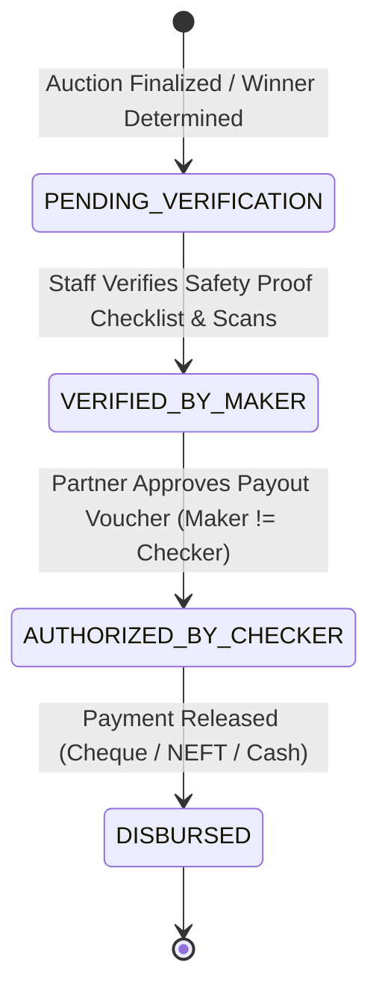
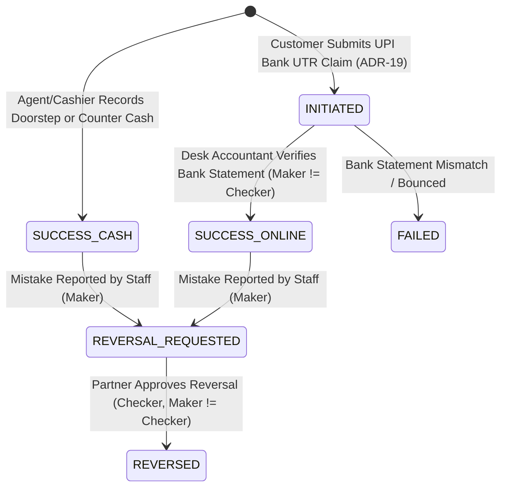
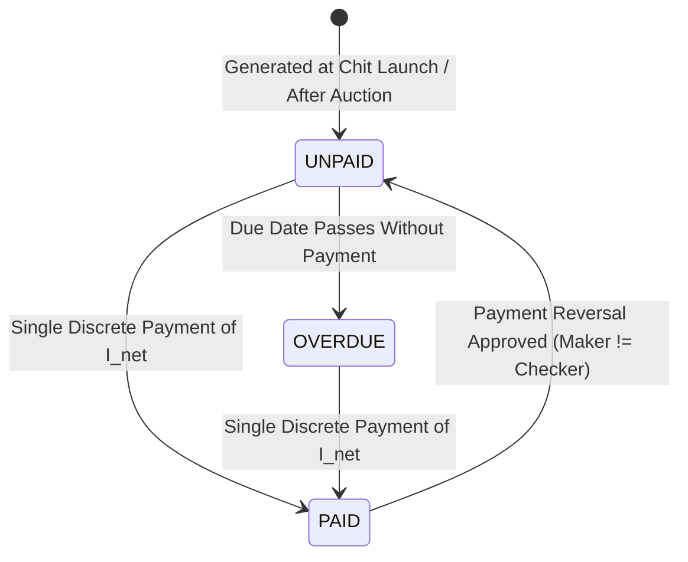
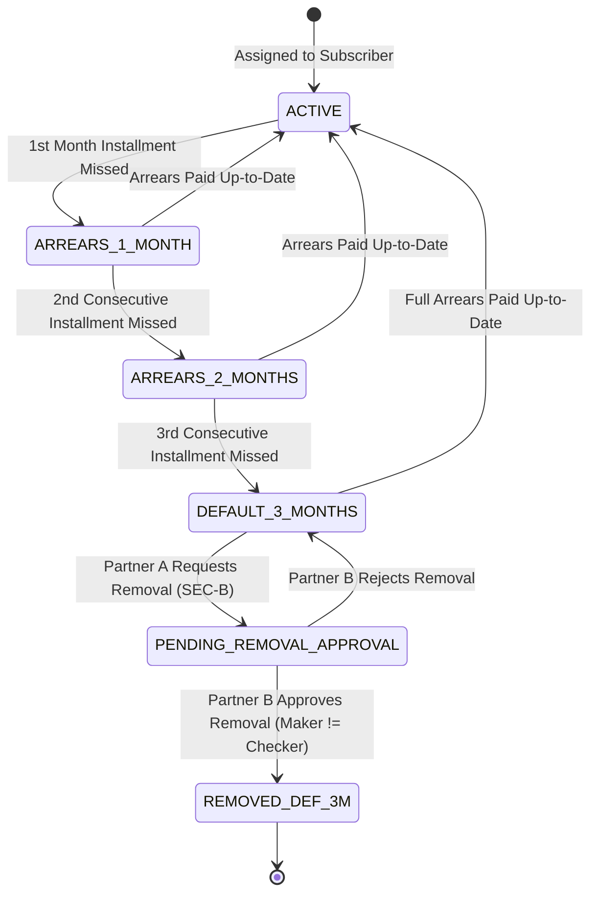

# Kumaran Chits — Lifecycle State Machines Specification

> **Product**: **Kumaran Chits** (Kumaran Finance)  
> **Mandate**: State transitions must be validated on the backend. Client apps cannot force state changes without meeting transition guards.  
> **Integrity Standard**: Strictly enforced **Maker-Checker separation of duties** (`maker_user_id != checker_user_id`) and **Whole Integer Rupee arithmetic** (`CONFIRMED-BY-DEVELOPER`).

---

## 1. Chit Group Lifecycle State Machine (`CONFIRMED-BY-DEVELOPER`)

### Transition Guards:
- **`DRAFT` $\to$ `REGISTERED`**: Requires valid `sanctionOrderNumber` and `sanctionDate` from the Chit Registrar.
- **`REGISTERED` $\to$ `ACTIVE`**: Requires that all $N$ tickets are assigned to verified subscribers (including 1 company representative ticket).
- **`ACTIVE` $\to$ `COMPLETED`**:
  - Month 1: Full pool collected and taken by company customer (no auction; `CONFIRMED-BY-DEVELOPER`).
  - Months 2 to $N-1$: All monthly auctions recorded, finalized, and prize disbursements completed.
  - Month $N$: Final settlement executed without auction (company takes 4% commission and last month's payable; settles prize money to final subscriber; `CONFIRMED-BY-DEVELOPER`).
- **`COMPLETED` $\to$ `CLOSED`**: Requires Accountant and Super Admin (Partner) sign-off and balance reconciliation.

---

## 2. In-Office Auction Lifecycle State Machine (Months 2 to $N-1$) (`CONFIRMED-BY-DEVELOPER`)

> **Note on Month 1 & Month $N$ (`CONFIRMED-BY-DEVELOPER`)**:  
> Month 1 and Month $N$ do **NOT** undergo this auction lifecycle. Month 1 pool is taken by the company customer ticket directly. Month $N$ is settled directly to the final remaining non-prized subscriber. This state machine applies exclusively to **Months 2 through $N-1$**.

> [!NOTE]
> **Database Column Mapping**: In PostgreSQL, `Auction.status` uses strictly 3 persisted enum states: `SCHEDULED` (covers creation, bid recording, and paper token lot draws), `COMPLETED` (set upon Checker finalization), and `MINUTES_FILED` (set when Form XVII minutes are filed). The states `IN_PROGRESS`, `TIE_PENDING`, and `BID_RECORDED` represent logical workflow sub-phases within `SCHEDULED`.

### Transition Guards:
- **`IN_PROGRESS` $\to$ `BID_RECORDED`**:
  - Guard 1: Winning discount $D \le \frac{V}{4}$ (validates against fixed 1/4 ceiling of total chit value).
  - Guard 2: Winning discount $D \ge \text{Foreman Commission}$ ($4.00\%$).
  - Guard 3: Winner ticket must be active and non-prized.
  - Guard 4: **Auction Ineligibility for Unpaid Dues (`CONFIRMED-BY-DEVELOPER`)**: The bidding ticket must have paid its installment due for the current month (`due.status == PAID`). Unpaid subscribers are strictly blocked from participating or bidding in that month's auction.
- **`TIE_PENDING` $\to$ `BID_RECORDED` (Physical Paper Token Tie-Break)**:
  - Foreman conducts physical paper token/lot draw live at the branch in front of attending subscribers (`CONFIRMED-BY-DEVELOPER`).
  - Branch staff enters the physically drawn winning ticket number into the software.
  - Software logs all tied bidders and records the physical draw outcome without running an electronic random lottery.
- **`BID_RECORDED` $\to$ `FINALIZED`**:
  - Requires **Partner-to-Partner Maker-Checker dual approval**: The partner or staff member who conducted the auction and entered the result cannot finalize it (`maker_user_id != checker_user_id`). Partner A records $\to$ Partner B, C, or D reviews and commits.
  - Automatically calculates Foreman Commission ($C_f = V \times 0.04$), Total Dividend ($Div_{total} = D - C_f$), and per-ticket dividend allocated equally across all members (including auction winners).
  - Generates next month's net installment dues in whole integer Rupees ($I_{net} = I_{base} - Div_{ticket}$) uniformly for all members.

---

## 3. Prize Disbursement & Safety Proof Checklist State Machine (`CONFIRMED-BY-DEVELOPER`)

### Transition Guards:
- **`PENDING_VERIFICATION` $\to$ `VERIFIED_BY_MAKER`**:
  - Property documents are completely eliminated. Collateral/surety is **not mandatory** across the board; requested only if required by Kumaran Finance for company safety on a case-by-case basis.
  - Accountant or Partner A (acting as Maker) verifies paperwork and records checklist in software:
    1. Safety proof required for this winner? [Yes / No]
    2. Winner agreement signed? [Yes / No]
    3. Nominee signed? [Yes / No]
    4. Signed blank cheque(s) with details submitted? [Yes / No]
    5. Promissory note / personal guarantee submitted? [Yes / No]
    6. Scanned copies uploaded to secure storage.
- **`VERIFIED_BY_MAKER` $\to$ `AUTHORIZED_BY_CHECKER`**:
  - Super Admin / Partner B authorizes the payout voucher.
  - Enforces `maker_user_id != checker_user_id` (Partner A cannot self-approve; Partner B, C, or D must authorize).
- **`AUTHORIZED_BY_CHECKER` $\to$ `DISBURSED`**:
  - Funds released via selected mode: Cheque, Bank Transfer (NEFT/RTGS/IMPS), or Cash.
  - Voucher number and payment reference recorded.

---

## 4. Payment & Cash Handover State Machine (`CONFIRMED-BY-DEVELOPER`)

> [!NOTE]
> **Database Column Mapping**: In PostgreSQL, `Payment.paymentStatus` is an enum (`INITIATED`, `SUCCESS`, `FAILED`, `REVERSED`), while cash custody during field collections is tracked via `Payment.cashHandoverStatus` (`PENDING_HANDOVER` $\to$ `ACKNOWLEDGED`).
> - **Doorstep & Counter Cash**: When an agent or cashier records cash, `paymentStatus` is immediately `SUCCESS` (crediting the subscriber's passbook and satisfying the monthly due), and `cashHandoverStatus` remains `PENDING_HANDOVER` until acknowledged by a Partner into the vault.
> - **Native 1-Tap UPI Intent Claims (ADR-19)**: When a customer launches UPI, transfers directly to KVB, and submits their 12-digit Bank UTR claim (`POST /payments/upi-claim`), a `Payment` record is created in `INITIATED` status with unique `transactionRef`. Upon Desk Accountant verification against the KVB bank statement (`POST /payments/:id/verify-upi-claim`), `paymentStatus` transitions to `SUCCESS` under strict Maker != Checker dual control.

### Transition Guards:
- **`[*] ` $\to$ `INITIATED` (Customer 1-Tap UPI Claim)**:
  - Customer completes payment on external UPI app (GPay/PhonePe/Paytm/Cred) and submits the 12-digit UTR reference (`POST /payments/upi-claim`).
  - Unique constraint on `transactionRef` strictly blocks duplicate claims.
  - Installment remains `UNPAID` until verification.
- **`INITIATED` $\to$ `SUCCESS` (Accountant Bank Statement Verification Guard)**:
  - Desk Accountant or Partner inspects the pending queue (`GET /payments/pending-upi-claims`), confirms credit in Karur Vysya Bank current account, and verifies (`POST /payments/:id/verify-upi-claim`).
  - Enforces `maker_user_id != checker_user_id` (a staff member who submitted a claim cannot verify it).
  - Automatically transitions installment due to `PAID` and triggers bilingual receipt.
- **`[*] ` $\to$ `PENDING_HANDOVER` $\to$ `ACKNOWLEDGED` (Field Cash Handover Guard)**:
  - Agent records physical cash collected in the field, creating a payment batch in `PENDING_HANDOVER`.
  - At end-of-day, the agent submits cash to the branch.
  - **Dual-Role Cash Handover Guard**: Since field agents also perform desk accounting duties, the software strictly enforces:
    $$\texttt{collector\_user\_id} \ne \texttt{acknowledger\_user\_id}$$
    An agent who collected the cash can **never** acknowledge their own handover. An independent Partner (Super Admin) must physically verify and sign off the cash into the branch vault.
- **`INITIATED` $\to$ `SUCCESS`**:
  - Issues sequential bilingual receipt (English + Tamil) in whole integer Rupees.
  - **Single Discrete Payment & Zero Partial Payments (`CONFIRMED-BY-DEVELOPER`)**:
    - Each payment is strictly for **one discrete month's net installment ($I_{net}$)** in full.
    - Partial payments and overpayments are strictly prohibited; floating allocations across multiple dues do not exist.
    - Zero double payments and zero advance balances exist in the system.
    - Marks that specific month's `InstallmentDue` status as `PAID`.
- **`SUCCESS` $\to$ `REVERSED`**:
  - Never deletes the original payment record.
  - Reverses the payment, restores the corresponding `InstallmentDue` strictly to `UNPAID`, and marks receipt as `VOID / CANCELED`.
  - Requires maker justification and checker authorization by Super Admin (`maker_user_id != checker_user_id`).

---

## 5. Installment Due Lifecycle State Machine (`CONFIRMED-BY-DEVELOPER`)

### Transition Guards:
- **`[*] ` $\to$ `UNPAID`**:
  - Generated automatically for each subscriber ticket upon chit group registration (Month 1) or immediately following auction finalization (Months 2 to $N$).
  - Net amount calculated as $I_{net} = I_{base} - Div_{ticket}$ in whole integer Rupees.
- **`UNPAID` $\to$ `OVERDUE`**:
  - Automatically triggered when the monthly due date passes without full payment.
  - **Auction Ineligibility**: Subscriber is strictly blocked from bidding in that month's auction until paid.
- **`UNPAID` / `OVERDUE` $\to$ `PAID`**:
  - Triggered exclusively by a single discrete payment of the exact net amount ($I_{net}$).
  - **Zero Partial Payments**: `DueStatus` has strictly 3 states (`UNPAID`, `PAID`, `OVERDUE`).
- **`PAID` $\to$ `UNPAID`**:
  - Triggered when a payment reversal is approved under Maker-Checker dual control. Restores the due back to `UNPAID` with zero mathematical discrepancy.

---

## 6. Subscriber Ticket & 3-Month Arrears State Machine (`CONFIRMED-BY-DEVELOPER`)

> [!NOTE]
> **Database Column Mapping**: In PostgreSQL, continuous arrears are tracked via the integer column `SubscriberTicket.consecutiveUnpaidMonths` (e.g. 1, 2, 3+). The ticket `status` column remains `'ACTIVE'` during 1st and 2nd month arrears, transitions automatically to `'DEFAULT_3_MONTHS'` when `consecutiveUnpaidMonths >= 3`, and transitions to `'REMOVED_DEF_3M'` when Super Admin executes company removal rights.

### Transition Guards:
- **`ACTIVE` $\to$ `ARREARS_1_MONTH` / `ARREARS_2_MONTHS`**:
  - Automatically triggered when monthly due date passes without payment.
  - Ineligibility: Subscribers in arrears are **strictly ineligible to bid in that month's auction** (`CONFIRMED-BY-DEVELOPER`).
- **`ARREARS_2_MONTHS` $\to$ `DEFAULT_3_MONTHS`**:
  - Triggered when `consecutiveUnpaidMonths == 3`. Ticket is flagged for default removal.
- **`DEFAULT_3_MONTHS` $\to$ `PENDING_REMOVAL_APPROVAL` $\to$ `REMOVED_DEF_3M` (SEC-B Two-Partner Dual Control)**:
  - **Step 1 (Maker Request)**: Partner A (`SUPER_ADMIN` with `isPartner: true`) submits removal request: `POST /tickets/:id/remove-defaulter/request` with `removalReason`. Status transitions to `PENDING_REMOVAL_APPROVAL`.
  - **Step 2 (Checker Approval)**: Independent Partner B (`SUPER_ADMIN` with `isPartner: true`) reviews justification: `POST /tickets/:id/remove-defaulter/approve`. Backend enforces `ticket.removalRequestedByUserId !== checkerPartnerUserId` (`maker != checker`).
  - Sets `status: REMOVED_DEF_3M` and vacates ticket for customer substitution.
  - Generates immutable audit event `DEFAULTER_REMOVAL_APPROVED`.
  - **Q25 Financial Guardrail**: Financial damage settlement on removal remains **BLOCKED** and fails closed with `UNAPPROVED_SETTLEMENT_POLICY` pending legal confirmation.

---

## 7. Full-Product $N \times N$ Status Transition Matrices (113 Transitions across 9 Lifecycles)

> **Architectural Invariant**: Every operational model in Kumaran Chits that possesses a status field is mathematically bounded by an exhaustive $N \times N$ transition matrix. Any transition not explicitly registered as **Allowed** is strictly **Fail-Closed** on the server, throwing an immediate HTTP 400 `BadRequestException`. Client applications (Web, Mobile) cannot force state bypasses.
>
> **Concurrency & Deadlock Protection (`withTransactionRetry` + `SELECT ... FOR UPDATE`)**: All critical state transitions across [`AuctionService`](file:///u:/Kumaran-finance/apps/api/src/auction/auction.service.ts) (`recordBid`, `recordTieBreak`, `finalizeAuction`, `markMinutesFiled`), [`DisbursementService`](file:///u:/Kumaran-finance/apps/api/src/disbursement/disbursement.service.ts) (`verifySafetyProof`, `authorizePayout`, `releasePayout`, `settleFinalMonth`), [`InstallmentService`](file:///u:/Kumaran-finance/apps/api/src/installment/installment.service.ts) (`generateMonthlyDues`, `substituteSubscriber`), and [`PaymentService`](file:///u:/Kumaran-finance/apps/api/src/payment/payment.service.ts) (`requestReversal`, `approveReversal`, `rejectReversal`) execute under [`withTransactionRetry`](file:///u:/Kumaran-finance/apps/api/src/common/utils/transaction-retry.util.ts) and acquire row-level locks via [`state-transition-lock.util.ts`](file:///u:/Kumaran-finance/apps/api/src/common/utils/state-transition-lock.util.ts) in strict DAG order inside PostgreSQL 17 before mutating status columns.

### Comprehensive Transition Census Summary
| # | Entity & Status Column | Number of States ($N$) | Total Transitions ($N \times N$) | Legally Allowed | Strictly Fail-Closed |
|---|---|:---:|:---:|:---:|:---:|
| 1 | `ChitGroup.status` | 5 | 25 | 5 | 20 |
| 2 | `SubscriberTicket.status` | 4 | 16 | 5 | 11 |
| 3 | `Auction.status` | 3 | 9 | 2 | 7 |
| 4 | `AuctionWinner.disbursementStatus` | 4 | 16 | 3 | 13 |
| 5 | `InstallmentDue.status` | 3 | 9 | 4 | 5 |
| 6 | `Payment.paymentStatus` | 4 | 16 | 3 | 13 |
| 7 | `PaymentReversal.status` | 3 | 9 | 2 | 7 |
| 8 | `Payment.cashHandoverStatus` | 2 | 4 | 1 | 3 |
| 9 | `Payment.chequeStatus` | 3 | 9 | 2 | 7 |
| **TOTAL** | **9 Status Lifecycles** | — | **113** | **27** | **86** |

---

### Matrix 1: `ChitGroup.status` ($5 \times 5 = 25$)
- **States**: `DRAFT`, `REGISTERED`, `ACTIVE`, `COMPLETED`, `CLOSED`

| From \ To | `DRAFT` | `REGISTERED` | `ACTIVE` | `COMPLETED` | `CLOSED` |
|---|:---:|:---:|:---:|:---:|:---:|
| **`DRAFT`** | ❌ 400 | ✅ Allowed (Order entered) | ✅ Allowed (Fast-track) | ❌ 400 | ❌ 400 |
| **`REGISTERED`** | ❌ 400 | ❌ 400 | ✅ Allowed (All $N$ filled) | ❌ 400 | ❌ 400 |
| **`ACTIVE`** | ❌ 400 | ❌ 400 | ❌ 400 | ✅ Allowed (All $N$ months done) | ❌ 400 |
| **`COMPLETED`** | ❌ 400 | ❌ 400 | ❌ 400 | ❌ 400 | ✅ Allowed (Reconciled & signed) |
| **`CLOSED`** | ❌ 400 | ❌ 400 | ❌ 400 | ❌ 400 | ❌ 400 |

*Allowed (5)*: `DRAFT -> REGISTERED`, `DRAFT -> ACTIVE`, `REGISTERED -> ACTIVE`, `ACTIVE -> COMPLETED`, `COMPLETED -> CLOSED`.  
*Fail-Closed (20)*: All other 20 transitions throw HTTP 400.

---

### Matrix 2: `SubscriberTicket.status` ($4 \times 4 = 16$)
- **States**: `ACTIVE`, `DEFAULT_3_MONTHS`, `REMOVED_DEF_3M`, `SURRENDERED`

| From \ To | `ACTIVE` | `DEFAULT_3_MONTHS` | `REMOVED_DEF_3M` | `SURRENDERED` |
|---|:---:|:---:|:---:|:---:|
| **`ACTIVE`** | ❌ 400 | ✅ Allowed (3 unpaid months) | ❌ 400 | ✅ Allowed (Voluntary surrender) |
| **`DEFAULT_3_MONTHS`** | ✅ Allowed (Full arrears cleared) | ❌ 400 | ✅ Allowed (Company removes) | ❌ 400 |
| **`REMOVED_DEF_3M`** | ✅ Allowed (New subscriber substituted) | ❌ 400 | ❌ 400 | ❌ 400 |
| **`SURRENDERED`** | ❌ 400 | ❌ 400 | ❌ 400 | ❌ 400 |

*Allowed (5)*: `ACTIVE -> DEFAULT_3_MONTHS`, `ACTIVE -> SURRENDERED`, `DEFAULT_3_MONTHS -> ACTIVE`, `DEFAULT_3_MONTHS -> REMOVED_DEF_3M`, `REMOVED_DEF_3M -> ACTIVE`.  
*Fail-Closed (11)*: All other 11 transitions throw HTTP 400.

---

### Matrix 3: `Auction.status` ($3 \times 3 = 9$)
- **States**: `SCHEDULED`, `COMPLETED`, `MINUTES_FILED`

| From \ To | `SCHEDULED` | `COMPLETED` | `MINUTES_FILED` |
|---|:---:|:---:|:---:|
| **`SCHEDULED`** | ❌ 400 | ✅ Allowed (Checker finalizes) | ❌ 400 |
| **`COMPLETED`** | ❌ 400 | ❌ 400 | ✅ Allowed (Form XVII minutes filed) |
| **`MINUTES_FILED`** | ❌ 400 | ❌ 400 | ❌ 400 |

*Allowed (2)*: `SCHEDULED -> COMPLETED`, `COMPLETED -> MINUTES_FILED`.  
*Fail-Closed (7)*: All other 7 transitions throw HTTP 400.

---

### Matrix 4: `AuctionWinner.disbursementStatus` ($4 \times 4 = 16$)
- **States**: `PENDING_VERIFICATION`, `VERIFIED_BY_MAKER`, `AUTHORIZED_BY_CHECKER`, `DISBURSED`

| From \ To | `PENDING_VERIFICATION` | `VERIFIED_BY_MAKER` | `AUTHORIZED_BY_CHECKER` | `DISBURSED` |
|---|:---:|:---:|:---:|:---:|
| **`PENDING_VERIFICATION`** | ❌ 400 | ✅ Allowed (Maker verifies safety proof) | ❌ 400 | ❌ 400 |
| **`VERIFIED_BY_MAKER`** | ❌ 400 | ❌ 400 | ✅ Allowed (Checker authorizes payout) | ❌ 400 |
| **`AUTHORIZED_BY_CHECKER`** | ❌ 400 | ❌ 400 | ❌ 400 | ✅ Allowed (Accountant releases funds) |
| **`DISBURSED`** | ❌ 400 | ❌ 400 | ❌ 400 | ❌ 400 |

*Allowed (3)*: Strict linear pipeline `PENDING_VERIFICATION -> VERIFIED_BY_MAKER -> AUTHORIZED_BY_CHECKER -> DISBURSED`.  
*Fail-Closed (13)*: All other 13 transitions throw HTTP 400.

---

### Matrix 5: `InstallmentDue.status` ($3 \times 3 = 9$)
- **States**: `UNPAID`, `PAID`, `OVERDUE`

| From \ To | `UNPAID` | `PAID` | `OVERDUE` |
|---|:---:|:---:|:---:|
| **`UNPAID`** | ❌ 400 | ✅ Allowed (Discrete payment) | ✅ Allowed (Due date passed) |
| **`PAID`** | ✅ Allowed (Reversal approved) | ❌ 400 (Double-pay blocked) | ❌ 400 |
| **`OVERDUE`** | ❌ 400 | ✅ Allowed (Arrears payment) | ❌ 400 |

*Allowed (4)*: `UNPAID -> PAID`, `UNPAID -> OVERDUE`, `PAID -> UNPAID`, `OVERDUE -> PAID`.  
*Fail-Closed (5)*: All other 5 transitions throw HTTP 400.

---

### Matrix 6: `Payment.paymentStatus` ($4 \times 4 = 16$)
- **States**: `INITIATED`, `SUCCESS`, `FAILED`, `REVERSED`

| From \ To | `INITIATED` | `SUCCESS` | `FAILED` | `REVERSED` |
|---|:---:|:---:|:---:|:---:|
| **`INITIATED`** | ❌ 400 | ✅ Allowed (Bank verified / Gateway confirmed) | ✅ Allowed (UTR reject / Gateway fail) | ❌ 400 |
| **`SUCCESS`** | ❌ 400 | ❌ 400 | ❌ 400 | ✅ Allowed (Dual-control reversal) |
| **`FAILED`** | ❌ 400 | ❌ 400 | ❌ 400 | ❌ 400 |
| **`REVERSED`** | ❌ 400 | ❌ 400 | ❌ 400 | ❌ 400 |

*Allowed (3)*: `INITIATED -> SUCCESS`, `INITIATED -> FAILED`, `SUCCESS -> REVERSED`.  
*Fail-Closed (13)*: All other 13 transitions throw HTTP 400.

---

### Matrix 7: `PaymentReversal.status` ($3 \times 3 = 9$)
- **States**: `REQUESTED`, `APPROVED`, `REJECTED`

| From \ To | `REQUESTED` | `APPROVED` | `REJECTED` |
|---|:---:|:---:|:---:|
| **`REQUESTED`** | ❌ 400 | ✅ Allowed (Partner signs off) | ✅ Allowed (Partner rejects) |
| **`APPROVED`** | ❌ 400 | ❌ 400 | ❌ 400 |
| **`REJECTED`** | ❌ 400 | ❌ 400 | ❌ 400 |

*Allowed (2)*: `REQUESTED -> APPROVED`, `REQUESTED -> REJECTED`.  
*Fail-Closed (7)*: All other 7 transitions throw HTTP 400.

---

### Matrix 8: `Payment.cashHandoverStatus` ($2 \times 2 = 4$)
- **States**: `PENDING_HANDOVER`, `ACKNOWLEDGED`

| From \ To | `PENDING_HANDOVER` | `ACKNOWLEDGED` |
|---|:---:|:---:|
| **`PENDING_HANDOVER`** | ❌ 400 | ✅ Allowed (Vault deposit signed off) |
| **`ACKNOWLEDGED`** | ❌ 400 | ❌ 400 |

*Allowed (1)*: `PENDING_HANDOVER -> ACKNOWLEDGED`.  
*Fail-Closed (3)*: All other 3 transitions throw HTTP 400.

---

### Matrix 9: `Payment.chequeStatus` ($3 \times 3 = 9$)
- **States**: `PENDING`, `CLEARED`, `BOUNCED`

| From \ To | `PENDING` | `CLEARED` | `BOUNCED` |
|---|:---:|:---:|:---:|
| **`PENDING`** | ❌ 400 | ✅ Allowed (Bank credit confirmed) | ✅ Allowed (Dishonored by bank) |
| **`CLEARED`** | ❌ 400 | ❌ 400 | ❌ 400 |
| **`BOUNCED`** | ❌ 400 | ❌ 400 | ❌ 400 |

*Allowed (2)*: `PENDING -> CLEARED`, `PENDING -> BOUNCED`.  
*Fail-Closed (7)*: All other 7 transitions throw HTTP 400.
