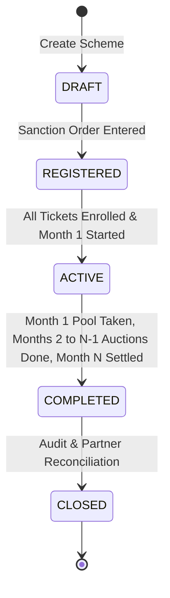
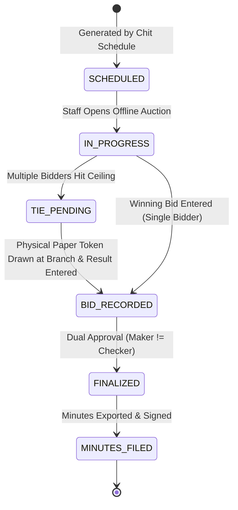
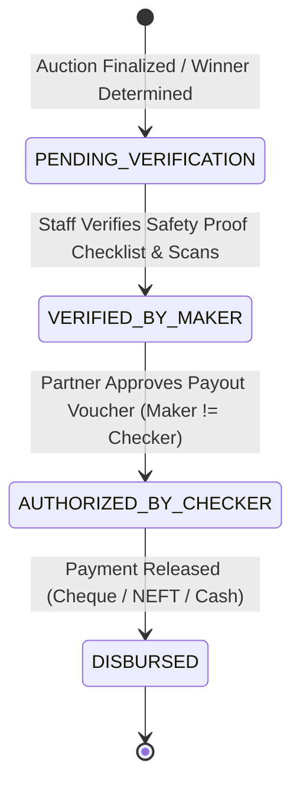
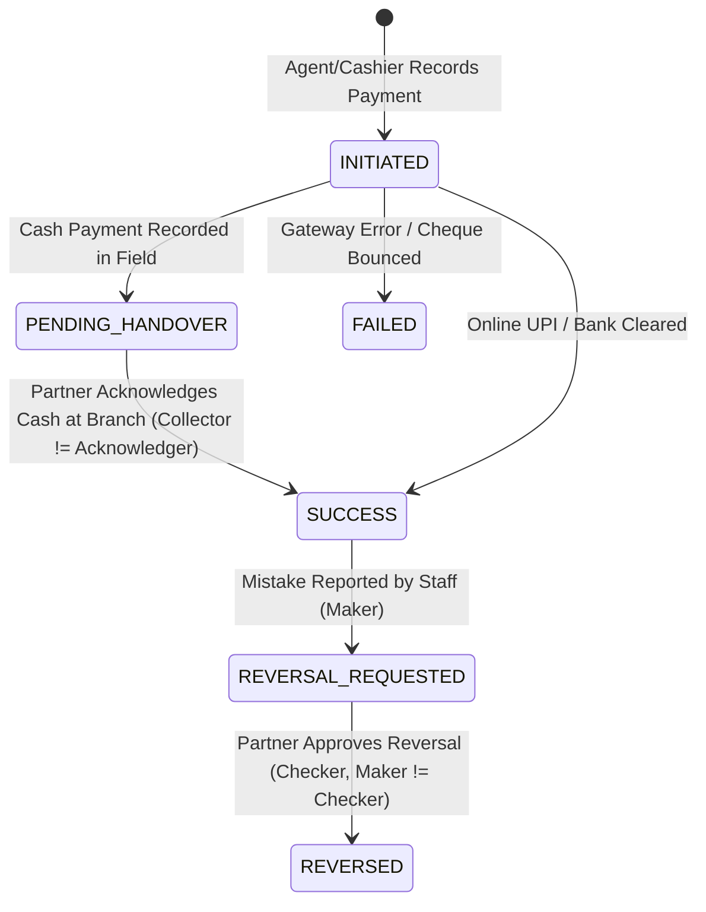
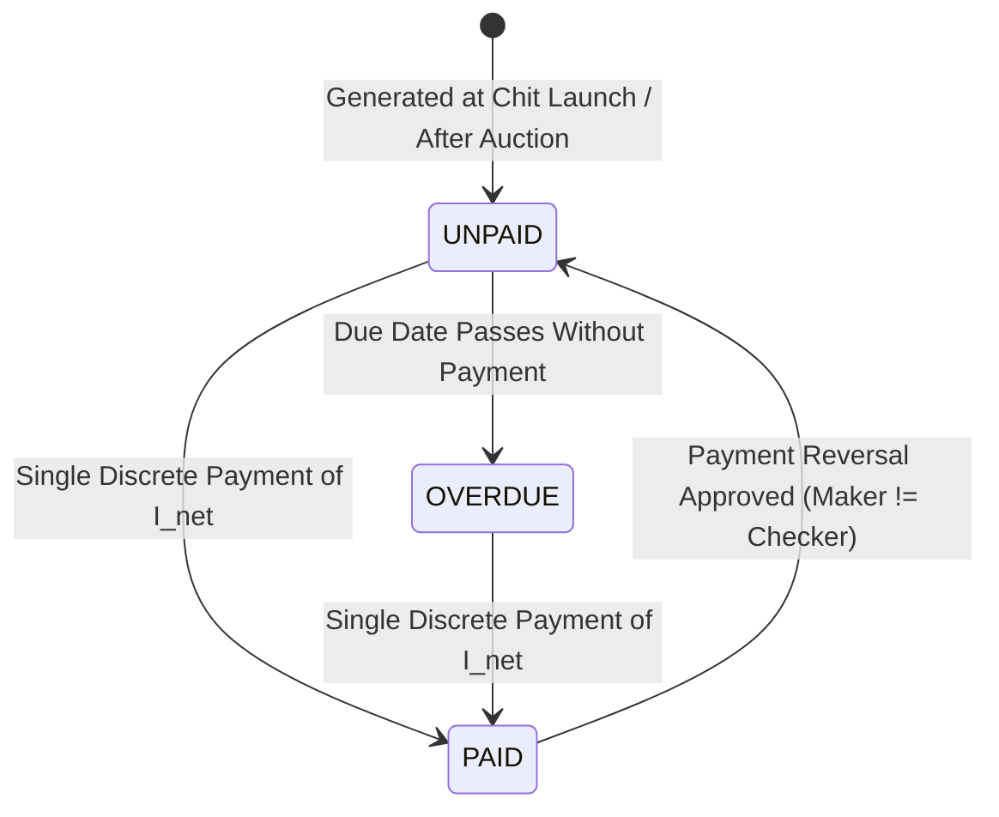
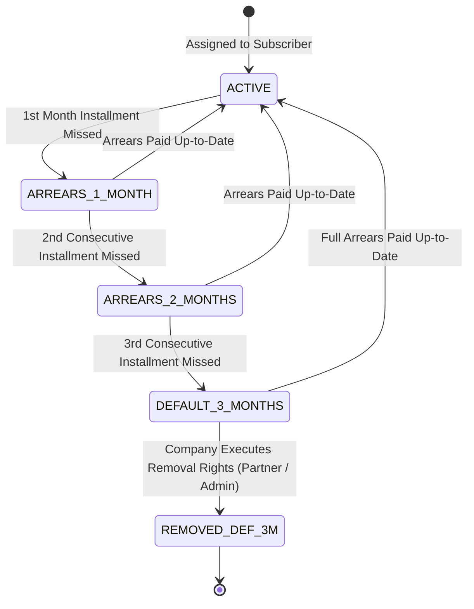

# Kumaran Chits — Lifecycle State Machines Specification

> **Product**: **Kumaran Chits** (Kumaran Finance)  
> **Mandate**: State transitions must be validated on the backend. Client apps cannot force state changes without meeting transition guards.  
> **Integrity Standard**: Strictly enforced **Maker-Checker separation of duties** (`maker_user_id != checker_user_id`) and **Whole Integer Rupee arithmetic** (`CONFIRMED-BY-DEVELOPER`).

---

## 1. Chit Group Lifecycle State Machine (`CONFIRMED-BY-DEVELOPER`)

### Transition Guards:
- **`DRAFT` $\to$ `REGISTERED`**: Requires valid `sanctionOrderNumber` and `sanctionDate` from the Chit Registrar.
- **`REGISTERED` $\to$ `ACTIVE`**: Requires that all $N$ tickets are assigned to verified subscribers (including 1 company representative ticket).
- **`ACTIVE` $\to$ `COMPLETED`**:
  - Month 1: Full pool collected and taken by company customer (no auction; `CONFIRMED-BY-DEVELOPER`).
  - Months 2 to $N-1$: All monthly auctions recorded, finalized, and prize disbursements completed.
  - Month $N$: Final settlement executed without auction (company takes 4% commission and last month's payable; settles prize money to final subscriber; `CONFIRMED-BY-DEVELOPER`).
- **`COMPLETED` $\to$ `CLOSED`**: Requires Accountant and Super Admin (Partner) sign-off and balance reconciliation.

---

## 2. In-Office Auction Lifecycle State Machine (Months 2 to $N-1$) (`CONFIRMED-BY-DEVELOPER`)

> **Note on Month 1 & Month $N$ (`CONFIRMED-BY-DEVELOPER`)**:  
> Month 1 and Month $N$ do **NOT** undergo this auction lifecycle. Month 1 pool is taken by the company customer ticket directly. Month $N$ is settled directly to the final remaining non-prized subscriber. This state machine applies exclusively to **Months 2 through $N-1$**.

> [!NOTE]
> **Database Column Mapping**: In PostgreSQL, `Auction.status` uses strictly 3 persisted enum states: `SCHEDULED` (covers creation, bid recording, and paper token lot draws), `COMPLETED` (set upon Checker finalization), and `MINUTES_FILED` (set when Form XVII minutes are filed). The states `IN_PROGRESS`, `TIE_PENDING`, and `BID_RECORDED` represent logical workflow sub-phases within `SCHEDULED`.

### Transition Guards:
- **`IN_PROGRESS` $\to$ `BID_RECORDED`**:
  - Guard 1: Winning discount $D \le \frac{V}{4}$ (validates against fixed 1/4 ceiling of total chit value).
  - Guard 2: Winning discount $D \ge \text{Foreman Commission}$ ($4.00\%$).
  - Guard 3: Winner ticket must be active and non-prized.
  - Guard 4: **Auction Ineligibility for Unpaid Dues (`CONFIRMED-BY-DEVELOPER`)**: The bidding ticket must have paid its installment due for the current month (`due.status == PAID`). Unpaid subscribers are strictly blocked from participating or bidding in that month's auction.
- **`TIE_PENDING` $\to$ `BID_RECORDED` (Physical Paper Token Tie-Break)**:
  - Foreman conducts physical paper token/lot draw live at the branch in front of attending subscribers (`CONFIRMED-BY-DEVELOPER`).
  - Branch staff enters the physically drawn winning ticket number into the software.
  - Software logs all tied bidders and records the physical draw outcome without running an electronic random lottery.
- **`BID_RECORDED` $\to$ `FINALIZED`**:
  - Requires **Partner-to-Partner Maker-Checker dual approval**: The partner or staff member who conducted the auction and entered the result cannot finalize it (`maker_user_id != checker_user_id`). Partner A records $\to$ Partner B, C, or D reviews and commits.
  - Automatically calculates Foreman Commission ($C_f = V \times 0.04$), Total Dividend ($Div_{total} = D - C_f$), and per-ticket dividend allocated equally across all members (including auction winners).
  - Generates next month's net installment dues in whole integer Rupees ($I_{net} = I_{base} - Div_{ticket}$) uniformly for all members.

---

## 3. Prize Disbursement & Safety Proof Checklist State Machine (`CONFIRMED-BY-DEVELOPER`)

### Transition Guards:
- **`PENDING_VERIFICATION` $\to$ `VERIFIED_BY_MAKER`**:
  - Property documents are completely eliminated. Collateral/surety is **not mandatory** across the board; requested only if required by Kumaran Finance for company safety on a case-by-case basis.
  - Accountant or Partner A (acting as Maker) verifies paperwork and records checklist in software:
    1. Safety proof required for this winner? [Yes / No]
    2. Winner agreement signed? [Yes / No]
    3. Nominee signed? [Yes / No]
    4. Signed blank cheque(s) with details submitted? [Yes / No]
    5. Promissory note / personal guarantee submitted? [Yes / No]
    6. Scanned copies uploaded to secure storage.
- **`VERIFIED_BY_MAKER` $\to$ `AUTHORIZED_BY_CHECKER`**:
  - Super Admin / Partner B authorizes the payout voucher.
  - Enforces `maker_user_id != checker_user_id` (Partner A cannot self-approve; Partner B, C, or D must authorize).
- **`AUTHORIZED_BY_CHECKER` $\to$ `DISBURSED`**:
  - Funds released via selected mode: Cheque, Bank Transfer (NEFT/RTGS/IMPS), or Cash.
  - Voucher number and payment reference recorded.

---

## 4. Payment & Cash Handover State Machine (`CONFIRMED-BY-DEVELOPER`)

> [!NOTE]
> **Database Column Mapping**: In PostgreSQL, `Payment.paymentStatus` is an enum (`INITIATED`, `SUCCESS`, `FAILED`, `REVERSED`), while cash custody during field collections is tracked via `Payment.cashHandoverStatus` (`PENDING_HANDOVER` $\to$ `ACKNOWLEDGED`). When an agent records doorstep cash, `paymentStatus` is immediately `SUCCESS` (crediting the subscriber's passbook and satisfying the monthly due), and `cashHandoverStatus` remains `PENDING_HANDOVER` until acknowledged by a Partner into the vault.

### Transition Guards:
- **`INITIATED` $\to$ `PENDING_HANDOVER` $\to$ `SUCCESS` (Field Cash Handover Guard)**:
  - Agent records physical cash collected in the field, creating a payment batch in `PENDING_HANDOVER`.
  - At end-of-day, the agent submits cash to the branch.
  - **Dual-Role Cash Handover Guard**: Since field agents also perform desk accounting duties, the software strictly enforces:
    $$\texttt{collector\_user\_id} \ne \texttt{acknowledger\_user\_id}$$
    An agent who collected the cash can **never** acknowledge their own handover. An independent Partner (Super Admin) must physically verify and sign off the cash into the branch vault.
- **`INITIATED` $\to$ `SUCCESS`**:
  - Issues sequential bilingual receipt (English + Tamil) in whole integer Rupees.
  - **Single Discrete Payment & Zero Partial Payments (`CONFIRMED-BY-DEVELOPER`)**:
    - Each payment is strictly for **one discrete month's net installment ($I_{net}$)** in full.
    - Partial payments and overpayments are strictly prohibited; floating allocations across multiple dues do not exist.
    - Zero double payments and zero advance balances exist in the system.
    - Marks that specific month's `InstallmentDue` status as `PAID`.
- **`SUCCESS` $\to$ `REVERSED`**:
  - Never deletes the original payment record.
  - Reverses the payment, restores the corresponding `InstallmentDue` strictly to `UNPAID`, and marks receipt as `VOID / CANCELED`.
  - Requires maker justification and checker authorization by Super Admin (`maker_user_id != checker_user_id`).

---

## 5. Installment Due Lifecycle State Machine (`CONFIRMED-BY-DEVELOPER`)

### Transition Guards:
- **`[*] ` $\to$ `UNPAID`**:
  - Generated automatically for each subscriber ticket upon chit group registration (Month 1) or immediately following auction finalization (Months 2 to $N$).
  - Net amount calculated as $I_{net} = I_{base} - Div_{ticket}$ in whole integer Rupees.
- **`UNPAID` $\to$ `OVERDUE`**:
  - Automatically triggered when the monthly due date passes without full payment.
  - **Auction Ineligibility**: Subscriber is strictly blocked from bidding in that month's auction until paid.
- **`UNPAID` / `OVERDUE` $\to$ `PAID`**:
  - Triggered exclusively by a single discrete payment of the exact net amount ($I_{net}$).
  - **Zero Partial Payments**: `DueStatus` has strictly 3 states (`UNPAID`, `PAID`, `OVERDUE`).
- **`PAID` $\to$ `UNPAID`**:
  - Triggered when a payment reversal is approved under Maker-Checker dual control. Restores the due back to `UNPAID` with zero mathematical discrepancy.

---

## 6. Subscriber Ticket & 3-Month Arrears State Machine (`CONFIRMED-BY-DEVELOPER`)

> [!NOTE]
> **Database Column Mapping**: In PostgreSQL, continuous arrears are tracked via the integer column `SubscriberTicket.consecutiveUnpaidMonths` (e.g. 1, 2, 3+). The ticket `status` column remains `'ACTIVE'` during 1st and 2nd month arrears, transitions automatically to `'DEFAULT_3_MONTHS'` when `consecutiveUnpaidMonths >= 3`, and transitions to `'REMOVED_DEF_3M'` when Super Admin executes company removal rights.

### Transition Guards:
- **`ACTIVE` $\to$ `ARREARS_1_MONTH` / `ARREARS_2_MONTHS`**:
  - Automatically triggered when monthly due date passes without payment.
  - Ineligibility: Subscribers in arrears are **strictly ineligible to bid in that month's auction** (`CONFIRMED-BY-DEVELOPER`).
- **`ARREARS_2_MONTHS` $\to$ `DEFAULT_3_MONTHS`**:
  - Triggered when `consecutiveUnpaidMonths == 3`. Ticket is flagged for default removal.
- **`DEFAULT_3_MONTHS` $\to$ `REMOVED_DEF_3M`**:
  - Requires **Company Management / Partner Authorization**: Company exercises its confirmed right to remove the customer from the chit group.
  - Generates an immutable audit event with `removedByUserId` and timestamp.
  - Ticket is freed for substitution / re-assignment or account settlement according to company terms.
