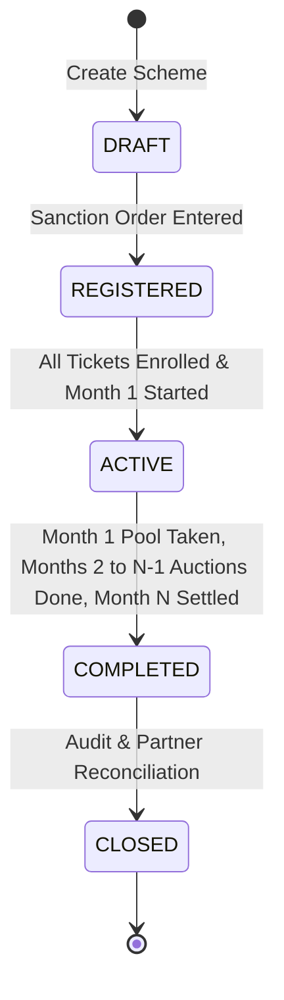
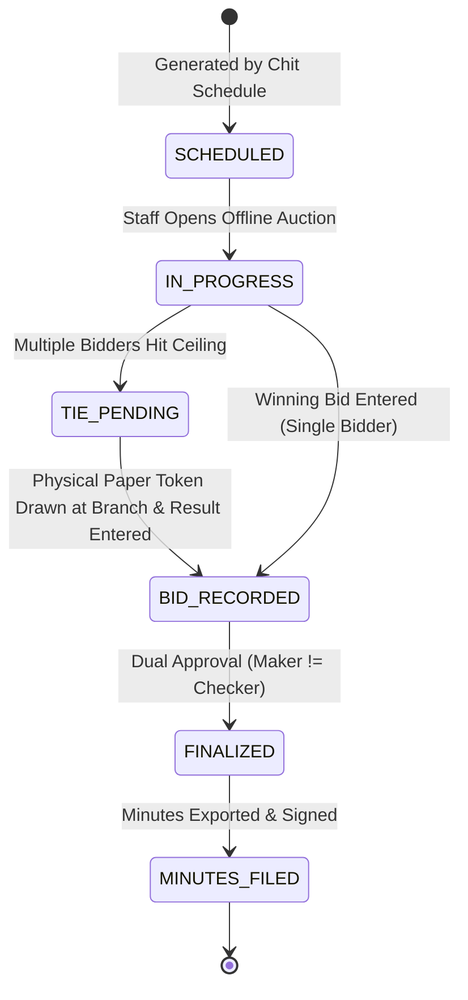
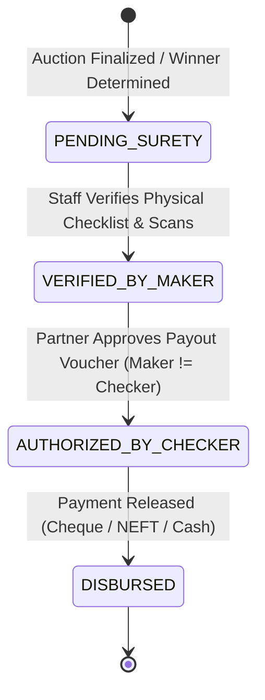
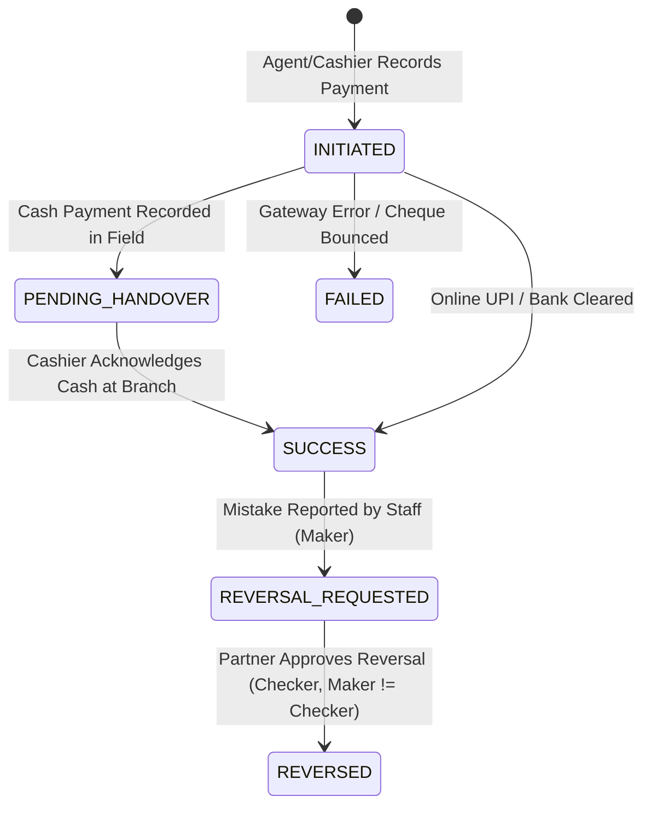
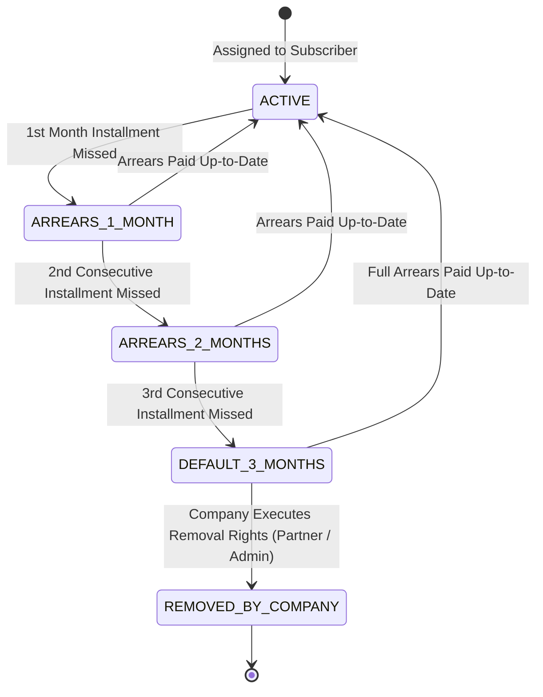

# Kumaran Chits — Lifecycle State Machines Specification

> **Product**: **Kumaran Chits** (Kumaran Finance)  
> **Mandate**: State transitions must be validated on the backend. Client apps cannot force state changes without meeting transition guards.  
> **Integrity Standard**: Strictly enforced **Maker-Checker separation of duties** (`maker_user_id != checker_user_id`) and **Whole Integer Rupee arithmetic** (`CONFIRMED-BY-DEVELOPER`).

---

## 1. Chit Group Lifecycle State Machine (`CONFIRMED-BY-DEVELOPER`)

### Transition Guards:
- **`DRAFT` $\to$ `REGISTERED`**: Requires valid `sanctionOrderNumber` and `sanctionDate` from the Chit Registrar.
- **`REGISTERED` $\to$ `ACTIVE`**: Requires that all $N$ tickets are assigned to verified subscribers (including 1 company representative ticket).
- **`ACTIVE` $\to$ `COMPLETED`**:
  - Month 1: Full pool collected and taken by company customer (no auction; `CONFIRMED-BY-DEVELOPER`).
  - Months 2 to $N-1$: All monthly auctions recorded, finalized, and prize disbursements completed.
  - Month $N$: Final settlement executed without auction (company takes 4% commission and last month's payable; settles prize money to final subscriber; `CONFIRMED-BY-DEVELOPER`).
- **`COMPLETED` $\to$ `CLOSED`**: Requires Accountant and Super Admin (Partner) sign-off and balance reconciliation.

---

## 2. In-Office Auction Lifecycle State Machine (Months 2 to $N-1$) (`CONFIRMED-BY-DEVELOPER`)

> **Note on Month 1 & Month $N$ (`CONFIRMED-BY-DEVELOPER`)**:  
> Month 1 and Month $N$ do **NOT** undergo this auction lifecycle. Month 1 pool is taken by the company customer ticket directly. Month $N$ is settled directly to the final remaining non-prized subscriber. This state machine applies exclusively to **Months 2 through $N-1$**.

### Transition Guards:
- **`IN_PROGRESS` $\to$ `BID_RECORDED`**:
  - Guard 1: Winning discount $D \le \text{Max Ceiling}$ for that month (validates against dynamic ceiling rule).
  - Guard 2: Winning discount $D \ge \text{Foreman Commission}$ ($4.00\%$).
  - Guard 3: Winner ticket must be active and non-prized.
  - Guard 4: **Auction Ineligibility for Unpaid Dues (`CONFIRMED-BY-DEVELOPER`)**: The bidding ticket must have paid its installment due for the current month (`due.status == PAID`). Unpaid subscribers are strictly blocked from participating or bidding in that month's auction.
- **`TIE_PENDING` $\to$ `BID_RECORDED` (Physical Paper Token Tie-Break)**:
  - Foreman conducts physical paper token/lot draw live at the branch in front of attending subscribers (`CONFIRMED-BY-DEVELOPER`).
  - Branch staff enters the physically drawn winning ticket number into the software.
  - Software logs all tied bidders and records the physical draw outcome without running an electronic random lottery.
- **`BID_RECORDED` $\to$ `FINALIZED`**:
  - Requires **Maker-Checker dual approval**: The staff member who entered the auction result cannot finalize it (`maker_user_id != checker_user_id`).
  - Automatically calculates Foreman Commission ($C_f = V \times 0.04$), Total Dividend ($Div_{total} = D - C_f$), and per-ticket dividend allocated to non-prized members.
  - Generates next month's net installment dues in whole integer Rupees ($I_{net} = I_{base} - Div_{ticket}$).

---

## 3. Prize Disbursement & Surety Checklist State Machine (`CONFIRMED-BY-DEVELOPER`)

### Transition Guards:
- **`PENDING_SURETY` $\to$ `VERIFIED_BY_MAKER`**:
  - Branch Manager or Accountant verifies physical paperwork and records checklist in software:
    1. Property documents submitted? [Yes / No]
    2. Winner agreement signed? [Yes / No]
    3. Nominee signed? [Yes / No]
    4. Scanned copies uploaded to secure storage.
- **`VERIFIED_BY_MAKER` $\to$ `AUTHORIZED_BY_CHECKER`**:
  - Super Admin (Partner) authorizes the payout voucher.
  - Enforces `maker_user_id != checker_user_id`.
- **`AUTHORIZED_BY_CHECKER` $\to$ `DISBURSED`**:
  - Funds released via selected mode: Cheque, Bank Transfer (NEFT/RTGS/IMPS), or Cash.
  - Voucher number and payment reference recorded.

---

## 4. Payment & Cash Handover State Machine (`CONFIRMED-BY-DEVELOPER`)

### Transition Guards:
- **`INITIATED` $\to$ `SUCCESS`**:
  - Issues sequential bilingual receipt (English + Tamil) in whole integer Rupees.
  - Allocates funds to oldest unpaid installment dues.
  - **Conflict Handling Rule**: If online payment and offline field collection occur for the same month, extra cash is credited as **Advance Balance** toward next month's installment (`CONFIRMED-BY-DEVELOPER`).
- **`SUCCESS` $\to$ `REVERSED`**:
  - Never deletes the original payment record.
  - Reverses allocations on installment dues and cancels receipt.
  - Requires maker justification and checker authorization by Super Admin (`maker_user_id != checker_user_id`).

---

## 5. Subscriber Ticket & 3-Month Arrears State Machine (`CONFIRMED-BY-DEVELOPER`)

### Transition Guards:
- **`ACTIVE` $\to$ `ARREARS_1_MONTH` / `ARREARS_2_MONTHS`**:
  - Automatically triggered when monthly due date passes without payment.
  - Ineligibility: Subscribers in arrears are **strictly ineligible to bid in that month's auction** (`CONFIRMED-BY-DEVELOPER`).
- **`ARREARS_2_MONTHS` $\to$ `DEFAULT_3_MONTHS`**:
  - Triggered when `consecutiveUnpaidMonths == 3`. Ticket is flagged for default removal.
- **`DEFAULT_3_MONTHS` $\to$ `REMOVED_BY_COMPANY`**:
  - Requires **Company Management / Partner Authorization**: Company exercises its confirmed right to remove the customer from the chit group.
  - Generates an immutable audit event with `removedByUserId` and timestamp.
  - Ticket is freed for substitution / re-assignment or account settlement according to company terms.
