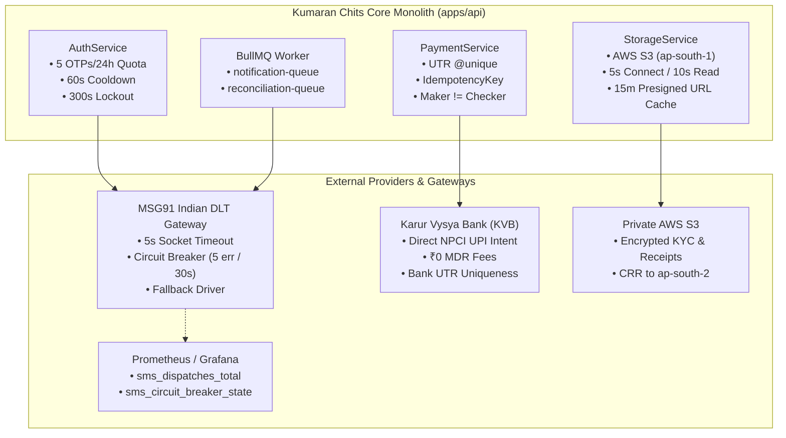

# Third-Party Integrations & External Service Resilience Architecture

> **Product**: **Kumaran Chits** (Kumaran Finance, Perundurai, Tamil Nadu)  
> **Status**: Authoritative Architectural Specification (`CONFIRMED-BY-DEVELOPER`)  
> **Key Architectural Decisions**: [ADR-02 (Whole Rupee Math)](../01-business/decision-log.md), [ADR-06 (Ceiling & Tie-Break)](../01-business/decision-log.md), [ADR-18 (Phone-Only Identity)](../01-business/decision-log.md), [ADR-19 (Zero-Fee Native UPI Intent & Bank UTR Uniqueness)](../01-business/decision-log.md), [Guardrail 10 (Maker != Checker)](../../AGENTS.md)

---

## 1. Executive Summary & Design Principles

Kumaran Chits is a licensed Indian chit-fund operations software platform managing high-value member subscriptions, cash vault handovers, and auction prize disbursements. To guarantee absolute financial determinism, regulatory compliance, and operational resilience under Indian telecom and banking realities:

1. **Deterministic Financial Math over AI/LLMs**: No external AI APIs are permitted in transaction or ledger paths. Invariant Guardrail 2 enforces pure whole-rupee math (`BigInt`), and Invariant Guardrail 6 strictly prohibits automated lottery draws in favor of physical paper token draws in front of members.
2. **Zero Aggregator Fee Leakage (ADR-19)**: Third-party payment aggregators (Razorpay, Cashfree, Stripe) with 2% MDR fees are eliminated. Transactions use native NPCI `upi://pay` deep-links directly settling into Karur Vysya Bank (KVB), tracked by unique Bank UTRs and reconciled via atomic `$transaction` background jobs.
3. **Phone-Only Identity & Zero Email (ADR-18)**: Email is permanently eliminated from database schemas and authentication workflows. All customer interactions use 10-digit Indian mobile numbers (`^[6-9]\d{9}$`). Notifications are offloaded to asynchronous BullMQ queues.
4. **Defense-in-Depth against Telecom Outages**: SMS delivery through MSG91 incorporates TRAI DLT compliance, rolling 24-hour daily quotas, circuit breakers, tightened 5s timeouts, multi-provider failover, and Prometheus APM telemetry.

---

## 2. The 7 Integration Domains & Resilience Matrix



| Area | Status | Architectural Defense & Production Guard |
|---|:---:|---|
| **1. AI API Rate Limits & Outages** | `PASS` | **Zero AI in Transaction Paths**: Prohibited by design. Chit formulas are deterministic; winner selection requires physical paper token draw. |
| **2. Payment Gateway Failures** | `PASS` | **ADR-19 Native UPI Intent**: Zero 3rd-party gateway downtime; payments settle directly into KVB account. `ReconciliationService` recovers ghost drops atomically. |
| **3. Email Delivery Bottlenecks** | `PASS` | **ADR-18 Phone-Only Identity**: Zero email overhead. All receipts and alerts are queued asynchronously to BullMQ (`notification-queue`). |
| **4. OTP & SMS Delays / Rate Limits** | `PASS` | **24h Rolling Quota (5/day)**, 60s cooldown lock, 5-attempt brute-force lockout, circuit breaker (5 failures / 30s), and automatic fallback driver. |
| **5. Hanging External Calls** | `PASS` | **Tightened 5,000ms Outbound Timeout** on MSG91 with socket destroy, and 5s connect / 10s read timeout on AWS S3 (`NodeHttpHandler`). |
| **6. API Quotas & Usage Monitoring** | `PASS` | **Prometheus APM Telemetry**: `kumaran_sms_dispatches_total` and `kumaran_sms_circuit_breaker_state` monitored with Grafana alerts. |
| **7. Duplicate Webhook Delivery** | `PASS` | **Database UTR Constraint**: `Payment.transactionRef @unique` rejects duplicate bank UTRs with HTTP 409; `Payment.idempotencyKey` prevents duplicate minting. |

---

## 3. Detailed Specifications

### 3.1 24-Hour Rolling Daily OTP Quota Model
To prevent SMS wallet depletion and SMS bombing attacks, `AuthService.requestOtp` enforces a 3-tier defense:
1. **Tier 1: Rolling 24-Hour Quota (5 requests / 24 hours)**: Tracked in Redis under `auth:otp:daily:${phone}` with an 86,400-second expiration. Requests beyond 5 fail-closed with HTTP 429 (`TOO_MANY_REQUESTS`).
2. **Tier 2: 60-Second Cooldown**: Tracked under `auth:otp:cooldown:${phone}` with a 60-second TTL to prevent rapid successive requests.
3. **Tier 3: 5-Attempt Brute-Force Lockout**: 3 consecutive invalid OTP guesses trigger a 300-second temporary lockout (`auth:otp:lockout:${phone}`).
4. **Atomic Rollback on Telecom Failure**: If MSG91 throws an exception or returns a timeout error, the active OTP session, cooldown lock, and daily increment are automatically decremented via `decrementDailyOtpCount`, ensuring legitimate subscribers are never penalized.

### 3.2 Outbound Socket Hardening & 5s Timeouts
In [`apps/api/src/notification/drivers/msg91-sms.driver.ts`](../../apps/api/src/notification/drivers/msg91-sms.driver.ts):
- `timeoutMs = 5000` (5 seconds).
- Sockets bind explicit connect timeouts via `req.on('socket', (socket) => socket.setTimeout(5000))`.
- On timeout or network error, `req.destroy()` is called immediately to free libuv sockets and avoid tying up BullMQ notification workers.
- Exponential backoff with jitter: 400ms base delay, maximum 2,000ms delay, 2 retries on HTTP 5xx, 408, or 429.

### 3.3 Multi-Provider Failover Architecture
In [`apps/api/src/notification/services/sms.service.ts`](../../apps/api/src/notification/services/sms.service.ts):
- Primary driver: `Msg91SmsDriver`.
- Backup driver: Configurable secondary driver (e.g., secondary MSG91 credentials, Fast2SMS, or Twilio) via `SMS_BACKUP_DRIVER_TOKEN`.
- When primary driver returns an error or when its `CircuitBreaker` trips `OPEN`, `SmsService` logs an administrative warning and automatically retries dispatch via the backup provider without throwing unhandled exceptions.

### 3.4 Prometheus APM Telemetry for External SMS
In [`apps/api/src/metrics/services/metrics.service.ts`](../../apps/api/src/metrics/services/metrics.service.ts):
1. **`kumaran_sms_dispatches_total`** (`Counter`):
   - Labels: `provider`, `template`, `status` (`success`, `fallback_success`, `circuit_open`, `failure`, `bypassed`).
2. **`kumaran_sms_circuit_breaker_state`** (`Gauge`):
   - Labels: `provider`.
   - Values: `0` (CLOSED / Healthy), `1` (HALF_OPEN / Testing), `2` (OPEN / Tripped).
   - Prometheus Alert Rule:
     ```yaml
     - alert: SmsGatewayCircuitBreakerTripped
       expr: kumaran_sms_circuit_breaker_state > 1
       for: 1m
       labels:
         severity: critical
       annotations:
         summary: "MSG91 SMS Gateway Circuit Breaker is OPEN"
         description: "SMS delivery to subscribers has degraded. Verify MSG91 wallet balance and TRAI DLT status."
     ```

### 3.5 Bank UTR Anti-Duplication Protocol (ADR-19)
- All non-cash payment records require a bank UTR or cheque reference (`transactionRef`).
- `Payment.transactionRef` is decorated with `@unique` in Prisma (`Payment_transactionRef_key`).
- Concurrent or replayed submissions trigger Prisma error `P2002` and return HTTP 409 `DUPLICATE_TRANSACTION_REF`.
- Reconciliations via `ReconciliationService.reconcileSettlement` process bank statement records inside a Prisma `$transaction`, matching `payment.transactionRef === record.gatewayOrderId`. If already matched, it records `matchedCount++` without altering balances or duplicating receipts.
