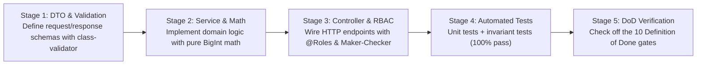

# Kumaran Chits — AI-Agent Development Playbook

> **Product**: **Kumaran Chits**  
> **Company**: **Kumaran Finance**  
> **Target Audience**: Solo Developer pair-programming with AI Coding Assistants  
> **Core Mandate**: High financial precision, small reviewable increments, zero guessing. **If any rule is ambiguous, stop and ask the developer before executing code.**

---

## 1. The Guided Coding Philosophy

As a solo developer working with AI:
1. **Small Increments Only**: Never generate massive 500-line code dumps across multiple files at once. Build one function, one endpoint, or one test at a time.
2. **Search for PoC (Proof of Concept) First**: Before writing any new module or integration, inspect existing codebase patterns, Prisma schemas, or standard NestJS/Flutter reference implementations to avoid inventing unnecessary architectures.
3. **Stop & Ask (Zero Hallucination Policy)**: If a business rule, calculation formula, or legal condition is not 100% explicitly documented in `docs/`, the AI assistant **MUST STOP and ask the developer** before making assumptions.
4. **Modularity & File Sizing**: Keep files clean and focused (ideally under 300–400 lines). If a service or controller grows too large, propose separating it into modular sub-services or helper files and link them cleanly.

---

## 2. The 10 Non-Negotiable Invariant Guardrails

Every AI coding assistant working in this repository must strictly adhere to these 10 guardrails:

| # | Guardrail | Technical Rule | What to Check Before Approving |
|---|---|---|---|
| **1** | **Single Company** | Built exclusively for Kumaran Finance. | No `company_id` columns or multi-tenant abstractions. |
| **2** | **Pure Whole Rupee Math** | Stored as `BigInt` / `bigint`. | Zero paise, zero decimals (`.00`), zero JavaScript `number` or `float` for currency. |
| **3** | **Commission Freeze** | 4.00% default, frozen per chit group. | Rate locked upon chit activation; never recalculated retroactively. |
| **4** | **Universal Dividends** | Deducted from all members equally: $I_{net} = I_{base} - Div$. | All members (including the auction winner) pay the same discounted net installment next month. |
| **5** | **Month 1 & Month $N$** | Month 1 pool goes to company ticket (no auction); Month $N$ settled directly to final subscriber (no auction). | Auctions run exclusively in Months 2 through $N-1$. |
| **6** | **Fixed 1/4 Ceiling & Physical Tie-Breaks** | Max discount = 1/4 of chit value ($D \le \frac{V}{4}$). Offline physical paper token draw at branch (Option A). | No dynamic ceiling; no autonomous software lottery draws or electronic RNG algorithms. |
| **7** | **Ticket Limit** | Maximum 1 ticket per customer in the same chit group. | Enforce database constraint: `@@unique([chitGroupId, customerId])`. |
| **8** | **Defaulter & Payment Rules** | (1) Unpaid for current month = ineligible to bid. (2) 3 consecutive unpaid months = removal rights. (3) Zero double payment / advance balance. | Backend transition guards reject unpaid bidders and enforce single discrete payment per month. |
| **9** | **Company Safety Proof** | Flexible checklist recordkeeper (signed agreement [Yes/No], nominee signed [Yes/No], blank cheques [Yes/No], scans). | Property documents eliminated; security is **not mandatory** across the board and requested only for company safety. |
| **10** | **Maker $\ne$ Checker** | Dual authorization enforced on reversals, auctions, and payouts. | Reject any transaction where `maker_user_id == checker_user_id`. |

---

## 3. Task-to-Documentation Cross-Reference Map

To prevent AI hallucination, always instruct the AI agent to read the exact corresponding specification document before beginning any task:

```text
TASK / FEATURE                      -->   MANDATORY SPECIFICATION DOCUMENT TO READ
-------------------------------------------------------------------------------------------------------------------
Database schema, fields, or types   -->   docs/03-architecture/data-model.md
Financial math, dividends, ceilings  -->   docs/01-business/financial-rules.md
Role permissions & Maker-Checker    -->   docs/01-business/permissions-matrix.md
Module functional requirements      -->   docs/02-requirements/prd.md
API routes, methods, and DTOs       -->   docs/03-architecture/api-spec.md
State transitions & lifecycle guards -->   docs/03-architecture/state-machines.md
Receipt formatting & SMS/WhatsApp   -->   docs/02-requirements/notification-and-receipt-templates.md
Writing unit/invariant tests        -->   docs/05-testing/financial-tests.md
Database migrations & seeding       -->   docs/04-engineering/database-migration-and-seeding-guide.md
Quality gate checklist before merge  -->   docs/04-engineering/definition-of-done.md
Ongoing notebook intake wizard      -->   docs/07-operations/manual-onboarding-sop.md
Cash handovers & field collections  -->   docs/07-operations/operations-sop.md
Web Admin Dashboard screens         -->   docs/07-operations/user-manuals/admin-foreman-manual.md
Android Agent mobile app screens    -->   docs/07-operations/user-manuals/agent-mobile-manual.md
Customer mobile app screens         -->   docs/07-operations/user-manuals/customer-app-guide.md
```

---

## 4. The 5-Stage Module Implementation Lifecycle

When developing any of the 10 core modules in `apps/api/src/`, execute strictly in this 5-stage order:



---

## 5. Copy-Paste AI Prompt Templates

Use these ready-to-use prompt templates when instructing an AI assistant:

### Prompt Template 1: Implementing a Service (Business Logic)
```text
You are pair-programming on Kumaran Chits (Kumaran Finance).
We are implementing the business logic for: [MODULE NAME, e.g., Auction Finalization].

Mandatory Rules:
1. First, search for existing PoC code in the repository and read: [SPEC DOCUMENT PATH, e.g., docs/01-business/financial-rules.md].
2. Use strictly whole integer Rupees (BigInt/bigint). Never use number, float, or paise.
3. Enforce Maker != Checker: The user entering this action cannot be the one finalizing it.
4. If any rule is unclear, stop and ask me before writing code.
5. Keep the code small and reviewable. Explain what each function does in plain language.
```

### Prompt Template 2: Writing Automated Tests
```text
You are writing automated tests for: [MODULE NAME, e.g., Dividend Distribution].

Mandatory Rules:
1. Read docs/05-testing/financial-tests.md for the required mathematical invariants.
2. Use BigInt literals (e.g., 100000n, 5000n) in all test assertions.
3. Include positive test cases, boundary tests, and negative tests (e.g., maker == checker must fail, bidding with unpaid dues must fail).
4. Provide the exact terminal command to run these tests.
```

---

## 6. Pre-Commit Developer Verification Checklist

Before accepting any AI-generated code or committing to Git, ask the AI (or verify yourself):
- [ ] *Did you use any `number` or floating-point types for monetary values?* (Must be `BigInt`).
- [ ] *Does this transaction verify that `maker_user_id != checker_user_id`?*
- [ ] *Are unpaid subscribers prevented from bidding in this auction?*
- [ ] *Did you prevent a customer from holding 2 tickets in the same group?*
- [ ] *Did you write automated unit tests covering failure edge cases?*
- [ ] *Is the file under 350 lines, or does it need to be split into modular files?*
