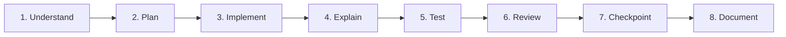

# Kumaran Chits — AI Coding Guidelines & Developer Protocol

> **Product**: **Kumaran Chits**  
> **Company**: **Kumaran Finance**  
> **Role**: Solo developer pair-programming with AI  
> **Methodology**: **Guided coding loop** — small, reviewable increments. Never generate massive, unverified code dumps.  
> **Core Principle**: Correctness of financial records comes before animation or feature count.

---

## 1. Non-Negotiable Financial & Architecture Guardrails (`CONFIRMED-BY-DEVELOPER`)

1. **No Binary Floating-Point Numbers or Paise for Money**:
   - Never use JavaScript `number` (IEEE 754 float) for currency calculations.
   - Database: Always use PostgreSQL 64-bit integer Rupees (**`BigInt`**). Paise and fractional currency are strictly prohibited (`CONFIRMED-BY-DEVELOPER`).
   - TypeScript: Use native **`bigint`** for all currency amounts with clean whole-rupee math.

2. **Server-Side Authoritative Truth**:
   - The PostgreSQL database is the single source of truth for financial balances, auction winners, and payment statuses.
   - Client clocks (Android/Web) are never trusted for auction cutoffs, bid acceptance, or payment confirmation.

3. **Append-Only Financial Ledger**:
   - Never run `DELETE` or `UPDATE` on posted financial transactions or `AuditLog` entries (enforced at the PostgreSQL 17 storage engine level by `ENABLE ALWAYS` triggers `trg_prevent_audit_log_mutation` & `trg_prevent_audit_log_truncate`).
   - Adjustments and cancellations must use auditable **reversal records** with an authorized reason and user ID.

4. **Maker-Checker Separation of Duties & Verified Partner Identity (Guardrails 10–11 / `ADR-21`)**:
   - Critical actions (payment reversals, auction finalization/corrections, prize disbursements, defaulter removals) strictly enforce **`maker_user_id != checker_user_id`** at application and PostgreSQL engine levels (**8 `CHECK` constraints**, `CONFIRMED-BY-DEVELOPER`).
   - Only verified statutory business partners (`Role.PARTNER`) may authorize financial mutations; IT Super Admins (`Role.SUPER_ADMIN`) strictly manage IT administrative functions and are strictly barred from financial operations, while audit logs and BullMQ telemetry remain strictly `Role.SUPER_ADMIN`-only.
   - Under no circumstances may a user approve their own entry.

5. **No AI Features in Operational Scope**:
   - Exclude chatbots, predictive risk scoring, or autonomous AI agents from operational financial processing.

---

## 2. The 8-Step Guided Coding Loop

For every feature or module, follow this loop sequentially:



1. **Understand**: State the exact requirement and assumptions. Identify any ambiguous business or legal rules and ask for human confirmation.
2. **Plan**: Propose the smallest safe implementation and list all files to create or change.
3. **Implement**: Generate one small, reviewable piece of code at a time.
4. **Explain**: Walk through each file, function, validation rule, and database schema change in plain language.
5. **Test**: Run unit/integration tests and inspect the actual output.
6. **Review**: Identify edge cases, race conditions, security vulnerabilities, and financial risks.
7. **Checkpoint**: Commit the working state to Git with a conventional commit message.
8. **Document**: Update relevant documentation, schema notes, or API specs.

---

## 3. Standard AI Prompt Template

When instructing an AI coding assistant on Kumaran Chits tasks, use this exact prompt structure:

```text
You are helping me build Kumaran Chits, an operations platform for
Kumaran Finance in Tamil Nadu, India.

Stack:
- Next.js 15 + React + TypeScript web dashboard (Phase 1 primary UI)
- NestJS 12 + TypeScript backend (Modular Monolith)
- Shared TypeScript Client SDK (@kumaran/api-client) & Dart Client Core (apps/mobile/lib/core/; Flutter Android UI deferred to Phase 2 Q2 2027 per ADR-26)
- PostgreSQL 17 + Prisma ORM (18 models, 23 migrations, 8 engine CHECK constraints)
- Redis 7 + BullMQ (background jobs only, not source of truth)

I am learning and want guided coding, not a giant code dump.

For this task:
1. Restate the requirement and assumptions.
2. Identify any business/legal rules that need confirmation.
3. Propose the smallest safe implementation.
4. List the files to create or change.
5. Explain the code in plain language.
6. Add tests, including failure and edge cases.
7. Explain how to run the tests and verify the result.
8. Identify security and financial-integrity risks.
9. Do not invent chit calculation rules; all monetary math is strictly whole integer Rupees (BigInt / bigint; zero paise).
10. Enforce Maker-Checker dual control (maker_user_id != checker_user_id) on reversals, auctions, and prize disbursements.
11. Do not change unrelated files or add unnecessary dependencies.
12. Never use floating-point types for money.
13. Do not mark payments successful based only on client input.
14. Do not bypass authentication, authorization, or audit logging.
15. Stop and ask questions if a business rule is ambiguous.

Implement only the requested task and wait for my verification before moving on.
```

---

## 4. Definition of Done (DoD) for Every Module

Every module and financial feature must strictly satisfy the 10 quality, security, and verification gates defined in the dedicated specification document:
👉 **[Kumaran Chits — Definition of Done (DoD)](file:///u:/Kumaran-finance/docs/04-engineering/definition-of-done.md)**.
