# Kumaran Chits — Definition of Done (DoD)

> **Product**: **Kumaran Chits** (Kumaran Finance)  
> **Rule**: A task, endpoint, or screen is **NOT DONE** merely because the code compiles or the UI renders. In financial software, every increment must satisfy all quality, security, and verification gates below.

---

## 1. Module-by-Module Quality Gate Checklist

Every feature or backend module must check off all 10 gates before being merged into `main`:

```mermaid
flowchart LR
    G1["1. Business Approved"] --> G2["2. Input Validation"]
    G2 --> G3["3. DB Migrations & Constraints"]
    G3 --> G4["4. RBAC & Branch Scoping"]
    G4 --> G5["5. Financial Invariant Tests"]
    G5 --> G6["6. Idempotency Keys"]
    G6 --> G7["7. Audit Trail Events"]
    G7 --> G8["8. UI State Coverage"]
    G8 --> G9["9. Documentation Updated"]
    G9 --> G10["10. Git Checkpoint Committed"]
```

### Gate 1: Business & Legal Review
- [ ] Requirements and calculation formulas documented in `docs/` and approved by relevant stakeholders (Accountant/Owner).
- [ ] No ambiguous business rules left to developer assumption.

### Gate 2: Server-Side Input Validation
- [ ] All DTOs use `class-validator` / `zod` with strict type checking.
- [ ] No untrusted client-supplied values (e.g., client clocks, self-calculated balances, arbitrary payment status) are accepted.

### Gate 3: Database Integrity & Constraints
- [ ] Foreign keys, unique constraints (e.g., unique receipt numbers, unique ticket per chit, and maximum 1 ticket per customer in the same chit group via `@@unique([chitGroupId, customerId])`), and check constraints defined in Prisma schema.
- [ ] SQL migration reviewed and applied without data corruption risk.
- [ ] Monetary columns use 64-bit integer Rupees (**`BigInt`**); zero floating-point numbers and zero paise (`CONFIRMED-BY-DEVELOPER`).

### Gate 4: Security & Authorization (RBAC)
- [ ] Endpoint is protected with JWT Auth Guard and Role Decorators (`@Roles(Role.BRANCH_MANAGER)`).
- [ ] Branch scoping enforced: Users cannot read or mutate data outside their assigned branch unless granted global scope.
- [ ] Sensitive operations (payment reversals, auction finalization, prize payouts) require Maker-Checker dual approval with **`maker_user_id != checker_user_id`** strictly enforced (`CONFIRMED-BY-DEVELOPER`).

### Gate 5: Automated Testing Coverage
- [ ] Unit tests for services and calculation logic pass with 100% success rate.
- [ ] Integration tests verify database transactions and pessimistic row locking (`SELECT FOR UPDATE`).
- [ ] Mathematical invariant tests verify zero rupee leaks:
  $$\text{Foreman Commission } (4\%) + \text{Dividends (Non-Prized)} = \text{Discount}$$
- [ ] Negative tests verify that unauthorized requests, self-approvals (`maker == checker`), and illegal discount bids are cleanly rejected.

### Gate 6: Idempotency & Concurrency
- [ ] Financial mutation endpoints (`POST /payments`, `POST /collections`, `POST /reversals`) enforce the `Idempotency-Key` header to safely handle network timeouts and retried requests.

### Gate 7: Immutable Audit Logging
- [ ] Mutation emits an append-only `AuditLog` record capturing `userId`, `action`, `entityType`, `entityId`, `oldValue`, `newValue`, and timestamp.

### Gate 8: Comprehensive UI States (Mobile / Web)
- [ ] Screens implement all 4 core visual states:
  1. **Loading State**: Shimmer / spinner while fetching data.
  2. **Empty State**: Friendly illustration and message when no data exists.
  3. **Success State**: Clear confirmation banner and bilingual digital receipt.
  4. **Error State**: Informative error message with safe retry button.

### Gate 9: Documentation & API Contracts
- [ ] OpenAPI / Swagger annotations added to controller.
- [ ] README or module operational notes updated.

### Gate 10: Git Checkpoint
- [ ] Working state committed using Conventional Commits format (e.g., `feat(payment): implement cash collection with idempotency`).
