# Kumaran Chits — Definition of Done (DoD)

> **Product**: **Kumaran Chits** (Kumaran Finance)  
> **Rule**: A task, endpoint, or screen is **NOT DONE** merely because the code compiles or the UI renders. In financial software, every increment must satisfy all quality, security, and verification gates below.

---

## 1. Module-by-Module Quality Gate Checklist

Every feature or backend module must check off all 10 gates before being merged into `main`:

```mermaid
flowchart LR
    G1["1. Business Approved"] --> G2["2. Input Validation"]
    G2 --> G3["3. DB Migrations & Constraints"]
    G3 --> G4["4. RBAC & Branch Scoping"]
    G4 --> G5["5. Financial Invariant Tests"]
    G5 --> G6["6. Idempotency Keys"]
    G6 --> G7["7. Audit Trail Events"]
    G7 --> G8["8. UI State Coverage"]
    G8 --> G9["9. Documentation Updated"]
    G9 --> G10["10. Git Checkpoint Committed"]
```

### Gate 1: Business & Legal Review
- [ ] Requirements and calculation formulas documented in `docs/` and approved by relevant stakeholders (Accountant/Owner).
- [ ] No ambiguous business rules left to developer assumption.

### Gate 2: Server-Side Input Validation
- [ ] All DTOs use `class-validator` / `zod` with strict type checking.
- [ ] Monetary DTO fields enforce `@IsInt()` to eliminate paise, fractional decimals, and floating-point injection attacks at the boundary.
- [ ] No untrusted client-supplied values (e.g., client clocks, self-calculated balances, arbitrary payment status) are accepted.

### Gate 3: Database Integrity & Constraints
- [ ] Foreign keys, unique constraints (e.g., unique receipt numbers, unique ticket per chit, and maximum 1 ticket per customer in the same chit group via `@@unique([chitGroupId, customerId])`), and check constraints defined in Prisma schema.
- [ ] SQL migration reviewed and applied without data corruption risk.
- [ ] Monetary columns use 64-bit integer Rupees (**`BigInt`**); zero floating-point numbers and zero paise (`CONFIRMED-BY-DEVELOPER`).

### Gate 4: Security & Authorization (RBAC)
- [ ] Endpoint is protected with JWT Auth Guard and Role Decorators (e.g., `@Roles(Role.SUPER_ADMIN, Role.BRANCH_MANAGER)`).
- [ ] Branch scoping enforced: Users cannot read or mutate data outside their assigned branch unless granted global scope.
- [ ] Sensitive operations (payment reversals, auction finalization, auction corrections, prize payouts, defaulter exit settlements) require Maker-Checker dual control with **`maker_user_id != checker_user_id`** strictly enforced by backend services and database transactions (`CONFIRMED-BY-DEVELOPER`).
- [ ] PostgreSQL 17 enforces **8 engine-level `CHECK` constraints** (covering cash handover, auctions, prize winners, reversals, ticket removals, and monetary invariants with SQL ternary NULL-trap protection — F12, migrations 20–22) plus case-insensitive partial unique index `uq_auction_winner_non_cash_payment_ref` (migration 23).
- [ ] Verified Partner exclusivity enforced (Guardrail 11 / `ADR-21` / `ADR-27`): Payment reversal initiation/approval/rejection ([`payment.controller.ts:220-278`](file:///u:/Kumaran-finance/apps/api/src/payment/payment.controller.ts#L220-L278)), auction finalization, auction corrections, prize authorizations, and defaulter removals are strictly restricted to verified statutory Partners (`Role.PARTNER`); IT Super Admins (`Role.SUPER_ADMIN`) strictly manage users/branches/queues and are barred from financial operations, while audit logs & BullMQ telemetry remain strictly `Role.SUPER_ADMIN`-only.
- [ ] Distributed SMS OTP request cooldown (60s via `auth:otp:cooldown:<phone>`), 24-hour rolling quota (`auth:otp:daily:<phone>`, max 5/day), and 5-minute brute-force lockout (300s via `auth:otp:lockout:<phone>` on 3rd invalid attempt) enforced via atomic Redis Lua script (`verifyOtpLua`) with in-memory fallback (F13).
- [ ] Session management enforces client-family isolation (`WEB`, `MOBILE`, `DESKTOP`), cryptographic `sid` binding in the PostgreSQL `Session` vault, and 7-day durable revocation cutoffs (`tokenRevokedBefore` / `auth:revoked_before:${sub}`) across restarts and Redis loss (F04).
- [ ] Bull Board Queue Monitor (`/admin/queues`) strictly protected by Super Admin JWT session guard; development default credentials (`admin:chitflow_secret`) are permanently rejected (F11).
- [ ] SSE streams assert token validity and session revocation on every tick (`assertStreamAuthorization`), immediately closing streams upon expiry or revocation (F15).
- [ ] Mobile client networking incorporates single-flight refresh mutex (`_inFlightRefresh`) with `clientType: 'MOBILE'` and transparent 401 request replay (F14).

### Gate 5: Automated Testing Coverage
- [ ] Unit tests for services and calculation logic pass with 100% success rate across **63 API unit test suites (1,226 tests) + 14 Web test suites (376 tests) + 10 `@kumaran/api-client` tests + 6 Dart suites + 26/26 real PostgreSQL 17 concurrency tests (`CONCURR-INV-1..26`) + 15/15 DB `CHECK` constraint E2E tests (0 failures)**.
- [ ] Integration tests verify database transactions and pessimistic row locking (`SELECT FOR UPDATE`).
- [ ] Mathematical invariant tests verify zero rupee leaks:
  $$\text{Foreman Commission } (4\%) + \text{Total Member Dividends} = \text{Discount}$$
- [ ] Whole-rupee divisibility guard verified: $(D - C_f) \pmod M == 0$, rejecting fractional bids with HTTP 400.
- [ ] Month $N$ final settlement verified: $V - C_f - \text{finalMonthDeduction} - \text{priorArrears}$ (where $\text{finalMonthDeduction} = 0$ if Month $N$ installment was already paid at branch desk, resulting in ₹96,000 net payout; or $I_{\text{base}}$ if unpaid, marking Month $N$ installment atomically `PAID` with ₹91,000 net payout).
- [ ] Prize payout arrears auto-offset verified: prior unpaid dues are deducted from prize snapshot and auto-settled on release; payout overrides fail closed (`PAYOUT_OVERRIDE_NOT_PERMITTED`).
- [ ] Prized ticket immutability verified: prized tickets reject defaulter removal or substitution with HTTP 400 `PRIZED_TICKET_IMMUTABLE`.
- [ ] Cancelled receipt PDF verified: reversed payments bypass cached active PDFs and render bold red diagonal `ரத்து செய்யப்பட்டது / CANCELLED` watermark.
- [ ] **Full $N \times N$ Status Transition Matrix Coverage**: Every model with a status lifecycle has exhaustive $N \times N$ transition tests (113 total transitions across the 9 product lifecycles) verifying that all illegal transitions fail-closed with HTTP 400 `BadRequestException`.
- [ ] **Ambiguous Failure & Network Disconnect Chaos Coverage**: External storage mid-upload drops verify zero orphan database records; external telecom 504 timeouts verify non-blocking financial ledger isolation and driver-level exponential backoff retries.
- [ ] **SMS OTP Cooldown & Lockout Coverage**: Rate limit and brute-force tests verify 60s request cooldown (HTTP 429) and 3-attempt 5-minute lockout (HTTP 429) across distributed Redis and in-memory stores.
- [ ] Negative tests verify that unauthorized requests, self-approvals (`maker == checker`), and illegal discount bids are cleanly rejected.

### Gate 6: Idempotency & Concurrency
- [ ] Financial mutation endpoints (`POST /api/v1/payments`, `POST /api/v1/collections/record`, `POST /api/v1/collections/sync-offline-queue`, `POST /api/v1/payments/:id/request-reversal`) enforce the `Idempotency-Key` header to safely handle network timeouts and retried requests.
- [ ] Concurrency and double-spend protection enforced via PostgreSQL pessimistic row locks (`SELECT FOR UPDATE`) across all financial contention points (Installment dues, Auction finalization, Prize payouts, Desk cash handover, Scheme activation, and Defaulter ticket substitution) with automated parallel integration tests (`CONCURR-INV-1..26`) verifying strictly 1 winner and N-1 rejected.

### Gate 7: Immutable Audit Logging
- [ ] Mutation emits an append-only `AuditLog` record capturing `userId`, `action`, `entityType`, `entityId`, `oldValue`, `newValue`, resolved `ipAddress`, and timestamp (protected by PostgreSQL `ENABLE ALWAYS` triggers).

### Gate 8: Comprehensive UI States (Mobile / Web)
- [ ] Screens implement all 4 core visual states:
  1. **Loading State**: Shimmer / spinner while fetching data.
  2. **Empty State**: Friendly illustration and message when no data exists.
  3. **Success State**: Clear confirmation banner and bilingual digital receipt.
  4. **Error State**: Informative error message with safe retry button.

### Gate 9: Documentation & API Contracts
- [ ] OpenAPI / Swagger annotations added to controller (`pnpm codegen:all` drift-checked in CI).
- [ ] README or module operational notes updated.

### Gate 10: Git Checkpoint
- [ ] Working state committed using Conventional Commits format (e.g., `feat(payment): implement cash collection with idempotency`).

---

## 2. Completed Remediation & Specification Parity Baseline (`KFC-*`)

All Phase 1–6 engineering remediations and cross-document discrepancy resolutions are implemented and verified in live code:

| Remediation ID | Scope & Enforced Production Invariant | Verification Status |
|---|---|:---:|
| **`KFC-FIN-001`** | Month $N$ final settlement deducts $I_{\text{base}}$ if unpaid ($₹91,000$ on ₹1L scheme) or $₹0$ if already paid at desk ($₹96,000$); double collection strictly barred (`FIN-B`). | **VERIFIED** |
| **`KFC-FIN-002`** | Auction bid/tie-break enforces exact whole-rupee dividend divisibility $(D - C_f) \pmod N == 0$ (`NON_DIVISIBLE_DIVIDEND`, HTTP 400). | **VERIFIED** |
| **`KFC-FIN-003` / `004`** | Prize payout auto-offsets prior unpaid arrears with TOCTOU verification inside lock (`FIN-D`) and blocks arbitrary payout overrides (`PAYOUT_OVERRIDE_NOT_PERMITTED`). | **VERIFIED** |
| **`KFC-FIN-005`** | Controlled partner dual-control correction on finalized (un-disbursed) auctions (`POST /auctions/:id/correction/{request,approve,reject}`) with downstream due recalculation. | **VERIFIED** |
| **`KFC-SEC-001`–`004`** | Verified Partner (`Role.PARTNER`, Guardrail 11) dual control on reversals, auction finalization, two-partner defaulter removal (`PENDING_REMOVAL_APPROVAL` $\to$ `REMOVED_DEF_3M`), and `PRIZED_TICKET_IMMUTABLE` guard. | **VERIFIED** |
| **`KFC-PDF-001`** | Reversed payment receipts bypass active S3 cache and stamp bold red diagonal `ரத்து செய்யப்பட்டது / CANCELLED` watermark. | **VERIFIED** |
| **`KFC-NOT-001` / `Q34`** | WhatsApp simulation stubs permanently purged; TRAI DLT SMS (MSG91) is active Phase 1 primary channel (`ADR-23`), with FCM Push built & ready for Phase 2 (`ADR-26`). | **VERIFIED** |
| **`KFC-INF-001`** | Redis 7 pinned to `--maxmemory 512mb --maxmemory-policy noeviction` for BullMQ safety across compose stacks. | **VERIFIED** |

