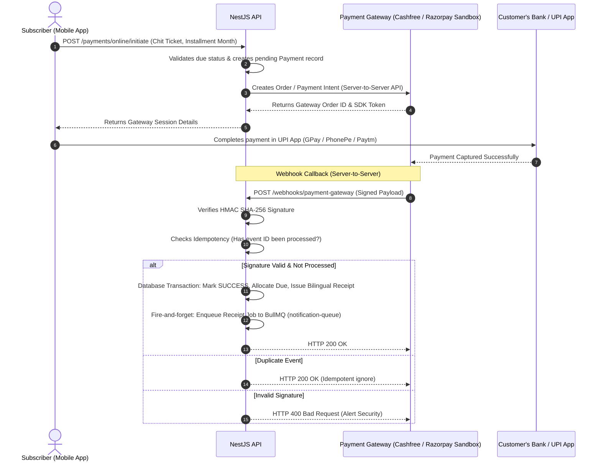
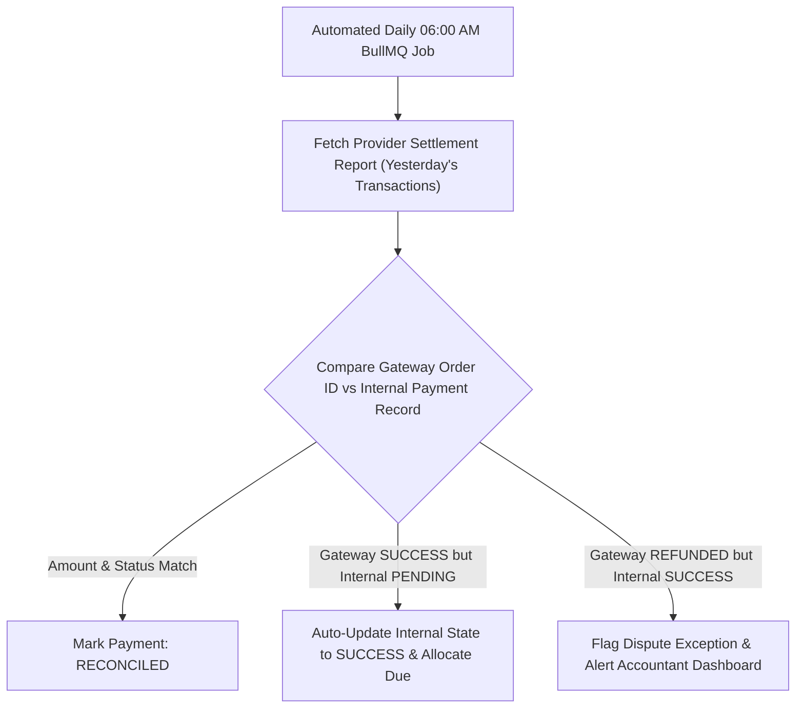

# Kumaran Chits — Payment Integration & Reconciliation Test Plan

> **Product**: **Kumaran Chits** (Kumaran Finance)  
> **Mandate**: No real-money payment integration may go live until provider merchant approvals, webhook cryptographic verification, and automated settlement reconciliation tests have passed in sandbox mode.

---

## 1. Online Payment Workflow (UPI & Netbanking)

---

## 2. Webhook Security & Idempotency Rules

1. **HMAC SHA-256 Signature Verification**:
   - The backend validates the `X-Webhook-Signature` header against the raw request body using the gateway's secret key.
   - If the signature does not match, the request is rejected immediately with HTTP 400, and a security alert is logged.
2. **Idempotent Webhook Processing**:
   - Payment providers frequently send duplicate webhook callbacks.
   - The backend checks `ProviderWebhookEvent` table for the unique `eventId`.
   - If already processed, the system immediately returns `HTTP 200 OK` without executing double allocations or issuing duplicate receipts.
3. **Never Trust App Success Redirects Alone**:
   - The client mobile app's return screen is for UI presentation only. Internal payment status is marked `SUCCESS` **only** upon cryptographic webhook verification or direct server-to-server status poll.

---

## 3. Daily Settlement Reconciliation Procedure

At 06:00 AM IST daily, an automated BullMQ reconciliation job reconciles internal records against the provider's settlement report:

### Reconciliation Mismatch Handling
| Scenario | Cause | Resolution Action |
|---|---|---|
| **Ghost Drop** | Customer debited, but app closed before webhook fired | Automated reconciliation detects settlement; updates internal status to `SUCCESS` and generates receipt retroactively. |
| **Amount Discrepancy** | Customer paid ₹3,500 but gateway captured ₹3,000 | Flagged as `RECONCILIATION_EXCEPTION`. Accountant investigates before allocating. |
| **Unmapped Credit** | Payment received without valid ticket reference | Placed in `UNCLAIMED_SUSPENSE_ACCOUNT` awaiting manual identification. |
