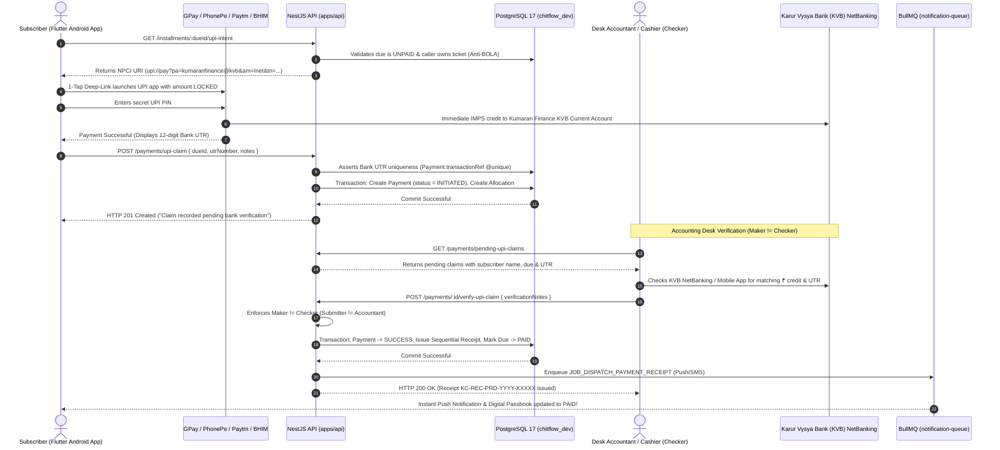

# Kumaran Chits — Native Zero-Fee UPI & Bank Reconciliation Specification

> **Product**: **Kumaran Chits** (Kumaran Finance, Perundurai, Tamil Nadu)  
> **Mandate (`CONFIRMED-BY-DEVELOPER` / ADR-19)**: **Strictly ZERO third-party payment gateways (No Razorpay, Cashfree, PayU, or 2% MDR fees)**. All online payments settle directly into Kumaran Finance's Karur Vysya Bank (KVB) Current Account in Perundurai using NPCI's Native UPI Intent Protocol.

---

## 1. Native One-Tap UPI Architecture & Lifecycles

In place of costly aggregator gateways that charge 1.5%–2% + GST per transaction, Kumaran Chits leverages the **NPCI UPI 2.0 Intent Protocol**:



---

## 2. The 3 Security & Financial Invariant Guards

### 2.1 Whole-Rupee Amount Locking ($I_{net} = I_{base} - Div$)
The generated NPCI URI dynamically locks the exact net installment due into the `am` parameter:
```
upi://pay?pa=kumaranfinance@kvb&pn=Kumaran+Finance&am=3950&cu=INR&tn=KCA-1L-20M-01+Ticket+%231+Month+3&tr=80210f78...
```
When launched on Android, the payment app does not allow the subscriber to edit or change the amount, preventing underpayments or overpayments.

### 2.2 Bank UTR Anti-Duplication Constraint (PostgreSQL 17)
- In [`apps/api/prisma/schema.prisma`](file:///u:/Kumaran-finance/apps/api/prisma/schema.prisma):
  ```prisma
  transactionRef String? @unique // UPI Ref, Cheque number, Bank UTR
  ```
- Migration [`20261027094809_add_transaction_ref_unique_constraint`](file:///u:/Kumaran-finance/apps/api/prisma/migrations/20261027094809_add_transaction_ref_unique_constraint/migration.sql) establishes a B-tree unique index in PostgreSQL (`Payment_transactionRef_key`).
- Standard SQL rule: `NULL` entries are permitted infinitely for physical cash transactions, but any non-null 12-digit UTR string can only be entered once across the lifetime of the database.
- Collision attempts return `HTTP 409 Conflict` (`DUPLICATE_TRANSACTION_REF`).

### 2.3 Strict Maker != Checker Separation
- If an office staff member or collection agent enters a payment claim on behalf of a customer, they are permanently recorded as the `maker` (`recordedByUserId`).
- The endpoint `POST /payments/:id/verify-upi-claim` enforces that `recordedByUserId != checkerUserId`.
- Only an independent staff member (`ACCOUNTANT`, `BRANCH_MANAGER`, or `SUPER_ADMIN`) who did not submit the claim can verify the credit against KVB NetBanking.

---

## 3. Endpoints & API Contract Reference

| Method & Path | Primary Role | Description |
|---|---|---|
| `GET /installments/:dueId/upi-intent` | `CUSTOMER`, All Staff | Builds standard NPCI 1-tap `upi://pay` URI locking exact whole-rupee $I_{net}$ amount and KVB account payee VPA (`kumaranfinance@kvb`). |
| `POST /payments/upi-claim` | `CUSTOMER`, Staff | Customer submits 12-digit bank UTR reference. Validates UTR uniqueness; records payment in `INITIATED` status pending bank check. |
| `GET /payments/pending-upi-claims` | `ACCOUNTANT`, `SUPER_ADMIN` | Lists paginated (`?page=1&limit=20`, max `100`) pending UPI claims via `ApiPaginatedResponseEnvelope` for Accounting Desk statement matching. |
| `POST /payments/:id/verify-upi-claim` | **Super Admin, Branch Manager, Accountant** | Confirms bank credit. Transitions payment to `SUCCESS`, issues bilingual receipt, marks due `PAID`. **Enforces `maker != checker`**. |

---

## 4. Automated Tests & Live Verification Proofs

- **Unit Test Suite**: [`apps/api/test/payment.spec.ts`](file:///u:/Kumaran-finance/apps/api/test/payment.spec.ts)
  - Bank UTR anti-duplication collision rejection (`ConflictException 409`)
  - Customer UPI claim submission in `INITIATED` status
  - Duplicate pending claim prevention on same due
  - Dual control verification with sequential bilingual receipt issuance
  - Submitter self-verification rejection (`maker != checker`)
- **Live Server Integration Script**: [`apps/api/scripts/stress/verify-upi-intent-and-claims.ts`](file:///u:/Kumaran-finance/apps/api/scripts/stress/verify-upi-intent-and-claims.ts)
  - Proves end-to-end execution against live PostgreSQL 17 on Port 5433 with 100% pass rate.
