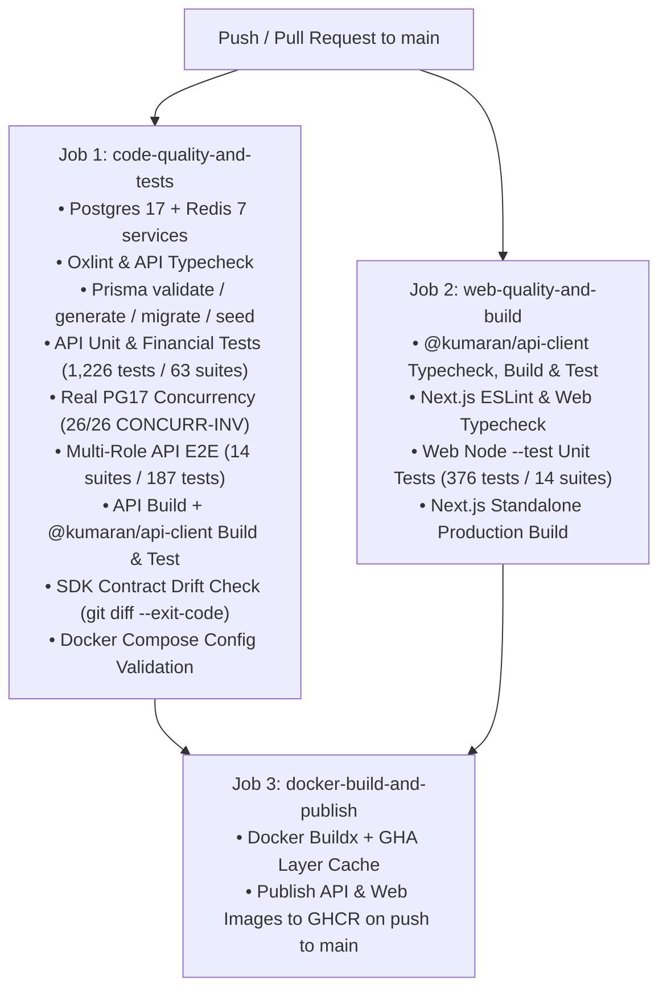

# Kumaran Chits — CI/CD Pipeline Specification

> **Platform**: GitHub Actions  
> **Repository**: `https://github.com/Kumaran-finance/chitflow` (or `kumaran-chits`)  
> **Mandate**: No pull request may be merged into `main` without 100% automated test pass rate and zero linter warnings.

---

## 1. Continuous Integration (CI) & Container Publish Architecture

Authoritative workflow file: [`.github/workflows/ci.yml`](file:///u:/Kumaran-finance/.github/workflows/ci.yml) (triggered automatically on every `push` and `pull_request` targeting `main`).

### 1.1 Live 3-Job GitHub Actions Pipeline Summary ([`.github/workflows/ci.yml`](file:///u:/Kumaran-finance/.github/workflows/ci.yml))

1. **Job 1 — `code-quality-and-tests` (`Lint, Test & Validate`)**:
   - **Service Containers**: Ephemeral `postgres:17` (`5432`) and `redis:7-alpine` (`6379`) with live health checks.
   - **Runtime**: `pnpm` (`pnpm/action-setup@v4`, pinned via root `packageManager: pnpm@12.14.0`) + **Node.js 24 LTS** + `pnpm install --frozen-lockfile`.
   - **Quality & Database Gates**: `pnpm --filter api run lint` (Oxlint), `pnpm --filter api run typecheck`, `prisma validate`, `prisma generate`, `prisma migrate deploy`, `prisma db seed`.
   - **Test Gates**:
     - `pnpm test` in `apps/api` (**63 unit suites / 1,226 tests** including financial invariants & zero-paise fuzzing)
     - Dedicated real PostgreSQL 17 row-lock gate: `pnpm test test/unit/concurrency-postgres.spec.ts` (**26/26 `CONCURR-INV-1..26`**)
     - Multi-role E2E gate: `pnpm run test:e2e` (**14 E2E suites / 187 tests**, including 25 engine-level DB `CHECK` constraint tests)
   - **Build, SDK Contract Drift & Compose Gates**:
     - `pnpm --filter api run build`
     - `pnpm --filter @kumaran/api-client build` & `test` (**10/10 tests**)
     - **Contract Drift Prevention**: runs `pnpm run codegen:spec`, `codegen:ts`, `codegen:dart` and asserts `git diff --exit-code docs/03-architecture/openapi-spec.json packages/api-client/src/generated/ apps/mobile/lib/core/api/models/` — any uncommitted OpenAPI or SDK drift fails CI immediately.
     - `docker compose -f infra/docker/docker-compose.yml config --quiet` & `docker-compose.fullstack.yml config --quiet`.
2. **Job 2 — `web-quality-and-build` (`Web Lint, Typecheck, Test & Build`)**:
   - Typechecks, builds, and tests `@kumaran/api-client`.
   - Runs Next.js ESLint (`pnpm --filter web run lint`), strict TypeScript check (`pnpm --filter web run typecheck`), Node.js native test runner (`pnpm --filter web test` — **14 suites / 376 tests** via `node --experimental-strip-types --test`), and Next.js production standalone build (`BUILD_STANDALONE=true`).
3. **Job 3 — `docker-build-and-publish` (`Docker Build & Container Registry`)**:
   - Depends on `[code-quality-and-tests, web-quality-and-build]`.
   - Uses `docker/setup-buildx-action@v3` and GitHub Actions build cache (`type=gha`) to build `apps/api/Dockerfile` and `apps/web/Dockerfile` (`node:24-alpine`).
   - On `push` to `main`, logs into **GitHub Container Registry (`ghcr.io`)** and pushes tagged images `ghcr.io/<owner>/kumaran-chits-api` and `ghcr.io/<owner>/kumaran-chits-web` (`branch`, short `sha`, and `latest`).

---

## 2. Branch Protection Rules for `main`

The repository enforces the following GitHub branch protections on `main`:
1. **Require all 3 CI status checks to pass before merging**:
   - `Lint, Test & Validate` (`code-quality-and-tests`)
   - `Web Lint, Typecheck, Test & Build` (`web-quality-and-build`)
   - `Docker Build & Container Registry` (`docker-build-and-publish`)
   *(Enforces 100% pass across all **1,226 API unit tests + 187 API E2E tests + 376 Web tests + 10 SDK tests**, zero Oxlint/ESLint/TypeScript errors, and zero OpenAPI/SDK contract drift.)*
2. **Require linear history**: Fast-forward merges or squashed commits only.
3. **No direct pushes**: All changes must arrive via reviewed pull requests.

---

## 3. Verified CI Boundaries & Pre-Release Operations

Absorbing Stage 06 CI/CD audit verification findings (`CI-CD-TEST-EXECUTION-EVIDENCE` & `PROMPT-06-CICD-SECRETS-MONITORING-AUDIT`):
1. **Playwright Browser E2E (Pre-Release Staging Gate)**: Job 2 executes all 376 fast Node `--test` Web component/store/i18n tests in CI, while full Chromium Playwright browser E2E suites (Suites `00` through `11` in `apps/web/e2e/`) are executed pre-release via `pnpm test:web:e2e`.
2. **Production Linux VPS Deployment (Operator-Controlled Rollout)**: Job 3 publishes immutable container images to GHCR (`ghcr.io`), rather than executing unreviewed SSH auto-deploys from GitHub Actions. Operators pull and roll out releases on the flat-fee Linux VPS via [`infra/scripts/zero-downtime-deploy.sh`](file:///u:/Kumaran-finance/infra/scripts/zero-downtime-deploy.sh) (with 60s `/health/readiness` verification and automatic rollback trap to `chitflow-api:previous`).
3. **Zero Secrets in CI & Source Control**: `.gitignore` blocks `.env*`, `*.pem`, `*.key`, and database dumps; production startup gates in [`env.validation.ts`](file:///u:/Kumaran-finance/apps/api/src/config/env.validation.ts) reject dev placeholders (`JWT_SECRET`, `STORAGE_DRIVER=local`, default `chitflow_secret` passwords) at boot.
